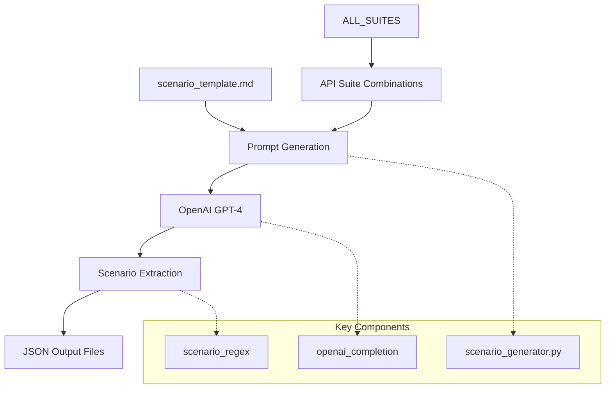
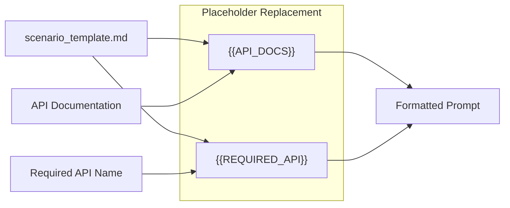
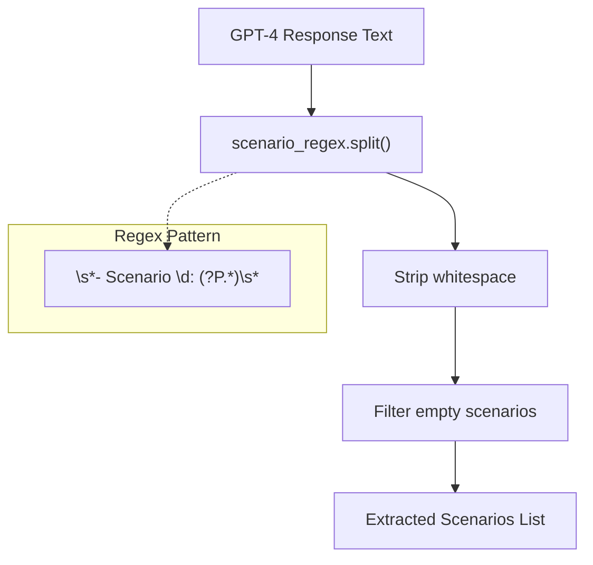
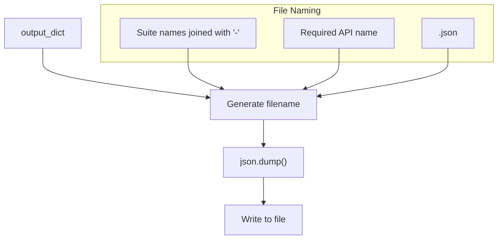

<!-- source: DeepWiki mcp.deepwiki.com · repo microsoft/ToolTalk · page 5.2 Scenario Generation · fetched 2026-10-26 -->

# Scenario Generation

<details>
<summary>Relevant source files</summary>

The following files were used as context for generating this wiki page:

- [src/prompts/scenario_template.md](src/prompts/scenario_template.md)
- [src/tooltalk/generation/__init__.py](src/tooltalk/generation/__init__.py)
- [src/tooltalk/generation/scenario_generator.py](src/tooltalk/generation/scenario_generator.py)

</details>


This document covers the scenario generation system in ToolTalk, which automatically creates conversation scenarios for evaluating tool-augmented language models. The scenario generator uses GPT-4 to create complex, multi-turn scenarios that require coordinated API usage across different tool suites.

For information about running evaluations on generated scenarios, see [Running Evaluations](#4.1). For details about the API system that scenarios are built upon, see [API System](#2.2).

## Purpose and Overview

The scenario generation system creates realistic conversation scenarios that test a model's ability to:

- Coordinate multiple API calls across different tool suites
- Use APIs in tandem to accomplish complex tasks  
- Handle multi-step workflows requiring 5+ API calls
- Adapt to different combinations of available tools

The generator takes combinations of API suites and prompts GPT-4 to create scenarios requiring specific APIs, ensuring comprehensive coverage of the tool ecosystem.

**Scenario Generation Pipeline**



Sources: [src/tooltalk/generation/scenario_generator.py:1-137](), [src/prompts/scenario_template.md:1-30]()

## Prompt Template System

The scenario generation uses a template-based approach with placeholder substitution. The main template is defined in `scenario_template.md` and contains two key placeholders:

| Placeholder | Purpose | Replacement Source |
|-------------|---------|-------------------|
| `{{API_DOCS}}` | API documentation | Generated from selected API suites |
| `{{REQUIRED_API}}` | Required API name | Specific API that must be used |

The template instructs GPT-4 to create scenarios with specific constraints:
- 3 varied, complex scenarios per prompt
- Each scenario requires 5+ API calls
- Must use at least 3 different APIs
- One API is explicitly required
- APIs should be used in tandem when possible

**Template Processing Flow**



Sources: [src/prompts/scenario_template.md:22-27](), [src/tooltalk/generation/scenario_generator.py:26-27](), [src/tooltalk/generation/scenario_generator.py:89-92]()

## Generation Pipeline

The `scenario_generator.py` script orchestrates the entire generation process through several key functions:

### API Suite Combination

The generator creates combinations of API suites from `ALL_SUITES` and formats their documentation:

```python
for combination in combinations(ALL_SUITES, k):
    formatted_apis = [
        api.to_docstring()
        for suite in combination
        for api in suite.apis
    ]
```

### Prompt Construction

For each API suite combination, the system:
1. Formats API documentation using `to_docstring()` method
2. Replaces `{{API_DOCS}}` placeholder with formatted documentation
3. Creates separate prompts for each required API
4. Batches prompts for efficient processing

### Response Processing

The `extract_scenarios` function processes GPT-4 responses using regex pattern matching:

```python
scenario_regex = re.compile(r"\s*- Scenario \d: (?P<scenario>.*)\s*")
```

**Scenario Extraction Process**



Sources: [src/tooltalk/generation/scenario_generator.py:30-44](), [src/tooltalk/generation/scenario_generator.py:83-99](), [src/tooltalk/generation/scenario_generator.py:117-122]()

## Output Format

Generated scenarios are saved as JSON files with the following structure:

```json
{
    "prompt": "Full formatted prompt sent to GPT-4",
    "apis": {
        "suites": ["AccountTools", "AlarmTools", "CalendarTools"],
        "required_api": "CreateEvent"
    },
    "response": "Raw GPT-4 response text",
    "scenarios": ["Scenario 1 text...", "Scenario 2 text...", "Scenario 3 text..."]
}
```

Files are named using the pattern: `{suite1-suite2-suite3}-{required_api}.json`

**Output File Generation**



Sources: [src/tooltalk/generation/scenario_generator.py:126-133](), [src/tooltalk/generation/scenario_generator.py:93-99]()

## Command Line Interface

The scenario generator provides extensive configuration options:

| Parameter | Default | Description |
|-----------|---------|-------------|
| `--prompt` | Required | Path to prompt template file |
| `--model` | `gpt-4` | OpenAI model to use |
| `--api_counts` | `[3]` | Number of API suites per combination |
| `--max_tokens` | `[25000]` | Maximum tokens to generate |
| `--temperature` | `0` | Sampling temperature |
| `--batch_size` | `10` | Batch size for API calls |
| `--output_dir` | Required | Output directory path |
| `--reset` | `False` | Reset output directory if exists |

The generator processes all combinations of the specified number of API suites, creating comprehensive scenario coverage across the tool ecosystem.

Sources: [src/tooltalk/generation/scenario_generator.py:47-60](), [src/tooltalk/generation/scenario_generator.py:65-134]()

## Integration with ToolTalk Framework

The scenario generator integrates with the broader ToolTalk framework through:

- **API Discovery**: Uses `ALL_SUITES` from `tooltalk.apis` for comprehensive API coverage
- **Documentation**: Leverages `to_docstring()` method from API base classes
- **Utilities**: Uses `openai_completion` and `chunkify` utilities
- **Output**: Generates scenarios compatible with evaluation pipeline

The generated scenarios serve as input to the evaluation framework, providing realistic test cases for assessing model performance across diverse tool usage patterns.

Sources: [src/tooltalk/generation/scenario_generator.py:19-21](), [src/tooltalk/generation/scenario_generator.py:84-88](), [src/tooltalk/generation/scenario_generator.py:105-111]()

---

