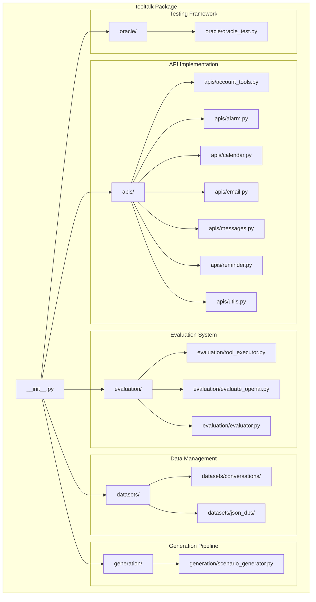
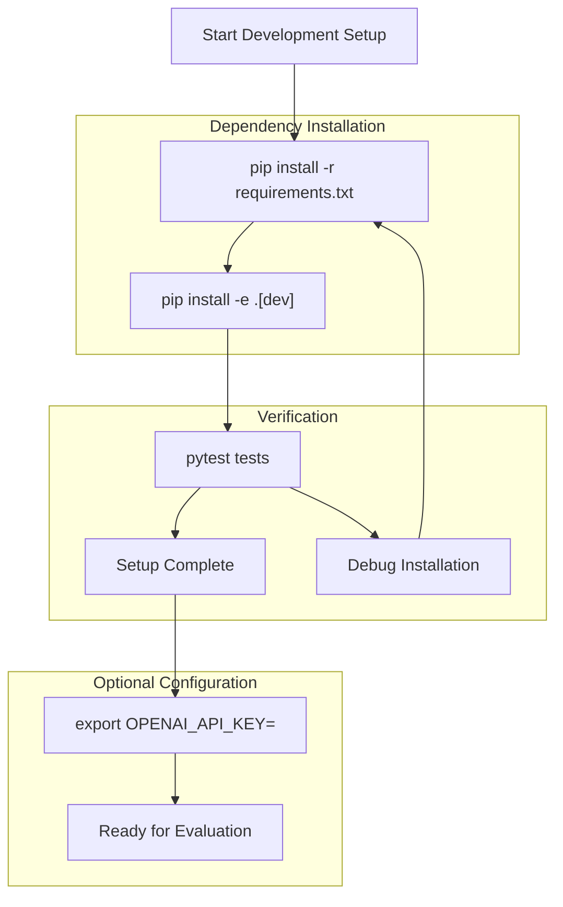
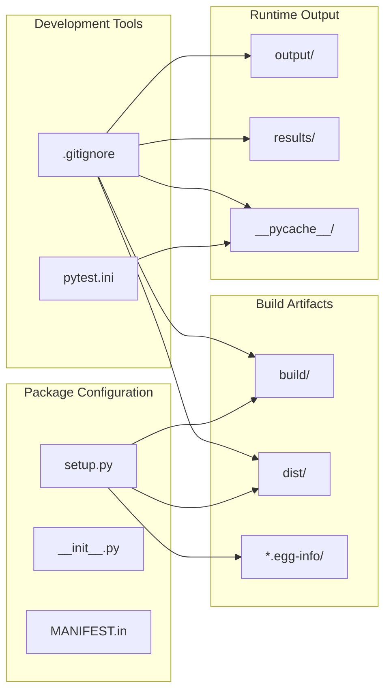
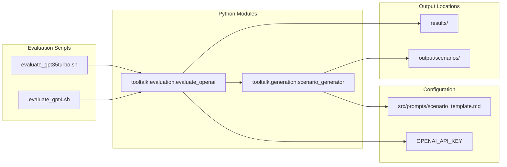

<!-- source: DeepWiki mcp.deepwiki.com · repo microsoft/ToolTalk · page 5.3 Project Structure · fetched 2026-10-26 -->

# Project Structure

Relevant source files

The following files were used as context for generating this wiki page:

- [.gitignore](.gitignore)
- [README.md](README.md)
- [images/Evaluation.png](images/Evaluation.png)

This document provides an overview of the ToolTalk repository structure, module organization, and development environment setup. It covers the filesystem layout, package dependencies, and build configuration necessary for understanding and contributing to the codebase.

For information about implementing new APIs within this structure, see [Adding New APIs](#5.1). For details about using the evaluation framework components, see [Evaluation Framework](#2.3).

## Repository Overview

The ToolTalk repository follows a standard Python package structure with a clear separation between source code, configuration, data, and output directories.

### High-Level Directory Structure

```mermaid
graph TD
    ROOT["ToolTalk Repository"]
    
    subgraph "Source Code"
        SRC["src/"]
        TOOLTALK["tooltalk/"]
        PROMPTS["src/prompts/"]
    end
    
    subgraph "Configuration"
        README["README.md"]
        REQUIREMENTS["requirements.txt"]
        SETUP["setup.py"]
        GITIGNORE[".gitignore"]
    end
    
    subgraph "Testing & Quality"
        TESTS["tests/"]
        PYTEST["pytest.ini"]
    end
    
    subgraph "Data & Resources"
        IMAGES["images/"]
        DATASETS["datasets/"]
    end
    
    subgraph "Output & Build"
        OUTPUT["output/"]
        RESULTS["results/"]
        DIST["dist/"]
        BUILD["build/"]
    end
    
    subgraph "Scripts"
        EVAL_GPT35["evaluate_gpt35turbo.sh"]
        EVAL_GPT4["evaluate_gpt4.sh"]
    end
    
    ROOT --> SRC
    ROOT --> TOOLTALK
    ROOT --> PROMPTS
    ROOT --> README
    ROOT --> REQUIREMENTS
    ROOT --> SETUP
    ROOT --> GITIGNORE
    ROOT --> TESTS
    ROOT --> PYTEST
    ROOT --> IMAGES
    ROOT --> DATASETS
    ROOT --> OUTPUT
    ROOT --> RESULTS
    ROOT --> DIST
    ROOT --> BUILD
    ROOT --> EVAL_GPT35
    ROOT --> EVAL_GPT4
```

**Sources:** [README.md:1-107](), [.gitignore:1-167]()

## Core Module Structure

The `tooltalk` package is organized into several key modules that correspond to the major system components described in the architecture overview.

### ToolTalk Package Organization

**Sources:** [README.md:67-73]()

### Module Responsibilities

| Module | Purpose | Key Components |
|--------|---------|----------------|
| `tooltalk.apis` | API suite implementations | `BaseAPI`, `APISuite`, individual API classes |
| `tooltalk.evaluation` | Evaluation pipeline and execution | `ToolExecutor`, `BaseAPIPredictor`, evaluator classes |
| `tooltalk.datasets` | Data storage and management | Conversation datasets, JSON databases |
| `tooltalk.generation` | Scenario generation pipeline | `scenario_generator` module |
| `tooltalk.oracle` | Testing and validation framework | Oracle test implementations |

**Sources:** [README.md:72-73]()

## Development Environment Setup

The project uses a standard Python development environment with specific requirements for evaluation and testing.

### Installation Process

**Sources:** [README.md:35-46]()

### Required Dependencies

The project dependencies are managed through `requirements.txt` and setup configuration:

| Dependency Type | Purpose | Configuration |
|----------------|---------|---------------|
| Core Dependencies | Runtime requirements | `requirements.txt` |
| Development Dependencies | Testing and development tools | `setup.py[dev]` extras |
| Optional Dependencies | API access for evaluation | Environment variables |

**Sources:** [README.md:38-39](), [README.md:55]()

## Build and Distribution Configuration

The project follows Python packaging standards with specific configurations for development and distribution.

### Package Configuration Structure

**Sources:** [README.md:39](), [.gitignore:16-33](), [.gitignore:4-5](), [.gitignore:7-10]()

### Ignored Files and Directories

The `.gitignore` configuration excludes several categories of files from version control:

| Category | Examples | Purpose |
|----------|----------|---------|
| Secrets | `*.key` | API keys and sensitive configuration |
| Output | `output/`, `results/` | Generated evaluation results |
| Python Build | `__pycache__/`, `*.pyc`, `dist/` | Compiled Python and distribution files |
| Development | `.pytest_cache/`, `.coverage` | Testing and analysis artifacts |

**Sources:** [.gitignore:1-167]()

## Evaluation and Testing Infrastructure

The project includes comprehensive evaluation and testing infrastructure with specific directory structures and execution patterns.

### Evaluation Script Organization

**Sources:** [README.md:54-58](), [README.md:66-68]()

### Testing Framework Structure

The testing infrastructure uses `pytest` with organized test modules:

| Test Type | Location | Purpose |
|-----------|----------|---------|
| Unit Tests | `tests/` | Component-level testing |
| Oracle Tests | `tooltalk.oracle` | End-to-end validation |
| Integration Tests | Evaluation scripts | Full pipeline testing |

**Sources:** [README.md:44-46]()

This project structure supports both development workflows and production evaluation scenarios, with clear separation of concerns between code, configuration, data, and output artifacts.

---

