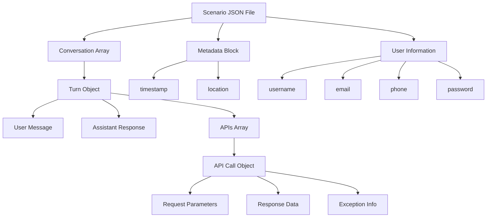
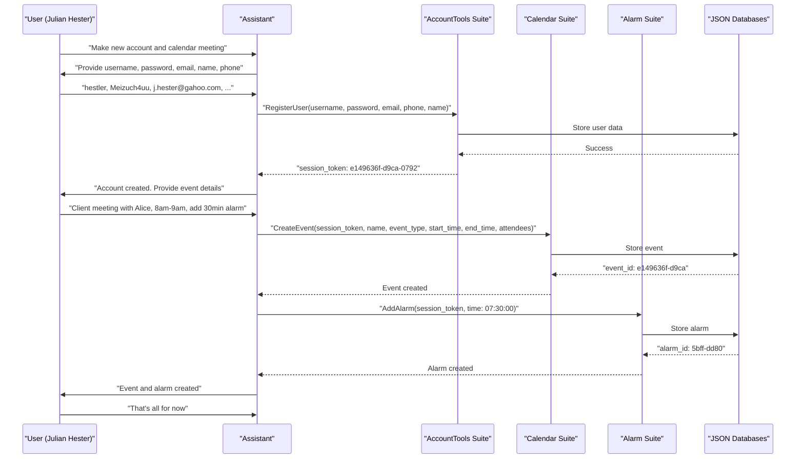
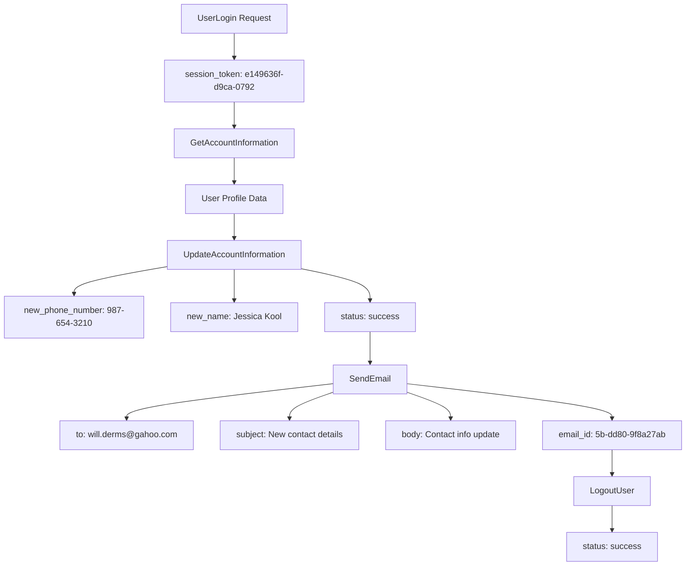

<!-- source: DeepWiki mcp.deepwiki.com · repo microsoft/ToolTalk · page 6 Example Scenarios · fetched 2026-10-26 -->

# Example Scenarios

<details>
<summary>Relevant source files</summary>

The following files were used as context for generating this wiki page:

- [data/tooltalk/AccountTools-Alarm-Calendar-AddAlarm-0.json](data/tooltalk/AccountTools-Alarm-Calendar-AddAlarm-0.json)
- [data/tooltalk/AccountTools-Alarm-Email-GetAccountInformati-0.json](data/tooltalk/AccountTools-Alarm-Email-GetAccountInformati-0.json)

</details>


This page provides detailed walkthroughs of example conversation scenarios from the ToolTalk benchmark dataset, demonstrating how the system executes multi-turn conversations involving API calls. These examples illustrate typical usage patterns, API interaction sequences, and the structure of evaluation data used for testing tool-augmented language models.

For information about generating new scenarios, see [Scenario Generation](#5.2). For details about the evaluation framework that processes these scenarios, see [Evaluation Framework](#2.3).

## Scenario Data Structure

Each scenario in the ToolTalk dataset is stored as a JSON file containing comprehensive conversation metadata and execution traces. The structure includes conversation context, user information, API execution logs, and response data.



**Sources:** [data/tooltalk/AccountTools-Alarm-Calendar-AddAlarm-0.json:1-26](), [data/tooltalk/AccountTools-Alarm-Email-GetAccountInformati-0.json:1-26]()

## Multi-Suite Account Creation Scenario

The first example demonstrates a common workflow involving account creation, calendar management, and alarm setting across multiple API suites.

### Scenario Overview

| Field | Value |
|-------|-------|
| **Scenario Name** | `AccountTools-Alarm-Calendar-AddAlarm-0` |
| **Suites Used** | `AccountTools`, `Alarm`, `Calendar` |
| **APIs Called** | `RegisterUser`, `CreateEvent`, `AddAlarm` |
| **Conversation Turns** | 7 turns (4 user, 3 assistant) |

**Sources:** [data/tooltalk/AccountTools-Alarm-Calendar-AddAlarm-0.json:2-13]()

### Conversation Flow Analysis



**Sources:** [data/tooltalk/AccountTools-Alarm-Calendar-AddAlarm-0.json:26-120]()

### API Execution Details

#### RegisterUser Call
The conversation begins with user registration, where the `RegisterUser` API creates a new account and returns a session token for subsequent authenticated operations.

```json
{
  "api_name": "RegisterUser",
  "parameters": {
    "username": "hestler",
    "password": "Meizuch4uu",
    "email": "j.hester@gahoo.com",
    "phone": "708-340-0190",
    "name": "Julian Hester"
  },
  "response": {
    "session_token": "e149636f-d9ca-0792",
    "user": {
      "username": "hestler",
      "email": "j.hester@gahoo.com",
      "phone": "708-340-0190", 
      "name": "Julian Hester"
    }
  }
}
```

**Sources:** [data/tooltalk/AccountTools-Alarm-Calendar-AddAlarm-0.json:47-68]()

#### CreateEvent Call
The `CreateEvent` API demonstrates calendar integration with structured time data and attendee management.

```json
{
  "api_name": "CreateEvent",
  "parameters": {
    "session_token": "e149636f-d9ca-0792",
    "name": "Client Meeting",
    "event_type": "meeting",
    "start_time": "2023-09-12 08:00:00",
    "end_time": "2023-09-12 09:00:00",
    "attendees": ["alice59"]
  },
  "response": {
    "event_id": "e149636f-d9ca"
  }
}
```

**Sources:** [data/tooltalk/AccountTools-Alarm-Calendar-AddAlarm-0.json:81-98]()

#### AddAlarm Call
The `AddAlarm` API sets a time-based notification using the established session context.

```json
{
  "api_name": "AddAlarm",
  "parameters": {
    "session_token": "e149636f-d9ca-0792",
    "time": "07:30:00"
  },
  "response": {
    "alarm_id": "5bff-dd80"
  }
}
```

**Sources:** [data/tooltalk/AccountTools-Alarm-Calendar-AddAlarm-0.json:100-112]()

## Account Management and Communication Scenario

The second example demonstrates account information management, updates, and email communication workflows.

### Scenario Overview

| Field | Value |
|-------|-------|
| **Scenario Name** | `AccountTools-Alarm-Email-GetAccountInformati-0` |
| **Suites Used** | `AccountTools`, `Email` |
| **APIs Called** | `UserLogin`, `GetAccountInformation`, `UpdateAccountInformation`, `SendEmail`, `LogoutUser` |
| **Conversation Turns** | 12 turns (6 user, 6 assistant) |

**Sources:** [data/tooltalk/AccountTools-Alarm-Email-GetAccountInformati-0.json:2-14]()

### Authentication and Information Retrieval Flow



**Sources:** [data/tooltalk/AccountTools-Alarm-Email-GetAccountInformati-0.json:47-166]()

### Session Management Pattern

The scenario demonstrates a complete session lifecycle from login to logout, showing how the `session_token` maintains authentication state across multiple API calls.

#### Authentication Sequence
```json
{
  "api_name": "UserLogin",
  "parameters": {
    "username": "justinkool",
    "password": "justforkicks123"
  },
  "response": {
    "session_token": "e149636f-d9ca-0792"
  }
}
```

#### Information Retrieval
```json
{
  "api_name": "GetAccountInformation", 
  "parameters": {
    "session_token": "e149636f-d9ca-0792"
  },
  "response": {
    "user": {
      "username": "justinkool",
      "email": "justintime@fmail.com",
      "phone": "123-456-7890",
      "name": "Justin Kool"
    }
  }
}
```

**Sources:** [data/tooltalk/AccountTools-Alarm-Email-GetAccountInformati-0.json:48-77]()

#### Account Updates and Email Notification
The `UpdateAccountInformation` call demonstrates parameter validation and partial updates, while `SendEmail` shows automated message composition.

```json
{
  "api_name": "UpdateAccountInformation",
  "parameters": {
    "session_token": "e149636f-d9ca-0792",
    "password": "justforkicks123",
    "new_phone_number": "987-654-3210",
    "new_name": "Jessica Kool"
  }
}
```

```json
{
  "api_name": "SendEmail",
  "parameters": {
    "session_token": "e149636f-d9ca-0792",
    "to": ["will.derms@gahoo.com"],
    "subject": "New contact details",
    "body": "Hi Will, this is Jessica Kool. I've changed my phone number to 987-654-3210. Please update your records. Thanks!"
  }
}
```

**Sources:** [data/tooltalk/AccountTools-Alarm-Email-GetAccountInformati-0.json:100-152]()

## Common API Usage Patterns

### Session Token Propagation
Both scenarios demonstrate consistent session token usage across API calls within a conversation. The token obtained from `RegisterUser` or `UserLogin` is propagated through subsequent authenticated API calls.

### Multi-Suite Coordination
The examples show coordinated usage of multiple API suites within single conversations:
- `AccountTools` + `Calendar` + `Alarm` integration
- `AccountTools` + `Email` workflow patterns

### Error Handling Structure
All API calls in the examples return `"exception": null`, indicating successful execution. The JSON schema supports exception data for error scenarios during evaluation.

**Sources:** [data/tooltalk/AccountTools-Alarm-Calendar-AddAlarm-0.json:67-112](), [data/tooltalk/AccountTools-Alarm-Email-GetAccountInformati-0.json:59-164]()

### Parameter Validation Patterns

The scenarios demonstrate several parameter validation patterns used throughout the ToolTalk system:

| API Call | Required Parameters | Optional Parameters | Validation Rules |
|----------|-------------------|-------------------|-----------------|
| `RegisterUser` | username, password, email, phone, name | - | Email format, phone format |
| `CreateEvent` | session_token, name, start_time, end_time | event_type, attendees, location | Time format validation |
| `AddAlarm` | session_token, time | - | Time format (HH:MM:SS) |
| `UpdateAccountInformation` | session_token, password | new_phone_number, new_name, new_email | Existing password required |
| `SendEmail` | session_token, to, subject, body | - | Email address validation |

**Sources:** [data/tooltalk/AccountTools-Alarm-Calendar-AddAlarm-0.json:49-112](), [data/tooltalk/AccountTools-Alarm-Email-GetAccountInformati-0.json:49-152]()