# Page: Overview

# Overview

<details>
<summary>Relevant source files</summary>

The following files were used as context for generating this wiki page:

- [NOTICE](NOTICE)
- [README.md](README.md)

</details>


## Purpose and Scope

This document introduces the ToolTalk benchmark framework, explaining its purpose as a conversational evaluation system for tool-augmented Large Language Models (LLMs). ToolTalk provides a structured environment for testing how well LLMs can predict and execute API calls within multi-turn conversations.

For detailed information about the core architecture components, see [Core Architecture](#2). For guidance on running evaluations, see [Running Evaluations](#4.1). For extending the system with new APIs, see [Adding New APIs](#5.1).

## What is ToolTalk

ToolTalk is a benchmark framework designed to evaluate tool-augmented LLMs in conversational settings, simulating realistic chatbot interactions where users request actions that require API calls. The system tests an LLM's ability to predict the correct sequence of tool usage after each user utterance in a conversation.

The framework contains a handcrafted dataset of 78 conversations (28 easy, 50 hard) with ground truth annotations for 28 unique tools organized into 7 themed API suites. Each conversation requires multiple correct predictions, making successful evaluation dependent on sustained accuracy across conversation turns.

**Core Components:**

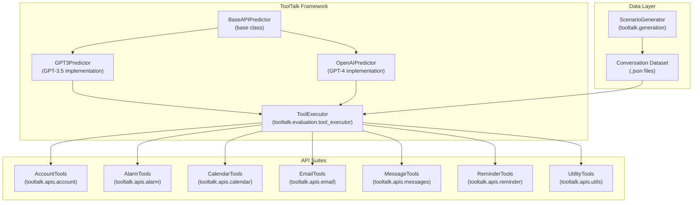

Sources: [README.md:1-84](), [tooltalk/evaluation/tool_executor.py](), [tooltalk/apis/]()

## Evaluation Process

The evaluation process follows a structured sequence where LLMs predict API calls based on conversational context, execute those calls through the `ToolExecutor`, and compare results against ground truth annotations.

**Evaluation Sequence:**

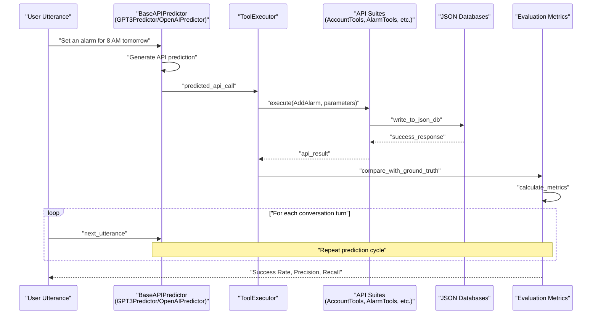

Sources: [README.md:20-22](), [tooltalk/evaluation/tool_executor.py](), [tooltalk/evaluation/evaluate_openai.py]()

## Dataset and Performance Metrics

ToolTalk provides curated conversation datasets with varying difficulty levels and comprehensive evaluation metrics to assess model performance across multiple dimensions.

**Dataset Composition:**

| Category | Count | Description |
|----------|-------|-------------|
| Easy Conversations | 28 | Single-domain interactions with straightforward tool usage |
| Hard Conversations | 50 | Multi-domain interactions requiring complex tool sequences |
| Unique Tools | 28 | Distinct API endpoints across 7 themed suites |
| API Suites | 7 | AccountTools, AlarmTools, CalendarTools, EmailTools, MessageTools, ReminderTools, UtilityTools |

**Benchmark Results:**

| Model | Difficulty | Success Rate | Precision | Recall | Incorrect Action Rate |
|-------|------------|--------------|-----------|--------|-----------------------|
| GPT-3.5 | Easy | 85.7% | 42.4% | 89.3% | 5.0% |
| GPT-4 | Easy | 92.8% | 69.2% | 96.4% | 3.8% |
| GPT-3.5 | Hard | 26.0% | 54.6% | 69.7% | 23.9% |
| GPT-4 | Hard | 50.0% | 74.9% | 79.0% | 25.1% |

Sources: [README.md:17-18](), [README.md:26-31]()

## Quick Start

The framework supports rapid setup for evaluation and extension. The core workflow involves installing dependencies, configuring API keys for model evaluation, and running provided evaluation scripts.

**Installation and Setup:**

```bash
pip install -r requirements.txt
pip install -e ".[dev]"
pytest tests  # Verify installation
```

**Running Evaluations:**

```bash
export OPENAI_API_KEY=<your_key>
bash evaluate_gpt35turbo.sh  # Evaluate GPT-3.5
bash evaluate_gpt4.sh        # Evaluate GPT-4
```

**Custom Model Integration:**

To evaluate new models, create a subclass of `BaseAPIPredictor` following the pattern established by `GPT3Predictor` and `OpenAIPredictor`:

```python
class CustomPredictor(BaseAPIPredictor):
    def predict_api_call(self, conversation_context):
        # Implementation for your model
        pass
```

**Scenario Generation:**

```bash
python -m tooltalk.generation.scenario_generator \
    --prompt src/prompts/scenario_template.md \
    --output_dir output/scenarios
```

Sources: [README.md:35-68](), [README.md:72-73](), [tooltalk/evaluation/tool_executor.py]()

---

# Page: Core Architecture

# Core Architecture

<details>
<summary>Relevant source files</summary>

The following files were used as context for generating this wiki page:

- [src/tooltalk/evaluation/__init__.py](src/tooltalk/evaluation/__init__.py)
- [src/tooltalk/evaluation/evaluate_openai.py](src/tooltalk/evaluation/evaluate_openai.py)
- [src/tooltalk/evaluation/tool_executor.py](src/tooltalk/evaluation/tool_executor.py)

</details>


This document explains the fundamental architectural components of the ToolTalk benchmark framework and how they work together to enable conversation simulation and tool-augmented LLM evaluation. The architecture provides a layered, plugin-based system for simulating realistic multi-turn conversations with API interactions.

For implementation details of specific components, see [ToolExecutor](#2.1), [API System](#2.2), and [Evaluation Framework](#2.3). For guidance on extending the system, see [Development Guide](#5).

## System Overview

ToolTalk implements a layered architecture with clear separation of concerns. The system orchestrates conversation simulation through the `ToolExecutor` class, which manages API execution, maintains database state, and coordinates between language models and API suites.

### Core Architecture Diagram

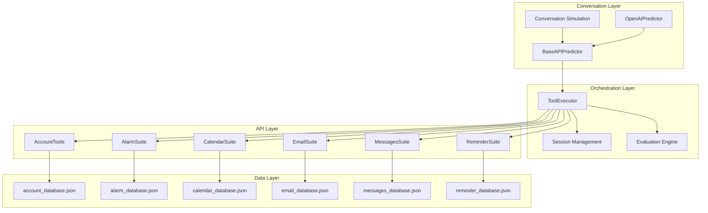

**Sources:** [src/tooltalk/evaluation/tool_executor.py:20-334](), [src/tooltalk/evaluation/evaluate_openai.py:27-113]()

## Key Components

### ToolExecutor Class

The `ToolExecutor` serves as the central orchestration component, managing conversation state, API execution, and evaluation metrics. It maintains database connections, handles authentication through session tokens, and provides conversation simulation capabilities.

**Key Responsibilities:**
- Database state management and reset functionality
- API tool initialization and execution 
- Session token management for authentication
- Conversation simulation with prediction functions
- Evaluation metrics calculation and comparison

### BaseAPIPredictor Interface

The `BaseAPIPredictor` abstract class defines the interface for language model integration, enabling support for different LLM providers while maintaining consistent conversation simulation behavior.

**Required Methods:**
- `__init__(function_docs, *args, **kwargs)` - Initialize with API documentation
- `predict(metadata, conversation_history)` - Generate next action prediction

### Database Management

The system uses JSON files as databases, with each API suite managing its own database file. The `ToolExecutor` loads all databases during initialization and provides state reset capabilities for conversation simulation.

**Database Files:**
- `account_database.json` - User accounts and authentication data
- `alarm_database.json` - Alarm and timer data
- `calendar_database.json` - Calendar events and scheduling
- `email_database.json` - Email messages and threads
- `messages_database.json` - Text messages and conversations
- `reminder_database.json` - Reminders and tasks

## Conversation Simulation Flow

The following diagram illustrates how conversations are simulated and evaluated within the ToolTalk framework:

### Conversation Simulation Data Flow

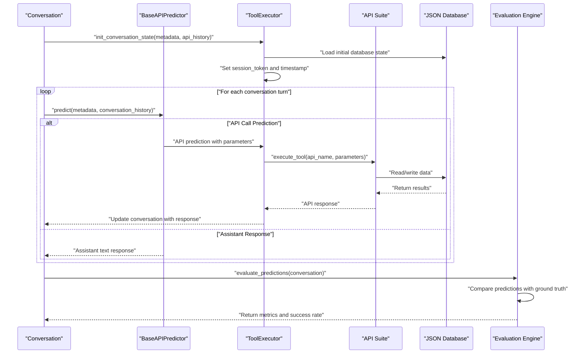

**Sources:** [src/tooltalk/evaluation/tool_executor.py:251-319](), [src/tooltalk/evaluation/tool_executor.py:134-232]()

## Authentication and Session Management

The architecture implements session-based authentication through the `ToolExecutor`. User login state is maintained via session tokens that are automatically managed during conversation simulation.

### Authentication Flow

| Component | Responsibility |
|-----------|----------------|
| `ToolExecutor.session_token` | Maintains current user session |
| `UserLogin` / `RegisterUser` | Creates session tokens |
| `LogoutUser` / `DeleteAccount` | Invalidates session tokens |
| API parameter injection | Automatically adds session tokens to authenticated API calls |

The system enforces single-user sessions and automatically handles login/logout state changes during API execution.

**Sources:** [src/tooltalk/evaluation/tool_executor.py:95-119](), [src/tooltalk/evaluation/tool_executor.py:234-250]()

## Plugin-Based API Architecture

The API system uses a plugin-based design where each API suite operates independently while following consistent interfaces. The `ToolExecutor` dynamically loads and initializes API classes from the `ALL_APIS` collection.

### API Integration Model

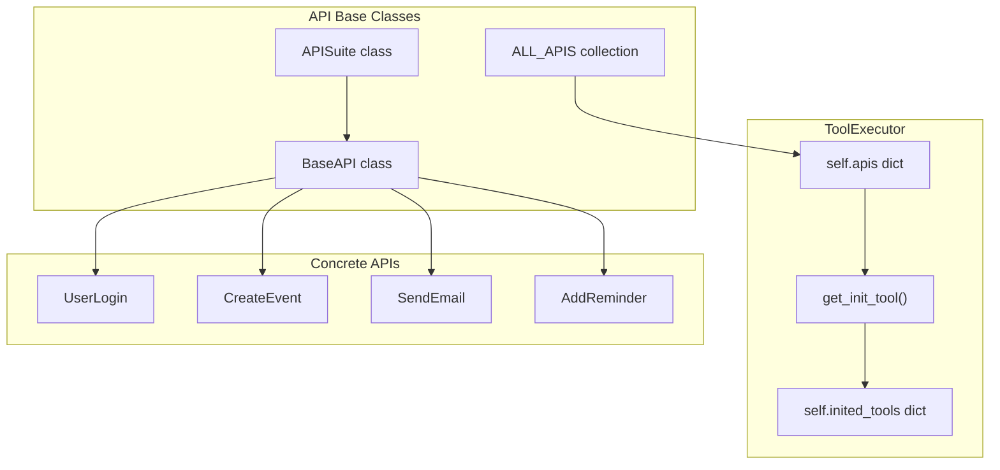

**Key Features:**
- Dynamic API loading from `ALL_APIS` collection
- Lazy initialization through `get_init_tool()` method
- Consistent database and authentication parameter injection
- Individual database management per API suite

**Sources:** [src/tooltalk/evaluation/tool_executor.py:45-46](), [src/tooltalk/evaluation/tool_executor.py:61-81]()

## Evaluation and Metrics

The evaluation system compares model predictions against ground truth API calls, calculating precision, recall, and success metrics. The `evaluate_predictions()` method implements sophisticated matching logic that accounts for the sequential nature of conversation flows.

### Evaluation Metrics

| Metric | Calculation | Purpose |
|--------|-------------|---------|
| `precision` | matches / predictions | Accuracy of model predictions |
| `recall` | matches / ground_truths | Coverage of required API calls |  
| `action_precision` | valid_actions / actions | Accuracy of action-type APIs |
| `bad_action_rate` | bad_actions / actions | Rate of harmful incorrect actions |
| `success` | recall == 1.0 && bad_action_rate == 0.0 | Complete conversation success |
| `soft_success` | recall * (1.0 - bad_action_rate) | Weighted success metric |

The evaluation engine uses a deque-based matching algorithm to ensure each ground truth API call can only match one prediction, preventing double-counting while respecting conversation order.

**Sources:** [src/tooltalk/evaluation/tool_executor.py:134-232](), [src/tooltalk/evaluation/evaluate_openai.py:187-218]()

## State Management and Reset

The `ToolExecutor` provides conversation-level state management through database snapshots and tool reinitialization. This enables independent evaluation of multiple conversations without cross-contamination.

**State Management Methods:**
- `reset_executor()` - Restores databases to initial state
- `init_conversation_state()` - Sets up conversation-specific context
- Database file reloading from original JSON files
- Tool instance cache clearing

This architecture ensures reproducible evaluation results and proper isolation between conversation simulations.

**Sources:** [src/tooltalk/evaluation/tool_executor.py:49-60](), [src/tooltalk/evaluation/tool_executor.py:234-250]()

---

# Page: ToolExecutor

# ToolExecutor

<details>
<summary>Relevant source files</summary>

The following files were used as context for generating this wiki page:

- [src/tooltalk/evaluation/tool_executor.py](src/tooltalk/evaluation/tool_executor.py)

</details>


The `ToolExecutor` class serves as the central orchestration layer for executing API calls, managing database state, and simulating conversations in the ToolTalk benchmark framework. It handles authentication, maintains database consistency during conversation simulation, and provides comprehensive evaluation metrics for comparing model predictions against ground truth API calls.

For information about the individual API suites that ToolExecutor manages, see [API System](#2.2). For details on how evaluation metrics are calculated and used, see [Evaluation Framework](#2.3).

## Core Architecture and Responsibilities

The `ToolExecutor` class acts as the primary execution engine that bridges conversation simulation with actual API functionality. It maintains stateful execution environments, handles cross-API session management, and provides evaluation capabilities for measuring model performance.

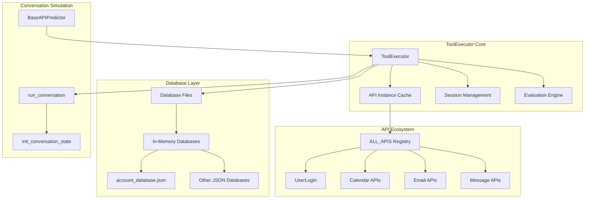

**ToolExecutor Architecture Overview**

The `ToolExecutor` manages four primary concerns: database state, API instance lifecycle, session-based authentication, and conversation simulation with evaluation metrics.

Sources: [src/tooltalk/evaluation/tool_executor.py:20-48]()

## Database Management System

The `ToolExecutor` implements a JSON-based database system that maintains conversation state and provides data persistence for API operations. Each database corresponds to a specific API suite's data requirements.

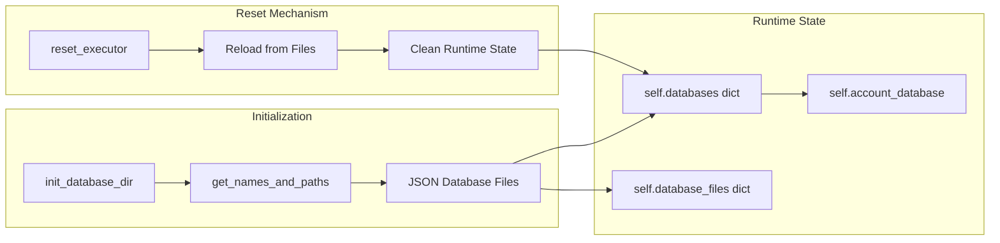

**Database State Management Flow**

The database system loads JSON files at initialization and maintains them in memory during conversation simulation. The `reset_executor` method restores original state between conversation runs.

| Database Component | Purpose | File Format |
|-------------------|---------|-------------|
| `self.databases` | In-memory database state | Python dict |
| `self.database_files` | File path mappings | String paths |
| `account_database` | User authentication data | JSON file |

Sources: [src/tooltalk/evaluation/tool_executor.py:36-44](), [src/tooltalk/evaluation/tool_executor.py:49-60]()

## API Instance Management

The `ToolExecutor` maintains a registry of available APIs and creates instances on-demand with proper database and authentication context. API instances are cached to maintain state consistency within conversation turns.

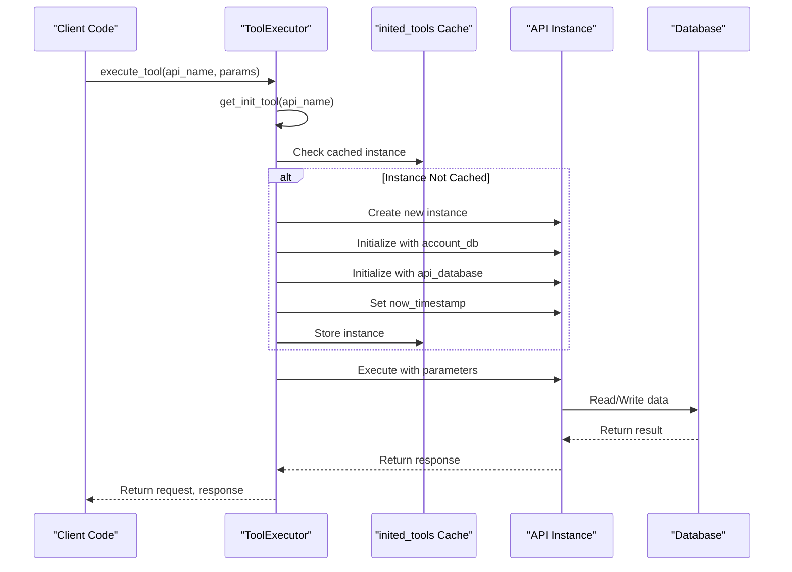

**API Instance Lifecycle Management**

The `get_init_tool` method creates API instances with appropriate database context and timestamp information. Each API class specifies its required database via the `database_name` attribute.

Sources: [src/tooltalk/evaluation/tool_executor.py:61-81](), [src/tooltalk/evaluation/tool_executor.py:45]()

## Authentication and Session Management

The `ToolExecutor` implements a session-based authentication system that manages user login state across API calls. Session tokens are automatically injected into API parameters for authenticated operations.

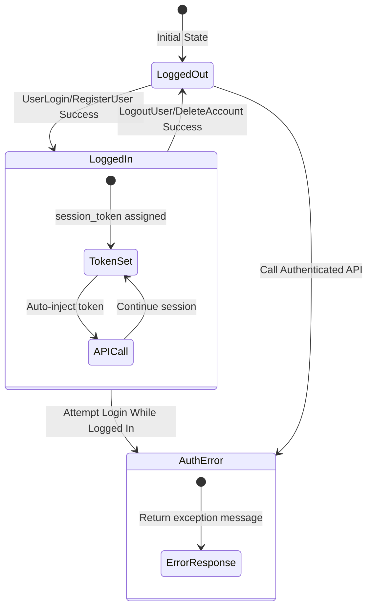

**Session State Management Flow**

The authentication system maintains a single active session per `ToolExecutor` instance and automatically handles token injection for APIs that require authentication.

| Authentication Component | Purpose | Behavior |
|-------------------------|---------|----------|
| `session_token` | Current user session | Set on login, cleared on logout |
| `requires_auth` | API authentication flag | Auto-inject token if required |
| Login/Register APIs | Session establishment | Create and store session token |
| Logout/Delete APIs | Session termination | Clear stored session token |

Sources: [src/tooltalk/evaluation/tool_executor.py:95-119]()

## Conversation Simulation Engine

The `run_conversation` method provides comprehensive conversation simulation by integrating prediction functions with actual API execution. It maintains conversation history and handles multi-turn interactions with stateful API calls.

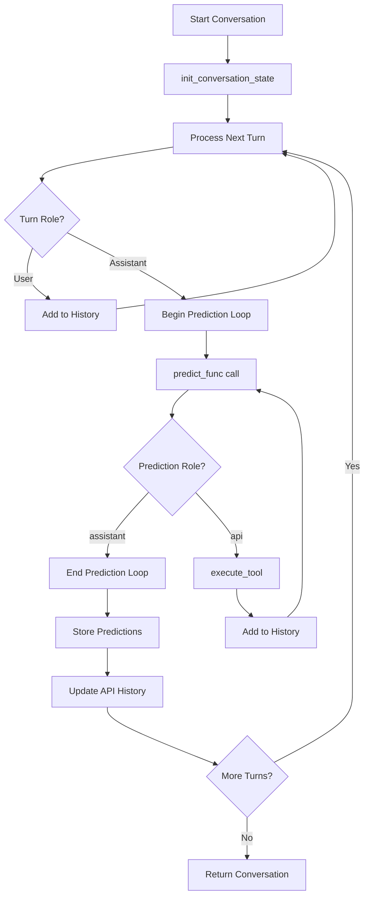

**Conversation Simulation Flow**

The simulation engine maintains separate histories for predictions and ground truth, allowing comprehensive evaluation of model behavior against expected API usage patterns.

Sources: [src/tooltalk/evaluation/tool_executor.py:251-319]()

## Evaluation Metrics System

The `evaluate_predictions` method implements a comprehensive evaluation framework that compares model predictions against ground truth API calls, calculating multiple metrics for model performance assessment.

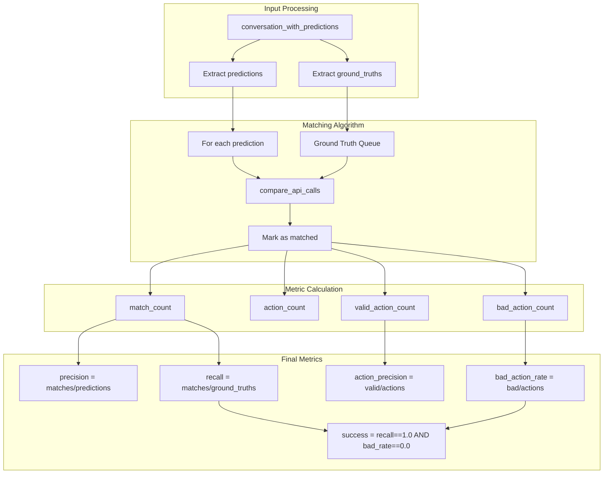

**Evaluation Metrics Calculation Process**

The evaluation system uses a greedy matching algorithm where each prediction can match at most one ground truth API call, and each ground truth can be matched at most once.

| Metric | Formula | Purpose |
|--------|---------|---------|
| `precision` | matches / predictions | Overall prediction accuracy |
| `recall` | matches / ground_truths | Coverage of required API calls |
| `action_precision` | valid_actions / actions | Accuracy of state-changing operations |
| `bad_action_rate` | bad_actions / actions | Rate of incorrect but successful actions |
| `success` | recall == 1.0 AND bad_action_rate == 0.0 | Perfect conversation completion |
| `soft_success` | recall × (1.0 - bad_action_rate) | Weighted success metric |

Sources: [src/tooltalk/evaluation/tool_executor.py:134-232]()

## BaseAPIPredictor Interface

The `BaseAPIPredictor` abstract base class defines the interface for integrating language models with the `ToolExecutor`. Model implementations must provide prediction capabilities that return either API calls or assistant responses.

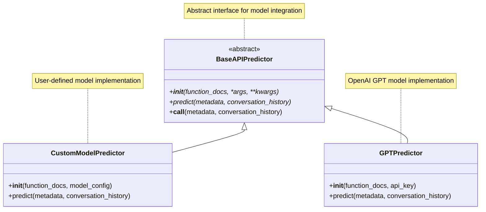

**BaseAPIPredictor Class Hierarchy**

The predictor interface enables flexible model integration while maintaining consistent interaction patterns with the `ToolExecutor` conversation simulation system.

| Method | Purpose | Return Format |
|--------|---------|---------------|
| `__init__` | Initialize with API documentation | N/A |
| `predict` | Generate next conversation action | `{"role": "api\|assistant", ...}` |
| `__call__` | Convenience wrapper for predict | Same as predict |

Sources: [src/tooltalk/evaluation/tool_executor.py:322-334]()

---

# Page: API System

# API System

<details>
<summary>Relevant source files</summary>

The following files were used as context for generating this wiki page:

- [src/tooltalk/apis/account.py](src/tooltalk/apis/account.py)
- [src/tooltalk/apis/api.py](src/tooltalk/apis/api.py)

</details>


This document explains ToolTalk's plugin-based API architecture, including the base classes that define the API framework, how APIs are organized into functional suites, and the implementation patterns used throughout the system. For information about how the ToolExecutor orchestrates API calls, see [ToolExecutor](#2.1). For details about specific API endpoints, see [API Reference](#3).

## Architecture Overview

ToolTalk's API system follows a hierarchical plugin architecture where individual APIs inherit from a common base class and are grouped into thematic suites. The system provides consistent patterns for authentication, parameter validation, error handling, and database interaction across all API implementations.

### API Class Hierarchy

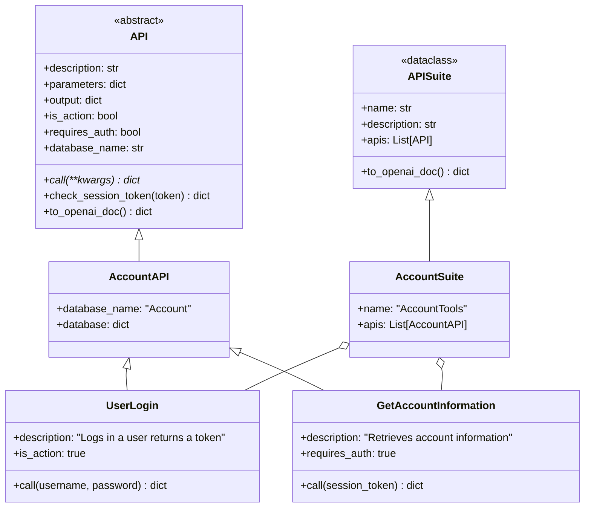

**Sources:** [src/tooltalk/apis/api.py:15-187](), [src/tooltalk/apis/account.py:26-532]()

### API Suite Organization

The system organizes APIs into functional suites that represent logical groupings of related operations. Each suite contains multiple API classes that share common data models and business logic.

```mermaid
graph TB
    subgraph "APISuite Framework"
        APISuite["APISuite"]
        API["API (Abstract Base)"]
    end
    
    subgraph "Account Management"
        AccountSuite["AccountSuite"]
        UserLogin["UserLogin"]
        RegisterUser["RegisterUser"]
        GetAccountInformation["GetAccountInformation"]
        DeleteAccount["DeleteAccount"]
        QueryUser["QueryUser"]
    end
    
    subgraph "Database Layer"
        AccountDB[("Account Database")]
    end
    
    APISuite <|-- AccountSuite
    API <|-- UserLogin
    API <|-- RegisterUser
    API <|-- GetAccountInformation
    
    AccountSuite --> UserLogin
    AccountSuite --> RegisterUser
    AccountSuite --> GetAccountInformation
    AccountSuite --> DeleteAccount
    AccountSuite --> QueryUser
    
    UserLogin --> AccountDB
    RegisterUser --> AccountDB
    GetAccountInformation --> AccountDB
```

**Sources:** [src/tooltalk/apis/api.py:159-187](), [src/tooltalk/apis/account.py:517-532]()

## Base API Framework

### API Base Class

The `API` class defines the contract that all APIs must implement. It provides common functionality for parameter validation, error handling, and response formatting.

| Property | Type | Purpose |
|----------|------|---------|
| `description` | str | Human-readable description of the API's function |
| `parameters` | dict | Schema defining required and optional parameters |
| `output` | dict | Schema defining the response structure |
| `is_action` | bool | Whether the API modifies system state |
| `requires_auth` | bool | Whether authentication is required |
| `database_name` | str | Name of the primary database used |

The base class provides several key methods:

- `call(**kwargs)` - Abstract method that subclasses must implement [src/tooltalk/apis/api.py:72-73]()
- `__call__(**kwargs)` - Wrapper that handles exceptions and response formatting [src/tooltalk/apis/api.py:75-102]()
- `check_session_token(token)` - Validates session tokens for authenticated APIs [src/tooltalk/apis/api.py:149-156]()
- `to_openai_doc()` - Converts API schema to OpenAI function calling format [src/tooltalk/apis/api.py:127-147]()

### Parameter and Output Schemas

APIs define their interface using structured schemas that specify parameter types, requirements, and descriptions:

```python
parameters = {
    'username': {
        'type': "string",
        'description': 'The username of the user.',
        'required': True,
    },
    'password': {
        'type': "string", 
        'description': 'The password of the user.',
        'required': True,
    },
}
```

**Sources:** [src/tooltalk/apis/api.py:15-125](), [src/tooltalk/apis/account.py:479-490]()

## Authentication System

### Session Token Management

The API system implements session-based authentication where authenticated operations require valid session tokens. The authentication flow follows these patterns:

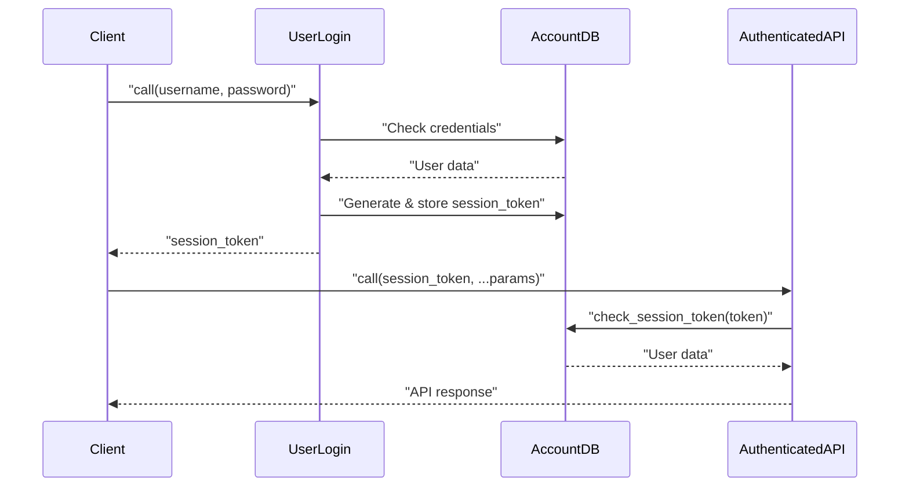

### Authentication Implementation

APIs that require authentication set `requires_auth = True` and receive `session_token` as their first parameter. The `check_session_token` method validates tokens by searching the account database:

```python
def check_session_token(self, session_token: str) -> dict:
    for username, user_data in self.account_database.items():
        if session_token == user_data['session_token']:
            return user_data
    raise APIException('Invalid session_token.')
```

**Sources:** [src/tooltalk/apis/api.py:149-156](), [src/tooltalk/apis/account.py:477-514](), [src/tooltalk/apis/account.py:128-143]()

## Database Integration

### Database Schema Patterns

Each API suite defines its database schema and access patterns. The Account suite uses the following schema:

| Field | Type | Purpose |
|-------|------|---------|
| `username` | str | Primary key |
| `password` | str | User password |  
| `session_token` | str | Authentication token (null when logged out) |
| `email` | str | User email address |
| `phone` | str | User phone number |
| `name` | str | Display name |

### Database Access Patterns

APIs inherit database references through their constructor and access data through the `self.database` property:

```python
class AccountAPI(API, ABC):
    database_name = ACCOUNT_DB_NAME
    
    def __init__(self, account_database: dict, now_timestamp: str, api_database: dict = None):
        super().__init__(account_database, now_timestamp, api_database)
        self.database = self.account_database
```

**Sources:** [src/tooltalk/apis/account.py:13-37](), [src/tooltalk/apis/account.py:26-37]()

## API Execution Flow

### Call Execution Pipeline

When an API is invoked, execution follows a consistent pipeline that handles parameter validation, business logic execution, and response formatting:

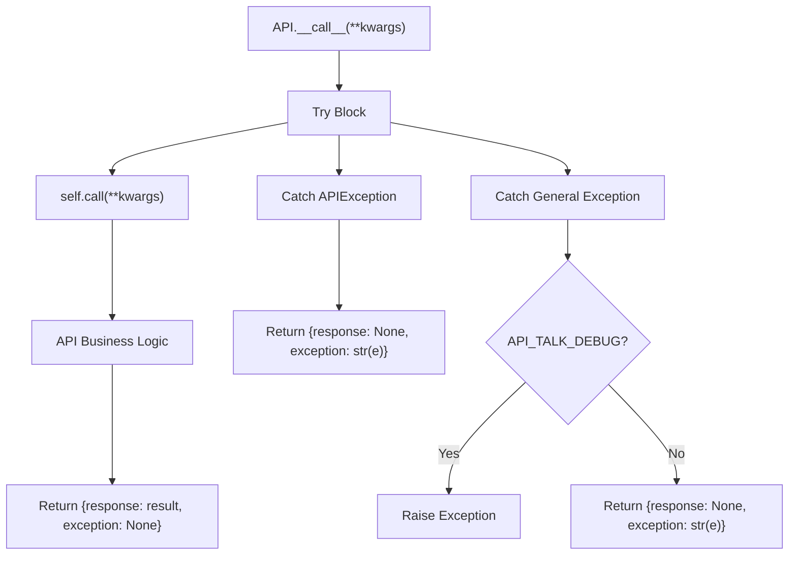

### Error Handling

The system distinguishes between expected business logic errors (`APIException`) and unexpected system errors. All responses follow a consistent format with separate `response` and `exception` fields:

```python
try:
    return {
        "response": self.call(**kwargs),
        "exception": None
    }
except APIException as e:
    return {
        "response": None,
        "exception": str(e)
    }
```

**Sources:** [src/tooltalk/apis/api.py:75-102]()

## Data Formats and Serialization

### OpenAI Function Format

APIs can be automatically converted to OpenAI function calling format for integration with language models:

```python
def to_openai_doc(cls, disable_doc: bool = False) -> dict:
    parameters = dict()
    required = list()
    for name, attributes in cls.parameters.items():
        if attributes["required"]:
            required.append(name)
        # ... parameter processing
    
    return {
        "name": cls.__name__,
        "description": description,
        "parameters": {
            "type": "object", 
            "properties": parameters,
        },
        "required": required,
    }
```

### Suite Documentation Generation

API suites provide methods to generate documentation in multiple formats including docstrings, dictionaries, and OpenAI function schemas for model integration.

**Sources:** [src/tooltalk/apis/api.py:127-147](), [src/tooltalk/apis/api.py:165-186]()

---

# Page: Evaluation Framework

# Evaluation Framework

<details>
<summary>Relevant source files</summary>

The following files were used as context for generating this wiki page:

- [scripts/evaluate_gpt35turbo.sh](scripts/evaluate_gpt35turbo.sh)
- [scripts/evaluate_gpt4.sh](scripts/evaluate_gpt4.sh)
- [src/tooltalk/evaluation/__init__.py](src/tooltalk/evaluation/__init__.py)
- [src/tooltalk/evaluation/evaluate_openai.py](src/tooltalk/evaluation/evaluate_openai.py)

</details>


## Purpose and Scope

The Evaluation Framework provides the core infrastructure for evaluating tool-augmented language models on conversational scenarios in ToolTalk. This framework handles model prediction, conversation execution, and metric calculation to assess how well models can correctly use APIs in multi-turn conversations.

The framework supports multiple evaluation modes and integrates with the ToolExecutor to simulate realistic conversation flows. For information about the API system being evaluated, see [API System](#2.2). For details on running evaluations, see [Running Evaluations](#4.1).

## Evaluation Pipeline Architecture

The evaluation framework follows a multi-stage pipeline that transforms conversation scenarios into executable evaluations and produces detailed metrics.

**Evaluation Pipeline Flow**

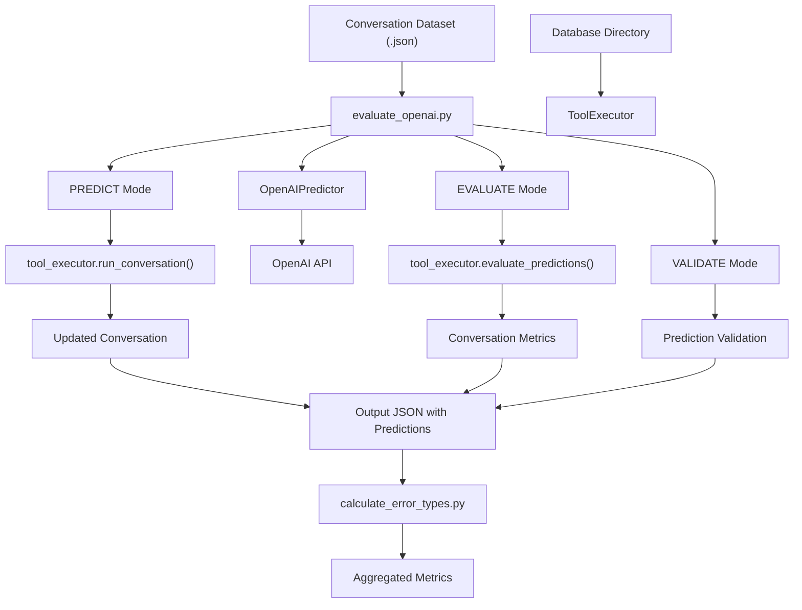

**Code Entity Integration**

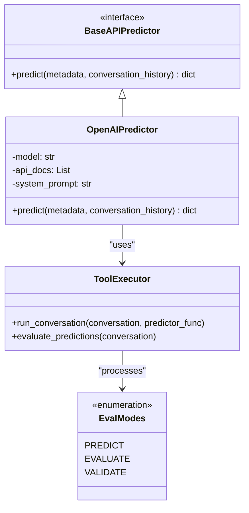

Sources: [src/tooltalk/evaluation/evaluate_openai.py:1-222]()

## Model Predictor Interface

The evaluation framework uses a plugin-based architecture through the `BaseAPIPredictor` interface, allowing integration of different language models.

### BaseAPIPredictor Interface

The `BaseAPIPredictor` abstract base class defines the contract for model integration:

| Method | Parameters | Return Type | Purpose |
|--------|------------|-------------|---------|
| `predict()` | `metadata: dict`, `conversation_history: dict` | `dict` | Generate next conversation turn |

### OpenAIPredictor Implementation

The `OpenAIPredictor` class implements the interface for OpenAI models like GPT-3.5 and GPT-4:

**Key Features:**
- **System Prompt**: Includes user metadata (location, timestamp, username) [src/tooltalk/evaluation/evaluate_openai.py:28-31]()
- **Function Calling**: Converts API documentation to OpenAI function format [src/tooltalk/evaluation/evaluate_openai.py:35]()
- **History Management**: Transforms conversation history into OpenAI message format [src/tooltalk/evaluation/evaluate_openai.py:44-71]()
- **Response Processing**: Handles both text responses and function calls [src/tooltalk/evaluation/evaluate_openai.py:88-112]()

**Prediction Workflow:**

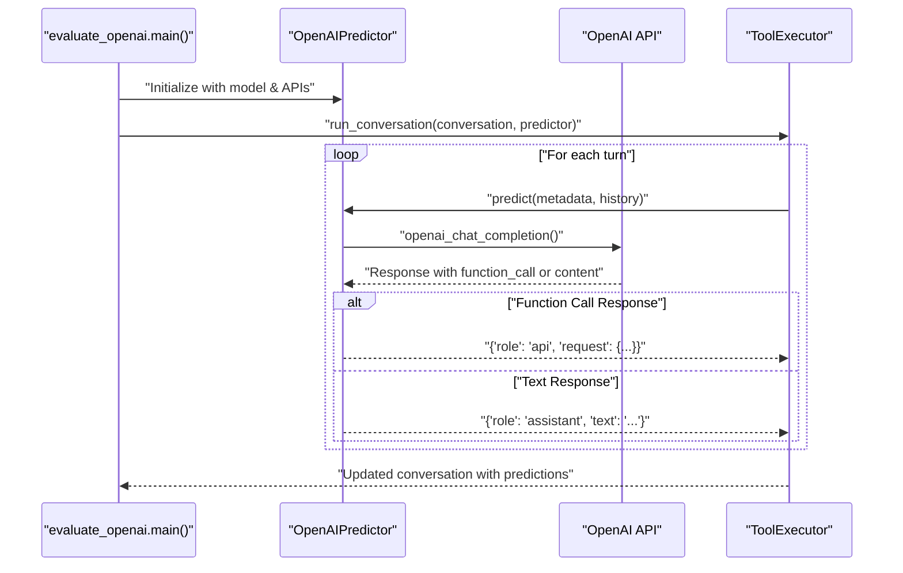

Sources: [src/tooltalk/evaluation/evaluate_openai.py:27-113](), [src/tooltalk/evaluation/tool_executor.py]()

## Evaluation Modes and Workflow

The evaluation framework supports three distinct modes controlled by the `EvalModes` enumeration:

### PREDICT Mode
Generates model predictions for conversation turns using the specified predictor:
- Loads conversation scenarios from dataset
- Determines API scope based on `api_mode` parameter (`exact`, `suite`, or `all`)
- Runs conversation simulation through `tool_executor.run_conversation()`
- Stores predictions with OpenAI request/response metadata

### EVALUATE Mode  
Calculates performance metrics by comparing predictions against ground truth:
- Runs `tool_executor.evaluate_predictions()` on conversations with predictions
- Computes precision, recall, action accuracy, and success rates
- Adds `match` and `bad_action` annotations to API predictions
- Aggregates metrics across all conversations

### VALIDATE Mode
Performs integrity checks on evaluation results:
- Ensures all API predictions have required evaluation fields (`match`, `bad_action`)
- Validates data consistency for downstream analysis

**Evaluation Modes Flow:**

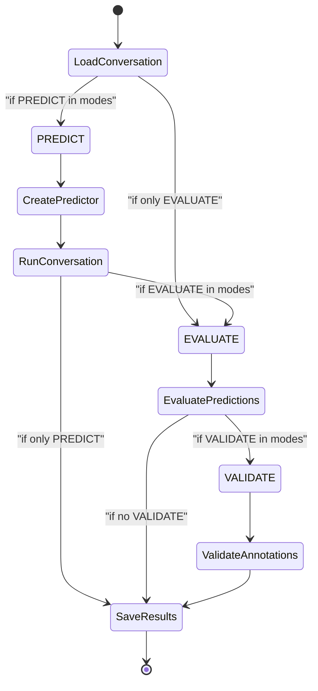

Sources: [src/tooltalk/evaluation/evaluate_openai.py:115-118](), [src/tooltalk/evaluation/evaluate_openai.py:167-203]()

## Metrics and Results

The evaluation framework calculates comprehensive metrics to assess model performance across different dimensions:

### Core Metrics

| Metric | Formula | Purpose |
|--------|---------|---------|
| Precision | `matches / predictions` | Accuracy of API calls made |
| Recall | `matches / ground_truths` | Coverage of required API calls |  
| Action Precision | `valid_actions / actions` | Correctness of API parameters |
| Bad Action Rate | `bad_actions / actions` | Rate of invalid API calls |
| Success Rate | `success / num_conversations` | End-to-end conversation success |

### Metric Calculation Process

The framework accumulates metrics using `Counter` objects throughout evaluation:

```python
# From evaluate_openai.py lines 150, 191-192, 209-217
total_metrics = Counter()
total_metrics += conversation["metrics"] 
total_metrics["num_conversations"] += 1

# Final aggregation
metrics = {
    "precision": total_metrics["matches"] / total_metrics["predictions"],
    "recall": total_metrics["matches"] / total_metrics["ground_truths"],
    # ... other metrics
}
```

### Output Structure

Each evaluated conversation produces a JSON file containing:
- Original conversation scenario
- Model predictions with metadata
- Evaluation annotations (`match`, `bad_action` flags)
- Conversation-level metrics
- OpenAI API request/response logs

Sources: [src/tooltalk/evaluation/evaluate_openai.py:150-217]()

## Integration with ToolExecutor

The evaluation framework delegates conversation execution and metric calculation to the `ToolExecutor` class, maintaining separation of concerns:

**ToolExecutor Interface Usage:**

```mermaid
graph TB
    EvaluateOpenAI["evaluate_openai.py"] --> ToolExecutor["ToolExecutor(init_database_dir)"]
    
    ToolExecutor --> RunConversation["run_conversation(conversation, predictor_func)"]
    ToolExecutor --> EvaluatePredictions["evaluate_predictions(conversation)"]
    
    RunConversation --> ConversationState["Updated conversation with predictions"]
    EvaluatePredictions --> MetricsState["Conversation with metrics & annotations"]
    
    ConversationState --> OutputJSON["conversation.json"]
    MetricsState --> OutputJSON
```

The `ToolExecutor` handles:
- Database initialization and state management
- API execution and response handling  
- Conversation flow control
- Prediction evaluation and metric computation

This design allows the evaluation framework to focus on model integration and result aggregation while delegating the complex conversation simulation logic to the specialized `ToolExecutor` component.

Sources: [src/tooltalk/evaluation/evaluate_openai.py:152](), [src/tooltalk/evaluation/evaluate_openai.py:185](), [src/tooltalk/evaluation/evaluate_openai.py:189]()

---

# Page: API Reference

# API Reference

<details>
<summary>Relevant source files</summary>

The following files were used as context for generating this wiki page:

- [src/tooltalk/apis/account.py](src/tooltalk/apis/account.py)
- [src/tooltalk/apis/alarm.py](src/tooltalk/apis/alarm.py)

</details>


This document provides comprehensive documentation of all available API suites and endpoints in the ToolTalk framework. The API Reference covers the structure, patterns, and specifications for all tool APIs that can be used during conversation simulation and evaluation.

For information about the underlying architecture and how APIs integrate with the ToolExecutor, see [Core Architecture](#2). For detailed implementation guides on creating new APIs, see [Adding New APIs](#5.1).

## API System Architecture

The ToolTalk API system is organized into thematic suites that group related functionality. Each suite contains multiple individual API endpoints that inherit from common base classes and follow standardized patterns.

### API Class Hierarchy

```mermaid
classDiagram
    class API {
        +description: str
        +parameters: dict
        +output: dict
        +database_name: str
        +is_action: bool
        +requires_auth: bool
        +call() dict
        +check_session_token() dict
        +check_api_call_correctness() bool
    }
    
    class APISuite {
        +name: str
        +description: str
        +apis: list
    }
    
    class AccountAPI {
        +database_name: "Account"
        +__init__()
    }
    
    class UserLogin {
        +description: "Logs in a user returns a token"
        +parameters: dict
        +call(username, password) dict
    }
    
    class RegisterUser {
        +description: "Register a new user"
        +parameters: dict
        +call(username, password, email, name, phone) dict
    }
    
    class DeleteAccount {
        +description: "Deletes a user's account"
        +requires_auth: true
        +call(session_token, password) dict
    }
    
    class AccountSuite {
        +name: "AccountTools"
        +apis: [UserLogin, RegisterUser, DeleteAccount, ...]
    }
    
    class AddAlarm {
        +description: "Adds an alarm for a set time"
        +database_name: "Alarm"
        +call(session_token, time) dict
    }
    
    class AlarmSuite {
        +name: "Alarm"
        +apis: [AddAlarm, DeleteAlarm, FindAlarms]
    }
    
    API <|-- AccountAPI
    API <|-- AddAlarm
    AccountAPI <|-- UserLogin
    AccountAPI <|-- RegisterUser
    AccountAPI <|-- DeleteAccount
    APISuite <|-- AccountSuite
    APISuite <|-- AlarmSuite
    AccountSuite --> UserLogin
    AccountSuite --> RegisterUser
    AccountSuite --> DeleteAccount
    AlarmSuite --> AddAlarm
```

Sources: [src/tooltalk/apis/account.py:1-532](), [src/tooltalk/apis/alarm.py:1-202]()

### API Suite Organization

```mermaid
graph TB
    subgraph "ToolExecutor"
        TE["ToolExecutor"]
    end
    
    subgraph "API Suites"
        AS["AccountSuite<br/>name: 'AccountTools'"]
        AlS["AlarmSuite<br/>name: 'Alarm'"]
        CS["CalendarSuite<br/>name: 'Calendar'"]
        ES["EmailSuite<br/>name: 'Email'"]
        MS["MessageSuite<br/>name: 'Messages'"]
        RS["ReminderSuite<br/>name: 'Reminder'"]
    end
    
    subgraph "Account APIs"
        UL["UserLogin"]
        RU["RegisterUser"]
        DA["DeleteAccount"]
        GAI["GetAccountInformation"]
        QU["QueryUser"]
        UAI["UpdateAccountInformation"]
        CP["ChangePassword"]
        LU["LogoutUser"]
        SVC["SendVerificationCode"]
        RP["ResetPassword"]
    end
    
    subgraph "Alarm APIs"
        AA["AddAlarm"]
        DelA["DeleteAlarm"]
        FA["FindAlarms"]
    end
    
    subgraph "Database Layer"
        AccDB[("Account Database<br/>JSON")]
        AlarmDB[("Alarm Database<br/>JSON")]
        CalDB[("Calendar Database<br/>JSON")]
        EmailDB[("Email Database<br/>JSON")]
        MsgDB[("Message Database<br/>JSON")]
        RemDB[("Reminder Database<br/>JSON")]
    end
    
    TE --> AS
    TE --> AlS
    TE --> CS
    TE --> ES
    TE --> MS
    TE --> RS
    
    AS --> UL
    AS --> RU
    AS --> DA
    AS --> GAI
    AS --> QU
    AS --> UAI
    AS --> CP
    AS --> LU
    AS --> SVC
    AS --> RP
    
    AlS --> AA
    AlS --> DelA
    AlS --> FA
    
    UL --> AccDB
    RU --> AccDB
    DA --> AccDB
    AA --> AlarmDB
    DelA --> AlarmDB
    FA --> AlarmDB
```

Sources: [src/tooltalk/apis/account.py:517-532](), [src/tooltalk/apis/alarm.py:194-202]()

## Common API Patterns

All APIs in ToolTalk follow consistent patterns for authentication, database access, parameter validation, and error handling.

### Authentication Flow

```mermaid
sequenceDiagram
    participant "Client" as C
    participant "API Endpoint" as API
    participant "AccountDatabase" as DB
    
    Note over C,DB: Authentication Required APIs
    
    C->>API: "call(session_token, ...params)"
    API->>API: "check_session_token(session_token)"
    API->>DB: "lookup user by session_token"
    
    alt Valid Session Token
        DB-->>API: "user_data"
        API->>API: "execute api logic"
        API-->>C: "response dict"
    else Invalid/Missing Token
        DB-->>API: "None/KeyError"
        API-->>C: "APIException('User not logged in')"
    end
    
    Note over C,DB: Public APIs (no auth required)
    
    C->>API: "call(...params)"
    API->>API: "execute api logic"
    API-->>C: "response dict"
```

Sources: [src/tooltalk/apis/account.py:69-73](), [src/tooltalk/apis/alarm.py:50-59]()

### Database Schema Patterns

| Suite | Database Name | Schema | Key Field |
|-------|---------------|---------|-----------|
| Account | `"Account"` | `{username: {username, password, session_token, email, phone, name}}` | `username` |
| Alarm | `"Alarm"` | `{username: {alarm_id: {alarm_id, time}}}` | `username` → `alarm_id` |
| Calendar | `"Calendar"` | `{username: {event_id: {event_id, title, start_time, end_time, location, attendees}}}` | `username` → `event_id` |
| Email | `"Email"` | `{username: {email_id: {from, to, subject, body, timestamp}}}` | `username` → `email_id` |
| Messages | `"Messages"` | `{username: {message_id: {from, to, message, timestamp}}}` | `username` → `message_id` |
| Reminder | `"Reminder"` | `{username: {reminder_id: {reminder_id, task, due_time, completed}}}` | `username` → `reminder_id` |

Sources: [src/tooltalk/apis/account.py:13-21](), [src/tooltalk/apis/alarm.py:15-22]()

## API Specification Format

Each API endpoint follows a standardized specification format that defines its interface, behavior, and integration points.

### Standard API Properties

```python
class ExampleAPI(API):
    description = "Human-readable description of what the API does"
    parameters = {
        'param_name': {
            'type': "string|number|boolean|object|array",
            'description': "Parameter description",
            'required': True|False
        }
    }
    output = {
        'field_name': {
            'type': "string|number|boolean|object|array", 
            'description': "Output field description"
        }
    }
    database_name = "DatabaseName"  # Which database this API uses
    is_action = True|False         # Whether this API modifies state
    requires_auth = True|False     # Whether authentication is required
```

### Parameter Types and Validation

| Type | Validation | Example |
|------|------------|---------|
| `string` | Format validation via utility functions | Email: `verify_email_format()`, Phone: `verify_phone_format()` |
| `string` (time) | DateTime parsing with specific formats | `%H:%M:%S`, `%Y-%m-%d %H:%M:%S` |
| `string` (ID) | Pattern validation | `alarm_id`: `xxxx-xxxx`, `session_token`: `xxxxxxxx-xxxx-xxxx` |
| `boolean` | Type validation | `completed: true/false` |
| `array` | Item type validation | `attendees: ["email1", "email2"]` |

Sources: [src/tooltalk/apis/account.py:42-55](), [src/tooltalk/apis/alarm.py:26-35]()

## Error Handling and Exceptions

All APIs use the `APIException` class for consistent error reporting. Common error patterns include:

### Authentication Errors
```python
# Session token validation
raise APIException("User not logged in.")
raise APIException("The user is already logged in.")

# Password validation  
raise APIException("The password is incorrect.")
raise APIException("The old password is incorrect.")
```

### Resource Errors
```python
# Resource not found
raise APIException("The username does not exist.")
raise APIException(f"Alarm {alarm_id} not found.")

# Resource conflicts
raise APIException("The username already exists.")
```

### Validation Errors
```python
# Format validation
raise APIException("The email format is invalid.")
raise APIException("The phone number format is invalid.")

# Parameter validation
raise APIException("You need to provide at least one of username and email.")
```

Sources: [src/tooltalk/apis/account.py:71](), [src/tooltalk/apis/account.py:297](), [src/tooltalk/apis/alarm.py:106]()

## API Suite Reference Overview

The following API suites are available in ToolTalk:

| Suite | Page | Description | Key APIs |
|-------|------|-------------|----------|
| AccountTools | [3.1](#3.1) | User account management and authentication | `UserLogin`, `RegisterUser`, `DeleteAccount` |
| Alarm | [3.2](#3.2) | Alarm clock management | `AddAlarm`, `DeleteAlarm`, `FindAlarms` |
| Calendar | [3.2](#3.2) | Calendar event management | `CreateEvent`, `QueryCalendar`, `ModifyEvent` |
| Reminder | [3.2](#3.2) | Task reminder management | `AddReminder`, `GetReminders`, `CompleteReminder` |
| Email | [3.3](#3.3) | Email sending and searching | `SendEmail`, `SearchInbox` |
| Messages | [3.3](#3.3) | Direct messaging | `SendMessage`, `SearchMessages` |
| Utilities | [3.4](#3.4) | Format validation and semantic comparison | `verify_email_format`, `semantic_str_compare` |

Each suite provides a cohesive set of functionality around a specific domain, with consistent authentication, database patterns, and error handling.

Sources: [src/tooltalk/apis/account.py:517-532](), [src/tooltalk/apis/alarm.py:194-202]()

---

# Page: Account Management

# Account Management

<details>
<summary>Relevant source files</summary>

The following files were used as context for generating this wiki page:

- [src/tooltalk/apis/account.py](src/tooltalk/apis/account.py)

</details>


## Purpose and Scope

The Account Management system provides comprehensive user account functionality within the ToolTalk benchmark framework. This system handles user registration, authentication, profile management, and password recovery operations through a session-based authentication mechanism. All account operations are implemented as part of the `AccountSuite` API collection and integrate with the broader ToolExecutor system for conversation simulation and evaluation.

For information about the overall API architecture and how account management fits into the evaluation framework, see [API System](#2.2). For details on running evaluations that utilize account management features, see [Running Evaluations](#4.1).

## System Architecture

The Account Management system is built around the `AccountSuite` class which contains multiple specialized API operations. All operations interact with a shared JSON-based account database and use session tokens for authentication.

### AccountSuite Integration

```mermaid
graph TB
    subgraph "ToolExecutor System"
        TE["ToolExecutor"]
        AUTH["Authentication Handler"]
    end
    
    subgraph "AccountSuite"
        AS["AccountSuite"]
        ADB[("Account Database (JSON)")]
    end
    
    subgraph "Account API Operations"
        REG["RegisterUser"]
        LOGIN["UserLogin"]
        LOGOUT["LogoutUser"]
        INFO["GetAccountInformation"]
        UPDATE["UpdateAccountInformation"]
        CHANGE["ChangePassword"]
        DELETE["DeleteAccount"]
        QUERY["QueryUser"]
        SEND["SendVerificationCode"]
        RESET["ResetPassword"]
    end
    
    subgraph "Validation Utilities"
        EMAIL["verify_email_format"]
        PHONE["verify_phone_format"]
    end
    
    TE --> AS
    AUTH --> AS
    AS --> ADB
    
    AS --> REG
    AS --> LOGIN
    AS --> LOGOUT
    AS --> INFO
    AS --> UPDATE
    AS --> CHANGE
    AS --> DELETE
    AS --> QUERY
    AS --> SEND
    AS --> RESET
    
    REG --> EMAIL
    REG --> PHONE
    UPDATE --> EMAIL
    UPDATE --> PHONE
    
    REG --> ADB
    LOGIN --> ADB
    LOGOUT --> ADB
    INFO --> ADB
    UPDATE --> ADB
    CHANGE --> ADB
    DELETE --> ADB
    QUERY --> ADB
    SEND --> ADB
    RESET --> ADB
```

Sources: [src/tooltalk/apis/account.py:517-531]()

## Database Schema

The account system uses a JSON database with the following schema structure:

| Field | Type | Description |
|-------|------|-------------|
| `username` | string | Primary key, unique identifier |
| `password` | string | User's password (plaintext in simulation) |
| `session_token` | string | Current session token (null when logged out) |
| `email` | string | User's email address |
| `phone` | string | Phone number in xxx-xxx-xxxx format |
| `name` | string | Display name |
| `verification_code` | string | Temporary field for password reset |

Sources: [src/tooltalk/apis/account.py:12-21]()

## Authentication Flow

The account system implements session-based authentication where users receive tokens upon login that must be included in subsequent authenticated requests.

### Session Token Lifecycle

```mermaid
sequenceDiagram
    participant U as "User"
    participant LOGIN as "UserLogin"
    participant ADB as "Account Database"
    participant API as "Authenticated API"
    participant LOGOUT as "LogoutUser"
    
    U->>LOGIN: "username, password"
    LOGIN->>ADB: "Verify credentials"
    ADB-->>LOGIN: "User data"
    LOGIN->>LOGIN: "Generate session_token"
    LOGIN->>ADB: "Store session_token"
    LOGIN-->>U: "session_token"
    
    Note over U,API: "Authenticated Operations"
    U->>API: "session_token + params"
    API->>ADB: "check_session_token()"
    ADB-->>API: "User data"
    API-->>U: "API response"
    
    U->>LOGOUT: "session_token"
    LOGOUT->>ADB: "Set session_token = null"
    LOGOUT-->>U: "success"
```

Sources: [src/tooltalk/apis/account.py:477-514](), [src/tooltalk/apis/account.py:146-166]()

## Core API Operations

### User Registration and Authentication

The system provides three primary authentication operations:

#### RegisterUser
- **Purpose**: Creates new user accounts with validation
- **Authentication**: Not required
- **Validation**: Email format, phone format (xxx-xxx-xxxx)
- **Returns**: Session token and user information
- **Implementation**: [src/tooltalk/apis/account.py:242-319]()

#### UserLogin  
- **Purpose**: Authenticates existing users
- **Authentication**: Not required
- **Validation**: Username exists, password matches, user not already logged in
- **Returns**: Session token
- **Implementation**: [src/tooltalk/apis/account.py:477-514]()

#### LogoutUser
- **Purpose**: Invalidates current session
- **Authentication**: Required
- **Action**: Sets session_token to null
- **Implementation**: [src/tooltalk/apis/account.py:146-166]()

### Account Information Management

#### GetAccountInformation
- **Purpose**: Retrieves current user's profile data
- **Authentication**: Required
- **Returns**: Username, email, phone, name
- **Implementation**: [src/tooltalk/apis/account.py:110-143]()

#### UpdateAccountInformation
- **Purpose**: Modifies user profile fields
- **Authentication**: Required
- **Parameters**: Password verification + optional new email/phone/name
- **Validation**: Email format, phone format
- **Implementation**: [src/tooltalk/apis/account.py:409-474]()

#### QueryUser
- **Purpose**: Search for other users by username or email
- **Authentication**: Required
- **Parameters**: Username OR email (at least one required)
- **Returns**: Array of matching user profiles
- **Implementation**: [src/tooltalk/apis/account.py:169-239]()

### Password Management

#### ChangePassword
- **Purpose**: Updates password for authenticated user
- **Authentication**: Required
- **Parameters**: Old password, new password
- **Validation**: Old password verification
- **Implementation**: [src/tooltalk/apis/account.py:39-73]()

#### Password Reset Flow
The system implements a two-step password reset process:

```mermaid
graph LR
    A["SendVerificationCode"] --> B["6-digit code generated"]
    B --> C["Code stored in database"]
    C --> D["ResetPassword"]
    D --> E["Code verification"]
    E --> F["Password updated"]
    
    A --> G["Username + email validation"]
    G --> H["Email must match account"]
```

#### SendVerificationCode
- **Purpose**: Initiates password reset by generating verification code
- **Authentication**: Not required
- **Parameters**: Username, email
- **Validation**: Username exists, email matches account
- **Implementation**: [src/tooltalk/apis/account.py:372-406]()

#### ResetPassword
- **Purpose**: Completes password reset using verification code
- **Authentication**: Not required
- **Parameters**: Username, verification code, new password
- **Validation**: Code matches stored value
- **Implementation**: [src/tooltalk/apis/account.py:322-369]()

### Account Deletion

#### DeleteAccount
- **Purpose**: Permanently removes user account
- **Authentication**: Required
- **Parameters**: Password confirmation
- **Action**: Removes user record from database
- **Implementation**: [src/tooltalk/apis/account.py:76-107]()

## API Class Hierarchy

```mermaid
classDiagram
    class API {
        <<abstract>>
        +check_session_token()
        +database_name
        +is_action
        +requires_auth
    }
    
    class AccountAPI {
        <<abstract>>
        +database_name = "Account"
        +__init__(account_database, now_timestamp, api_database)
    }
    
    class APISuite {
        <<abstract>>
        +name
        +description
        +apis[]
    }
    
    class AccountSuite {
        +name = "AccountTools"
        +description = "This API contains tools for account management."
        +apis = [RegisterUser, UserLogin, ...]
    }
    
    API <|-- AccountAPI
    APISuite <|-- AccountSuite
    
    AccountAPI <|-- RegisterUser
    AccountAPI <|-- UserLogin
    AccountAPI <|-- LogoutUser
    AccountAPI <|-- GetAccountInformation
    AccountAPI <|-- UpdateAccountInformation
    AccountAPI <|-- ChangePassword
    AccountAPI <|-- DeleteAccount
    AccountAPI <|-- QueryUser
    AccountAPI <|-- SendVerificationCode
    AccountAPI <|-- ResetPassword
    
    AccountSuite --> RegisterUser
    AccountSuite --> UserLogin
    AccountSuite --> LogoutUser
    AccountSuite --> GetAccountInformation
    AccountSuite --> UpdateAccountInformation
    AccountSuite --> ChangePassword
    AccountSuite --> DeleteAccount
    AccountSuite --> QueryUser
    AccountSuite --> SendVerificationCode
    AccountSuite --> ResetPassword
```

Sources: [src/tooltalk/apis/account.py:26-36](), [src/tooltalk/apis/account.py:517-531]()

## Error Handling

The account system uses `APIException` for standardized error responses. Common error scenarios include:

### Authentication Errors
- Invalid username/password combinations
- Missing or invalid session tokens
- Attempting to login when already logged in

### Validation Errors  
- Invalid email format (handled by `verify_email_format`)
- Invalid phone format (handled by `verify_phone_format`)
- Missing required parameters

### Business Logic Errors
- Username already exists during registration
- Incorrect verification codes during password reset
- Password mismatch during account operations

Sources: [src/tooltalk/apis/account.py:8](), [src/tooltalk/apis/account.py:10]()

## Integration Points

### ToolExecutor Integration
The `AccountSuite` is registered with the `ToolExecutor` system which:
- Manages session token injection for authenticated APIs
- Handles database initialization and state management
- Coordinates account operations within conversation simulations

### Utility Dependencies
The account system depends on validation utilities:
- `verify_email_format`: Validates email address format
- `verify_phone_format`: Validates phone numbers in xxx-xxx-xxxx format

Sources: [src/tooltalk/apis/account.py:10]()

## Database Configuration

The account database is identified by the constant `ACCOUNT_DB_NAME = "Account"` and all `AccountAPI` classes inherit this database configuration. The database is passed to API constructors during initialization and shared across all account operations.

Sources: [src/tooltalk/apis/account.py:23](), [src/tooltalk/apis/account.py:27]()

---

# Page: Time Management

# Time Management

<details>
<summary>Relevant source files</summary>

The following files were used as context for generating this wiki page:

- [src/tooltalk/apis/alarm.py](src/tooltalk/apis/alarm.py)
- [src/tooltalk/apis/calendar.py](src/tooltalk/apis/calendar.py)
- [src/tooltalk/apis/reminder.py](src/tooltalk/apis/reminder.py)

</details>


This document covers the time management API suites in the ToolTalk framework, which enable conversational agents to manage alarms, calendar events, and reminders. These APIs provide comprehensive time-based functionality for scheduling, notification, and task management scenarios.

The time management system consists of three primary API suites: `AlarmSuite` for simple time-based alarms, `CalendarSuite` for complex event scheduling with attendees and locations, and `ReminderSuite` for task-based reminders with optional due dates. For general API architecture information, see [API System](#2.2). For evaluation of these APIs, see [Evaluation Framework](#2.3).

## Time Management API Architecture

```mermaid
graph TB
    subgraph "Time Management Suites"
        AS[AlarmSuite]
        CS[CalendarSuite] 
        RS[ReminderSuite]
    end
    
    subgraph "Alarm APIs"
        AA[AddAlarm]
        DA[DeleteAlarm]
        FA[FindAlarms]
    end
    
    subgraph "Calendar APIs"
        CE[CreateEvent]
        DE[DeleteEvent]
        ME[ModifyEvent]
        QC[QueryCalendar]
    end
    
    subgraph "Reminder APIs"
        AR[AddReminder]
        CR[CompleteReminder]
        DR[DeleteReminder]
        GR[GetReminders]
    end
    
    subgraph "Databases"
        ALARM_DB["ALARM_DB_NAME: 'Alarm'"]
        CALENDAR_DB["CALENDAR_DB_NAME: 'Calendar'"]
        REMINDER_DB["REMINDER_DB_NAME: 'Reminder'"]
    end
    
    AS --> AA
    AS --> DA
    AS --> FA
    
    CS --> CE
    CS --> DE
    CS --> ME
    CS --> QC
    
    RS --> AR
    RS --> CR
    RS --> DR
    RS --> GR
    
    AA --> ALARM_DB
    DA --> ALARM_DB
    FA --> ALARM_DB
    
    CE --> CALENDAR_DB
    DE --> CALENDAR_DB
    ME --> CALENDAR_DB
    QC --> CALENDAR_DB
    
    AR --> REMINDER_DB
    CR --> REMINDER_DB
    DR --> REMINDER_DB
    GR --> REMINDER_DB
```

Sources: [src/tooltalk/apis/alarm.py:194-201](), [src/tooltalk/apis/calendar.py:450-453](), [src/tooltalk/apis/reminder.py:229-237]()

## Database Schema Overview

The time management APIs use three separate JSON databases with distinct data structures:

**Database Schema Architecture**
```mermaid
erDiagram
    ALARM_DB {
        string username PK
        dict alarms
    }
    
    CALENDAR_DB {
        string username PK
        dict events
    }
    
    REMINDER_DB {
        string username PK
        dict reminders
    }
    
    ALARM_RECORD {
        string alarm_id PK
        string time
    }
    
    EVENT_RECORD {
        string event_id PK
        string name
        string event_type
        string description
        string start_time
        string end_time
        string location
        array attendees
    }
    
    REMINDER_RECORD {
        string reminder_id PK
        string task
        string due_date
        string status
    }
    
    ALARM_DB ||--o{ ALARM_RECORD : contains
    CALENDAR_DB ||--o{ EVENT_RECORD : contains
    REMINDER_DB ||--o{ REMINDER_RECORD : contains
```

Sources: [src/tooltalk/apis/alarm.py:12-21](), [src/tooltalk/apis/calendar.py:17-32](), [src/tooltalk/apis/reminder.py:13-21]()

## Alarm Suite

The `AlarmSuite` provides simple time-based alarm functionality with three core operations:

| API Class | Description | Time Format | Action Type |
|-----------|-------------|-------------|-------------|
| `AddAlarm` | Creates a new alarm | `%H:%M:%S` | Action |
| `DeleteAlarm` | Removes an existing alarm | N/A | Action |
| `FindAlarms` | Searches alarms by time range | `%H:%M:%S` | Query |

### Alarm ID Generation
Alarm IDs follow the pattern `xxxx-xxxx` where each `x` represents a hexadecimal digit, generated using [src/tooltalk/apis/alarm.py:54]().

### Time Range Filtering
The `FindAlarms` API supports optional time range filtering through `start_range` and `end_range` parameters, allowing users to query alarms within specific time windows [src/tooltalk/apis/alarm.py:145-173]().

Sources: [src/tooltalk/apis/alarm.py:24-201]()

## Calendar Suite

The `CalendarSuite` manages complex scheduling with full event lifecycle support:

| API Class | Description | Primary Function | Validation |
|-----------|-------------|------------------|------------|
| `CreateEvent` | Creates calendar events | Event scheduling | Time/attendee validation |
| `DeleteEvent` | Removes events | Event deletion | Ownership validation |
| `ModifyEvent` | Updates existing events | Event modification | Consistency validation |
| `QueryCalendar` | Finds events in time range | Event discovery | Time range validation |

### Event Types
Events are categorized into two types defined in `EventTypes`:
- `meeting`: Requires attendees list
- `event`: General purpose events

[src/tooltalk/apis/calendar.py:37-43]()

### Time Format and Validation
All calendar operations use the format `%Y-%m-%d %H:%M:%S` with strict validation:
- Start time must precede end time
- Times must be in the future relative to `now_timestamp`
- Attendee lists automatically include the event creator

Sources: [src/tooltalk/apis/calendar.py:46-453]()

## Reminder Suite

The `ReminderSuite` implements task management with status tracking:

**Reminder Lifecycle Flow**
```mermaid
stateDiagram-v2
    [*] --> AddReminder: "task + optional due_date"
    AddReminder --> pending: "status = 'pending'"
    pending --> CompleteReminder: "mark complete"
    pending --> DeleteReminder: "remove reminder"
    CompleteReminder --> complete: "status = 'complete'" 
    complete --> DeleteReminder: "remove reminder"
    DeleteReminder --> [*]
```

### Reminder Status Management
- **pending**: Initial status for new reminders
- **complete**: Status after calling `CompleteReminder`
- Completed reminders cannot be completed again [src/tooltalk/apis/reminder.py:132-133]()

### Due Date Handling
Due dates are optional and follow the format `%Y-%m-%d %H:%M:%S`. The `AddReminder.check_api_call_correctness` method validates dates by comparing only the date portion, ignoring time differences [src/tooltalk/apis/reminder.py:92-97]().

Sources: [src/tooltalk/apis/reminder.py:24-237]()

## API Interaction Patterns

**Common Authentication and Error Handling**
```mermaid
sequenceDiagram
    participant User as "User Request"
    participant API as "Time API"
    participant Auth as "check_session_token"
    participant DB as "JSON Database"
    
    User->>API: "call(session_token, ...params)"
    API->>Auth: "validate session"
    
    alt Authentication Success
        Auth-->>API: "user_info"
        API->>DB: "read/write operation"
        DB-->>API: "data response"
        API-->>User: "success response"
    else Authentication Failure
        Auth-->>API: "APIException"
        API-->>User: "error response"
    end
```

### Semantic String Comparison
Several APIs use `semantic_str_compare` for fuzzy matching of text fields with a threshold of 0.9:
- Calendar event names, descriptions, and locations [src/tooltalk/apis/calendar.py:182-185]()
- Reminder task descriptions [src/tooltalk/apis/reminder.py:99]()

### Time Format Standardization

| Suite | Time Format | Usage |
|-------|-------------|-------|
| Alarm | `%H:%M:%S` | Daily recurring alarms |
| Calendar | `%Y-%m-%d %H:%M:%S` | Specific date/time events |
| Reminder | `%Y-%m-%d %H:%M:%S` | Optional due dates |

Sources: [src/tooltalk/apis/alarm.py:49](), [src/tooltalk/apis/calendar.py:131-132](), [src/tooltalk/apis/reminder.py:58]()

## API Correctness Validation

Each time management API implements custom `check_api_call_correctness` methods for evaluation:

**Validation Strategy Summary**
```mermaid
flowchart TD
    Request[API Request] --> Exception{Exception Check}
    Exception -->|Match| Params[Parameter Validation]
    Exception -->|Mismatch| Invalid[Return False]
    
    Params --> Required[Required Parameters]
    Required --> Optional[Optional Parameters]
    Optional --> Semantic{Semantic Fields?}
    
    Semantic -->|Yes| SemanticCheck[semantic_str_compare >= 0.9]
    Semantic -->|No| ExactMatch[Exact Value Match]
    
    SemanticCheck --> Valid[Return True]
    ExactMatch --> Valid
    
    SemanticCheck -->|Fail| Invalid
    ExactMatch -->|Fail| Invalid
```

The validation logic prioritizes ground truth requirements, allowing predictions to include additional parameters while ensuring all ground truth parameters are present and correct.

Sources: [src/tooltalk/apis/alarm.py:62-76](), [src/tooltalk/apis/calendar.py:160-190](), [src/tooltalk/apis/reminder.py:71-103]()

---

# Page: Communication

# Communication

<details>
<summary>Relevant source files</summary>

The following files were used as context for generating this wiki page:

- [src/tooltalk/apis/email.py](src/tooltalk/apis/email.py)
- [src/tooltalk/apis/message.py](src/tooltalk/apis/message.py)

</details>


This page documents the communication API suites in ToolTalk, which provide functionality for sending and searching emails and messages. The communication APIs enable conversational agents to interact with simulated email and messaging systems, supporting both outbound communication and content retrieval through flexible search capabilities.

For account management and authentication, see [Account Management](#3.1). For utility functions used by communication APIs, see [Utilities](#3.4).

## Overview

The ToolTalk communication system consists of two primary API suites that handle different types of communication:

- **EmailSuite**: Manages email sending and inbox searching with support for multiple recipients
- **MessagesSuite**: Handles direct user-to-user messaging with search capabilities

Both suites follow the standard ToolTalk API architecture, requiring authentication and providing both action APIs (for sending) and query APIs (for searching).

### Communication System Architecture

```mermaid
graph TB
    subgraph "Communication APIs"
        EmailSuite["EmailSuite"]
        MessagesSuite["MessagesSuite"]
    end
    
    subgraph "Email Operations"
        SendEmail["SendEmail"]
        SearchInbox["SearchInbox"]
    end
    
    subgraph "Message Operations"
        SendMessage["SendMessage"]
        SearchMessages["SearchMessages"]
    end
    
    subgraph "Data Storage"
        EmailDB["EMAIL_DB_NAME: 'Email'"]
        MessageDB["MESSAGE_DB_NAME: 'Message'"]
    end
    
    subgraph "Base Framework"
        API["API base class"]
        APISuite["APISuite base class"]
        ToolExecutor["ToolExecutor"]
    end
    
    subgraph "Utilities"
        verify_email_format["verify_email_format()"]
        semantic_str_compare["semantic_str_compare()"]
    end
    
    EmailSuite --> SendEmail
    EmailSuite --> SearchInbox
    MessagesSuite --> SendMessage
    MessagesSuite --> SearchMessages
    
    SendEmail --> EmailDB
    SearchInbox --> EmailDB
    SendMessage --> MessageDB
    SearchMessages --> MessageDB
    
    EmailSuite -.-> APISuite
    MessagesSuite -.-> APISuite
    SendEmail -.-> API
    SearchInbox -.-> API
    SendMessage -.-> API
    SearchMessages -.-> API
    
    ToolExecutor --> EmailSuite
    ToolExecutor --> MessagesSuite
    
    SendEmail --> verify_email_format
    SendEmail --> semantic_str_compare
    SendMessage --> semantic_str_compare
    SearchInbox --> semantic_str_compare
    SearchMessages --> semantic_str_compare
```

Sources: [src/tooltalk/apis/email.py:1-244](), [src/tooltalk/apis/message.py:1-223]()

## Email Suite

The `EmailSuite` provides comprehensive email functionality through two primary APIs. It manages a simulated email system with support for multiple recipients, subject lines, and rich content searching.

### SendEmail API

The `SendEmail` API enables sending emails to multiple recipients with validation of email addresses.

| Property | Value |
|----------|-------|
| Class | `SendEmail` |
| Description | Sends an email on behalf of a given user |
| Action API | Yes (`is_action = True`) |
| Authentication | Required (`requires_auth = True`) |
| Database | `EMAIL_DB_NAME` |

**Parameters:**
- `to` (array of strings, required): Receiving email addresses
- `subject` (string, required): Email subject line
- `body` (string, required): Email content

**Returns:**
- `email_id` (string): Generated unique identifier for the sent email

The API validates email formats using `verify_email_format()` and generates a unique email ID in the format `{hex2}-{hex4}-{hex8}`.

Sources: [src/tooltalk/apis/email.py:169-213]()

### SearchInbox API

The `SearchInbox` API provides flexible email search with multiple filter options, returning up to 5 most recent matching results.

| Property | Value |
|----------|-------|
| Class | `SearchInbox` |
| Description | Searches for emails matching filters returning 5 most recent results |
| Action API | No (`is_action = False`) |
| Authentication | Required (`requires_auth = True`) |
| Database | `EMAIL_DB_NAME` |

**Parameters:**
- `query` (string, optional): Keywords to search for in subject and body
- `match_type` (string, optional): "any" or "all" keyword matching (default: "any")  
- `sender` (string, optional): Email address of sender to filter by
- `start_date` (string, optional): Starting time filter (format: %Y-%m-%d %H:%M:%S)
- `end_date` (string, optional): End time filter (format: %Y-%m-%d %H:%M:%S)

**Returns:**
- `emails` (array): List of matching email objects with sender, receivers, subject, body, and date

The search algorithm filters emails chronologically, excludes future-dated emails, and supports both "any" and "all" keyword matching modes.

Sources: [src/tooltalk/apis/email.py:28-146]()

### Email Database Schema

```mermaid
erDiagram
    EmailDatabase {
        string username PK "Primary key"
        array emails "List of email objects"
    }
    
    EmailObject {
        string email_id "Unique identifier"
        string sender "Sender email address"
        array receivers "List of recipient addresses"
        string subject "Email subject line"
        string body "Email content"
        string date "Timestamp (YYYY-MM-DD HH:MM:SS)"
    }
    
    EmailDatabase ||--o{ EmailObject : contains
```

Sources: [src/tooltalk/apis/email.py:13-25]()

## Messages Suite

The `MessagesSuite` handles direct user-to-user messaging with username-based addressing and content search capabilities.

### SendMessage API

The `SendMessage` API enables sending messages between users identified by username.

| Property | Value |
|----------|-------|
| Class | `SendMessage` |
| Description | Sends a message to another user |
| Action API | Yes (`is_action = True`) |
| Authentication | Required (`requires_auth = True`) |

**Parameters:**
- `receiver` (string, required): Username of the message recipient
- `message` (string, required): Message content (cannot be empty)

**Returns:**
- `message_id` (string): Generated unique identifier in format `{hex8}-{hex8}`

The API validates that messages are not empty and accepts any receiver username since resolution is handled externally.

Sources: [src/tooltalk/apis/message.py:159-196]()

### SearchMessages API

The `SearchMessages` API provides message search functionality with temporal and content-based filtering.

| Property | Value |
|----------|-------|
| Class | `SearchMessages` |
| Description | Searches messages matching filters returning 5 most recent results |
| Action API | No (`is_action = False`) |
| Authentication | Required (`requires_auth = True`) |
| Database | `MESSAGE_DB_NAME` |

**Parameters:**
- `query` (string, optional): Keywords to search for in message content
- `match_type` (string, optional): "any" or "all" keyword matching (default: "any")
- `sender` (string, optional): Username of sender to filter by
- `start_date` (string, optional): Starting time filter (format: %Y-%m-%d %H:%M:%S)
- `end_date` (string, optional): End time filter (format: %Y-%m-%d %H:%M:%S)

**Returns:**
- `messages` (array): List of matching message objects with message_id, timestamp, sender, and message content

Sources: [src/tooltalk/apis/message.py:27-139]()

### Message Database Schema

```mermaid
erDiagram
    MessageDatabase {
        string username PK "Primary key"
        array messages "List of message objects"
    }
    
    MessageObject {
        string message_id "Unique identifier"
        string timestamp "Message timestamp (YYYY-MM-DD HH:MM:SS)"
        string sender "Sender username"
        string message "Message content"
    }
    
    MessageDatabase ||--o{ MessageObject : contains
```

Sources: [src/tooltalk/apis/message.py:14-24]()

## Common Patterns

### Authentication Flow

All communication APIs require valid session tokens and follow the standard authentication pattern:

```mermaid
sequenceDiagram
    participant Client
    participant API as "Communication API"
    participant Auth as "check_session_token()"
    participant DB as "Database"
    
    Client->>API: "API call with session_token"
    API->>Auth: "Validate session_token"
    Auth-->>API: "User info or exception"
    API->>DB: "Perform operation"
    DB-->>API: "Result data"
    API-->>Client: "Response or exception"
```

Sources: [src/tooltalk/apis/email.py:101](), [src/tooltalk/apis/message.py:96]()

### Search Filter Logic

Both email and message search APIs implement consistent filtering logic:

1. **Temporal Filtering**: Exclude future-dated items using `self.now_timestamp`
2. **Sender Filtering**: Exact match on sender field
3. **Date Range Filtering**: Support for start_date and end_date bounds
4. **Keyword Filtering**: Case-insensitive keyword matching with "any" or "all" modes
5. **Result Limiting**: Return maximum 5 most recent results, sorted by timestamp

### Correctness Validation

Communication APIs implement semantic validation for content comparison:

- **Email**: Uses `semantic_str_compare()` with thresholds of 0.9 for subjects and 0.8 for body content
- **Messages**: Uses `semantic_str_compare()` with threshold of 0.8 for message content
- **Search Results**: Validates that all ground truth items are present in prediction results

Sources: [src/tooltalk/apis/email.py:216-237](), [src/tooltalk/apis/message.py:198-216]()

### Suite Registration

Both communication suites follow the standard APISuite pattern:

```mermaid
classDiagram
    class APISuite {
        +name: str
        +description: str
        +apis: List[API]
    }
    
    class EmailSuite {
        +name: "Email"
        +description: "This API lets a user send and search emails"
        +apis: [SendEmail, SearchInbox]
    }
    
    class MessagesSuite {
        +name: "Messages"  
        +description: "This API lets a user send and search messages"
        +apis: [SendMessage, SearchMessages]
    }
    
    APISuite <|-- EmailSuite
    APISuite <|-- MessagesSuite
```

Sources: [src/tooltalk/apis/email.py:240-244](), [src/tooltalk/apis/message.py:219-223]()

---

# Page: Utilities

# Utilities

<details>
<summary>Relevant source files</summary>

The following files were used as context for generating this wiki page:

- [src/tooltalk/apis/utils.py](src/tooltalk/apis/utils.py)

</details>


The utilities module provides essential helper functions for data validation and semantic text comparison within the ToolTalk framework. These utilities support both API operations and evaluation processes by ensuring data format consistency and enabling sophisticated text similarity measurements.

This page covers format verification utilities and semantic comparison tools. For information about API implementation details, see [API System](#2.2). For evaluation framework details, see [Evaluation Framework](#2.3).

## Overview

The utilities system consists of two main categories of functions:

| Category | Purpose | Key Functions |
|----------|---------|---------------|
| Format Validation | Ensure data meets expected formats | `verify_phone_format`, `verify_email_format` |
| Semantic Comparison | Compare text meanings for evaluation | `semantic_str_compare` |

## Format Validation

### Phone Number Validation

The `verify_phone_format` function validates phone numbers against the standard xxx-xxx-xxxx format using regular expressions.

**Format Validation Flow**
```mermaid
flowchart TD
    INPUT[Phone Number Input]
    REGEX["verify_phone_format()"]
    PATTERN["Pattern: ^\d{3}-\d{3}-\d{4}$"]
    VALID["Returns True"]
    INVALID["Returns False"]
    
    INPUT --> REGEX
    REGEX --> PATTERN
    PATTERN --> VALID
    PATTERN --> INVALID
```

The function uses the regex pattern `^\d{3}-\d{3}-\d{4}$` to match exactly three digits, hyphen, three digits, hyphen, four digits [src/tooltalk/apis/utils.py:14]().

### Email Address Validation

The `verify_email_format` function validates email addresses using a permissive regular expression pattern.

The validation pattern `^[\w\-\d\.]+@[\w\-\d\.]+$` accepts alphanumeric characters, hyphens, and dots before and after the @ symbol [src/tooltalk/apis/utils.py:19]().

**Format Validation Integration**
```mermaid
graph TB
    subgraph "API_Operations"
        USER_REG["RegisterUser"]
        USER_LOGIN["UserLogin"]
        SEND_EMAIL["SendEmail"]
    end
    
    subgraph "Validation_Utils"
        PHONE_VERIFY["verify_phone_format()"]
        EMAIL_VERIFY["verify_email_format()"]
    end
    
    subgraph "Data_Storage"
        ACCOUNT_DB["Account Database"]
        EMAIL_DB["Email Database"]
    end
    
    USER_REG --> PHONE_VERIFY
    USER_REG --> EMAIL_VERIFY
    SEND_EMAIL --> EMAIL_VERIFY
    
    PHONE_VERIFY --> ACCOUNT_DB
    EMAIL_VERIFY --> ACCOUNT_DB
    EMAIL_VERIFY --> EMAIL_DB
```

Sources: [src/tooltalk/apis/utils.py:13-20]()

## Semantic Text Comparison

### Text Vectorization System

The semantic comparison system uses the sent2vec library to convert text into numerical vectors for similarity analysis.

**Text Vectorization Architecture**
```mermaid
flowchart TD
    subgraph "Vectorization_System"
        TEXT_INPUT["Text Input"]
        VECTORIZER_CLASS["_TextVectorizer"]
        SENT2VEC["Vectorizer()"]
        LRU_CACHE["@lru_cache()"]
        VECTOR_OUTPUT["np.ndarray"]
    end
    
    subgraph "Comparison_Engine"
        PREDICTION["Prediction Text"]
        GROUND_TRUTH["Ground Truth Text"]
        COSINE_SIM["Cosine Similarity"]
        SIMILARITY_SCORE["Float Score"]
    end
    
    TEXT_INPUT --> VECTORIZER_CLASS
    VECTORIZER_CLASS --> SENT2VEC
    VECTORIZER_CLASS --> LRU_CACHE
    SENT2VEC --> VECTOR_OUTPUT
    
    PREDICTION --> VECTORIZER_CLASS
    GROUND_TRUTH --> VECTORIZER_CLASS
    VECTOR_OUTPUT --> COSINE_SIM
    COSINE_SIM --> SIMILARITY_SCORE
```

### Vectorizer Implementation

The `_TextVectorizer` class wraps the sent2vec `Vectorizer` with LRU caching for performance optimization [src/tooltalk/apis/utils.py:24-37]().

Key implementation details:
- Uses `@lru_cache()` decorator to cache vector calculations
- Clears the vectorizer's internal vectors list after each computation
- Returns numpy arrays representing text embeddings

### Semantic Comparison Function

The `semantic_str_compare` function computes cosine similarity between two text strings using their vector representations.

**Semantic Comparison Process**
```mermaid
sequenceDiagram
    participant EVAL as "Evaluation System"
    participant COMPARE as "semantic_str_compare()"
    participant VECTORIZER as "_TextVectorizer"
    participant SENT2VEC as "sent2vec.Vectorizer"
    
    EVAL->>COMPARE: "prediction_text, ground_truth_text"
    COMPARE->>VECTORIZER: "Initialize if None"
    COMPARE->>VECTORIZER: "vectorize(prediction_text)"
    VECTORIZER->>SENT2VEC: "run([text])"
    SENT2VEC-->>VECTORIZER: "vectors[0]"
    VECTORIZER-->>COMPARE: "prediction_vec"
    
    COMPARE->>VECTORIZER: "vectorize(ground_truth_text)"
    VECTORIZER->>SENT2VEC: "run([text])"
    SENT2VEC-->>VECTORIZER: "vectors[0]"
    VECTORIZER-->>COMPARE: "ground_truth_vec"
    
    COMPARE->>COMPARE: "Calculate cosine similarity"
    COMPARE-->>EVAL: "similarity_score (float)"
```

The function handles None inputs by returning 0.0 and uses lazy initialization of the global `_vectorize_text` variable [src/tooltalk/apis/utils.py:43-58]().

Sources: [src/tooltalk/apis/utils.py:24-58]()

## Integration with ToolTalk Framework

### Evaluation Integration

The semantic comparison utilities integrate with the evaluation framework to measure the quality of model predictions against ground truth data.

**Utility Integration in ToolTalk**
```mermaid
graph TB
    subgraph "Evaluation_Pipeline"
        MODEL_PRED["Model Predictions"]
        GROUND_TRUTH["Ground Truth Data"]
        EVAL_METRICS["Evaluation Metrics"]
    end
    
    subgraph "API_Validation"
        USER_INPUT["User Input Data"]
        API_CALLS["API Function Calls"]
        DATABASE["JSON Databases"]
    end
    
    subgraph "Utils_Module"
        SEMANTIC_COMPARE["semantic_str_compare()"]
        PHONE_VERIFY["verify_phone_format()"]
        EMAIL_VERIFY["verify_email_format()"]
        TEXT_VECTORIZER["_TextVectorizer"]
    end
    
    MODEL_PRED --> SEMANTIC_COMPARE
    GROUND_TRUTH --> SEMANTIC_COMPARE
    SEMANTIC_COMPARE --> EVAL_METRICS
    
    USER_INPUT --> PHONE_VERIFY
    USER_INPUT --> EMAIL_VERIFY
    PHONE_VERIFY --> API_CALLS
    EMAIL_VERIFY --> API_CALLS
    API_CALLS --> DATABASE
    
    SEMANTIC_COMPARE --> TEXT_VECTORIZER
```

### Performance Considerations

The utilities module includes several performance optimizations:

| Optimization | Implementation | Purpose |
|--------------|----------------|---------|
| LRU Caching | `@lru_cache()` on `_TextVectorizer.__call__` | Cache vector computations for repeated text |
| Lazy Initialization | Global `_vectorize_text` variable | Initialize sent2vec only when needed |
| Memory Management | Clear `vectorizer.vectors` list | Prevent memory accumulation |

Sources: [src/tooltalk/apis/utils.py:1-59]()

## Usage Patterns

### Format Validation Usage

Format validation functions are typically used within API implementations to ensure data integrity before database operations.

### Semantic Comparison Usage

The semantic comparison function is primarily used during evaluation to measure how closely model-generated text matches expected outputs, providing more nuanced evaluation than exact string matching.

The lazy initialization pattern ensures that the computationally expensive sent2vec model is only loaded when semantic comparison is actually needed during evaluation runs.

Sources: [src/tooltalk/apis/utils.py:39-53]()

---

# Page: Evaluation and Testing

# Evaluation and Testing

<details>
<summary>Relevant source files</summary>

The following files were used as context for generating this wiki page:

- [scripts/evaluate_gpt35turbo.sh](scripts/evaluate_gpt35turbo.sh)
- [scripts/evaluate_gpt4.sh](scripts/evaluate_gpt4.sh)
- [tests/test_documentation.py](tests/test_documentation.py)
- [tests/test_oracle.py](tests/test_oracle.py)

</details>


This document provides an overview of ToolTalk's evaluation and testing infrastructure, covering how to assess model performance on conversational tool-use tasks and validate system correctness. The evaluation system measures how well language models can predict and execute API calls in multi-turn conversations, while the testing framework ensures system reliability and API documentation completeness.

For step-by-step instructions on running model evaluations, see [Running Evaluations](#4.1). For details on the testing infrastructure including oracle testing, see [Testing Framework](#4.2).

## Evaluation System Overview

ToolTalk's evaluation system is designed to measure language model performance on conversational tool-use scenarios. The system compares model predictions against ground truth conversations, calculating metrics like precision, recall, and task success rates.

### Core Evaluation Pipeline

```mermaid
flowchart TD
    subgraph "Input"
        DATASET["Dataset Files\n(data/easy, data/tooltalk)"]
        DATABASE["Database State\n(data/databases)"]
        MODEL["Model Configuration\n(gpt-3.5-turbo, gpt-4)"]
    end
    
    subgraph "Evaluation Engine"
        EVAL_SCRIPT["evaluate_openai.py"]
        TOOL_EXECUTOR["ToolExecutor"]
        PREDICTOR["OpenAIPredictor"]
    end
    
    subgraph "Execution"
        CONV_SIM["Conversation Simulation"]
        API_EXEC["API Execution"]
        METRICS_CALC["Metrics Calculation"]
    end
    
    subgraph "Analysis"
        ERROR_TYPES["calculate_error_types.py"]
        METRICS_OUT["Metrics JSON Files"]
        RESULTS["Evaluation Results"]
    end
    
    DATASET --> EVAL_SCRIPT
    DATABASE --> TOOL_EXECUTOR
    MODEL --> PREDICTOR
    
    EVAL_SCRIPT --> TOOL_EXECUTOR
    EVAL_SCRIPT --> PREDICTOR
    
    TOOL_EXECUTOR --> CONV_SIM
    CONV_SIM --> API_EXEC
    API_EXEC --> METRICS_CALC
    
    METRICS_CALC --> ERROR_TYPES
    ERROR_TYPES --> METRICS_OUT
    METRICS_CALC --> RESULTS
```

**Sources:** [scripts/evaluate_gpt35turbo.sh:1-9](), [scripts/evaluate_gpt4.sh:1-9]()

### Evaluation Scripts

The system provides ready-to-use evaluation scripts for OpenAI models:

| Script | Model | Purpose |
|--------|-------|---------|
| `evaluate_gpt35turbo.sh` | GPT-3.5 Turbo | Evaluate GPT-3.5 on easy and hard datasets |
| `evaluate_gpt4.sh` | GPT-4 | Evaluate GPT-4 on easy and hard datasets |

Each script follows the same pattern:
1. Run evaluation on easy dataset (`data/easy`)
2. Run evaluation on hard dataset (`data/tooltalk`) 
3. Calculate error types and generate metrics for both datasets

**Sources:** [scripts/evaluate_gpt35turbo.sh:1-9](), [scripts/evaluate_gpt4.sh:1-9]()

## Testing Framework Overview

The testing framework ensures system correctness through two main approaches: oracle testing and documentation validation.

### Testing Architecture

```mermaid
flowchart TD
    subgraph "Test Types"
        ORACLE_TEST["Oracle Testing\n(test_oracle.py)"]
        DOC_TEST["Documentation Testing\n(test_documentation.py)"]
    end
    
    subgraph "Oracle Testing Components"
        ORACLE_PRED["OraclePredictor"]
        TOOL_EXEC["ToolExecutor"]
        GROUND_TRUTH["Ground Truth Conversations"]
    end
    
    subgraph "Documentation Testing Components"
        ALL_APIS["ALL_APIS Collection"]
        API_INSPECTION["API Signature Inspection"]
        PARAM_VALIDATION["Parameter Validation"]
    end
    
    subgraph "Validation"
        METRICS_CHECK["Metrics Assertion\n(precision=1.0, recall=1.0)"]
        DOC_COMPLETENESS["Documentation Completeness"]
        PARAM_MATCH["Parameter Matching"]
    end
    
    ORACLE_TEST --> ORACLE_PRED
    ORACLE_TEST --> TOOL_EXEC
    ORACLE_TEST --> GROUND_TRUTH
    
    DOC_TEST --> ALL_APIS
    DOC_TEST --> API_INSPECTION
    DOC_TEST --> PARAM_VALIDATION
    
    ORACLE_PRED --> METRICS_CHECK
    API_INSPECTION --> DOC_COMPLETENESS
    PARAM_VALIDATION --> PARAM_MATCH
```

**Sources:** [tests/test_oracle.py:1-121](), [tests/test_documentation.py:1-32]()

### Oracle Testing

The `OraclePredictor` class implements perfect prediction by using ground truth conversations. This validates that the `ToolExecutor` can achieve perfect performance when given correct predictions.

Key components:
- **OraclePredictor**: Provides ground truth API calls and responses
- **Conversation state tracking**: Matches conversation history to expected next actions
- **Perfect metrics validation**: Ensures precision and recall equal 1.0

```mermaid
sequenceDiagram
    participant Test as "test_oracle.py"
    participant Oracle as "OraclePredictor" 
    participant Executor as "ToolExecutor"
    participant APIs as "API Suites"
    
    Test->>Oracle: "Initialize with ground truth"
    Test->>Executor: "run_conversation(conversation, oracle)"
    
    loop "For each conversation turn"
        Executor->>Oracle: "predict(metadata, history)"
        Oracle->>Oracle: "Find next ground truth action"
        Oracle-->>Executor: "Perfect prediction"
        Executor->>APIs: "Execute API call"
        APIs-->>Executor: "API response"
    end
    
    Executor->>Executor: "evaluate_predictions()"
    Executor-->>Test: "metrics (precision=1.0, recall=1.0)"
    Test->>Test: "assert perfect metrics"
```

**Sources:** [tests/test_oracle.py:23-77](), [tests/test_oracle.py:104-112]()

### Documentation Testing

The documentation test validates that all APIs in the `ALL_APIS` collection have complete documentation and consistent parameter definitions.

Validation checks:
- API description exists and is non-empty
- All parameters have descriptions, types, and required flags
- Documentation parameters match implementation signatures
- Session tokens are properly handled in parameter matching

**Sources:** [tests/test_documentation.py:12-31]()

## Evaluation Metrics and Error Analysis

The evaluation system calculates several key metrics:

| Metric | Description | Calculation |
|--------|-------------|-------------|
| Precision | Fraction of predicted API calls that are correct | Correct predictions / Total predictions |
| Recall | Fraction of ground truth API calls that were predicted | Correct predictions / Ground truth calls |
| Success | Whether the conversation completed successfully | Boolean based on conversation outcome |

The `calculate_error_types` module provides detailed error analysis by categorizing prediction failures and generating comprehensive metrics reports.

**Sources:** [scripts/evaluate_gpt35turbo.sh:7-8](), [scripts/evaluate_gpt4.sh:7-8]()

## Integration with Core Architecture

The evaluation and testing systems integrate deeply with ToolTalk's core components:

- **ToolExecutor**: Orchestrates prediction, execution, and evaluation cycles
- **BaseAPIPredictor**: Interface for integrating different language models
- **API Suites**: Execute predicted API calls and return responses
- **Database Layer**: Maintains conversation state and API data

For details on these core components, see [Core Architecture](#2) and [ToolExecutor](#2.1).

---

# Page: Running Evaluations

# Running Evaluations

<details>
<summary>Relevant source files</summary>

The following files were used as context for generating this wiki page:

- [scripts/evaluate_gpt35turbo.sh](scripts/evaluate_gpt35turbo.sh)
- [scripts/evaluate_gpt4.sh](scripts/evaluate_gpt4.sh)
- [src/tooltalk/evaluation/__init__.py](src/tooltalk/evaluation/__init__.py)
- [src/tooltalk/evaluation/evaluate_openai.py](src/tooltalk/evaluation/evaluate_openai.py)

</details>


This document covers how to execute model evaluations using the ToolTalk benchmark framework. It provides step-by-step instructions for running evaluations against conversation datasets, configuring evaluation parameters, and interpreting results. 

For information about the underlying evaluation framework architecture, see [Evaluation Framework](#2.3). For details on testing the APIs themselves, see [Testing Framework](#4.2).

## Overview

The ToolTalk evaluation system allows you to evaluate language models on their ability to perform multi-turn conversations with API tool usage. The evaluation process consists of three main phases: prediction generation, execution against ground truth, and metric calculation. The system supports both OpenAI models out-of-the-box and custom model integration through the `BaseAPIPredictor` interface.

Sources: [src/tooltalk/evaluation/evaluate_openai.py:1-221]()

## Evaluation Pipeline Architecture

The evaluation system follows a multi-stage pipeline that processes conversation datasets and generates comprehensive metrics:

```mermaid
flowchart TD
    Dataset["Conversation Dataset<br/>(JSON files)"] --> EvalScript["evaluate_openai.py"]
    Database["API Databases<br/>(JSON files)"] --> ToolExecutor["ToolExecutor"]
    EvalScript --> OpenAIPredictor["OpenAIPredictor"]
    
    OpenAIPredictor --> PredictMode["PREDICT Mode<br/>Generate predictions"]
    PredictMode --> EvaluateMode["EVALUATE Mode<br/>Compare with ground truth"]
    EvaluateMode --> ValidateMode["VALIDATE Mode<br/>Assertion checking"]
    
    ValidateMode --> OutputFiles["Output JSON files<br/>with predictions & metrics"]
    
    subgraph "API Execution"
        ToolExecutor --> APIS_BY_NAME["APIS_BY_NAME"]
        ToolExecutor --> SUITES_BY_NAME["SUITES_BY_NAME"] 
        ToolExecutor --> ALL_APIS["ALL_APIS"]
    end
    
    subgraph "Model Integration"
        OpenAIPredictor --> BaseAPIPredictor["BaseAPIPredictor<br/>Abstract Interface"]
        BaseAPIPredictor -.-> CustomModel["Custom Model<br/>Implementation"]
    end
```

Sources: [src/tooltalk/evaluation/evaluate_openai.py:115-118](), [src/tooltalk/evaluation/evaluate_openai.py:27-113]()

## Running Basic Evaluations

### Using Provided Scripts

The simplest way to run evaluations is using the provided shell scripts for GPT-3.5 and GPT-4:

**GPT-4 Evaluation:**
```bash
./scripts/evaluate_gpt4.sh
```

**GPT-3.5 Evaluation:**
```bash
./scripts/evaluate_gpt35turbo.sh
```

These scripts automatically run evaluations on both the easy and hard datasets, then calculate error type metrics.

Sources: [scripts/evaluate_gpt4.sh:1-9](), [scripts/evaluate_gpt35turbo.sh:1-9]()

### Manual Evaluation Command

For more control, you can run the evaluation script directly:

```bash
python -m tooltalk.evaluation.evaluate_openai \
    --dataset data/easy \
    --database data/databases \
    --model gpt-4 \
    --output_dir output/gpt-4/easy
```

Sources: [src/tooltalk/evaluation/evaluate_openai.py:121-136]()

## Configuration Parameters

The evaluation script accepts several configuration parameters that control the evaluation behavior:

| Parameter | Type | Default | Description |
|-----------|------|---------|-------------|
| `--dataset` | string | Required | Path to conversation dataset directory |
| `--database` | string | Required | Path to API database directory |
| `--model` | string | `gpt-4` | OpenAI model identifier |
| `--output_dir` | string | Required | Directory for output files |
| `--api_mode` | choice | `all` | API exposure mode: `exact`, `suite`, or `all` |
| `--reset` | flag | False | Overwrite existing cached results |
| `--disable_documentation` | flag | False | Remove API documentation from model input |
| `--modes` | list | All modes | Evaluation phases to run |

### API Mode Configuration

The `--api_mode` parameter controls which APIs are exposed to the model during evaluation:

```mermaid
graph TD
    APIMode["API Mode Configuration"]
    APIMode --> Exact["exact:<br/>Only APIs used in conversation"]
    APIMode --> Suite["suite:<br/>All APIs in used suites"] 
    APIMode --> All["all:<br/>All available APIs"]
    
    Exact --> ConversationAPIs["conversation['apis_used']<br/>→ APIS_BY_NAME lookup"]
    Suite --> SuiteAPIs["conversation['suites_used']<br/>→ SUITES_BY_NAME lookup"]
    All --> AllAPIs["ALL_APIS constant"]
```

Sources: [src/tooltalk/evaluation/evaluate_openai.py:126-127](), [src/tooltalk/evaluation/evaluate_openai.py:169-178]()

## Evaluation Modes

The evaluation process consists of three sequential modes:

### PREDICT Mode
Generates model predictions for each conversation turn using the `OpenAIPredictor` class. The predictor:

1. Formats conversation history into OpenAI chat format
2. Includes relevant API documentation as function definitions
3. Calls the OpenAI API with function calling enabled
4. Parses the response into either API calls or assistant messages

### EVALUATE Mode
Compares generated predictions against ground truth using the `ToolExecutor.evaluate_predictions()` method. Calculates metrics including:

- **Precision**: `matches / predictions`
- **Recall**: `matches / ground_truths` 
- **Action Precision**: `valid_actions / actions`
- **Bad Action Rate**: `bad_actions / actions`
- **Success Rate**: `success / num_conversations`

### VALIDATE Mode
Performs assertion checking to ensure evaluation results contain required fields (`match`, `bad_action`) for all API predictions.

Sources: [src/tooltalk/evaluation/evaluate_openai.py:167-203](), [src/tooltalk/evaluation/evaluate_openai.py:208-218]()

## OpenAI Model Integration

### OpenAIPredictor Implementation

The `OpenAIPredictor` class extends `BaseAPIPredictor` to integrate OpenAI models:

```mermaid
classDiagram
    class BaseAPIPredictor {
        <<abstract>>
        +predict(metadata, conversation_history) dict
    }
    
    class OpenAIPredictor {
        -model: string
        -api_docs: list
        -system_prompt: string
        +predict(metadata, conversation_history) dict
        +__init__(model, apis_used, disable_docs)
    }
    
    BaseAPIPredictor <|-- OpenAIPredictor
    
    class ToolExecutor {
        +run_conversation(conversation, predictor)
        +evaluate_predictions(conversation)
    }
    
    OpenAIPredictor --> ToolExecutor : used by
```

### System Prompt Template

The `OpenAIPredictor` uses a standardized system prompt that includes user context:

```
You are a helpful assistant. Here is some user data:
location: {location}
timestamp: {timestamp}
username (if logged in): {username}
```

Sources: [src/tooltalk/evaluation/evaluate_openai.py:27-43](), [src/tooltalk/evaluation/evaluate_openai.py:28-31]()

## Custom Model Integration

To evaluate custom models, implement the `BaseAPIPredictor` interface:

```python
class CustomModelPredictor(BaseAPIPredictor):
    def predict(self, metadata: dict, conversation_history: dict) -> dict:
        # Return either:
        # {"role": "api", "request": {"api_name": str, "parameters": dict}}
        # or 
        # {"role": "assistant", "text": str}
```

The predictor receives conversation metadata (location, timestamp, username) and full conversation history, then returns the next predicted turn.

Sources: [src/tooltalk/evaluation/tool_executor.py:1-1](), [src/tooltalk/evaluation/evaluate_openai.py:27]()

## Output Format and Results

### Conversation Output Structure

Each evaluated conversation is saved as a JSON file containing:

- **Original conversation data**: Metadata, ground truth turns
- **Predictions**: Model-generated predictions for each turn  
- **Evaluation results**: Match indicators, error classifications
- **Metrics**: Per-conversation success metrics
- **API metadata**: Full OpenAI request/response data

### Metrics Aggregation

The evaluation script aggregates metrics across all conversations and outputs:

```json
{
    "num_conversations": 150,
    "precision": 0.85,
    "recall": 0.78,
    "action_precision": 0.92,
    "bad_action_rate": 0.08,
    "success_rate": 0.73
}
```

Sources: [src/tooltalk/evaluation/evaluate_openai.py:209-217](), [src/tooltalk/evaluation/evaluate_openai.py:150-160]()

## Error Handling and Debugging

### API Key Configuration

The evaluation script supports multiple API key sources:

1. `OPENAI_KEY` environment variable
2. File specified by `--api_key` parameter (default: `openai.key`)

### Caching and Resume

The system automatically caches evaluation results. Use `--reset` to overwrite existing results, or let the system skip already-processed conversations for faster iteration.

### Logging and Debug Information

The script provides detailed logging including:
- Conversation processing status
- Individual conversation success/failure
- Full OpenAI request/response metadata (debug level)
- JSON parsing errors for malformed API arguments

Sources: [src/tooltalk/evaluation/evaluate_openai.py:144-148](), [src/tooltalk/evaluation/evaluate_openai.py:155-161](), [src/tooltalk/evaluation/evaluate_openai.py:94-96]()

---

# Page: Testing Framework

# Testing Framework

<details>
<summary>Relevant source files</summary>

The following files were used as context for generating this wiki page:

- [tests/test_documentation.py](tests/test_documentation.py)
- [tests/test_oracle.py](tests/test_oracle.py)

</details>


The ToolTalk testing framework provides automated validation of conversation execution and API documentation completeness. This framework ensures that the benchmark maintains accuracy and consistency through oracle testing and comprehensive documentation validation.

For information about running model evaluations, see [Running Evaluations](#4.1). This section focuses specifically on the internal testing infrastructure used to validate the ToolTalk system itself.

## Oracle Testing System

The oracle testing system validates conversation execution by comparing actual API execution results against ground truth data. The `OraclePredictor` class provides perfect predictions based on ground truth conversations, enabling verification that the `ToolExecutor` produces expected results.

### Oracle Prediction Flow

```mermaid
graph TD
    CONV["Conversation Ground Truth"] --> ORACLE["OraclePredictor"]
    ORACLE --> PREDICT["predict()"]
    PREDICT --> HISTORY["conversation_history"]
    HISTORY --> STATE["Calculate Turn State"]
    STATE --> DECISION{"Next Action?"}
    
    DECISION -->|API Call| API_PRED["API Prediction"]
    DECISION -->|Assistant Response| ASST_PRED["Assistant Prediction"]
    
    API_PRED --> API_PARAMS["Extract Parameters"]
    API_PARAMS --> REMOVE_TOKEN["Remove session_token"]
    REMOVE_TOKEN --> API_RETURN["Return API Request"]
    
    ASST_PRED --> TEXT_RETURN["Return Assistant Text"]
    
    API_RETURN --> EXECUTOR["ToolExecutor.run_conversation()"]
    TEXT_RETURN --> EXECUTOR
    
    EXECUTOR --> METRICS["Evaluate Metrics"]
    METRICS --> VALIDATE["Assert Perfect Scores"]
    VALIDATE --> SUCCESS["Test Success"]
```

The `OraclePredictor` class implements the prediction interface by tracking conversation state and returning the next correct action from ground truth data. The key methods include:

- `predict()` - Returns the next prediction based on conversation history position
- State tracking logic that maps conversation history to ground truth turns
- Parameter extraction that removes session tokens for API calls

**Sources:** [tests/test_oracle.py:23-77]()

### Test Execution Process

```mermaid
sequenceDiagram
    participant TEST as "test_oracle()"
    participant MAIN as "main()"
    participant EXEC as "ToolExecutor"
    participant ORACLE as "OraclePredictor"
    participant EVAL as "Evaluation"
    
    TEST->>MAIN: Call with dataset_name
    MAIN->>EXEC: Initialize with test database
    
    loop For each conversation file
        MAIN->>ORACLE: Create OraclePredictor(conversation)
        MAIN->>EXEC: run_conversation(conversation, predictor)
        EXEC->>ORACLE: predict(metadata, history)
        ORACLE->>EXEC: Return next action
        EXEC->>EVAL: evaluate_predictions()
        EVAL->>MAIN: Return metrics
        MAIN->>MAIN: Assert perfect scores
    end
```

The testing process loads conversations from specified datasets (`easy`, `tooltalk`) and validates each one produces perfect execution metrics:

- **Precision**: 1.0 (all predicted API calls are correct)
- **Recall**: 1.0 (all required API calls are predicted)  
- **Success**: True (conversation completes successfully)

**Sources:** [tests/test_oracle.py:86-117]()

## Documentation Validation

The documentation validation system ensures all APIs maintain complete and consistent documentation. The `test_missing_documentation` function validates that every API in `ALL_APIS` has proper documentation structure.

### Documentation Requirements

| Validation Check | Requirement | Code Location |
|-----------------|-------------|---------------|
| API Description | Non-empty string | [tests/test_documentation.py:14]() |
| Parameter Description | Non-empty string for each parameter | [tests/test_documentation.py:17-18]() |
| Parameter Type | Non-empty type specification | [tests/test_documentation.py:19-20]() |
| Required Flag | Boolean value for each parameter | [tests/test_documentation.py:21-22]() |
| Signature Match | Documentation parameters match function signature | [tests/test_documentation.py:24-31]() |

### Validation Process

```mermaid
graph TD
    ALL_APIS["ALL_APIS Collection"] --> ITERATE["Iterate Each API"]
    ITERATE --> CHECK_DESC["Validate API Description"]
    CHECK_DESC --> GET_SIG["Get Function Signature"]
    GET_SIG --> ITERATE_PARAMS["Iterate Parameters"]
    
    ITERATE_PARAMS --> CHECK_PARAM_DESC["Check Parameter Description"]
    CHECK_PARAM_DESC --> CHECK_PARAM_TYPE["Check Parameter Type"]
    CHECK_PARAM_TYPE --> CHECK_REQUIRED["Check Required Flag"]
    CHECK_REQUIRED --> NEXT_PARAM{"More Parameters?"}
    
    NEXT_PARAM -->|Yes| ITERATE_PARAMS
    NEXT_PARAM -->|No| COMPARE_SETS["Compare Parameter Sets"]
    
    COMPARE_SETS --> DOC_PARAMS["api.parameters.keys()"]
    COMPARE_SETS --> SIG_PARAMS["signature.parameters.keys()"]
    
    DOC_PARAMS --> REMOVE_EXCLUDED["Remove 'self', 'session_token'"]
    SIG_PARAMS --> REMOVE_EXCLUDED
    REMOVE_EXCLUDED --> ASSERT_MATCH["Assert Sets Match"]
    
    ASSERT_MATCH --> VALIDATION_COMPLETE["Validation Complete"]
```

The validation process automatically excludes standard parameters (`self`, `session_token`) that don't require documentation, focusing on user-facing API parameters.

**Sources:** [tests/test_documentation.py:12-31]()

## Test Architecture Integration

### Testing Components Overview

```mermaid
graph TB
    subgraph "Test Suite"
        ORACLE_TEST["test_oracle.py"]
        DOC_TEST["test_documentation.py"]
    end
    
    subgraph "Core Framework"
        TOOL_EXECUTOR["ToolExecutor"]
        BASE_PREDICTOR["BaseAPIPredictor"]
        ALL_APIS["ALL_APIS"]
    end
    
    subgraph "Test Infrastructure"
        ORACLE_PREDICTOR["OraclePredictor"]
        PYTEST["pytest Framework"]
        PARAMETRIZE["@pytest.mark.parametrize"]
    end
    
    subgraph "Test Data"
        EASY_DATASET["data/easy/"]
        TOOLTALK_DATASET["data/tooltalk/"]
        TEST_DB["data/databases/"]
    end
    
    ORACLE_TEST --> ORACLE_PREDICTOR
    ORACLE_PREDICTOR --> BASE_PREDICTOR
    ORACLE_TEST --> TOOL_EXECUTOR
    ORACLE_TEST --> EASY_DATASET
    ORACLE_TEST --> TOOLTALK_DATASET
    ORACLE_TEST --> TEST_DB
    
    DOC_TEST --> ALL_APIS
    
    ORACLE_TEST --> PYTEST
    DOC_TEST --> PYTEST
    ORACLE_TEST --> PARAMETRIZE
```

The testing framework leverages pytest for test execution and parametrization. The `OraclePredictor` extends `BaseAPIPredictor` to provide perfect predictions for validation purposes.

**Sources:** [tests/test_oracle.py:23-31](), [tests/test_documentation.py:12-14]()

## Running Tests

### Oracle Testing

Oracle tests validate conversation execution across multiple datasets:

```bash
pytest tests/test_oracle.py::test_oracle
```

The test is parameterized to run against both `easy` and `tooltalk` datasets using `@pytest.mark.parametrize("dataset_name", ["easy", "tooltalk"])`.

### Documentation Testing

Documentation validation runs against all registered APIs:

```bash
pytest tests/test_documentation.py::test_missing_documentation
```

### Test Configuration

The oracle testing system uses specific configuration:

- Debug logging enabled via `os.environ["API_TALK_DEBUG"] = "1"`
- Test database directory: `data/databases/`
- Conversation datasets: `data/easy/` and `data/tooltalk/`
- Progress tracking via `tqdm` for large dataset processing

**Sources:** [tests/test_oracle.py:18-21](), [tests/test_oracle.py:93-98](), [tests/test_oracle.py:114-116]()

---

# Page: Development Guide

# Development Guide

<details>
<summary>Relevant source files</summary>

The following files were used as context for generating this wiki page:

- [.gitignore](.gitignore)
- [images/Evaluation.png](images/Evaluation.png)
- [src/tooltalk/generation/__init__.py](src/tooltalk/generation/__init__.py)
- [src/tooltalk/generation/scenario_generator.py](src/tooltalk/generation/scenario_generator.py)

</details>


This document provides comprehensive guidance for developers who want to extend ToolTalk with new APIs, scenarios, or evaluation capabilities. It covers the development environment setup, key architectural components, and extension points for customizing the framework.

For information about using existing APIs, see [API Reference](#3). For running evaluations with the current system, see [Running Evaluations](#4.1). For detailed scenario generation workflows, see [Scenario Generation](#5.2).

## Development Environment Setup

ToolTalk is a Python-based framework that requires several dependencies for development work. The project follows standard Python packaging conventions with source code organized under `src/tooltalk/`.

### Project Structure Overview

```mermaid
graph TB
    subgraph "Repository Root"
        SRC["src/tooltalk/"]
        TESTS["tests/"]
        GITIGNORE[".gitignore"]
        README["README.md"]
    end
    
    subgraph "Core Modules"
        SRC --> APIS["apis/"]
        SRC --> EVAL["eval/"]
        SRC --> GEN["generation/"]
        SRC --> UTILS["utils/"]
    end
    
    subgraph "API Suites"
        APIS --> ACCOUNT["account_tools.py"]
        APIS --> ALARM["alarm.py"] 
        APIS --> CALENDAR["calendar.py"]
        APIS --> EMAIL["email.py"]
        APIS --> MESSAGES["messages.py"]
        APIS --> REMINDER["reminder.py"]
    end
    
    subgraph "Generation System"
        GEN --> SCENARIO_GEN["scenario_generator.py"]
        GEN --> INIT_GEN["__init__.py"]
    end
    
    subgraph "Evaluation Components"
        EVAL --> PREDICTORS["predictors/"]
        EVAL --> SCRIPTS["scripts/"]
        EVAL --> METRICS["metrics/"]
    end
    
    subgraph "Ignored Artifacts"
        GITIGNORE -.-> OUTPUT["output/"]
        GITIGNORE -.-> CACHE["__pycache__/"]
        GITIGNORE -.-> KEYS["*.key"]
    end
```

The `.gitignore` file excludes development artifacts including API key files (`*.key`), output directories (`output/`), Python cache files (`__pycache__/`), and standard Python distribution files.

**Sources:** [.gitignore:1-167]()

## Core Development Components

### Scenario Generation Architecture

The scenario generation system is built around the `scenario_generator.py` module, which orchestrates the creation of new conversation scenarios using OpenAI's GPT models.

```mermaid
flowchart TD
    subgraph "Input Components"
        PROMPT_TEMPLATE["Prompt Template File"]
        ALL_SUITES["ALL_SUITES from tooltalk.apis"]
        API_DOCS["API Documentation"]
    end
    
    subgraph "Generator Core"
        MAIN_FUNC["main() function"]
        ARG_PARSER["get_arg_parser()"]
        EXTRACT_SCENARIOS["extract_scenarios()"]
    end
    
    subgraph "OpenAI Integration"
        OPENAI_COMPLETION["openai_completion()"]
        GPT4_MODEL["gpt-4 model"]
        RESPONSE_PARSING["scenario_regex pattern"]
    end
    
    subgraph "Output Processing"
        BATCH_PROCESSING["chunkify() batching"]
        JSON_OUTPUT["JSON scenario files"]
        OUTPUT_DIR["Output directory"]
    end
    
    subgraph "Template Variables"
        API_DOC_KEY["{{API_DOCS}} placeholder"]
        REQUIRED_API_KEY["{{REQUIRED_API}} placeholder"]
    end
    
    PROMPT_TEMPLATE --> API_DOC_KEY
    PROMPT_TEMPLATE --> REQUIRED_API_KEY
    ALL_SUITES --> API_DOCS
    API_DOCS --> API_DOC_KEY
    
    MAIN_FUNC --> ARG_PARSER
    ARG_PARSER --> PROMPT_TEMPLATE
    MAIN_FUNC --> ALL_SUITES
    
    MAIN_FUNC --> OPENAI_COMPLETION
    OPENAI_COMPLETION --> GPT4_MODEL
    GPT4_MODEL --> EXTRACT_SCENARIOS
    EXTRACT_SCENARIOS --> RESPONSE_PARSING
    
    EXTRACT_SCENARIOS --> BATCH_PROCESSING
    BATCH_PROCESSING --> JSON_OUTPUT
    JSON_OUTPUT --> OUTPUT_DIR
```

**Sources:** [src/tooltalk/generation/scenario_generator.py:1-138]()

### Key Development Classes and Functions

The scenario generator exposes several key extension points for developers:

| Component | Purpose | Location |
|-----------|---------|----------|
| `main()` | Primary entry point for scenario generation | [src/tooltalk/generation/scenario_generator.py:65-137]() |
| `get_arg_parser()` | Command-line argument configuration | [src/tooltalk/generation/scenario_generator.py:47-61]() |
| `extract_scenarios()` | Parse generated scenarios from GPT responses | [src/tooltalk/generation/scenario_generator.py:30-44]() |
| `API_DOC_KEY` | Template placeholder for API documentation | [src/tooltalk/generation/scenario_generator.py:26]() |
| `REQUIRED_API_KEY` | Template placeholder for required API | [src/tooltalk/generation/scenario_generator.py:27]() |

## Development Workflow

### Scenario Generation Process

```mermaid
sequenceDiagram
    participant DEV as "Developer"
    participant SCRIPT as "scenario_generator.main()"
    participant PARSER as "get_arg_parser()"
    participant OPENAI as "openai_completion()"
    participant EXTRACTOR as "extract_scenarios()"
    participant FS as "File System"
    
    DEV->>SCRIPT: Execute with arguments
    SCRIPT->>PARSER: Parse command line args
    PARSER-->>SCRIPT: Return parsed arguments
    
    SCRIPT->>FS: Load prompt template
    FS-->>SCRIPT: Template content
    
    loop "For each API combination"
        SCRIPT->>SCRIPT: Format API documentation
        SCRIPT->>SCRIPT: Replace template placeholders
        
        loop "For each batch"
            SCRIPT->>OPENAI: Generate scenarios
            OPENAI-->>SCRIPT: Raw GPT responses
            SCRIPT->>EXTRACTOR: Parse scenarios
            EXTRACTOR-->>SCRIPT: Extracted scenario list
            SCRIPT->>FS: Write JSON output files
        end
    end
```

**Sources:** [src/tooltalk/generation/scenario_generator.py:65-137]()

## Extension Points for Developers

### Adding Custom Prompt Templates

The scenario generator uses template files with specific placeholder variables that developers can customize:

- `{{API_DOCS}}`: Replaced with formatted API documentation
- `{{REQUIRED_API}}`: Replaced with the specific required API name

Template validation ensures these placeholders exist before processing begins.

**Sources:** [src/tooltalk/generation/scenario_generator.py:73-74]()

### Customizing API Suite Combinations

The generator creates scenarios for all possible combinations of API suites using the `combinations()` function from itertools. Developers can modify this logic to:

- Focus on specific API suite combinations
- Ensure certain APIs are always included
- Implement custom sampling strategies

The current implementation processes all combinations of size `k` from `ALL_SUITES`, where `k` is specified via command-line arguments.

**Sources:** [src/tooltalk/generation/scenario_generator.py:83-99]()

### Extending Output Formats

The current system outputs JSON files with the following structure:
- `prompt`: The complete formatted prompt sent to GPT
- `apis`: Metadata about API suites and required APIs used
- `response`: Raw GPT response text
- `scenarios`: Extracted and parsed scenario list

Developers can extend the `extract_scenarios()` function to support additional output formats or parsing patterns.

**Sources:** [src/tooltalk/generation/scenario_generator.py:119-133]()

### Development Environment Configuration

The project uses several configuration patterns that developers should follow:

| Configuration Type | Implementation | Purpose |
|-------------------|----------------|---------|
| Logging | `logging.basicConfig(level=logging.INFO)` | Development debugging |
| OpenAI Integration | `openai_completion()` utility function | Standardized API calls |
| File Processing | `chunkify()` utility for batching | Memory-efficient processing |
| Error Handling | Try-catch blocks with detailed logging | Robust scenario generation |

**Sources:** [src/tooltalk/generation/scenario_generator.py:23-24](), [src/tooltalk/generation/scenario_generator.py:104-125]()

---

# Page: Adding New APIs

# Adding New APIs

<details>
<summary>Relevant source files</summary>

The following files were used as context for generating this wiki page:

- [src/tooltalk/apis/account.py](src/tooltalk/apis/account.py)
- [src/tooltalk/apis/api.py](src/tooltalk/apis/api.py)

</details>


This document provides a comprehensive guide for developers who want to extend ToolTalk by implementing new API suites. It covers the architectural patterns, base class usage, database integration, authentication handling, and testing procedures required to successfully add new APIs to the ToolTalk framework.

For information about the overall API system architecture, see [API System](#2.2). For details on running tests for your new APIs, see [Testing Framework](#4.2).

## API Architecture Overview

ToolTalk uses a hierarchical API architecture built around two primary base classes: `API` and `APISuite`. Individual APIs inherit from the `API` base class and are grouped into logical suites using the `APISuite` class.

### Core API Class Hierarchy

```mermaid
classDiagram
    class API {
        <<abstract>>
        +description: str
        +parameters: dict
        +output: dict
        +is_action: bool
        +requires_auth: bool
        +database_name: str
        +call(**kwargs) dict*
        +check_session_token(str) dict
        +to_openai_doc() dict
    }
    
    class AccountAPI {
        +database_name: "Account"
        +__init__(account_database, now_timestamp, api_database)
    }
    
    class UserLogin {
        +description: "Logs in a user returns a token"
        +is_action: True
        +call(username, password) dict
    }
    
    class RegisterUser {
        +description: "Register a new user"
        +is_action: True
        +call(username, password, email, name, phone) dict
    }
    
    class APISuite {
        +name: str
        +description: str
        +apis: List[API]
        +to_openai_doc() dict
    }
    
    class AccountSuite {
        +name: "AccountTools"
        +apis: [UserLogin, RegisterUser, ...]
    }
    
    API <|-- AccountAPI
    AccountAPI <|-- UserLogin
    AccountAPI <|-- RegisterUser
    APISuite <|-- AccountSuite
```

**Sources:** [src/tooltalk/apis/api.py:15-187](), [src/tooltalk/apis/account.py:26-532]()

### API Execution Flow

```mermaid
sequenceDiagram
    participant TE as "ToolExecutor"
    participant API as "API Instance"
    participant DB as "Database"
    participant Auth as "Authentication"
    
    TE->>API: "__call__(**kwargs)"
    API->>API: "Validate parameters"
    
    alt "requires_auth == True"
        API->>Auth: "check_session_token()"
        Auth->>DB: "Query account_database"
        DB-->>Auth: "Return user_data"
        Auth-->>API: "Return validated user"
    end
    
    API->>API: "call(**kwargs)"
    API->>DB: "Execute business logic"
    DB-->>API: "Return results"
    API-->>TE: "Return response dict"
```

**Sources:** [src/tooltalk/apis/api.py:75-102](), [src/tooltalk/apis/api.py:149-157]()

## Creating a New API Class

### Required Class Attributes

Every API class must define specific class attributes that describe its functionality and behavior:

| Attribute | Type | Description | Required |
|-----------|------|-------------|----------|
| `description` | `str` | Human-readable description of the API | Yes |
| `parameters` | `dict` | Parameter schema with types and descriptions | Yes |
| `output` | `dict` | Output schema with types and descriptions | Yes |
| `is_action` | `bool` | Whether the API modifies system state | Yes |
| `requires_auth` | `bool` | Whether authentication is required | No (default: False) |
| `database_name` | `str` | Name of the database to use | No |

### Parameter Schema Format

Parameters must follow this schema structure:

```python
parameters = {
    'parameter_name': {
        'type': "string",  # or "integer", "boolean", "array", "object"
        'description': 'Description of the parameter',
        'required': True   # or False
    }
}
```

### Implementation Template

Here's the basic template for creating a new API class:

```python
class YourAPIName(YourBaseAPI):
    description = 'Description of what this API does'
    parameters = {
        'param1': {
            'type': "string",
            'description': 'Description of param1',
            'required': True
        }
    }
    output = {
        'result': {
            'type': "string", 
            'description': 'Description of return value'
        }
    }
    is_action = True  # or False for read-only APIs
    requires_auth = True  # if authentication needed
    
    def call(self, session_token: str, param1: str) -> dict:
        """
        Implementation of the API logic.
        
        Args:
            session_token: Handled automatically if requires_auth=True
            param1: Your parameter
        """
        if self.requires_auth:
            user_data = self.check_session_token(session_token)
        
        # Your implementation logic here
        return {"result": "success"}
```

**Sources:** [src/tooltalk/apis/account.py:39-74](), [src/tooltalk/apis/api.py:15-21]()

## Database Integration

### Database Access Patterns

ToolTalk APIs interact with JSON-based databases through the `database` attribute. The system supports two database access patterns:

1. **Suite-specific Database**: APIs that inherit from a suite base class (like `AccountAPI`) automatically get access to their suite's database
2. **Custom Database**: APIs can specify a custom `database_name` and access it through `self.api_database`

### Database Schema Design

When designing database schemas, follow these conventions:

```python
# Example database schema documentation
"""
YourAPI database schema:

primary_key: str - unique identifier
field1: str - description of field1
field2: int - description of field2
timestamp: str - creation/modification timestamp
user_id: str - reference to user (if user-specific data)
"""

DATABASE_NAME = "YourAPIDatabase"
```

### Database Operations

Common database operations in ToolTalk APIs:

```python
# Create new record
self.database[primary_key] = {
    "field1": value1,
    "field2": value2,
    "timestamp": self.now_timestamp.strftime("%Y-%m-%d %H:%M:%S")
}

# Read record
if primary_key in self.database:
    record = self.database[primary_key]

# Update record
self.database[primary_key]["field1"] = new_value

# Delete record
del self.database[primary_key]

# Query records
results = [
    record for key, record in self.database.items()
    if record["field1"] == search_value
]
```

**Sources:** [src/tooltalk/apis/account.py:13-23](), [src/tooltalk/apis/account.py:303-319]()

## Authentication Requirements

### Session Token Validation

APIs that require authentication must set `requires_auth = True` and use the inherited `check_session_token()` method:

```python
def call(self, session_token: str, other_params) -> dict:
    user_data = self.check_session_token(session_token)
    username = user_data['username']
    # Continue with authenticated logic
```

The `check_session_token()` method automatically:
- Validates the session token exists in the account database
- Returns the full user record if valid
- Raises `APIException` if invalid or expired

### Authentication Flow

```mermaid
flowchart TD
    Start["API Call with session_token"]
    CheckAuth["requires_auth == True?"]
    ValidateToken["check_session_token()"]
    SearchDB["Search account_database"]
    TokenFound["session_token found?"]
    ReturnUser["Return user_data"]
    ExecuteLogic["Execute API logic"]
    ThrowException["Raise APIException"]
    
    Start --> CheckAuth
    CheckAuth -->|"Yes"| ValidateToken
    CheckAuth -->|"No"| ExecuteLogic
    ValidateToken --> SearchDB
    SearchDB --> TokenFound
    TokenFound -->|"Yes"| ReturnUser
    TokenFound -->|"No"| ThrowException
    ReturnUser --> ExecuteLogic
    
    style ThrowException fill:#ffebee
    style ReturnUser fill:#e8f5e8
```

**Sources:** [src/tooltalk/apis/api.py:149-157](), [src/tooltalk/apis/account.py:58-73]()

## Creating API Suites

### APISuite Structure

API suites group related APIs together and provide a unified interface for documentation and discovery:

```python
class YourAPISuite(APISuite):
    name = "YourSuiteName"
    description = "Description of what this suite provides"
    apis = [
        FirstAPI,
        SecondAPI,
        ThirdAPI,
    ]
```

### Suite Base Classes

For APIs that share common database access or functionality, create a suite-specific base class:

```python
class YourSuiteAPI(API, ABC):
    database_name = "YourSuiteDatabase"
    
    def __init__(self, account_database: dict, now_timestamp: str, api_database: dict = None):
        super().__init__(account_database, now_timestamp, api_database)
        self.database = self.api_database  # or specific database access logic
```

**Sources:** [src/tooltalk/apis/account.py:26-37](), [src/tooltalk/apis/account.py:517-532]()

## Implementation Example

### Complete API Implementation

Here's a complete example implementing a simple note-taking API suite:

```python
from .api import API, APISuite
from .exceptions import APIException

NOTE_DB_NAME = "Notes"

class NoteAPI(API, ABC):
    database_name = NOTE_DB_NAME
    
    def __init__(self, account_database: dict, now_timestamp: str, api_database: dict = None):
        super().__init__(account_database, now_timestamp, api_database)
        self.database = self.api_database

class CreateNote(NoteAPI):
    description = 'Creates a new note for the authenticated user'
    parameters = {
        'title': {
            'type': "string",
            'description': 'The title of the note',
            'required': True
        },
        'content': {
            'type': "string", 
            'description': 'The content of the note',
            'required': True
        }
    }
    output = {
        'note_id': {'type': "string", 'description': 'The ID of the created note'},
        'status': {'type': "string", 'description': 'success or failed'}
    }
    is_action = True
    requires_auth = True
    
    def call(self, session_token: str, title: str, content: str) -> dict:
        user_data = self.check_session_token(session_token)
        username = user_data['username']
        
        note_id = f"note_{self.random.randint(1000, 9999)}"
        self.database[note_id] = {
            'id': note_id,
            'title': title,
            'content': content,
            'owner': username,
            'created': self.now_timestamp.strftime("%Y-%m-%d %H:%M:%S")
        }
        
        return {
            'note_id': note_id,
            'status': 'success'
        }

class NoteSuite(APISuite):
    name = "NoteTools"
    description = "APIs for managing user notes"
    apis = [CreateNote]
```

**Sources:** [src/tooltalk/apis/account.py:242-319](), [src/tooltalk/apis/api.py:159-187]()

## Testing New APIs

### Oracle Testing

ToolTalk provides an oracle testing framework that validates API implementations against expected behavior. When adding new APIs, ensure they pass oracle tests by:

1. **Following the API Contract**: Ensure your `call()` method signature matches the declared parameters
2. **Proper Exception Handling**: Use `APIException` for expected business logic errors
3. **Consistent Return Values**: Match the declared output schema exactly

### Integration Testing

Test your APIs within the full ToolTalk ecosystem by:

1. **Adding to ToolExecutor**: Ensure your suite is properly registered
2. **Database State Management**: Verify database operations work correctly
3. **Authentication Flow**: Test both authenticated and unauthenticated scenarios
4. **Error Conditions**: Validate proper error handling and messaging

For comprehensive testing procedures, see [Testing Framework](#4.2).

**Sources:** [src/tooltalk/apis/api.py:44-69](), [src/tooltalk/apis/api.py:85-102]()

---

# Page: Scenario Generation

# Scenario Generation

<details>
<summary>Relevant source files</summary>

The following files were used as context for generating this wiki page:

- [src/prompts/scenario_template.md](src/prompts/scenario_template.md)
- [src/tooltalk/generation/__init__.py](src/tooltalk/generation/__init__.py)
- [src/tooltalk/generation/scenario_generator.py](src/tooltalk/generation/scenario_generator.py)

</details>


This document covers the scenario generation system in ToolTalk, which automatically creates conversation scenarios for evaluating tool-augmented language models. The scenario generator uses GPT-4 to create complex, multi-turn scenarios that require coordinated API usage across different tool suites.

For information about running evaluations on generated scenarios, see [Running Evaluations](#4.1). For details about the API system that scenarios are built upon, see [API System](#2.2).

## Purpose and Overview

The scenario generation system creates realistic conversation scenarios that test a model's ability to:

- Coordinate multiple API calls across different tool suites
- Use APIs in tandem to accomplish complex tasks  
- Handle multi-step workflows requiring 5+ API calls
- Adapt to different combinations of available tools

The generator takes combinations of API suites and prompts GPT-4 to create scenarios requiring specific APIs, ensuring comprehensive coverage of the tool ecosystem.

**Scenario Generation Pipeline**

```mermaid
flowchart TD
    TEMPLATE["scenario_template.md"]
    ALL_SUITES["ALL_SUITES"]
    COMBOS["API Suite Combinations"]
    PROMPT_GEN["Prompt Generation"]
    GPT4["OpenAI GPT-4"]
    EXTRACT["Scenario Extraction"]
    OUTPUT["JSON Output Files"]
    
    TEMPLATE --> PROMPT_GEN
    ALL_SUITES --> COMBOS
    COMBOS --> PROMPT_GEN
    PROMPT_GEN --> GPT4
    GPT4 --> EXTRACT
    EXTRACT --> OUTPUT
    
    subgraph "Key Components"
        SCENARIO_GEN["scenario_generator.py"]
        REGEX["scenario_regex"]
        OPENAI_UTILS["openai_completion"]
    end
    
    PROMPT_GEN -.-> SCENARIO_GEN
    EXTRACT -.-> REGEX
    GPT4 -.-> OPENAI_UTILS
```

Sources: [src/tooltalk/generation/scenario_generator.py:1-137](), [src/prompts/scenario_template.md:1-30]()

## Prompt Template System

The scenario generation uses a template-based approach with placeholder substitution. The main template is defined in `scenario_template.md` and contains two key placeholders:

| Placeholder | Purpose | Replacement Source |
|-------------|---------|-------------------|
| `{{API_DOCS}}` | API documentation | Generated from selected API suites |
| `{{REQUIRED_API}}` | Required API name | Specific API that must be used |

The template instructs GPT-4 to create scenarios with specific constraints:
- 3 varied, complex scenarios per prompt
- Each scenario requires 5+ API calls
- Must use at least 3 different APIs
- One API is explicitly required
- APIs should be used in tandem when possible

**Template Processing Flow**

```mermaid
flowchart LR
    TEMPLATE["scenario_template.md"]
    API_DOCS["API Documentation"]
    REQUIRED_API["Required API Name"]
    FORMATTED["Formatted Prompt"]
    
    subgraph "Placeholder Replacement"
        API_DOC_KEY["{{API_DOCS}}"]
        REQUIRED_API_KEY["{{REQUIRED_API}}"]
    end
    
    TEMPLATE --> API_DOC_KEY
    TEMPLATE --> REQUIRED_API_KEY
    API_DOCS --> API_DOC_KEY
    REQUIRED_API --> REQUIRED_API_KEY
    API_DOC_KEY --> FORMATTED
    REQUIRED_API_KEY --> FORMATTED
```

Sources: [src/prompts/scenario_template.md:22-27](), [src/tooltalk/generation/scenario_generator.py:26-27](), [src/tooltalk/generation/scenario_generator.py:89-92]()

## Generation Pipeline

The `scenario_generator.py` script orchestrates the entire generation process through several key functions:

### API Suite Combination

The generator creates combinations of API suites from `ALL_SUITES` and formats their documentation:

```python
for combination in combinations(ALL_SUITES, k):
    formatted_apis = [
        api.to_docstring()
        for suite in combination
        for api in suite.apis
    ]
```

### Prompt Construction

For each API suite combination, the system:
1. Formats API documentation using `to_docstring()` method
2. Replaces `{{API_DOCS}}` placeholder with formatted documentation
3. Creates separate prompts for each required API
4. Batches prompts for efficient processing

### Response Processing

The `extract_scenarios` function processes GPT-4 responses using regex pattern matching:

```python
scenario_regex = re.compile(r"\s*- Scenario \d: (?P<scenario>.*)\s*")
```

**Scenario Extraction Process**

```mermaid
flowchart TD
    GPT4_RESPONSE["GPT-4 Response Text"]
    REGEX_SPLIT["scenario_regex.split()"]
    CLEAN["Strip whitespace"]
    FILTER["Filter empty scenarios"]
    SCENARIOS["Extracted Scenarios List"]
    
    GPT4_RESPONSE --> REGEX_SPLIT
    REGEX_SPLIT --> CLEAN
    CLEAN --> FILTER
    FILTER --> SCENARIOS
    
    subgraph "Regex Pattern"
        PATTERN["\s*- Scenario \d: (?P<scenario>.*)\s*"]
    end
    
    REGEX_SPLIT -.-> PATTERN
```

Sources: [src/tooltalk/generation/scenario_generator.py:30-44](), [src/tooltalk/generation/scenario_generator.py:83-99](), [src/tooltalk/generation/scenario_generator.py:117-122]()

## Output Format

Generated scenarios are saved as JSON files with the following structure:

```json
{
    "prompt": "Full formatted prompt sent to GPT-4",
    "apis": {
        "suites": ["AccountTools", "AlarmTools", "CalendarTools"],
        "required_api": "CreateEvent"
    },
    "response": "Raw GPT-4 response text",
    "scenarios": ["Scenario 1 text...", "Scenario 2 text...", "Scenario 3 text..."]
}
```

Files are named using the pattern: `{suite1-suite2-suite3}-{required_api}.json`

**Output File Generation**

```mermaid
flowchart TD
    OUTPUT_DICT["output_dict"]
    FILENAME["Generate filename"]
    JSON_DUMP["json.dump()"]
    FILE_WRITE["Write to file"]
    
    subgraph "File Naming"
        SUITES["Suite names joined with '-'"]
        REQUIRED["Required API name"]
        EXTENSION[".json"]
    end
    
    OUTPUT_DICT --> FILENAME
    SUITES --> FILENAME
    REQUIRED --> FILENAME
    EXTENSION --> FILENAME
    FILENAME --> JSON_DUMP
    JSON_DUMP --> FILE_WRITE
```

Sources: [src/tooltalk/generation/scenario_generator.py:126-133](), [src/tooltalk/generation/scenario_generator.py:93-99]()

## Command Line Interface

The scenario generator provides extensive configuration options:

| Parameter | Default | Description |
|-----------|---------|-------------|
| `--prompt` | Required | Path to prompt template file |
| `--model` | `gpt-4` | OpenAI model to use |
| `--api_counts` | `[3]` | Number of API suites per combination |
| `--max_tokens` | `[25000]` | Maximum tokens to generate |
| `--temperature` | `0` | Sampling temperature |
| `--batch_size` | `10` | Batch size for API calls |
| `--output_dir` | Required | Output directory path |
| `--reset` | `False` | Reset output directory if exists |

The generator processes all combinations of the specified number of API suites, creating comprehensive scenario coverage across the tool ecosystem.

Sources: [src/tooltalk/generation/scenario_generator.py:47-60](), [src/tooltalk/generation/scenario_generator.py:65-134]()

## Integration with ToolTalk Framework

The scenario generator integrates with the broader ToolTalk framework through:

- **API Discovery**: Uses `ALL_SUITES` from `tooltalk.apis` for comprehensive API coverage
- **Documentation**: Leverages `to_docstring()` method from API base classes
- **Utilities**: Uses `openai_completion` and `chunkify` utilities
- **Output**: Generates scenarios compatible with evaluation pipeline

The generated scenarios serve as input to the evaluation framework, providing realistic test cases for assessing model performance across diverse tool usage patterns.

Sources: [src/tooltalk/generation/scenario_generator.py:19-21](), [src/tooltalk/generation/scenario_generator.py:84-88](), [src/tooltalk/generation/scenario_generator.py:105-111]()

---

# Page: Project Structure

# Project Structure

<details>
<summary>Relevant source files</summary>

The following files were used as context for generating this wiki page:

- [.gitignore](.gitignore)
- [README.md](README.md)
- [images/Evaluation.png](images/Evaluation.png)

</details>


This document provides an overview of the ToolTalk repository structure, module organization, and development environment setup. It covers the filesystem layout, package dependencies, and build configuration necessary for understanding and contributing to the codebase.

For information about implementing new APIs within this structure, see [Adding New APIs](#5.1). For details about using the evaluation framework components, see [Evaluation Framework](#2.3).

## Repository Overview

The ToolTalk repository follows a standard Python package structure with a clear separation between source code, configuration, data, and output directories.

### High-Level Directory Structure

```mermaid
graph TD
    ROOT["ToolTalk Repository"]
    
    subgraph "Source Code"
        SRC["src/"]
        TOOLTALK["tooltalk/"]
        PROMPTS["src/prompts/"]
    end
    
    subgraph "Configuration"
        README["README.md"]
        REQUIREMENTS["requirements.txt"]
        SETUP["setup.py"]
        GITIGNORE[".gitignore"]
    end
    
    subgraph "Testing & Quality"
        TESTS["tests/"]
        PYTEST["pytest.ini"]
    end
    
    subgraph "Data & Resources"
        IMAGES["images/"]
        DATASETS["datasets/"]
    end
    
    subgraph "Output & Build"
        OUTPUT["output/"]
        RESULTS["results/"]
        DIST["dist/"]
        BUILD["build/"]
    end
    
    subgraph "Scripts"
        EVAL_GPT35["evaluate_gpt35turbo.sh"]
        EVAL_GPT4["evaluate_gpt4.sh"]
    end
    
    ROOT --> SRC
    ROOT --> TOOLTALK
    ROOT --> PROMPTS
    ROOT --> README
    ROOT --> REQUIREMENTS
    ROOT --> SETUP
    ROOT --> GITIGNORE
    ROOT --> TESTS
    ROOT --> PYTEST
    ROOT --> IMAGES
    ROOT --> DATASETS
    ROOT --> OUTPUT
    ROOT --> RESULTS
    ROOT --> DIST
    ROOT --> BUILD
    ROOT --> EVAL_GPT35
    ROOT --> EVAL_GPT4
```

**Sources:** [README.md:1-107](), [.gitignore:1-167]()

## Core Module Structure

The `tooltalk` package is organized into several key modules that correspond to the major system components described in the architecture overview.

### ToolTalk Package Organization

```mermaid
graph TB
    subgraph "tooltalk Package"
        INIT["__init__.py"]
        
        subgraph "API Implementation"
            APIS["apis/"]
            ACCOUNT_TOOLS["apis/account_tools.py"]
            ALARM["apis/alarm.py"]
            CALENDAR["apis/calendar.py"]
            EMAIL["apis/email.py"]
            MESSAGES["apis/messages.py"]
            REMINDER["apis/reminder.py"]
            UTILS["apis/utils.py"]
        end
        
        subgraph "Evaluation System"
            EVALUATION["evaluation/"]
            TOOL_EXECUTOR["evaluation/tool_executor.py"]
            EVALUATE_OPENAI["evaluation/evaluate_openai.py"]
            EVALUATOR["evaluation/evaluator.py"]
        end
        
        subgraph "Data Management"
            DATASETS_MOD["datasets/"]
            CONVERSATIONS["datasets/conversations/"]
            JSON_DBS["datasets/json_dbs/"]
        end
        
        subgraph "Generation Pipeline"
            GENERATION["generation/"]
            SCENARIO_GEN["generation/scenario_generator.py"]
        end
        
        subgraph "Testing Framework"
            ORACLE["oracle/"]
            ORACLE_TESTS["oracle/oracle_test.py"]
        end
    end
    
    INIT --> APIS
    INIT --> EVALUATION
    INIT --> DATASETS_MOD
    INIT --> GENERATION
    INIT --> ORACLE
    
    APIS --> ACCOUNT_TOOLS
    APIS --> ALARM
    APIS --> CALENDAR
    APIS --> EMAIL
    APIS --> MESSAGES
    APIS --> REMINDER
    APIS --> UTILS
    
    EVALUATION --> TOOL_EXECUTOR
    EVALUATION --> EVALUATE_OPENAI
    EVALUATION --> EVALUATOR
    
    DATASETS_MOD --> CONVERSATIONS
    DATASETS_MOD --> JSON_DBS
    
    GENERATION --> SCENARIO_GEN
    
    ORACLE --> ORACLE_TESTS
```

**Sources:** [README.md:67-73]()

### Module Responsibilities

| Module | Purpose | Key Components |
|--------|---------|----------------|
| `tooltalk.apis` | API suite implementations | `BaseAPI`, `APISuite`, individual API classes |
| `tooltalk.evaluation` | Evaluation pipeline and execution | `ToolExecutor`, `BaseAPIPredictor`, evaluator classes |
| `tooltalk.datasets` | Data storage and management | Conversation datasets, JSON databases |
| `tooltalk.generation` | Scenario generation pipeline | `scenario_generator` module |
| `tooltalk.oracle` | Testing and validation framework | Oracle test implementations |

**Sources:** [README.md:72-73]()

## Development Environment Setup

The project uses a standard Python development environment with specific requirements for evaluation and testing.

### Installation Process

```mermaid
flowchart TD
    START["Start Development Setup"]
    
    subgraph "Dependency Installation"
        REQ["pip install -r requirements.txt"]
        DEV["pip install -e .[dev]"]
    end
    
    subgraph "Verification"
        TESTS["pytest tests"]
        SUCCESS["Setup Complete"]
        FAILURE["Debug Installation"]
    end
    
    subgraph "Optional Configuration"
        API_KEY["export OPENAI_API_KEY=<key>"]
        EVAL_READY["Ready for Evaluation"]
    end
    
    START --> REQ
    REQ --> DEV
    DEV --> TESTS
    TESTS --> SUCCESS
    TESTS --> FAILURE
    SUCCESS --> API_KEY
    API_KEY --> EVAL_READY
    
    FAILURE --> REQ
```

**Sources:** [README.md:35-46]()

### Required Dependencies

The project dependencies are managed through `requirements.txt` and setup configuration:

| Dependency Type | Purpose | Configuration |
|----------------|---------|---------------|
| Core Dependencies | Runtime requirements | `requirements.txt` |
| Development Dependencies | Testing and development tools | `setup.py[dev]` extras |
| Optional Dependencies | API access for evaluation | Environment variables |

**Sources:** [README.md:38-39](), [README.md:55]()

## Build and Distribution Configuration

The project follows Python packaging standards with specific configurations for development and distribution.

### Package Configuration Structure

```mermaid
graph LR
    subgraph "Package Configuration"
        SETUP["setup.py"]
        INIT["__init__.py"]
        MANIFEST["MANIFEST.in"]
    end
    
    subgraph "Development Tools"
        PYTEST_CFG["pytest.ini"]
        GITIGNORE_CFG[".gitignore"]
    end
    
    subgraph "Build Artifacts"
        BUILD_DIR["build/"]
        DIST_DIR["dist/"]
        EGG_INFO["*.egg-info/"]
    end
    
    subgraph "Runtime Output"
        OUTPUT_DIR["output/"]
        RESULTS_DIR["results/"]
        CACHE["__pycache__/"]
    end
    
    SETUP --> BUILD_DIR
    SETUP --> DIST_DIR
    SETUP --> EGG_INFO
    
    PYTEST_CFG --> CACHE
    
    GITIGNORE_CFG --> BUILD_DIR
    GITIGNORE_CFG --> DIST_DIR
    GITIGNORE_CFG --> OUTPUT_DIR
    GITIGNORE_CFG --> RESULTS_DIR
    GITIGNORE_CFG --> CACHE
```

**Sources:** [README.md:39](), [.gitignore:16-33](), [.gitignore:4-5](), [.gitignore:7-10]()

### Ignored Files and Directories

The `.gitignore` configuration excludes several categories of files from version control:

| Category | Examples | Purpose |
|----------|----------|---------|
| Secrets | `*.key` | API keys and sensitive configuration |
| Output | `output/`, `results/` | Generated evaluation results |
| Python Build | `__pycache__/`, `*.pyc`, `dist/` | Compiled Python and distribution files |
| Development | `.pytest_cache/`, `.coverage` | Testing and analysis artifacts |

**Sources:** [.gitignore:1-167]()

## Evaluation and Testing Infrastructure

The project includes comprehensive evaluation and testing infrastructure with specific directory structures and execution patterns.

### Evaluation Script Organization

```mermaid
flowchart LR
    subgraph "Evaluation Scripts"
        GPT35_SCRIPT["evaluate_gpt35turbo.sh"]
        GPT4_SCRIPT["evaluate_gpt4.sh"]
    end
    
    subgraph "Python Modules"
        SCENARIO_GEN["tooltalk.generation.scenario_generator"]
        OPENAI_EVAL["tooltalk.evaluation.evaluate_openai"]
    end
    
    subgraph "Configuration"
        PROMPTS_DIR["src/prompts/scenario_template.md"]
        API_KEY_ENV["OPENAI_API_KEY"]
    end
    
    subgraph "Output Locations"
        RESULTS_DIR["results/"]
        OUTPUT_SCENARIOS["output/scenarios/"]
    end
    
    GPT35_SCRIPT --> OPENAI_EVAL
    GPT4_SCRIPT --> OPENAI_EVAL
    
    SCENARIO_GEN --> PROMPTS_DIR
    SCENARIO_GEN --> OUTPUT_SCENARIOS
    
    OPENAI_EVAL --> API_KEY_ENV
    OPENAI_EVAL --> RESULTS_DIR
    
    OPENAI_EVAL --> SCENARIO_GEN
```

**Sources:** [README.md:54-58](), [README.md:66-68]()

### Testing Framework Structure

The testing infrastructure uses `pytest` with organized test modules:

| Test Type | Location | Purpose |
|-----------|----------|---------|
| Unit Tests | `tests/` | Component-level testing |
| Oracle Tests | `tooltalk.oracle` | End-to-end validation |
| Integration Tests | Evaluation scripts | Full pipeline testing |

**Sources:** [README.md:44-46]()

This project structure supports both development workflows and production evaluation scenarios, with clear separation of concerns between code, configuration, data, and output artifacts.

---

# Page: Example Scenarios

# Example Scenarios

<details>
<summary>Relevant source files</summary>

The following files were used as context for generating this wiki page:

- [data/tooltalk/AccountTools-Alarm-Calendar-AddAlarm-0.json](data/tooltalk/AccountTools-Alarm-Calendar-AddAlarm-0.json)
- [data/tooltalk/AccountTools-Alarm-Email-GetAccountInformati-0.json](data/tooltalk/AccountTools-Alarm-Email-GetAccountInformati-0.json)

</details>


This page provides detailed walkthroughs of example conversation scenarios from the ToolTalk benchmark dataset, demonstrating how the system executes multi-turn conversations involving API calls. These examples illustrate typical usage patterns, API interaction sequences, and the structure of evaluation data used for testing tool-augmented language models.

For information about generating new scenarios, see [Scenario Generation](#5.2). For details about the evaluation framework that processes these scenarios, see [Evaluation Framework](#2.3).

## Scenario Data Structure

Each scenario in the ToolTalk dataset is stored as a JSON file containing comprehensive conversation metadata and execution traces. The structure includes conversation context, user information, API execution logs, and response data.

```mermaid
graph TB
    ScenarioFile["Scenario JSON File"]
    Metadata["Metadata Block"]
    UserInfo["User Information"]
    ConversationArray["Conversation Array"]
    
    TurnObject["Turn Object"]
    UserMessage["User Message"]
    AssistantMessage["Assistant Response"]
    APIArray["APIs Array"]
    
    APICall["API Call Object"]
    RequestData["Request Parameters"]
    ResponseData["Response Data"]
    ExceptionData["Exception Info"]
    
    ScenarioFile --> Metadata
    ScenarioFile --> UserInfo
    ScenarioFile --> ConversationArray
    
    ConversationArray --> TurnObject
    TurnObject --> UserMessage
    TurnObject --> AssistantMessage
    TurnObject --> APIArray
    
    APIArray --> APICall
    APICall --> RequestData
    APICall --> ResponseData
    APICall --> ExceptionData
    
    Metadata --> TimestampField["timestamp"]
    Metadata --> LocationField["location"]
    
    UserInfo --> UsernameField["username"]
    UserInfo --> EmailField["email"]
    UserInfo --> PhoneField["phone"]
    UserInfo --> PasswordField["password"]
```

**Sources:** [data/tooltalk/AccountTools-Alarm-Calendar-AddAlarm-0.json:1-26](), [data/tooltalk/AccountTools-Alarm-Email-GetAccountInformati-0.json:1-26]()

## Multi-Suite Account Creation Scenario

The first example demonstrates a common workflow involving account creation, calendar management, and alarm setting across multiple API suites.

### Scenario Overview

| Field | Value |
|-------|-------|
| **Scenario Name** | `AccountTools-Alarm-Calendar-AddAlarm-0` |
| **Suites Used** | `AccountTools`, `Alarm`, `Calendar` |
| **APIs Called** | `RegisterUser`, `CreateEvent`, `AddAlarm` |
| **Conversation Turns** | 7 turns (4 user, 3 assistant) |

**Sources:** [data/tooltalk/AccountTools-Alarm-Calendar-AddAlarm-0.json:2-13]()

### Conversation Flow Analysis

```mermaid
sequenceDiagram
    participant U as "User (Julian Hester)"
    participant A as "Assistant"
    participant AccountTools as "AccountTools Suite"
    participant Calendar as "Calendar Suite" 
    participant Alarm as "Alarm Suite"
    participant DB as "JSON Databases"
    
    U->>A: "Make new account and calendar meeting"
    A->>U: "Provide username, password, email, name, phone"
    
    U->>A: "hestler, Meizuch4uu, j.hester@gahoo.com, ..."
    A->>AccountTools: "RegisterUser(username, password, email, phone, name)"
    AccountTools->>DB: Store user data
    DB-->>AccountTools: Success
    AccountTools-->>A: "session_token: e149636f-d9ca-0792"
    A->>U: "Account created. Provide event details"
    
    U->>A: "Client meeting with Alice, 8am-9am, add 30min alarm"
    A->>Calendar: "CreateEvent(session_token, name, event_type, start_time, end_time, attendees)"
    Calendar->>DB: Store event
    DB-->>Calendar: "event_id: e149636f-d9ca"
    Calendar-->>A: Event created
    
    A->>Alarm: "AddAlarm(session_token, time: 07:30:00)"
    Alarm->>DB: Store alarm
    DB-->>Alarm: "alarm_id: 5bff-dd80"
    Alarm-->>A: Alarm created
    A->>U: "Event and alarm created"
    
    U->>A: "That's all for now"
```

**Sources:** [data/tooltalk/AccountTools-Alarm-Calendar-AddAlarm-0.json:26-120]()

### API Execution Details

#### RegisterUser Call
The conversation begins with user registration, where the `RegisterUser` API creates a new account and returns a session token for subsequent authenticated operations.

```json
{
  "api_name": "RegisterUser",
  "parameters": {
    "username": "hestler",
    "password": "Meizuch4uu",
    "email": "j.hester@gahoo.com",
    "phone": "708-340-0190",
    "name": "Julian Hester"
  },
  "response": {
    "session_token": "e149636f-d9ca-0792",
    "user": {
      "username": "hestler",
      "email": "j.hester@gahoo.com",
      "phone": "708-340-0190", 
      "name": "Julian Hester"
    }
  }
}
```

**Sources:** [data/tooltalk/AccountTools-Alarm-Calendar-AddAlarm-0.json:47-68]()

#### CreateEvent Call
The `CreateEvent` API demonstrates calendar integration with structured time data and attendee management.

```json
{
  "api_name": "CreateEvent",
  "parameters": {
    "session_token": "e149636f-d9ca-0792",
    "name": "Client Meeting",
    "event_type": "meeting",
    "start_time": "2023-09-12 08:00:00",
    "end_time": "2023-09-12 09:00:00",
    "attendees": ["alice59"]
  },
  "response": {
    "event_id": "e149636f-d9ca"
  }
}
```

**Sources:** [data/tooltalk/AccountTools-Alarm-Calendar-AddAlarm-0.json:81-98]()

#### AddAlarm Call
The `AddAlarm` API sets a time-based notification using the established session context.

```json
{
  "api_name": "AddAlarm",
  "parameters": {
    "session_token": "e149636f-d9ca-0792",
    "time": "07:30:00"
  },
  "response": {
    "alarm_id": "5bff-dd80"
  }
}
```

**Sources:** [data/tooltalk/AccountTools-Alarm-Calendar-AddAlarm-0.json:100-112]()

## Account Management and Communication Scenario

The second example demonstrates account information management, updates, and email communication workflows.

### Scenario Overview

| Field | Value |
|-------|-------|
| **Scenario Name** | `AccountTools-Alarm-Email-GetAccountInformati-0` |
| **Suites Used** | `AccountTools`, `Email` |
| **APIs Called** | `UserLogin`, `GetAccountInformation`, `UpdateAccountInformation`, `SendEmail`, `LogoutUser` |
| **Conversation Turns** | 12 turns (6 user, 6 assistant) |

**Sources:** [data/tooltalk/AccountTools-Alarm-Email-GetAccountInformati-0.json:2-14]()

### Authentication and Information Retrieval Flow

```mermaid
graph TB
    LoginRequest["UserLogin Request"]
    SessionToken["session_token: e149636f-d9ca-0792"]
    AccountInfo["GetAccountInformation"]
    UserData["User Profile Data"]
    
    UpdateRequest["UpdateAccountInformation"]
    NewPhone["new_phone_number: 987-654-3210"]
    NewName["new_name: Jessica Kool"]
    UpdateSuccess["status: success"]
    
    EmailRequest["SendEmail"]
    EmailRecipient["to: will.derms@gahoo.com"]
    EmailSubject["subject: New contact details"]
    EmailBody["body: Contact info update"]
    EmailID["email_id: 5b-dd80-9f8a27ab"]
    
    LogoutRequest["LogoutUser"]
    LogoutSuccess["status: success"]
    
    LoginRequest --> SessionToken
    SessionToken --> AccountInfo
    AccountInfo --> UserData
    
    UserData --> UpdateRequest
    UpdateRequest --> NewPhone
    UpdateRequest --> NewName
    UpdateRequest --> UpdateSuccess
    
    UpdateSuccess --> EmailRequest
    EmailRequest --> EmailRecipient
    EmailRequest --> EmailSubject
    EmailRequest --> EmailBody
    EmailRequest --> EmailID
    
    EmailID --> LogoutRequest
    LogoutRequest --> LogoutSuccess
```

**Sources:** [data/tooltalk/AccountTools-Alarm-Email-GetAccountInformati-0.json:47-166]()

### Session Management Pattern

The scenario demonstrates a complete session lifecycle from login to logout, showing how the `session_token` maintains authentication state across multiple API calls.

#### Authentication Sequence
```json
{
  "api_name": "UserLogin",
  "parameters": {
    "username": "justinkool",
    "password": "justforkicks123"
  },
  "response": {
    "session_token": "e149636f-d9ca-0792"
  }
}
```

#### Information Retrieval
```json
{
  "api_name": "GetAccountInformation", 
  "parameters": {
    "session_token": "e149636f-d9ca-0792"
  },
  "response": {
    "user": {
      "username": "justinkool",
      "email": "justintime@fmail.com",
      "phone": "123-456-7890",
      "name": "Justin Kool"
    }
  }
}
```

**Sources:** [data/tooltalk/AccountTools-Alarm-Email-GetAccountInformati-0.json:48-77]()

#### Account Updates and Email Notification
The `UpdateAccountInformation` call demonstrates parameter validation and partial updates, while `SendEmail` shows automated message composition.

```json
{
  "api_name": "UpdateAccountInformation",
  "parameters": {
    "session_token": "e149636f-d9ca-0792",
    "password": "justforkicks123",
    "new_phone_number": "987-654-3210",
    "new_name": "Jessica Kool"
  }
}
```

```json
{
  "api_name": "SendEmail",
  "parameters": {
    "session_token": "e149636f-d9ca-0792",
    "to": ["will.derms@gahoo.com"],
    "subject": "New contact details",
    "body": "Hi Will, this is Jessica Kool. I've changed my phone number to 987-654-3210. Please update your records. Thanks!"
  }
}
```

**Sources:** [data/tooltalk/AccountTools-Alarm-Email-GetAccountInformati-0.json:100-152]()

## Common API Usage Patterns

### Session Token Propagation
Both scenarios demonstrate consistent session token usage across API calls within a conversation. The token obtained from `RegisterUser` or `UserLogin` is propagated through subsequent authenticated API calls.

### Multi-Suite Coordination
The examples show coordinated usage of multiple API suites within single conversations:
- `AccountTools` + `Calendar` + `Alarm` integration
- `AccountTools` + `Email` workflow patterns

### Error Handling Structure
All API calls in the examples return `"exception": null`, indicating successful execution. The JSON schema supports exception data for error scenarios during evaluation.

**Sources:** [data/tooltalk/AccountTools-Alarm-Calendar-AddAlarm-0.json:67-112](), [data/tooltalk/AccountTools-Alarm-Email-GetAccountInformati-0.json:59-164]()

### Parameter Validation Patterns

The scenarios demonstrate several parameter validation patterns used throughout the ToolTalk system:

| API Call | Required Parameters | Optional Parameters | Validation Rules |
|----------|-------------------|-------------------|-----------------|
| `RegisterUser` | username, password, email, phone, name | - | Email format, phone format |
| `CreateEvent` | session_token, name, start_time, end_time | event_type, attendees, location | Time format validation |
| `AddAlarm` | session_token, time | - | Time format (HH:MM:SS) |
| `UpdateAccountInformation` | session_token, password | new_phone_number, new_name, new_email | Existing password required |
| `SendEmail` | session_token, to, subject, body | - | Email address validation |

**Sources:** [data/tooltalk/AccountTools-Alarm-Calendar-AddAlarm-0.json:49-112](), [data/tooltalk/AccountTools-Alarm-Email-GetAccountInformati-0.json:49-152]()