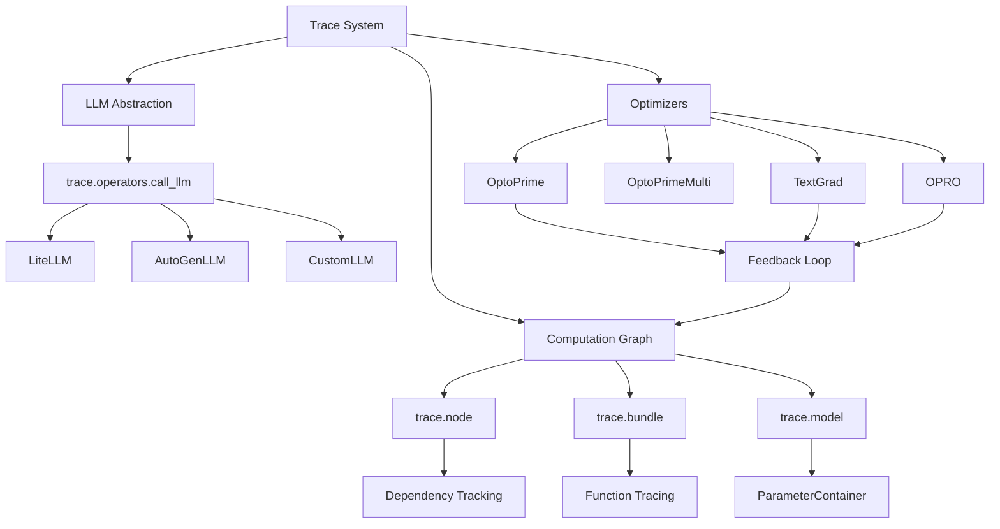
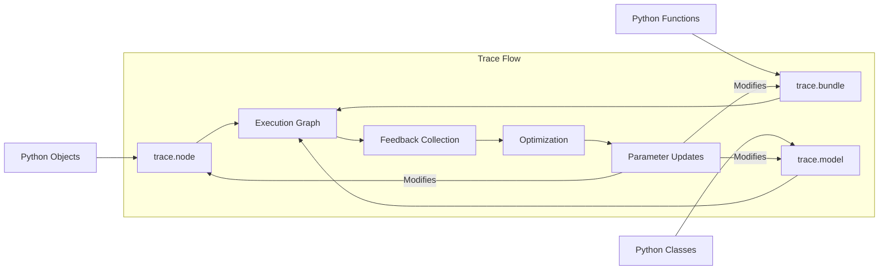
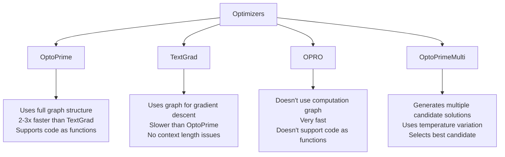
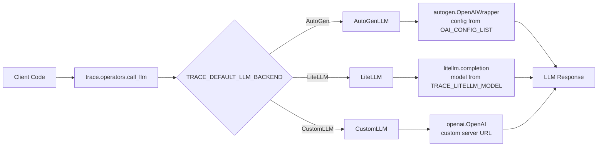
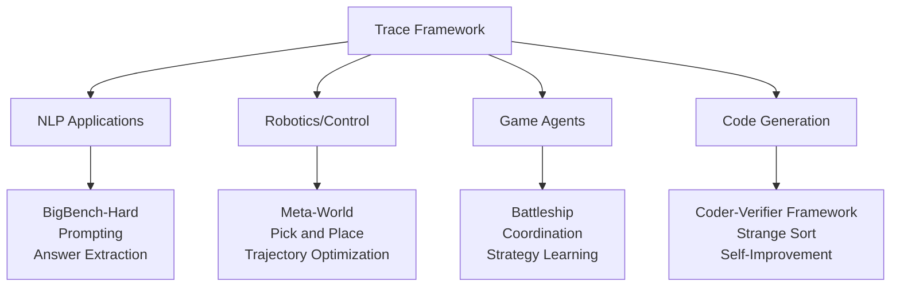

<!-- source: DeepWiki mcp.deepwiki.com · repo microsoft/Trace · page 1 Overview · fetched 2026-10-26 -->

# Overview

<details>
<summary>Relevant source files</summary>

The following files were used as context for generating this wiki page:

- [README.md](README.md)
- [docs/images/backprop.png](docs/images/backprop.png)
- [docs/images/compare_to_textgrad3.png](docs/images/compare_to_textgrad3.png)
- [docs/images/forward_backward.png](docs/images/forward_backward.png)
- [docs/images/platform.png](docs/images/platform.png)
- [docs/images/platform2.png](docs/images/platform2.png)

</details>


Trace is an innovative framework that extends traditional AutoDiff tools (like PyTorch) by enabling end-to-end optimization of AI systems using general feedback mechanisms. Unlike standard deep learning frameworks that rely solely on differentiable loss functions, Trace can optimize systems using natural language feedback, numerical rewards, compiler errors, and other diverse signals.

This page provides a high-level introduction to Trace, its key components, and how they work together. For more detailed information on specific components like the Node System or Optimizers, please refer to their dedicated wiki pages.

## Core Architecture

Trace consists of three main components that work together to enable AI systems that can learn from general feedback:

Title: Core Architecture of Trace



Sources: [README.md:12-16](), [README.md:56-58](), [README.md:231-254]()

The architecture consists of:

1. **Computation Graph**: The foundation for tracing execution and dependencies through nodes, bundles, and models
2. **Optimizers**: Algorithms that use feedback to improve code and parameters
3. **LLM Abstraction**: A unified interface for working with different LLM backends

Each component plays a critical role in enabling the optimization of AI systems with diverse feedback signals.

## Key Primitives

Trace provides three fundamental primitives that allow users to define traceable and optimizable components:

### Node

A `node` is the basic unit in the computation graph. It represents a value or object whose operations are automatically traced to create dependencies.

```python
from opto.trace import node

x = node(1, trainable=True)  # Declare a trainable node
y = node(3)                  # Declare a non-trainable node
z = x / y                    # Operation is traced automatically
```

### Bundle

A `bundle` is a decorator that wraps Python functions, making them traceable and optimizable while maintaining their original behavior.

```python
from opto.trace import bundle

@bundle(trainable=True)
def strange_sort_list(lst):
    '''Strange sorting starts with minimum value, then maximum, then minimum again...'''
    lst = sorted(lst)
    return lst
```

### Model

A `model` decorator transforms classes into parameter containers, similar to PyTorch modules, with methods for parameter management.

```python
from opto.trace import model

@model
class Agent:
    def __init__(self, system_prompt):
        self.system_prompt = system_prompt
        self.instruct1 = node("Decide the language", trainable=True)
```

Sources: [README.md:59-76](), [README.md:88-104](), [README.md:148-176]()

## Optimization Flow

The Trace framework enables a cyclical optimization process where feedback drives improvements:

Title: Trace Data Flow



The process works as follows:

1. **Trace Creation**: Python objects, functions, and classes are transformed into nodes, bundles, and models
2. **Execution Graph**: These elements form a computation graph capturing dependencies
3. **Feedback Loop**: Execution results are evaluated with feedback
4. **Optimization**: Optimizers use feedback to update parameters and code
5. **Continuous Improvement**: The cycle repeats, improving performance over time

Sources: [README.md:105-139]()

## Supported Optimizers

Trace includes multiple optimizers, each with specific strengths:

Title: Optimizer Comparison



### Optimizer Comparison Table

| Optimizer | Uses Computation Graph | Supports Code as Functions | Speed | Large Graph Support |
|-----------|------------------------|----------------------------|-------|-------------------|
| OptoPrime | ✅ | ✅ | Fast | May have context length issues |
| TextGrad | ✅ | ❌ | Slower (2-3x) | Better with large graphs |
| OPRO | ❌ | ❌ | Very Fast | ✅ |
| OptoPrimeMulti | ✅ | ✅ | Fast | Similar to OptoPrime |

To use an optimizer:

```python
from opto.optimizers import OptoPrime

optimizer = OptoPrime(agent.parameters())
optimizer.zero_feedback()
optimizer.backward(result, feedback)
optimizer.step()
```

Sources: [README.md:231-264](), [README.md:123-139]()

## LLM Integration

Trace seamlessly integrates with different LLM backends through a unified interface:

Title: LLM Backend Integration



### Configuration Options

1. **LiteLLM Configuration** (Default since v0.1.3.5):
   ```python
   import os
   os.environ["OPENAI_API_KEY"] = "<your OpenAI API key here>"
   os.environ["TRACE_LITELLM_MODEL"] = "gpt-4o"
   ```

2. **AutoGen Configuration**:
   ```python
   # Install with: pip install trace-opt[autogen]
   os.environ["OAI_CONFIG_LIST"] = "/path/to/config/file"
   os.environ["TRACE_DEFAULT_LLM_BACKEND"] = "AutoGen"
   ```

Sources: [README.md:278-332]()

## Applications and Use Cases

Trace has been successfully applied to diverse domains:

Title: Application Integration Examples



### Example: Adaptive Sales Agent

```python
@trace.model
class Agent:
    def __init__(self, system_prompt):
        self.system_prompt = system_prompt
        self.instruct1 = trace.node("Decide the language", trainable=True)
        self.instruct2 = trace.node("Extract name if it's there", trainable=True)

    def __call__(self, user_query):
        response = trace.operators.call_llm(self.system_prompt,
                                            self.instruct1, user_query)
        en_or_es = self.decide_lang(response)
        user_name = trace.operators.call_llm(self.system_prompt,
                                             self.instruct2, user_query)
        greeting = self.greet(en_or_es, user_name)
        return greeting

    @trace.bundle(trainable=True)
    def decide_lang(self, response):
        """Map the language into a variable"""
        return

    @trace.bundle(trainable=True)
    def greet(self, lang, user_name):
        """Produce a greeting based on the language"""
        greeting = "Hola"
        return f"{greeting}, {user_name}!"
```

This agent can learn to improve its language detection and greeting based on feedback from interactions.

Sources: [README.md:148-176](), [README.md:221-229]()

## Installation and Setup

To get started with Trace:

```bash
pip install trace-opt  # Basic installation
pip install trace-opt[autogen]  # With AutoGen support
```

Trace requires Python >= 3.9 and optionally needs API keys for the LLM backends you intend to use.

Sources: [README.md:24-37]()

## Summary of Key Features

Trace provides a flexible framework for creating self-adapting AI agents using general feedback mechanisms:

1. **Computational Graph Tracing**: Automatically captures execution flow and dependencies
2. **Multiple Optimizers**: Different optimization strategies for various use cases
3. **LLM Abstraction**: Unified interface for working with different LLM backends
4. **Parameter Management**: Hierarchical organization of trainable parameters
5. **Error Handling**: Detailed error reporting for debugging and optimization
6. **Flexibility**: Can be applied to diverse domains from NLP to robotics

The system's design enables end-to-end optimization of AI systems using general feedback, going beyond traditional supervised learning approaches. The compositional nature allows for building complex, adaptive systems that can learn from environment feedback.

Sources: [README.md:5-18](), [README.md:221-264]()

---

