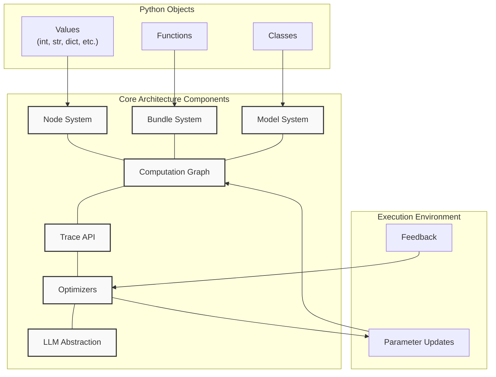
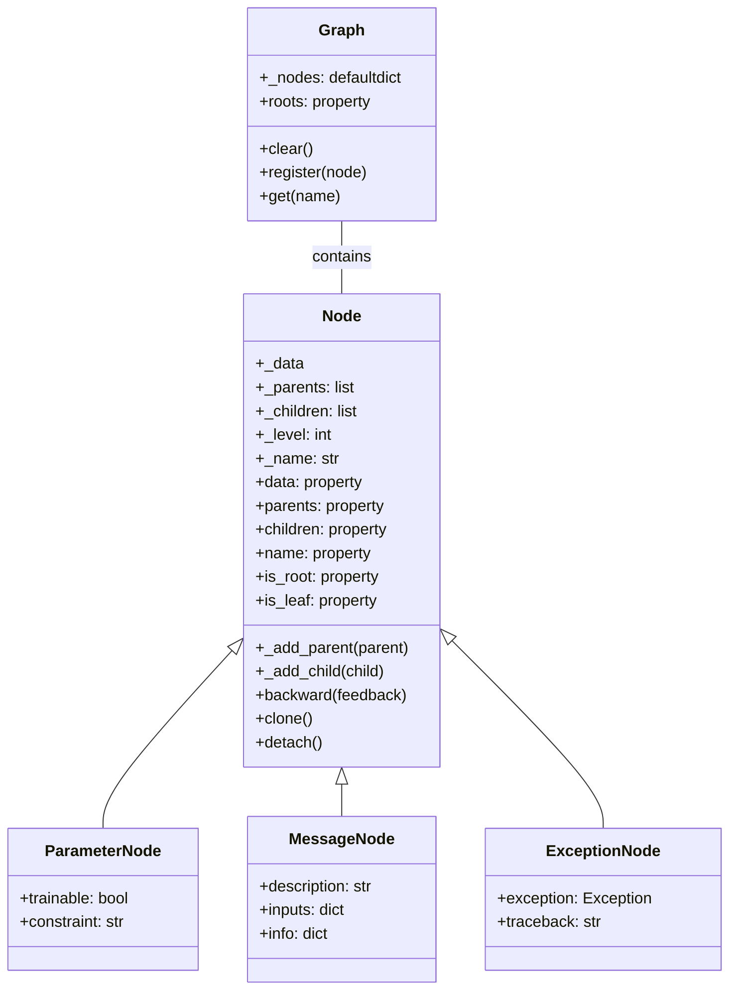
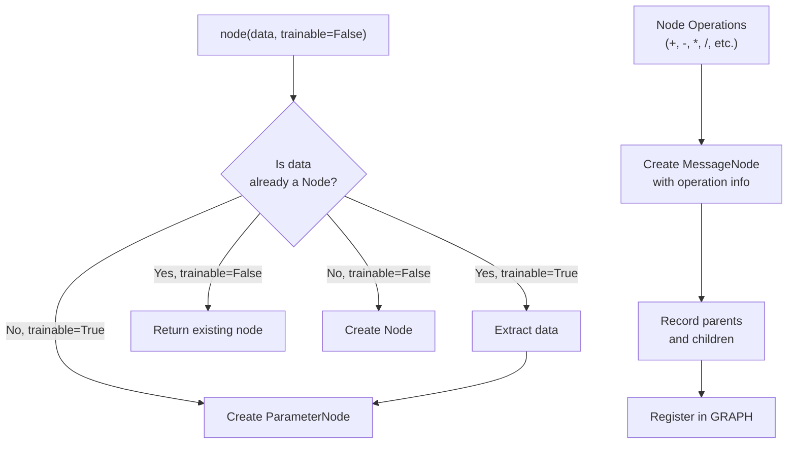
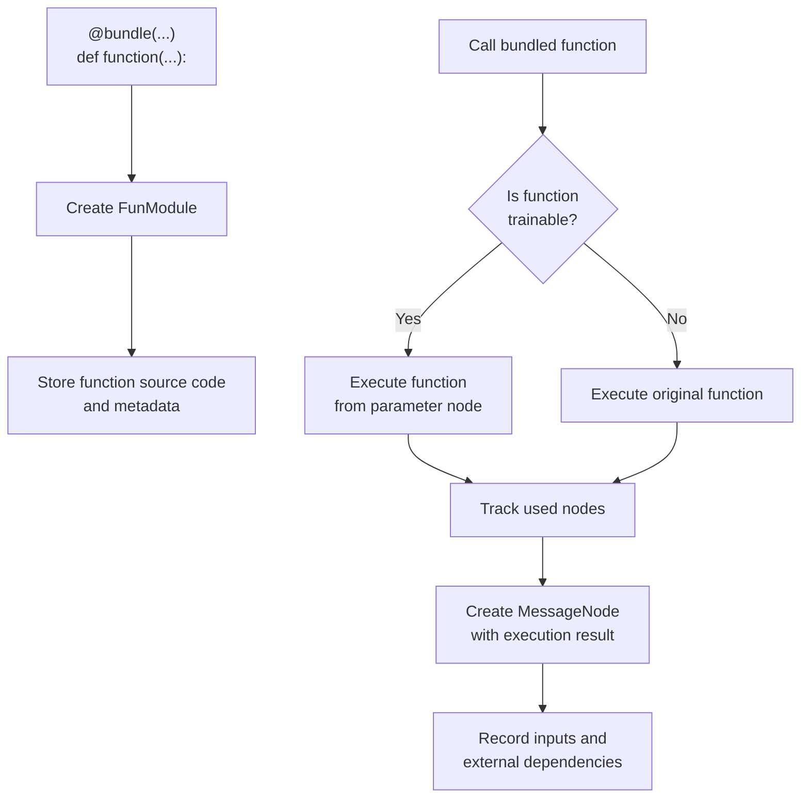
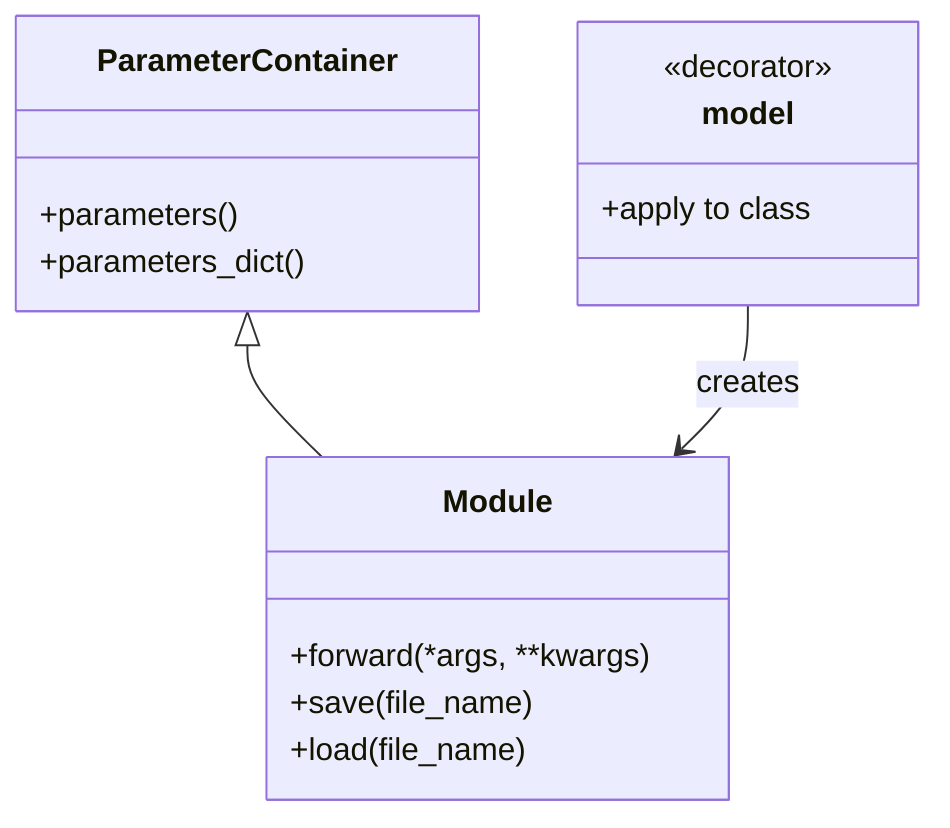
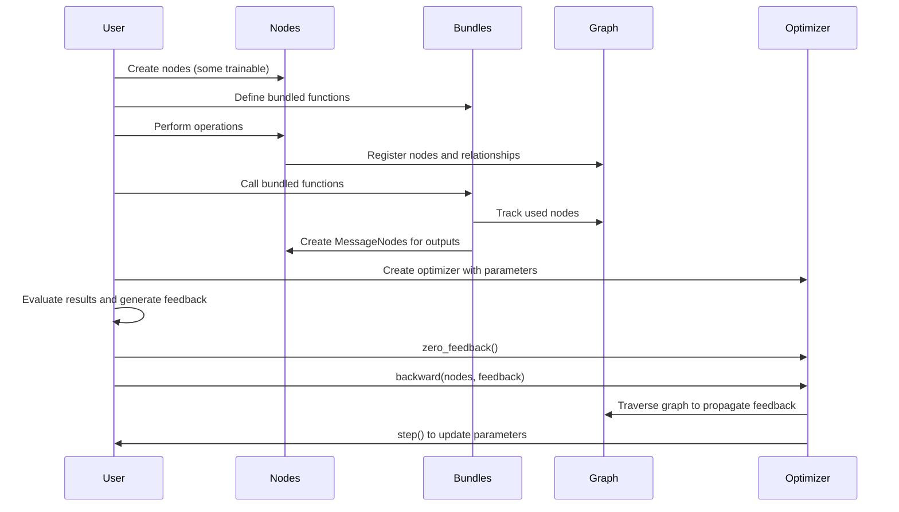
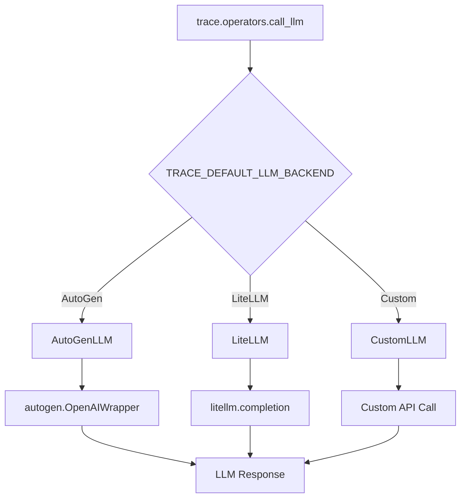
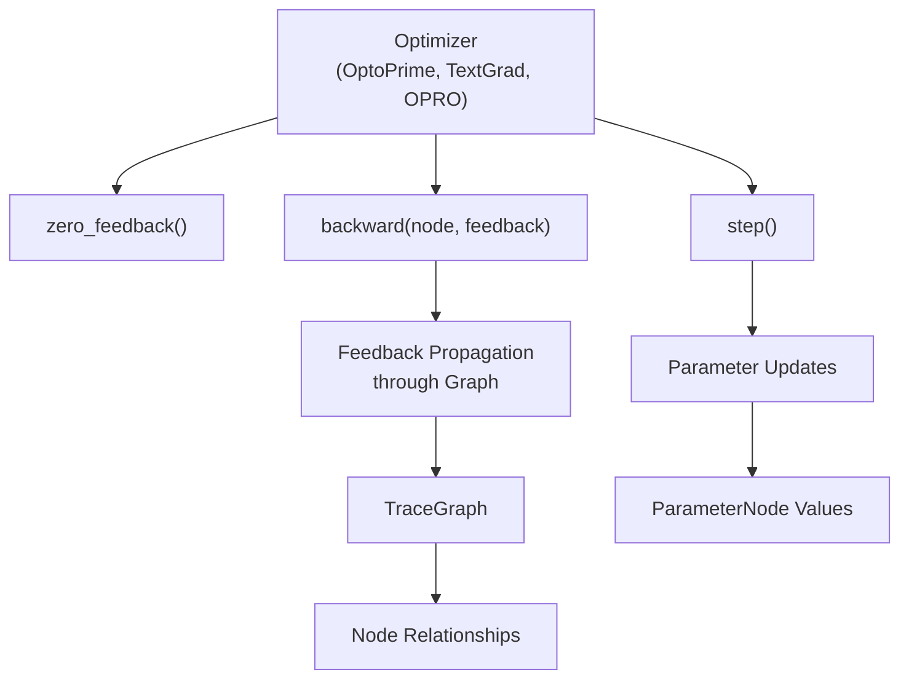
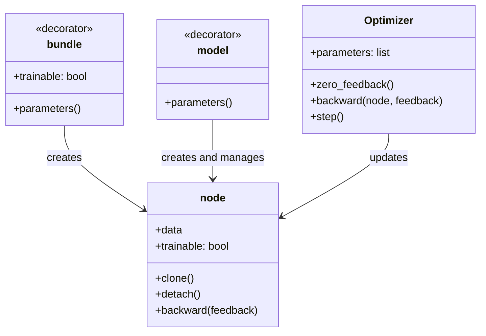

<!-- source: DeepWiki mcp.deepwiki.com · repo microsoft/Trace · page 2 Core Architecture · fetched 2026-10-26 -->

# Core Architecture

<details>
<summary>Relevant source files</summary>

The following files were used as context for generating this wiki page:

- [README.md](README.md)
- [docs/_toc.yml](docs/_toc.yml)
- [docs/images/backprop.png](docs/images/backprop.png)
- [docs/images/compare_to_textgrad3.png](docs/images/compare_to_textgrad3.png)
- [docs/images/forward_backward.png](docs/images/forward_backward.png)
- [docs/images/platform.png](docs/images/platform.png)
- [docs/images/platform2.png](docs/images/platform2.png)
- [docs/intro.md](docs/intro.md)
- [docs/quickstart/installation.md](docs/quickstart/installation.md)
- [docs/quickstart/virtualhome.md](docs/quickstart/virtualhome.md)
- [opto/trace/bundle.py](opto/trace/bundle.py)
- [opto/trace/nodes.py](opto/trace/nodes.py)
- [opto/trace/operators.py](opto/trace/operators.py)
- [tests/unit_tests/test_asyncio.py](tests/unit_tests/test_asyncio.py)
- [tests/unit_tests/test_nodes.py](tests/unit_tests/test_nodes.py)

</details>


This document provides a comprehensive overview of the Trace system's core architecture, explaining its primary components and how they interact. It describes the fundamental building blocks that enable end-to-end generative optimization for AI agents through the capture and optimization of execution traces.

For details about specific subsystems, see the [Node System](#2.1), [Bundle System](#2.2), and [Model and Parameter Management](#2.3). For information about the optimization framework, see [Optimizers](#3).

## System Overview

Trace is designed as a minimal, pure Python implementation that allows users to trace and optimize arbitrary computation through a graph-based representation. It provides an autodiff-like mechanism that extends beyond numerical calculations to encompass general computation, including code execution and LLM interactions.



*Diagram: High-level overview of Trace architecture and component relationships*

Sources: [README.md:13-17](), [opto/trace/nodes.py:10-52](), [opto/trace/bundle.py:28-70]()

The core architecture consists of three primary components:

1. **Node System**: Represents values and their relationships in a computation graph
2. **Bundle System**: Wraps functions to track their execution and dependencies
3. **Model System**: Manages hierarchical parameters and module structures

These components work together to construct a comprehensive computation graph that captures the execution trace of a program, which optimizers can then use to improve the system based on feedback.

## Computation Graph

The computation graph is the central data structure that captures the execution flow and dependencies in a Trace program. It is implemented as a Directed Acyclic Graph (DAG) where nodes represent values and edges represent data dependencies.



*Diagram: Core data structures in the computation graph*

Sources: [opto/trace/nodes.py:58-154](), [opto/trace/nodes.py:174-492]()

The Graph class serves as a global registry for all nodes, maintaining their relationships and enabling traversal for optimization. The three specialized node types serve distinct purposes:

- **ParameterNode**: Represents trainable parameters that can be modified by optimizers
- **MessageNode**: Captures function outputs and their dependencies
- **ExceptionNode**: Represents exceptions that occur during execution

## Node System

The Node system is the foundation of Trace, providing a way to wrap Python values in traceable objects. It allows the system to record operations and dependencies between values.



*Diagram: Node creation and operation flow*

Sources: [opto/trace/nodes.py:10-52](), [opto/trace/operators.py:11-600]()

The `node()` function is the primary entry point for creating nodes:

```python
node(data, name=None, trainable=False, description=None, constraint=None)
```

When operations are performed on nodes, they:
1. Automatically create new nodes to represent the result
2. Record parent-child relationships
3. Register the new nodes in the global graph

## Bundle System

The Bundle system wraps Python functions to make them traceable, allowing Trace to capture function execution and dependencies.



*Diagram: Bundle function creation and execution flow*

Sources: [opto/trace/bundle.py:28-70](), [opto/trace/bundle.py:85-762]()

The `bundle()` decorator transforms functions into `FunModule` objects that:
1. Capture the function's source code and metadata
2. Track which nodes are used during execution
3. Create message nodes to represent function outputs
4. Record dependencies between inputs and outputs

If a function is marked as trainable, its code becomes a parameter that optimizers can modify.

## Model and Parameter Management

The Model system provides a way to organize parameters hierarchically and manage complex parameter structures.



*Diagram: Model and parameter management classes*

Sources: [opto/trace/bundle.py:85-95]()

The Model system enables:
1. Organization of parameters in a hierarchical structure
2. Easy access to all parameters for optimization
3. Serialization and deserialization of models
4. Object-oriented parameter management

## Execution Flow

Trace's execution flow involves building a computation graph during forward execution and then using that graph for optimization during backward propagation.



*Diagram: Execution flow from node creation to optimization*

Sources: [README.md:78-139](), [opto/trace/bundle.py:523-559]()

The process follows these general steps:
1. **Declaration**: Users create nodes and bundle functions to define the computational structure
2. **Forward Execution**: The system records the execution trace as operations are performed
3. **Feedback Collection**: External evaluation provides feedback on the execution result
4. **Optimization**: Optimizers use the feedback to improve parameters

## Integration with LLMs

Trace provides built-in integration with Language Models through a standardized abstraction layer.



*Diagram: LLM integration architecture*

Sources: [README.md:277-332](), [opto/trace/operators.py:592-600]()

The LLM integration:
1. Provides a unified interface through `call_llm`
2. Supports multiple backends (LiteLLM, AutoGen, custom)
3. Handles configuration through environment variables
4. Abstracts away the details of different LLM APIs

## Optimization Framework

Trace's optimization framework uses the computation graph to propagate feedback and improve parameters. It connects to the core architecture through the optimizers that traverse the graph.



*Diagram: Optimization framework relationship to core architecture*

Sources: [README.md:231-264]()

The optimization framework:
1. Uses the computation graph to propagate feedback
2. Updates trainable parameters based on feedback
3. Supports different optimization strategies through pluggable optimizers
4. Provides a PyTorch-like API for familiar usage

## API Design

Trace's API design is influenced by PyTorch's Autograd, providing a familiar interface for machine learning practitioners.



*Diagram: API design and relationships between key concepts*

Sources: [README.md:54-77](), [README.md:148-179]()

Trace provides a minimal and intuitive API:
1. `node()` creates traceable variables
2. `@bundle` decorates functions to make them traceable
3. `@model` decorates classes to organize parameters
4. Optimizers provide a familiar `zero_feedback()`, `backward()`, `step()` pattern

## Summary

The core architecture of Trace consists of interrelated systems for tracing computation, constructing execution graphs, and optimizing parameters based on feedback. The Node system provides the foundational value representation, the Bundle system captures function execution, and the Model system organizes parameters hierarchically. These components work together to enable end-to-end optimization of AI systems using general feedback mechanisms.

The architecture is designed to be minimal and intuitive, with an API inspired by PyTorch's Autograd, making it accessible to machine learning practitioners while extending beyond traditional numerical differentiation to encompass general computation, including code execution and LLM interactions.

---

