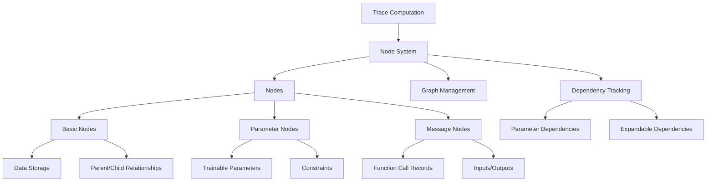
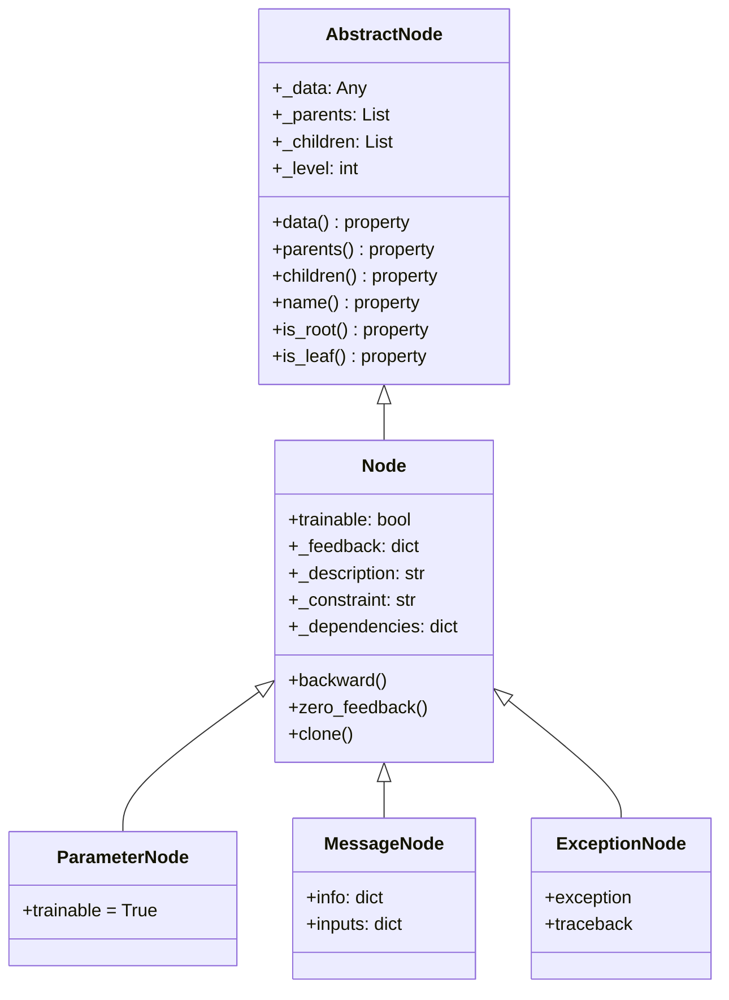
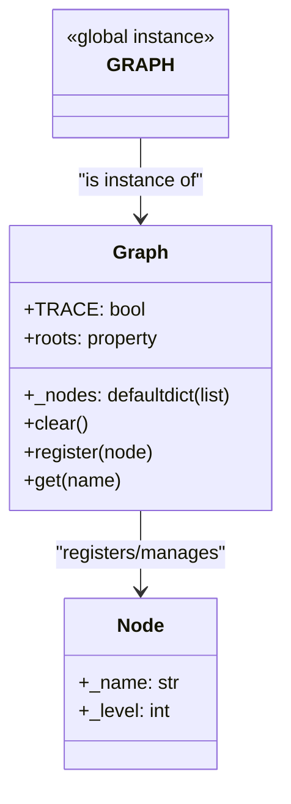
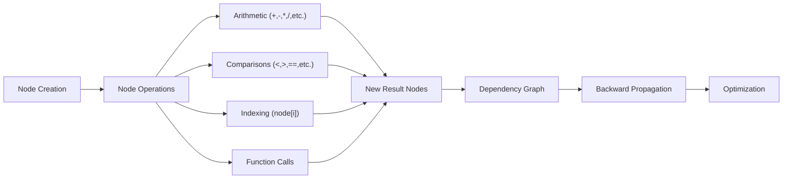
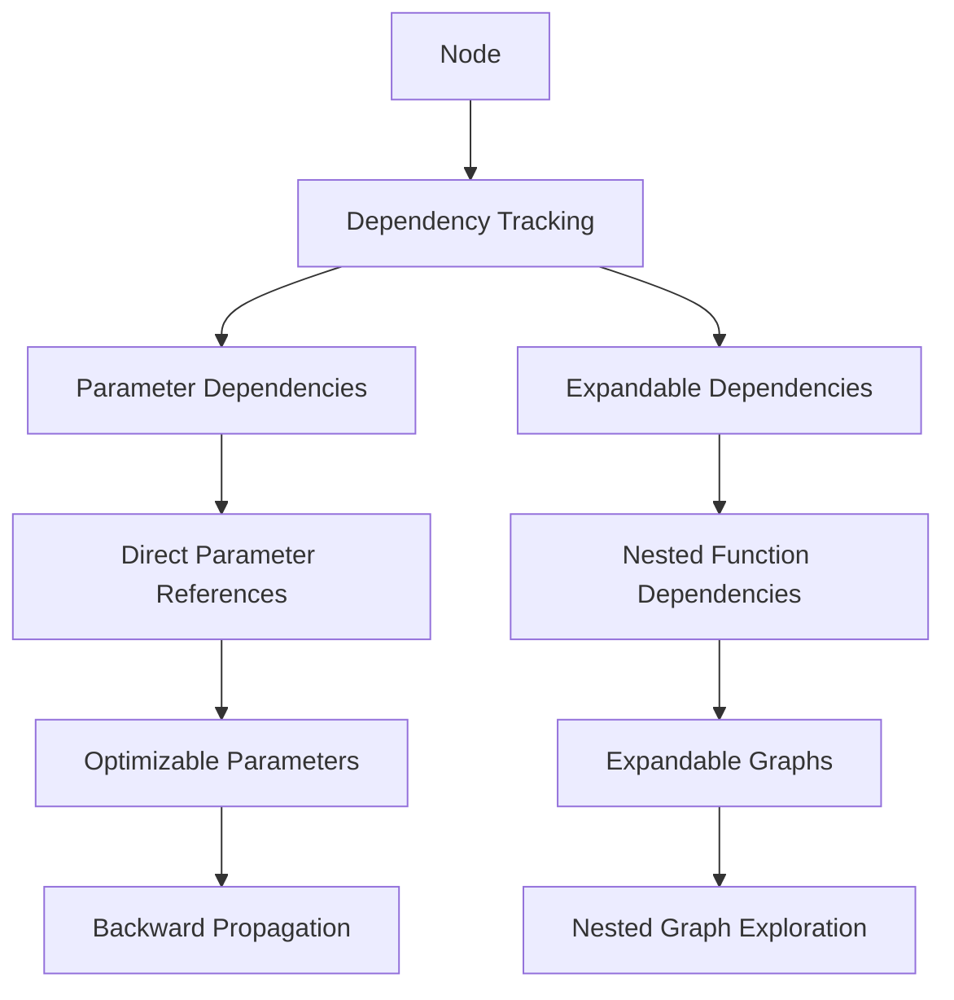
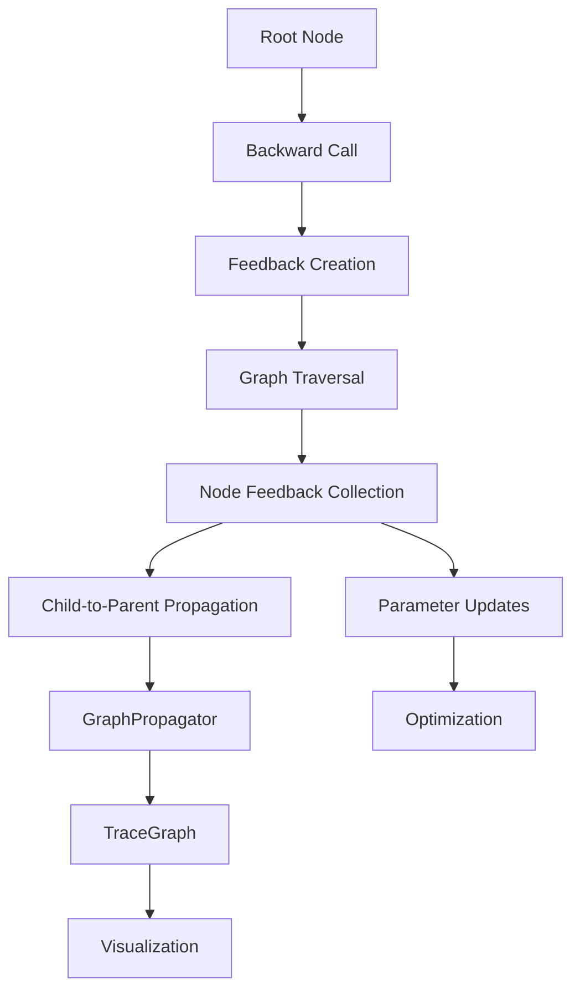
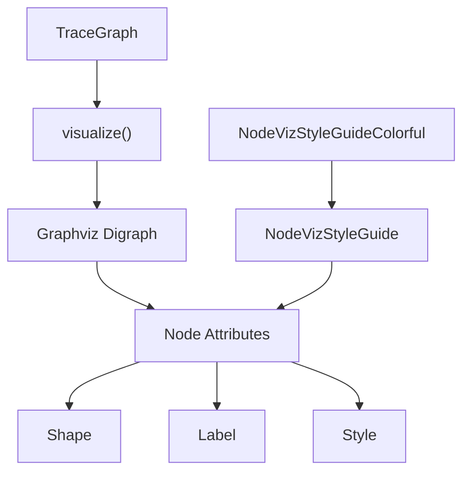
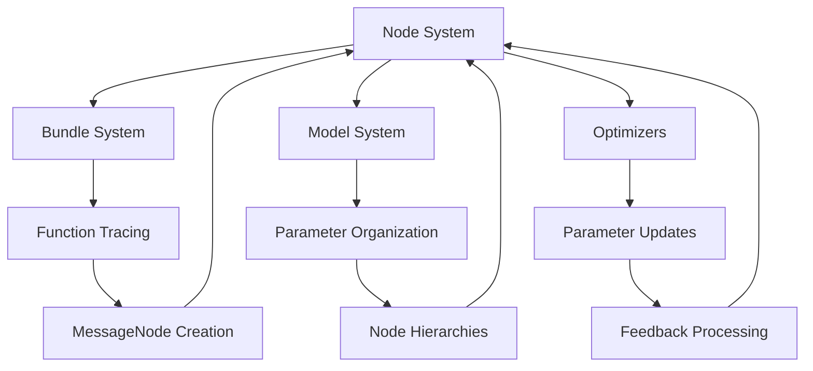

<!-- source: DeepWiki mcp.deepwiki.com · repo microsoft/Trace · page 2.1 Node System · fetched 2026-10-26 -->

# Node System

<details>
<summary>Relevant source files</summary>

The following files were used as context for generating this wiki page:

- [opto/trace/nodes.py](opto/trace/nodes.py)
- [opto/trace/operators.py](opto/trace/operators.py)
- [opto/trace/propagators/graph_propagator.py](opto/trace/propagators/graph_propagator.py)
- [tests/unit_tests/test_dependencies.py](tests/unit_tests/test_dependencies.py)
- [tests/unit_tests/test_nodes.py](tests/unit_tests/test_nodes.py)

</details>


The Node System is the foundational layer of the Microsoft Trace framework that implements a computational graph structure through connected node objects. It provides the building blocks for creating, tracking, and manipulating data dependencies within computation flows, enabling tracing of operations and propagation of feedback across the graph.

For information about how these nodes are used within functions, see [Bundle System](#2.2). For how nodes are organized into models, see [Model and Parameter Management](#2.3).

## Introduction to the Node System

The Node System implements a directed acyclic graph (DAG) structure where each node represents a piece of data and its relationship to other data within a computation. This graph structure enables several key capabilities:

1. **Dependency Tracking**: Automatically tracks which nodes depend on which parameters
2. **Computation Tracing**: Records the lineage of operations applied to data
3. **Feedback Propagation**: Allows optimization signals to flow backward through the graph
4. **Constraint Management**: Nodes can have constraints that describe valid values



Sources: [opto/trace/nodes.py:1-754]()

## Core Components of the Node System

The Node System consists of several interconnected components:

### Node Class Hierarchy

The node system follows an inheritance hierarchy that enables specialized behavior while maintaining common functionality.



Sources: [opto/trace/nodes.py:174-753](), [opto/trace/nodes.py:753-2225]()

### Graph Management

The `Graph` class serves as a global registry of all nodes, forming the backbone of the node system.



Sources: [opto/trace/nodes.py:58-165]()

## Node Creation and Usage

Nodes are typically created using the `node()` function, which creates appropriate node objects based on the provided parameters.

The basic pattern for node creation is:

```python
from opto.trace import node

# Create basic nodes
x = node("Hello")
y = node(42)

# Create trainable parameter nodes
p = node(0.5, trainable=True)

# Create nodes with descriptions and constraints
c = node([1, 2, 3], 
         description="A list of numbers", 
         constraint="All elements must be positive integers")
```

The `node()` function intelligently handles different input types:

| Input Type | Trainable | Result |
|------------|-----------|--------|
| Regular data | False | Regular Node |
| Regular data | True | ParameterNode |
| Existing Node | False | Returns original Node |
| Existing Node | True | New ParameterNode with same data |

Sources: [opto/trace/nodes.py:10-52](), [tests/unit_tests/test_nodes.py:1-162]()

### Working with Nodes

Nodes support various operations through direct usage of Python operators or the bundled operators in the `operators.py` file.



Sources: [opto/trace/operators.py:1-600](), [tests/unit_tests/test_nodes.py:1-162]()

## Dependency Tracking

A key feature of the Node System is its ability to track dependencies between nodes, which is essential for the optimization process.

### Types of Dependencies

The Node System tracks two main types of dependencies:

1. **Parameter Dependencies**: Direct dependencies on trainable `ParameterNode` objects
2. **Expandable Dependencies**: References to nodes that depend on parameters not visible in the current graph level (typically from nested function calls)



Sources: [opto/trace/nodes.py:823-875](), [tests/unit_tests/test_dependencies.py:1-127]()

### Dependency Resolution

When operations are performed on nodes, the dependencies are automatically propagated and tracked:

```python
# Example of dependency tracking
x = node(1.0, trainable=True)
y = node(2.0)
z = x**y + (x*x*x*x) + 0.5

# z has a parameter dependency on x but not on y
assert len(z.parameter_dependencies) == 1
assert x in z.parameter_dependencies
assert y not in z.parameter_dependencies
```

For nested function calls, the dependency tracking system captures relationships across different levels of the computation graph.

Sources: [tests/unit_tests/test_dependencies.py:1-20]()

## Feedback Propagation

The Node System includes a mechanism for propagating feedback backward through the graph, analogous to gradients in traditional neural networks.



The `backward()` method on nodes initiates the feedback propagation process, which collects and processes feedback through the computation graph. This feedback drives the optimization process in the Trace framework.

Sources: [opto/trace/nodes.py:825-833](), [opto/trace/propagators/graph_propagator.py:1-154]()

## Node Types

The Node System includes several specialized node types for different purposes:

### Basic Node

A standard `Node` represents data within the computation graph and tracks relationships with other nodes.

### ParameterNode

`ParameterNode` is a specialized node type that is marked as trainable and can be optimized based on feedback. These nodes typically represent parameters that should be adjusted during optimization.

### MessageNode

`MessageNode` represents the result of a function call, storing information about the inputs, outputs, and the function that was called. This node type is central to the Bundle System that wraps functions for tracing.

### ExceptionNode

`ExceptionNode` captures exceptions that occur during computation, allowing the system to handle errors gracefully and provide useful debugging information.

Sources: [opto/trace/nodes.py:753-2225]()

## Visualization

The Node System includes utilities for visualizing the computation graph, which is valuable for debugging and understanding the relationships between nodes.



Visualization can be used to:
1. Inspect the structure of the computation graph
2. Debug dependencies between nodes
3. Understand the flow of feedback during optimization

Sources: [opto/trace/nodes.py:529-751](), [opto/trace/propagators/graph_propagator.py:88-121]()

## Example Usage of the Node System

Here is a simple example showing how the Node System is used to create a computation graph and propagate feedback:

```python
from opto.trace import node
from opto.trace import operators as ops

# Create parameter and regular nodes
x = node(1.0, trainable=True, name="input")
y = node(2.0, name="constant")

# Create a computation graph
z = ops.add(x, y)
result = ops.multiply(z, z)

# Propagate feedback through the graph
result.backward("Optimize this")

# Extract the computation graph for visualization
from opto.trace.utils import sum_feedback
trace_graph = sum_feedback([x])
visualization = trace_graph.visualize()
```

This example creates a simple computation graph that computes `(x + y)²`, and then propagates feedback from the result node back to the trainable parameter `x`.

Sources: [tests/unit_tests/test_nodes.py:1-40](), [tests/unit_tests/test_dependencies.py:38-44]()

## Integration with Other Systems

The Node System forms the foundation of the Trace framework and integrates closely with other components:

1. The **Bundle System** wraps Python functions to create `MessageNode` objects that track function calls within the computation graph.
2. The **Model System** organizes parameters into hierarchical containers for structured optimization.
3. **Optimizers** use the dependency and feedback information from the Node System to update parameters.



The Node System provides the underlying data structure and tracking mechanisms that enable these higher-level systems to function effectively.

Sources: [opto/trace/nodes.py:1-2225]()

## Summary

The Node System in Microsoft Trace is a sophisticated implementation of a computational graph that:

1. Creates and manages node objects representing data and operations
2. Tracks dependencies between nodes and parameters
3. Propagates feedback through the graph for optimization
4. Supports visualization and debugging of complex computations

This system forms the foundation upon which the rest of the Trace framework is built, enabling powerful capabilities for optimization based on general feedback.

---

