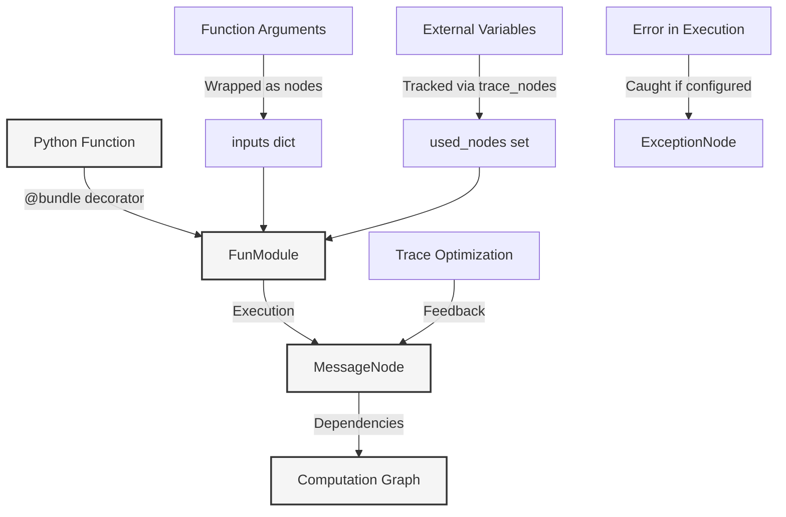
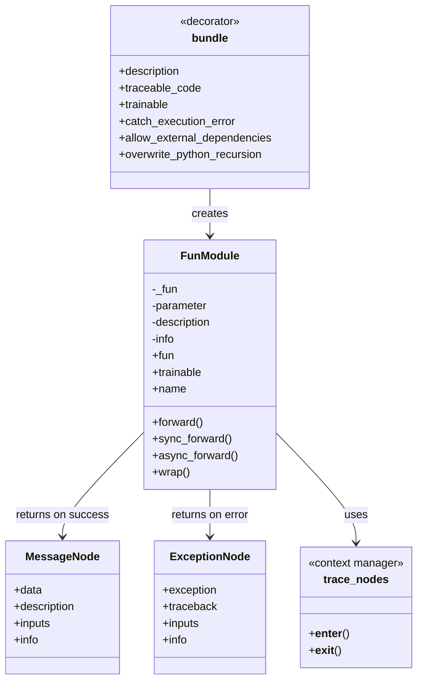
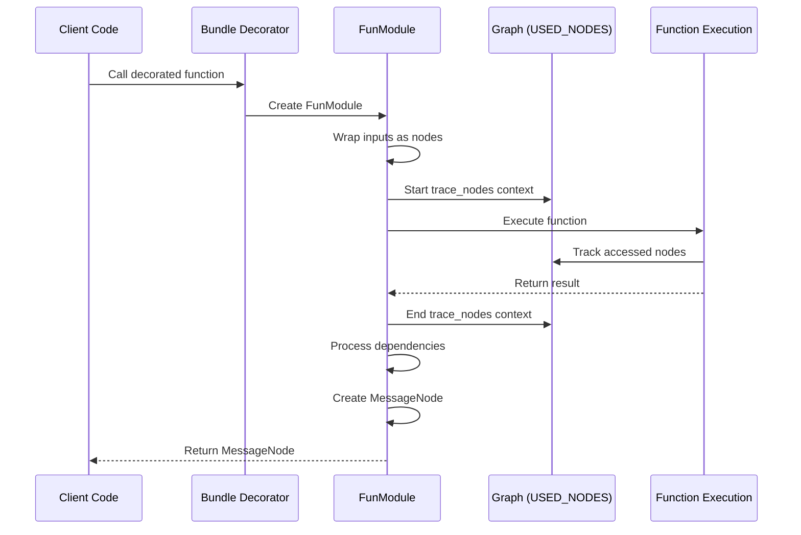
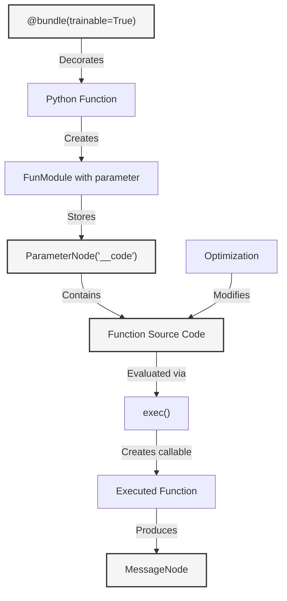
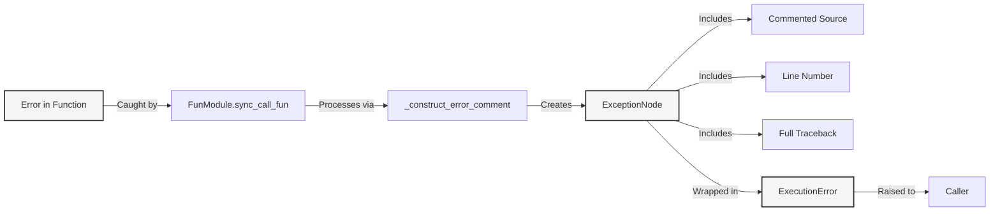
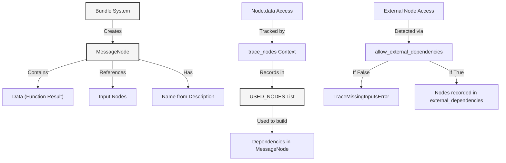

<!-- source: DeepWiki mcp.deepwiki.com · repo microsoft/Trace · page 2.2 Bundle System · fetched 2026-10-26 -->

# Bundle System

<details>
<summary>Relevant source files</summary>

The following files were used as context for generating this wiki page:

- [opto/trace/bundle.py](opto/trace/bundle.py)
- [opto/trace/iterators.py](opto/trace/iterators.py)
- [tests/unit_tests/test_asyncio.py](tests/unit_tests/test_asyncio.py)
- [tests/unit_tests/test_basic_containers.py](tests/unit_tests/test_basic_containers.py)
- [tests/unit_tests/test_bundle.py](tests/unit_tests/test_bundle.py)
- [tests/unit_tests/test_python_funcs.py](tests/unit_tests/test_python_funcs.py)

</details>


## Purpose and Scope

The Bundle System is a core component of the Microsoft Trace framework that enables function tracing and builds the computation graph. It provides the `@bundle` decorator which transforms regular Python functions into traceable operations that return node objects. This is essential for both tracking dependencies between operations and enabling optimization of code through the Trace framework.

For information about the underlying Node System that Bundle builds upon, see [Node System](#2.1). For details about parameter management within bundles, see [Model and Parameter Management](#2.3).

Sources: [opto/trace/bundle.py:27-70]()

## Overview



The Bundle System transforms Python functions into traceable components of a computation graph. When a function is decorated with `@bundle`, it becomes a `FunModule` that tracks its inputs, operations on node objects, and produces a `MessageNode` containing the result. This creates a structured computation graph that enables dependency tracking, error handling, and optimization.

Sources: [opto/trace/bundle.py:27-70](), [opto/trace/bundle.py:85-106]()

## The @bundle Decorator

The `@bundle` decorator is the primary entry point for the Bundle System, transforming regular Python functions into traceable components.

```python
@bundle(
    description="Example function",
    traceable_code=False,
    trainable=False,
    catch_execution_error=True,
    allow_external_dependencies=False,
    overwrite_python_recursion=False
)
def example_function(a, b):
    return a + b
```

### Key Parameters

| Parameter | Default | Description |
|-----------|---------|-------------|
| `description` | `None` | Text description of the operator (auto-generated from function name if not provided) |
| `traceable_code` | `False` | Whether the operator's code should be traced by Trace |
| `trainable` | `False` | Whether the code block should be treated as a variable in optimization |
| `catch_execution_error` | `True` | Whether to catch exceptions during operator execution |
| `allow_external_dependencies` | `False` | Whether to allow using nodes not provided as inputs |
| `overwrite_python_recursion` | `False` | Controls recursion behavior of the decorated function |

Sources: [opto/trace/bundle.py:28-70]()

## Bundle Internal Architecture



When a function is decorated with `@bundle`, it creates a `FunModule` instance that wraps the original function. When called, the `FunModule` tracks inputs and variable accesses through the `trace_nodes` context manager, and returns either a `MessageNode` containing the result or an `ExceptionNode` if an error occurs.

Sources: [opto/trace/bundle.py:85-621](), [opto/trace/bundle.py:73-82]()

## Bundle Execution Flow



When a bundled function is called:
1. Inputs are wrapped as nodes
2. The `trace_nodes` context manager starts tracking node access
3. The original function is executed with processed inputs
4. Any node's data that's accessed is tracked in `USED_NODES`
5. The result is wrapped in a `MessageNode` with tracked dependencies
6. The `MessageNode` is returned to the caller

Sources: [opto/trace/bundle.py:513-559]()

## Key Components

### FunModule

The `FunModule` class is the core implementation of bundled functions. It's a subclass of `Module` that handles:

1. Wrapping function inputs and outputs as nodes
2. Tracking variable dependencies during execution
3. Handling errors with detailed context
4. Supporting both synchronous and asynchronous functions
5. Managing trainable code parameters

```python
# General structure of how FunModule works
fun_module = FunModule(
    fun=original_function,
    description=description,
    trainable=trainable,
    # other parameters...
)
result = fun_module(*args, **kwargs)  # Returns a MessageNode
```

Sources: [opto/trace/bundle.py:85-621]()

### trace_nodes Context Manager

The `trace_nodes` context manager tracks which nodes have their data attribute accessed during function execution:

```python
with trace_nodes() as used_nodes:
    # Any node.data access here gets recorded in used_nodes
    result = function(*args, **kwargs)
```

This allows the Bundle System to automatically identify and track dependencies between nodes, even when they're not explicitly passed as arguments.

Sources: [opto/trace/bundle.py:73-82]()

## Trainable Bundles

One of the powerful features of the Bundle System is its ability to make function implementations trainable:



When a bundle is marked as trainable:
1. The function's source code is stored in a `ParameterNode` named `__code`
2. When called, the code in this parameter is executed via Python's `exec()`
3. Optimizers can modify the source code in this parameter
4. Errors during execution are captured with detailed context for debugging

This allows optimizers to modify the actual code inside functions, not just parameters.

Sources: [opto/trace/bundle.py:156-173](), [opto/trace/bundle.py:176-235]()

## Error Handling

The Bundle System provides detailed error handling that helps both developers and optimizers:



When an error occurs inside a bundled function:
1. The error is caught (if `catch_execution_error=True`)
2. Detailed context about the error is collected, including:
   - Commented source code indicating the error location
   - The error type and message
   - A full traceback
3. An `ExceptionNode` is created containing this information
4. The `ExceptionNode` is wrapped in an `ExecutionError` and raised

This provides rich context for both debugging and optimization.

Sources: [opto/trace/bundle.py:364-412](), [opto/trace/bundle.py:423-430]()

## Asynchronous Function Support

The Bundle System supports asynchronous functions with dedicated handling:

```python
@bundle()
async def fetch_data(url):
    response = await some_async_operation(url)
    return response

# Usage
result_node = await fetch_data(url_node)
```

The system automatically detects if a function is a coroutine function and uses either `sync_forward` or `async_forward` appropriately. This ensures proper tracing and dependency tracking for asynchronous code.

Sources: [opto/trace/bundle.py:513-559](), [tests/unit_tests/test_asyncio.py:1-100]()

## Integration with Node System

The Bundle System integrates deeply with the Node System:



Key integration points:
1. Input arguments are automatically wrapped as nodes
2. Access to node.data is tracked during function execution
3. The function result is wrapped in a MessageNode
4. Dependencies between nodes are automatically established
5. External dependencies can be allowed or restricted

Sources: [opto/trace/bundle.py:244-328](), [opto/trace/bundle.py:455-511]()

## Common Use Cases

### Basic Function Wrapping

```python
from opto.trace import bundle, node

@bundle(description="Add two numbers")
def add(x, y):
    return x + y

x = node(1)
y = node(2)
z = add(x, y)  # z is a MessageNode with x and y as parents
```

Sources: [tests/unit_tests/test_bundle.py:33-43]()

### Class Methods

```python
from opto.trace import bundle, node

class Calculator:
    @bundle(description="Multiply two numbers")
    def multiply(self, x, y):
        return x * y

calc = Calculator()
x = node(3)
y = node(4)
z = calc.multiply(x, y)  # z is a MessageNode with x, y, and self_node as parents
```

Sources: [tests/unit_tests/test_bundle.py:74-83]()

### External Dependencies

```python
from opto.trace import bundle, node

external_var = node(10)

@bundle(allow_external_dependencies=True)
def process(x, y):
    # Using a node not passed as an argument
    return x + y + external_var.data

x = node(1)
y = node(2)
z = process(x, y)  # z depends on x, y, and external_var is tracked
```

Sources: [tests/unit_tests/test_bundle.py:250-260]()

### Trainable Code

```python
from opto.trace import bundle, node

@bundle(trainable=True)
def calculate(x, y):
    """Performs a calculation on x and y."""
    return x + y  # This code can be modified by optimizers

x = node(5)
y = node(7)
z = calculate(x, y)
# The implementation of calculate can be optimized
```

Sources: [tests/unit_tests/test_bundle.py:11-15](), [tests/unit_tests/test_python_funcs.py:11-19]()

## Limitations and Best Practices

1. **External Dependencies**: By default, bundled functions cannot use nodes not passed as arguments. Use `allow_external_dependencies=True` when needed.

2. **Recursion Handling**: For recursive functions, use `overwrite_python_recursion=True` to ensure proper execution.

3. **Namespace Access**: Bundles preserve access to local, nonlocal, and global variables in the function's scope.

4. **Trainable Bundles**: Making bundles trainable implies `overwrite_python_recursion=True` and may have limitations with certain language constructs.

5. **Async Functions**: When using async functions, make sure to await the bundle's result appropriately.

Sources: [tests/unit_tests/test_bundle.py:338-349](), [tests/unit_tests/test_asyncio.py:6-25]()

## Advanced Features

### Object Method Access

The Bundle System provides special handling for accessing methods and attributes of node-wrapped objects:

```python
class Example:
    def method(self, x):
        return x + 1

example_node = node(Example())
method_node = example_node.getattr("method")  # Get method as a node
result = method_node(node(5))  # Call the method

# Or more concisely
result = example_node.call("method", node(5))
```

Sources: [tests/unit_tests/test_bundle.py:309-335]()

### Container Handling

The Bundle System works with container types by tracking both the container and its elements:

```python
# Lists
list_node = node([1, 2, 3])
for item in list_node:  # item is a node with list_node as parent
    print(item)

# Dictionaries
dict_node = node({"a": 1, "b": 2})
for key, value in dict_node.items():  # Both key and value are nodes
    print(key, value)
```

Sources: [tests/unit_tests/test_basic_containers.py:7-34](), [opto/trace/iterators.py:10-33]()

## Conclusion

The Bundle System is a fundamental component of the Trace framework that enables:
1. Automatic tracing of function execution
2. Building a computation graph with proper dependencies
3. Error handling with rich context
4. Support for optimization of code and parameters
5. Seamless integration with the rest of the Trace ecosystem

By wrapping functions with `@bundle`, developers can make their code traceable and optimizable, forming a key part of the Trace framework's ability to create self-improving AI systems.

---

