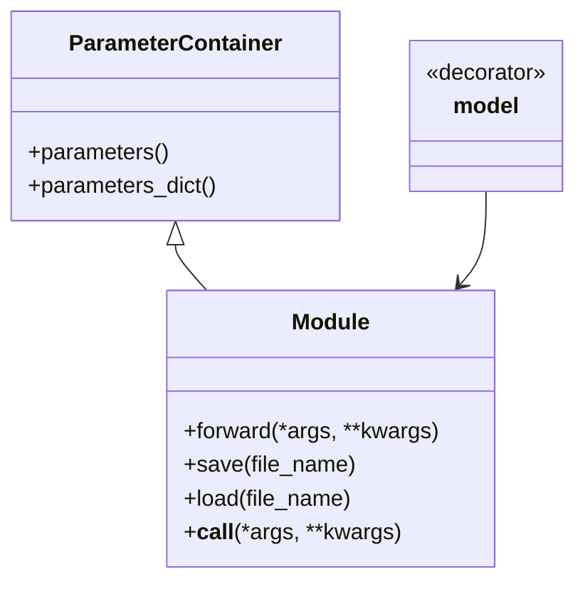
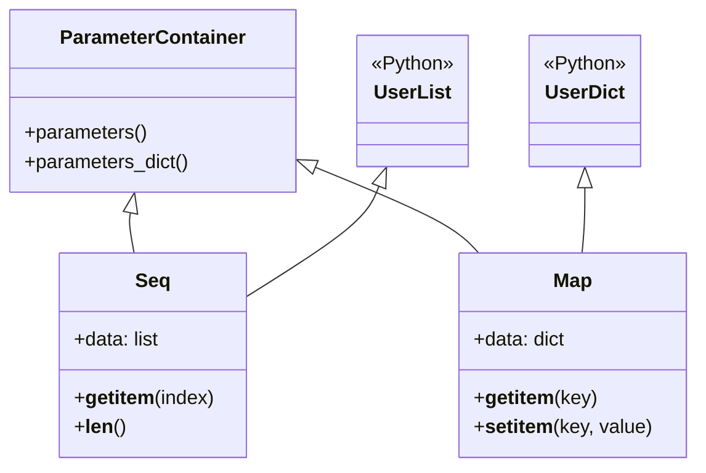
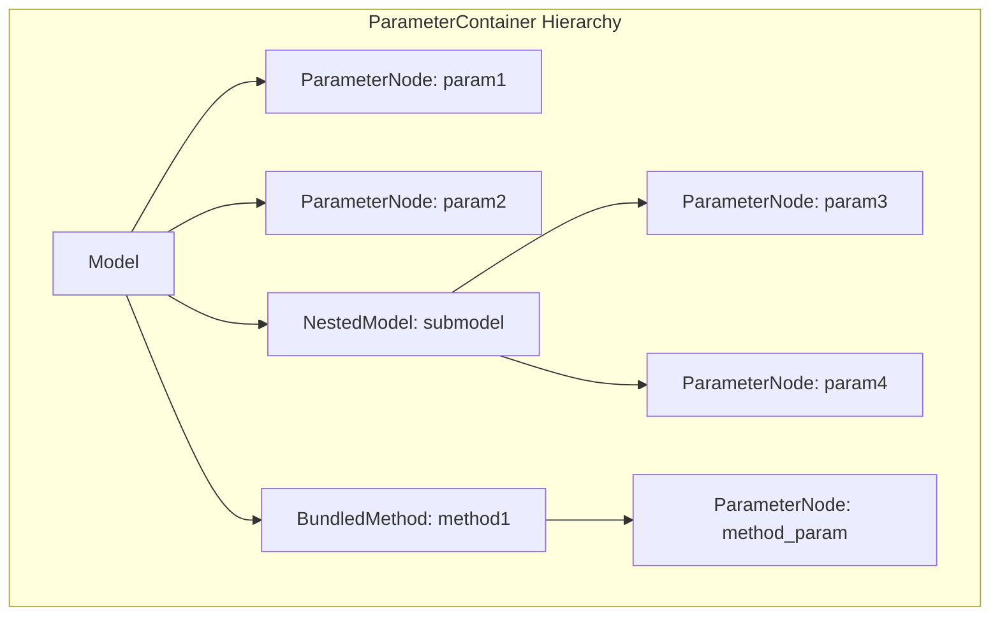
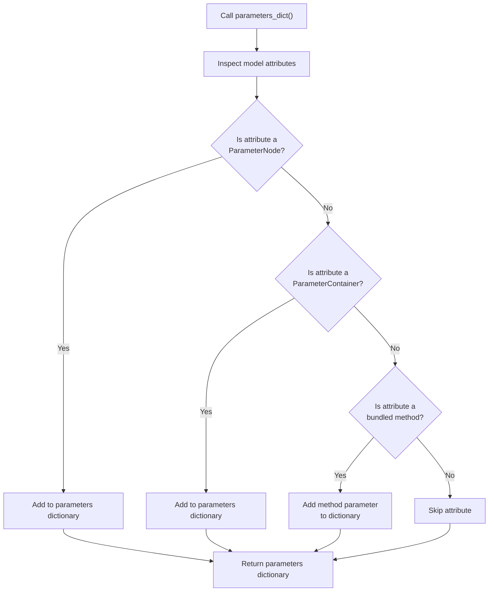
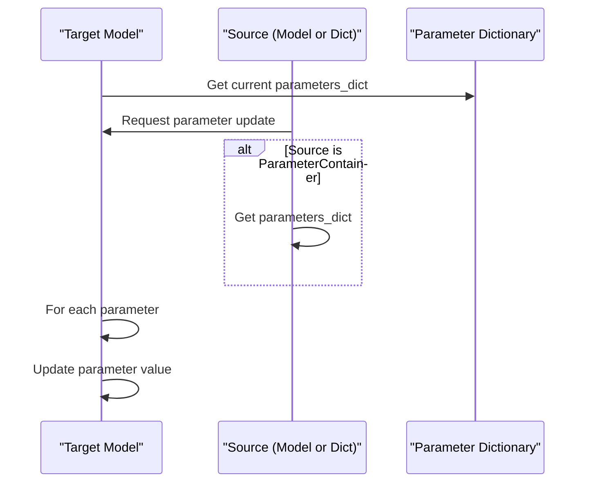
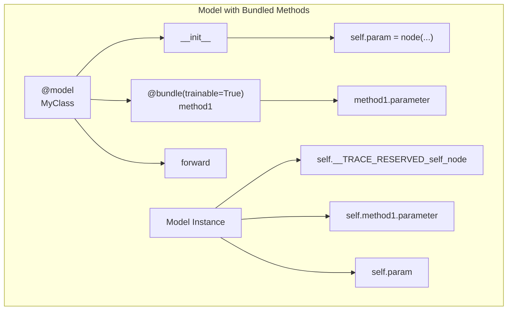

<!-- source: DeepWiki mcp.deepwiki.com · repo microsoft/Trace · page 2.3 Model and Parameter Management · fetched 2026-10-26 -->

# Model and Parameter Management

<details>
<summary>Relevant source files</summary>

The following files were used as context for generating this wiki page:

- [opto/trace/containers.py](opto/trace/containers.py)
- [opto/trace/modules.py](opto/trace/modules.py)
- [opto/version.py](opto/version.py)
- [tests/unit_tests/test_class_method.py](tests/unit_tests/test_class_method.py)
- [tests/unit_tests/test_containers.py](tests/unit_tests/test_containers.py)
- [tests/unit_tests/test_modules.py](tests/unit_tests/test_modules.py)

</details>


This document covers how models and their parameters are defined, organized, and managed within the Trace system. Models in Trace provide a structured way to organize parameters for optimization and tracing. This page focuses on the `Module` class, the `@model` decorator, and the parameter container system that forms the backbone of model management in Trace.

For information about how functions are wrapped for tracing, see [Bundle System](#2.2). For details on the optimization of models, see [Optimizers](#3).

## Core Components

The model and parameter management system consists of three main components:



- **ParameterContainer**: Base class that provides parameter collection functionality
- **Module**: Extends ParameterContainer and adds model-specific operations
- **@model**: Decorator that transforms regular classes into Module instances

Sources: [opto/trace/modules.py:19-66](), [opto/trace/containers.py:21-64](), [opto/trace/modules.py:8-16]()

## Parameter Containers

The `ParameterContainer` class serves as the foundation for parameter management, providing two key methods:

1. `parameters()`: Returns a flattened list of all parameter nodes in the container
2. `parameters_dict()`: Returns a dictionary of all parameters (including nested containers)

Trace provides specialized container types that extend `ParameterContainer`:



- **Seq**: Container for sequence data (extends Python's `UserList`)
- **Map**: Container for key-value data (extends Python's `UserDict`)

These containers automatically track and manage parameter nodes within their structure, enabling hierarchical parameter organization.

Sources: [opto/trace/containers.py:21-64](), [opto/trace/containers.py:67-100](), [opto/trace/containers.py:103-133]()

## Creating Models

There are two primary ways to create models in Trace:

### 1. Using the `@model` Decorator

```python
@trace.model
class MyModel:
    def __init__(self):
        self.param = trace.node(1, trainable=True)
    
    @trace.bundle(trainable=True)
    def forward(self, x):
        return x + self.param
```

The `@model` decorator transforms a regular class into a `Module` instance, adding parameter management capabilities.

### 2. Inheriting from `Module`

```python
class MyModel(trace.modules.Module):
    def __init__(self):
        super().__init__()
        self.param = trace.node(1, trainable=True)
    
    @trace.bundle(trainable=True)
    def forward(self, x):
        return x + self.param
```

Inheriting from `Module` provides the same functionality as using the decorator.

Sources: [opto/trace/modules.py:8-16](), [tests/unit_tests/test_modules.py:7-30](), [tests/unit_tests/test_modules.py:56-70]()

## Parameter Organization

Trace models organize parameters in a hierarchical structure, allowing for complex models with nested components:



The parameter hierarchy is automatically traversed when calling `parameters()` or `parameters_dict()`, collecting parameters from all levels.

Sources: [opto/trace/containers.py:24-36](), [opto/trace/containers.py:38-64](), [tests/unit_tests/test_modules.py:35-53](), [tests/unit_tests/test_modules.py:82-99]()

## Parameter Collection Process

The parameter collection process examines all attributes of a model to identify parameters:



The system collects:
- Direct `ParameterNode` attributes
- Nested `ParameterContainer` instances
- Parameters from bundled methods

Sources: [opto/trace/containers.py:38-64](), [tests/unit_tests/test_containers.py:38-52]()

## Parameter Operations

### Saving and Loading Models

The `Module` class provides methods to save and load model parameters:

```python
model = MyModel()
model.save("model.pkl")  # Save parameters to file

new_model = MyModel()
new_model.load("model.pkl")  # Load parameters from file
```

Behind the scenes, these methods:
1. For saving: pickle the parameter dictionary to a file
2. For loading: load the parameter dictionary and update the model

Sources: [opto/trace/modules.py:28-42](), [tests/unit_tests/test_modules.py:102-129]()

### Parameter Updates

The `_set` method allows updating model parameters from another model or parameter dictionary:



This mechanism enables parameter transfer between models while maintaining the parameter structure.

Sources: [opto/trace/modules.py:43-65]()

## Integration with Bundle System

Models work closely with the bundle system to make method parameters traceable and optimizable:



When a method is bundled with `trainable=True`:
1. The bundle creates a parameter node for the method
2. This parameter is collected by the model's parameter management system
3. The parameter can be optimized like any other parameter

Sources: [tests/unit_tests/test_class_method.py:1-149](), [tests/unit_tests/test_modules.py:132-154]()

## Advanced Usage Patterns

### Nested Models

Models can contain other models as attributes, creating a hierarchy of parameters:

```python
class ParentModel(Module):
    def __init__(self):
        super().__init__()
        self.child = ChildModel()
        self.param = node(1, trainable=True)
```

When calling `parameters()` on the parent model, parameters from the child model are automatically included.

### Model Copying

Models can be copied using Python's `copy` or `deepcopy`, which creates a new model with the same structure but independent parameters:

```python
import copy
model = MyModel()
model_copy = copy.deepcopy(model)
```

The copied model has its own parameter nodes that can be optimized independently.

Sources: [tests/unit_tests/test_class_method.py:56-99]()

## Best Practices for Model Design

1. **Initialize the base class**: Always call `super().__init__()` in your model's `__init__` method
2. **Use descriptive parameter names**: Good naming helps with debugging and optimization
3. **Implement the forward method**: Define the primary computation flow in the `forward` method
4. **Prefer composition over inheritance**: Use nested models for complex structures
5. **Set trainable flags appropriately**: Mark only parameters that should be optimized as trainable

Sources: [tests/unit_tests/test_modules.py:10-24](), [tests/unit_tests/test_modules.py:56-70]()

## Common Patterns and Examples

### Basic Model with Parameters

```python
@trace.model
class SimpleModel:
    def __init__(self):
        self.weight = trace.node(1.0, trainable=True)
        self.bias = trace.node(0.0, trainable=True)
    
    def forward(self, x):
        return x * self.weight + self.bias
```

### Model with Bundled Methods

```python
@trace.model
class ComplexModel:
    def __init__(self):
        self.param = trace.node(1.0, trainable=True)
    
    @trace.bundle(trainable=True)
    def process(self, x):
        return x * 2
    
    def forward(self, x):
        processed = self.process(x)
        return processed + self.param
```

### Hierarchical Model Structure

```python
@trace.model
class SubModule:
    def __init__(self):
        self.param = trace.node(2.0, trainable=True)
    
    def forward(self, x):
        return x * self.param

@trace.model
class MainModel:
    def __init__(self):
        self.sub = SubModule()
        self.bias = trace.node(0.5, trainable=True)
    
    def forward(self, x):
        processed = self.sub(x)
        return processed + self.bias
```

Sources: [tests/unit_tests/test_modules.py:35-53](), [tests/unit_tests/test_modules.py:82-99]()

---

