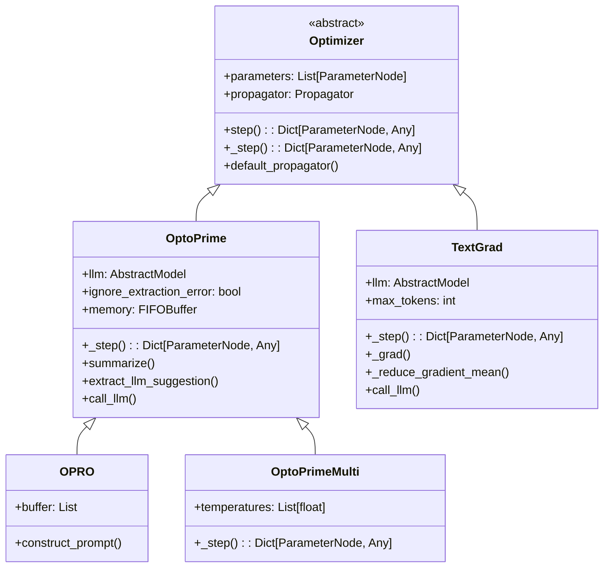
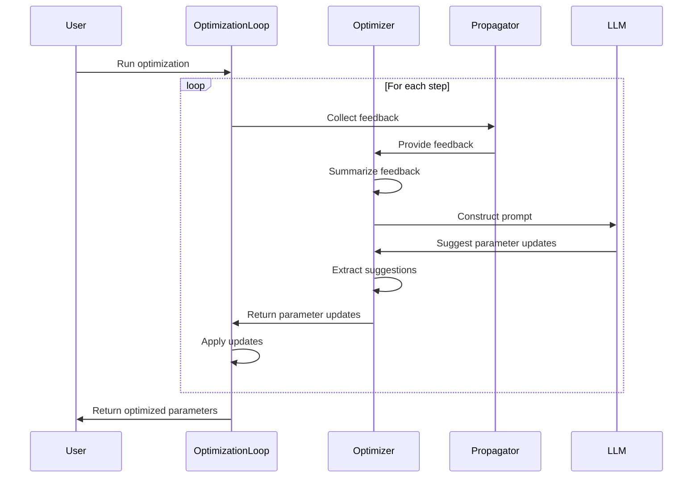
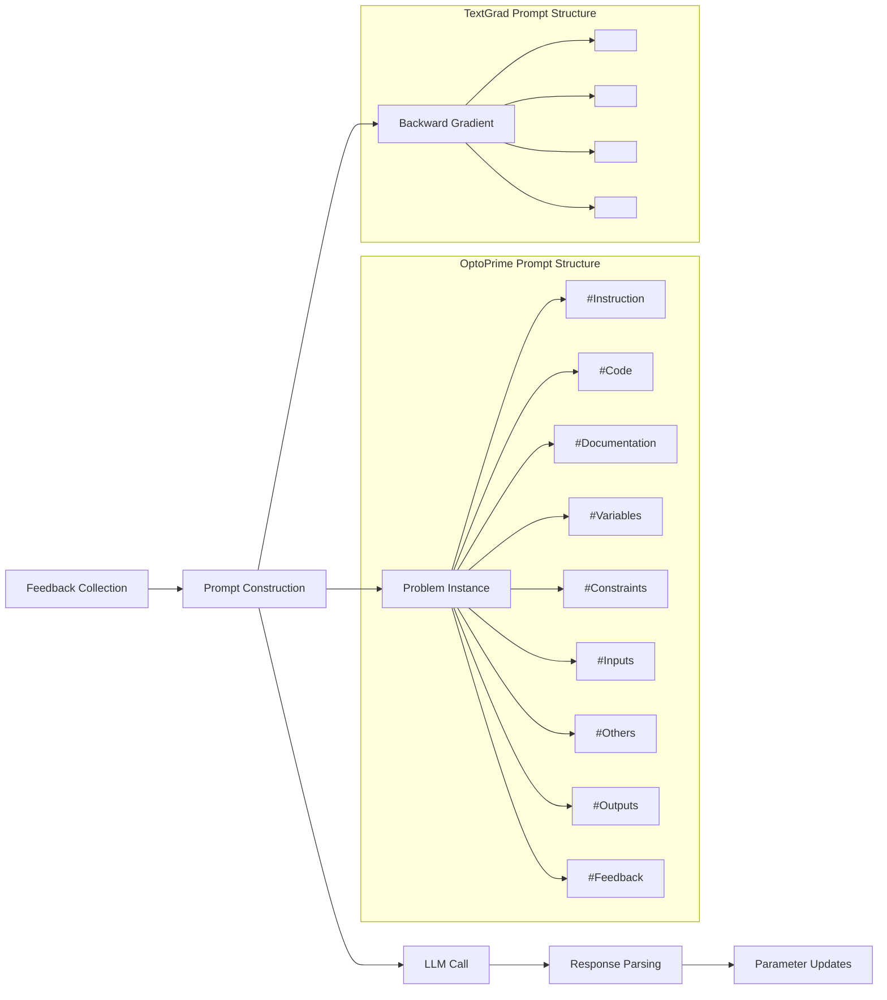
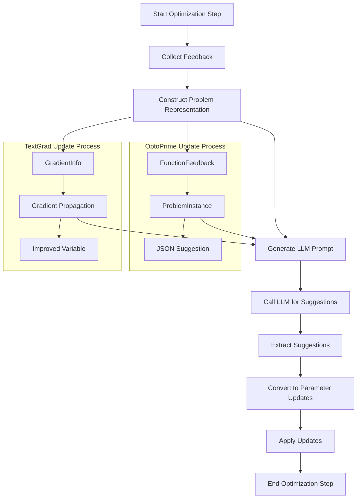
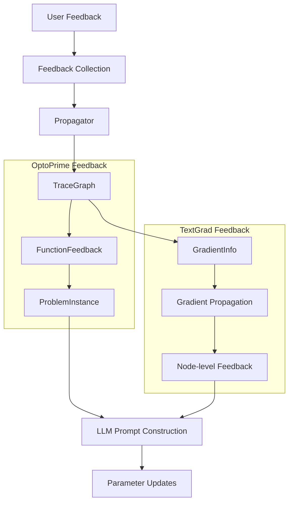
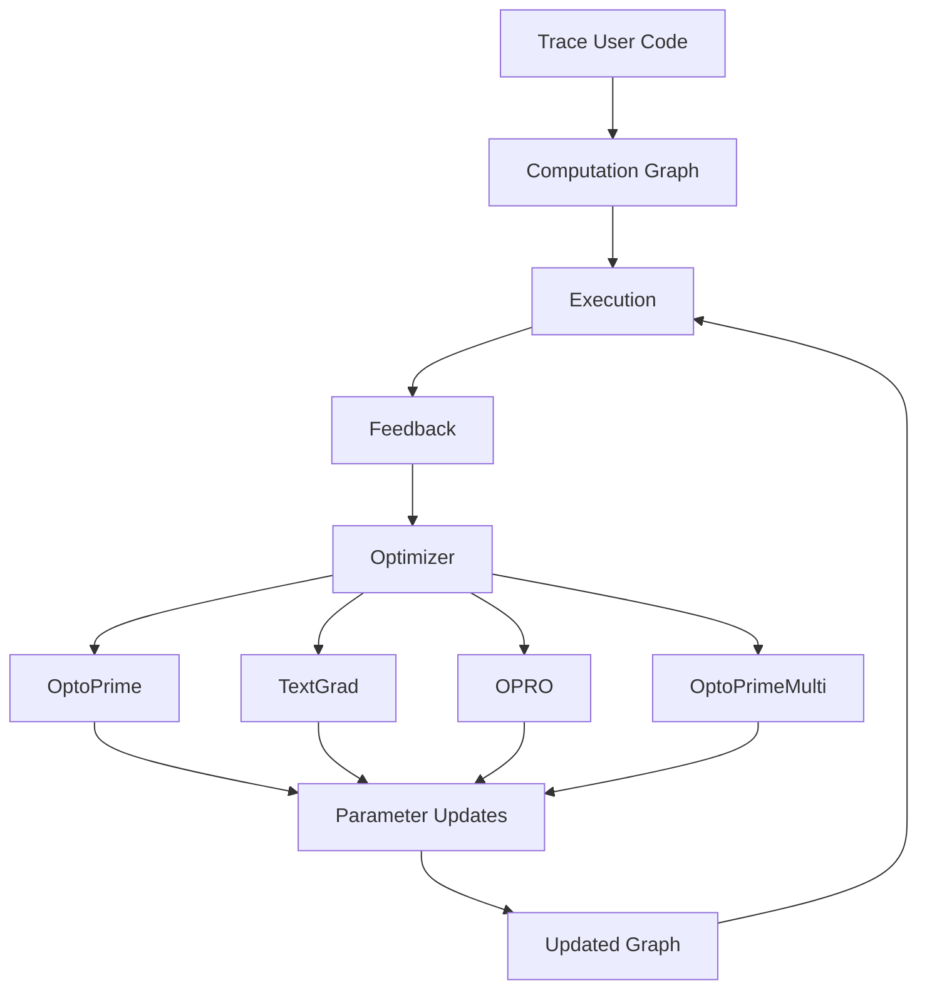

<!-- source: DeepWiki mcp.deepwiki.com · repo microsoft/Trace · page 3 Optimizers · fetched 2026-10-26 -->

# Optimizers

Relevant source files

The following files were used as context for generating this wiki page:

- [opto/optimizers/__init__.py](opto/optimizers/__init__.py)
- [opto/optimizers/opro.py](opto/optimizers/opro.py)
- [opto/optimizers/optoprime.py](opto/optimizers/optoprime.py)
- [opto/optimizers/textgrad.py](opto/optimizers/textgrad.py)

This page documents the optimization framework in the Trace system, which enables parameters to be improved based on feedback. Optimizers are a key component that works alongside the Computation Graph (see [Core Architecture](#2)) to create a system that can adapt and improve through feedback loops.

## Overview

Optimizers in Trace are responsible for updating parameters based on feedback received from model execution. They represent the learning mechanism of the system, allowing models to improve their performance over time without traditional gradient descent through manual differentiation.

The Trace system includes several optimizer implementations, each with different characteristics and use cases:

```mermaid
graph TD
    A["Optimizer<br>(Abstract Base Class)"] --> B["OptoPrime"]
    A --> C["TextGrad"]
    A --> D["OPRO"]
    B --> E["OptoPrimeMulti"]
    
    B --> |"Uses full graph structure"| F["Parameter Updates"]
    C --> |"Text-based gradient descent"| F
    D --> |"Fast, minimal structure"| F
    E --> |"Multiple candidate solutions"| F
    
    F --> G["Improved Parameters"]
    G --> |"Feedback Loop"| B
    G --> |"Feedback Loop"| C
    G --> |"Feedback Loop"| D
    G --> |"Feedback Loop"| E
```

Sources: [opto/optimizers/__init__.py:1-6]()

## Optimizer Architecture

Optimizers follow a common architectural pattern while implementing different strategies for parameter updates:

Sources: [opto/optimizers/optoprime.py:144-578](), [opto/optimizers/textgrad.py:306-523](), [opto/optimizers/opro.py:7-67]()

## Optimization Process

The optimization process in Trace involves:

1. **Propagation**: Collecting feedback from execution nodes
2. **Gradient Calculation**: Determining how parameters should be updated
3. **Parameter Updates**: Modifying parameters based on LLM suggestions

Sources: [opto/optimizers/optoprime.py:436-471](), [opto/optimizers/textgrad.py:432-497]()

## Optimizer Types

### OptoPrime

OptoPrime is the primary optimizer that leverages the full computation graph structure to improve parameters. It represents the problem as a computational graph with inputs, outputs, and feedback, and uses an LLM to suggest improvements to parameters.

**Key features:**
- Uses the full graph structure to understand parameter relationships
- 2-3x faster than TextGrad
- Supports code as functions (can optimize Python functions)
- Represents the problem in a structured format for the LLM

**Implementation details:**
- Constructs a problem representation with instruction, code, documentation, variables, constraints, inputs, outputs, and feedback
- Uses JSON format for parameter updates
- Includes memory of past optimization attempts

Sources: [opto/optimizers/optoprime.py:144-578]()

### TextGrad

TextGrad is an optimizer that uses text-based gradient descent. It adapts the TextGrad approach from academic research to the Trace system.

**Key features:**
- Uses the graph for gradient descent in text space
- More methodical than OptoPrime but slower
- No context length issues with complex graphs
- Provides detailed feedback on parameters

**Implementation details:**
- Implements backward gradient calculation through the graph
- Reduces gradients from multiple sources
- Constructs specialized prompts for gradient computation and parameter updates

Sources: [opto/optimizers/textgrad.py:306-523]()

### OPRO

OPRO (Optimization with Previous Results Only) is a simplified optimizer that doesn't use the computation graph structure, focusing instead on the history of parameter values and feedback.

**Key features:**
- Doesn't use the computation graph structure
- Very fast compared to other optimizers
- Limited to simpler optimization scenarios
- Doesn't support optimizing code as functions

**Implementation details:**
- Maintains a buffer of past parameter values and feedback
- Uses a simpler prompt format
- Inherits core functionality from OptoPrime

Sources: [opto/optimizers/opro.py:7-67]()

### OptoPrimeMulti

OptoPrimeMulti extends OptoPrime to generate multiple candidate solutions using temperature variation, then selects the best candidate.

**Key features:**
- Generates multiple candidate solutions
- Uses temperature variation to ensure diversity
- Selects the best candidate based on evaluation
- More exploration of the solution space

Sources: [opto/optimizers/__init__.py:1-6]()

## Optimizer Communication with LLMs

Optimizers in Trace use carefully structured prompts to communicate with language models for parameter updates:

Sources: [opto/optimizers/optoprime.py:87-141](), [opto/optimizers/textgrad.py:139-194]()

## Parameter Update Process

The optimizers use different strategies to update parameters, but all follow a general pattern:

Sources: [opto/optimizers/optoprime.py:472-547](), [opto/optimizers/textgrad.py:348-408]()

## Optimizer Selection Guide

| Optimizer | Best For | Graph Usage | Speed | Code Support | Implementation |
|-----------|----------|-------------|-------|--------------|----------------|
| OptoPrime | General purpose optimization with complex dependencies | Full graph | Fast | Yes | [opto/optimizers/optoprime.py:144-578]() |
| TextGrad | Text-heavy optimization with detailed feedback | Full graph | Slower | Limited | [opto/optimizers/textgrad.py:306-523]() |
| OPRO | Simple optimization tasks with quick iterations | None | Very fast | No | [opto/optimizers/opro.py:7-67]() |
| OptoPrimeMulti | Exploring multiple solutions to find optimal one | Full graph | Medium | Yes | Extends OptoPrime |

## Feedback Handling

Optimizers process feedback in different ways:

Sources: [opto/optimizers/optoprime.py:24-71](), [opto/optimizers/textgrad.py:242-303]()

## Integration with Trace System

Optimizers integrate with other components of the Trace system to enable end-to-end optimization:

Sources: [opto/optimizers/__init__.py:1-6]()

## Key Concepts

### FunctionFeedback (OptoPrime)

A data structure used by OptoPrime that contains:
- Graph: Topologically sorted function calls
- Documentation: Function documentation strings
- Others: Intermediate variable values
- Roots: Root variable values and constraints
- Output: Output variable values
- User feedback: Feedback on the leaf of the graph

Sources: [opto/optimizers/optoprime.py:73-86]()

### GradientInfo (TextGrad)

A data structure used by TextGrad that contains:
- Gradient: The feedback/gradient for a node
- Gradient context: Additional context for the gradient

Sources: [opto/optimizers/textgrad.py:242-261]()

### ProblemInstance (OptoPrime)

A representation of the problem for the LLM, containing:
- Instruction: What needs to be done
- Code: The computation graph as code
- Documentation: Function documentation
- Variables: Trainable parameters
- Constraints: Parameter constraints
- Inputs: Non-trainable inputs
- Others: Intermediate values
- Outputs: Output values
- Feedback: User feedback

Sources: [opto/optimizers/optoprime.py:87-141]()

## Summary

Optimizers in the Trace system provide a flexible framework for improving parameters based on feedback. The different optimizer implementations cater to different use cases, from quick iterations with OPRO to comprehensive graph-based optimization with OptoPrime. The optimizer interface allows for extending the system with new optimization strategies while maintaining compatibility with the rest of the Trace framework.

---

