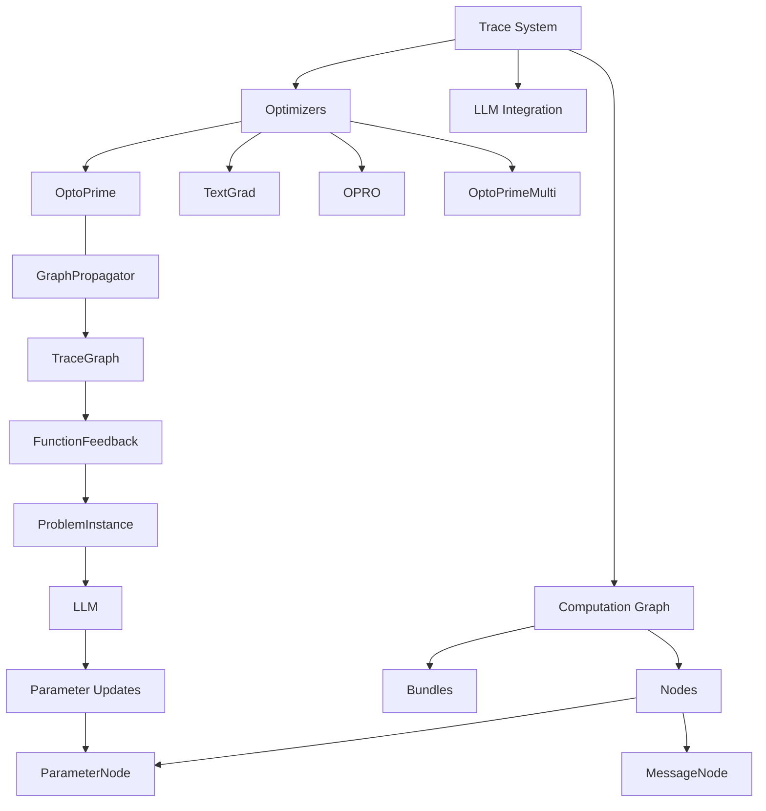
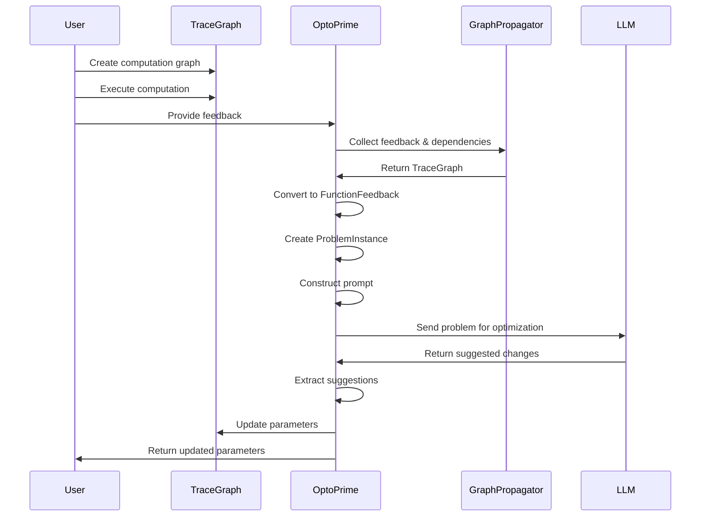
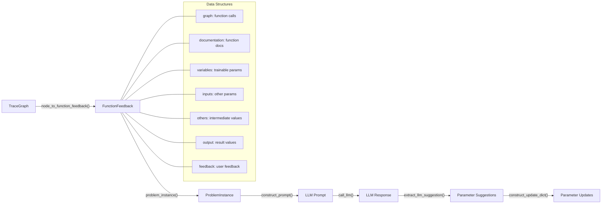

<!-- source: DeepWiki mcp.deepwiki.com · repo microsoft/Trace · page 3.1 OptoPrime · fetched 2026-10-26 -->

# OptoPrime

<details>
<summary>Relevant source files</summary>

The following files were used as context for generating this wiki page:

- [opto/optimizers/optoprime.py](opto/optimizers/optoprime.py)
- [opto/optimizers/textgrad.py](opto/optimizers/textgrad.py)
- [tests/unit_tests/test_optimizer.py](tests/unit_tests/test_optimizer.py)

</details>


## Purpose and Scope

OptoPrime is the primary optimizer in the Microsoft Trace system. It leverages Language Models (LLMs) to improve code and parameters based on feedback by representing the computation graph as a complete problem for the LLM to solve. OptoPrime effectively bridges the gap between natural language feedback and parameter/code optimization.

For information about other optimizers in the Trace system, see [Optimizers](#3) or specifically [TextGrad](#3.2) and [OptoPrimeMulti and OPRO](#3.3).

## Key Features and Capabilities

OptoPrime offers several advantages compared to other optimizers in the system:

- **Full Graph Utilization**: Leverages the complete computation graph structure to provide context to the LLM
- **Code Function Optimization**: Can optimize entire functions, not just numeric parameters
- **Memory System**: Maintains a buffer of past optimization attempts to guide future improvements
- **Efficiency**: 2-3x faster than TextGrad while providing high-quality optimizations
- **Rich Context Passing**: Transforms the graph into a structured problem representation with code, documentation, variables, constraints, and feedback

Sources: [opto/optimizers/optoprime.py:144-194]()

## Architecture and Position in the Trace System

OptoPrime is a core component of the Trace optimization framework. Here's how it fits into the larger system:



Sources: [opto/optimizers/optoprime.py:144-578](), [opto/optimizers/textgrad.py:306-523]()

## OptoPrime Workflow

The following diagram illustrates the internal workflow of OptoPrime during optimization:



Sources: [opto/optimizers/optoprime.py:436-471]()

## Core Components and Data Flow

OptoPrime's optimization pipeline involves several key components that transform computation graph information into a format that LLMs can reason about:



Sources: [opto/optimizers/optoprime.py:73-141](), [opto/optimizers/optoprime.py:352-387]()

## Key Classes and Methods

### OptoPrime Class

The main optimizer implementation inherits from the base `Optimizer` class and implements the optimization logic:

```python
class OptoPrime(Optimizer):
    def __init__(self, parameters, llm=None, propagator=None, objective=None, ...):
        # Initialize the optimizer with parameters to optimize
        
    def summarize(self):
        # Convert TraceGraph to FunctionFeedback
        
    def problem_instance(self, summary, mask=None):
        # Create structured problem representation
        
    def construct_prompt(self, summary, mask=None):
        # Generate system and user prompts for LLM
        
    def _step(self, verbose=False, mask=None, *args, **kwargs):
        # Execute one optimization step
        
    def extract_llm_suggestion(self, response):
        # Parse LLM response to extract suggestions
        
    def construct_update_dict(self, suggestion):
        # Convert suggestions to parameter updates
```

Sources: [opto/optimizers/optoprime.py:144-547]()

### Data Container Classes

OptoPrime uses several dataclasses to structure the optimization problem:

#### FunctionFeedback

```python
@dataclass
class FunctionFeedback:
    graph: List[Tuple[int, str]]  # Topologically sorted function calls
    documentation: Dict[str, str]  # Function documentation
    others: Dict[str, Any]  # Intermediate variable values
    roots: Dict[str, Any]  # Root variable values
    output: Dict[str, Any]  # Output values
    user_feedback: str  # User feedback at the leaf
```

Sources: [opto/optimizers/optoprime.py:73-85]()

#### ProblemInstance

```python
@dataclass
class ProblemInstance:
    instruction: str  # Optimization objective
    code: str  # Function call graph
    documentation: str  # Function documentation
    variables: str  # Trainable parameters
    inputs: str  # Non-trainable inputs
    others: str  # Intermediate values
    outputs: str  # Output values
    feedback: str  # User feedback
    constraints: str  # Parameter constraints
```

Sources: [opto/optimizers/optoprime.py:87-141]()

## LLM Communication Format

OptoPrime uses a structured format to communicate with LLMs. The prompt consists of:

1. **System Prompt**: Explains the task and output format requirements
2. **User Prompt**: Contains the problem instance with code, variables, inputs, etc.

The LLM is expected to respond with a JSON object containing:
- `reasoning`: Explanation of the problem and suggested changes
- `answer`: Direct answer if requested in the instruction
- `suggestion`: Dictionary of variable names and suggested new values

This is defined in `representation_prompt` and `output_format_prompt` class variables.

Sources: [opto/optimizers/optoprime.py:146-236]()

## Usage Example

Here's an example of how to use OptoPrime to optimize a parameter:

```python
# Import necessary modules
from opto.trace import node, bundle
from opto.optimizers import OptoPrime

# Define a function to be traced
@bundle()
def compute_value(x):
    """Computes a value based on input x"""
    return x * 2 - 10

# Create a parameter node
x = node(5.0, trainable=True)

# Create the optimizer with the parameter
optimizer = OptoPrime([x])

# Compute the output
output = compute_value(x)

# Provide feedback on the output
feedback = "The output should be greater than 50"

# Zero out previous feedback
optimizer.zero_feedback()

# Backward pass to propagate feedback
optimizer.backward(output, feedback)

# Perform optimization step
optimizer.step()

# Access updated parameter
print(f"Updated parameter value: {x.data}")
```

Sources: [tests/unit_tests/test_optimizer.py:10-45]()

## Optimizing Code Functions

One of OptoPrime's unique capabilities is optimizing code functions. Here's an example:

```python
# Define a function as a trainable parameter
@bundle(trainable=True)
def my_fun(x):
    """Test function"""
    return x**2 + 1

# Create input and optimizer
x = node(-1, trainable=False)
optimizer = OptoPrime([my_fun.parameter])

# Compute output and provide feedback
output = my_fun(x)
feedback = "The output should be negative"

# Optimize
optimizer.zero_feedback()
optimizer.backward(output, feedback)
optimizer.step()

# my_fun has been updated with new implementation
```

Sources: [tests/unit_tests/test_optimizer.py:148-171]()

## Comparison with Other Optimizers

| Feature | OptoPrime | TextGrad | OPRO | OptoPrimeMulti |
|---------|-----------|----------|------|----------------|
| **Speed** | 2-3x faster than TextGrad | Slower baseline | Very fast | Similar to OptoPrime |
| **Graph Usage** | Full graph structure | Uses graph for gradient descent | Doesn't use graph | Uses graph |
| **Code Optimization** | Yes | Limited | No | Yes |
| **Multiple Solutions** | No | No | No | Yes (generates variants) |
| **Method** | Problem solving via LLM | Text-based gradient descent | Direct optimization | Multi-solution selection |
| **Memory** | Configurable history | No | No | Yes |
| **Implementation** | [optoprime.py]() | [textgrad.py]() | Not in files | Not in files |

Sources: [opto/optimizers/optoprime.py:144-194](), [opto/optimizers/textgrad.py:306-523]()

## Internal Algorithms

### Trace Graph to Problem Conversion

OptoPrime converts the Trace computational graph into a structured problem representation through these steps:

1. **Summarization**: Convert the graph to `FunctionFeedback` using `node_to_function_feedback()`
2. **Problem Formatting**: Convert `FunctionFeedback` to `ProblemInstance` using `problem_instance()`
3. **Prompt Construction**: Format the problem instance as LLM prompts using `construct_prompt()`

Sources: [opto/optimizers/optoprime.py:31-70](), [opto/optimizers/optoprime.py:298-329](), [opto/optimizers/optoprime.py:352-427]()

### Suggestion Extraction and Application

After receiving the LLM response, OptoPrime:

1. Extracts suggestions using `extract_llm_suggestion()` which parses JSON and handles errors
2. Converts suggestions to parameter updates with `construct_update_dict()`
3. Applies updates to parameter nodes

Sources: [opto/optimizers/optoprime.py:472-547]()

## Implementation Notes

- OptoPrime uses Python's `black` formatter to ensure that suggested code is properly formatted
- It includes an error-handling system that can ignore extraction errors (controlled by `ignore_extraction_error`)
- Memory system allows for storing past optimizations to help guide future suggestions

Sources: [opto/optimizers/optoprime.py:472-496]()

---

