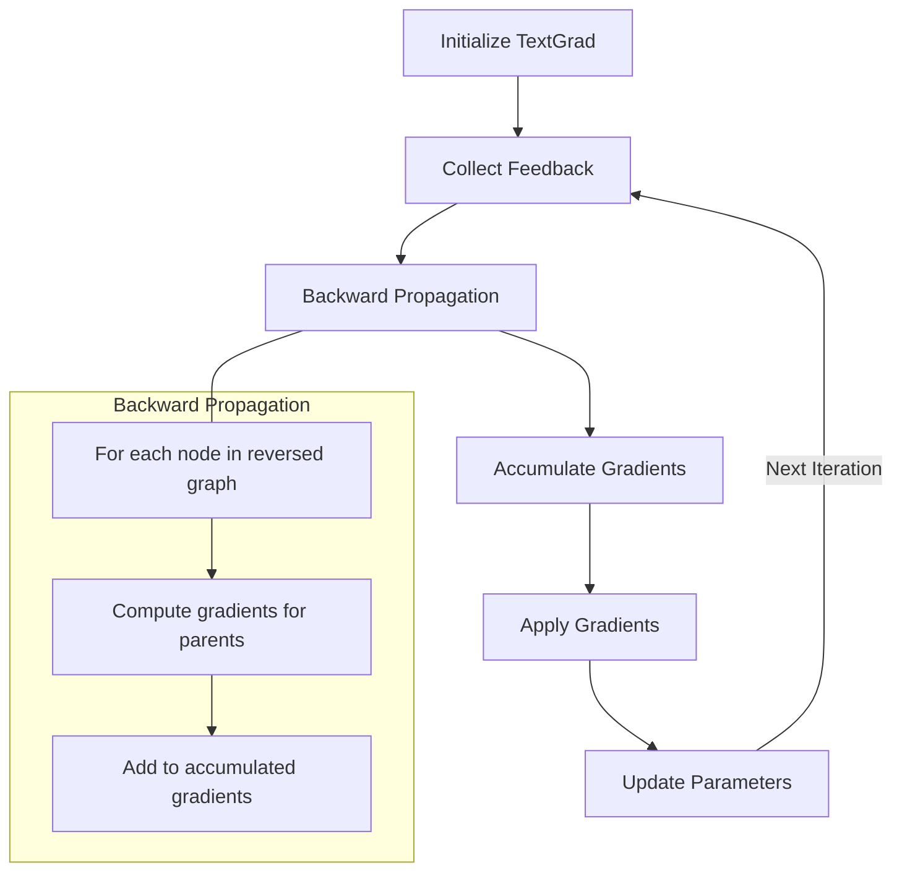
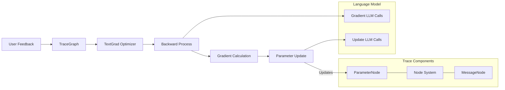
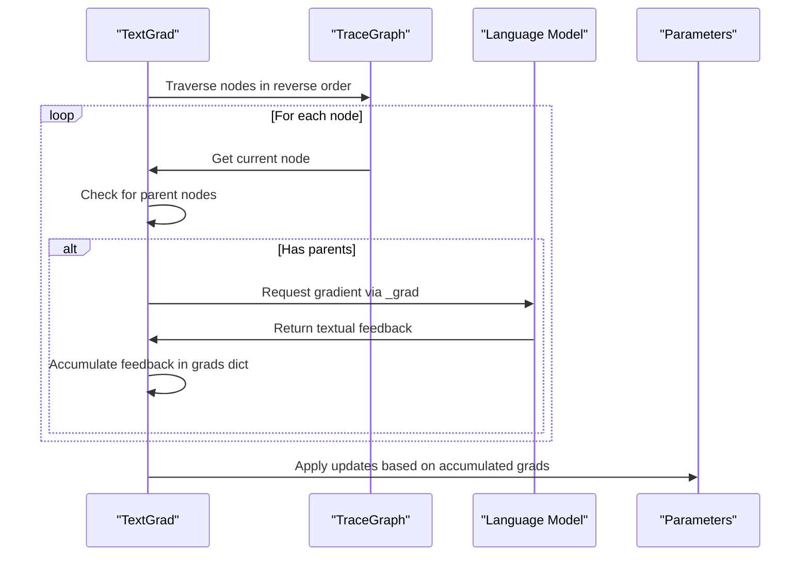
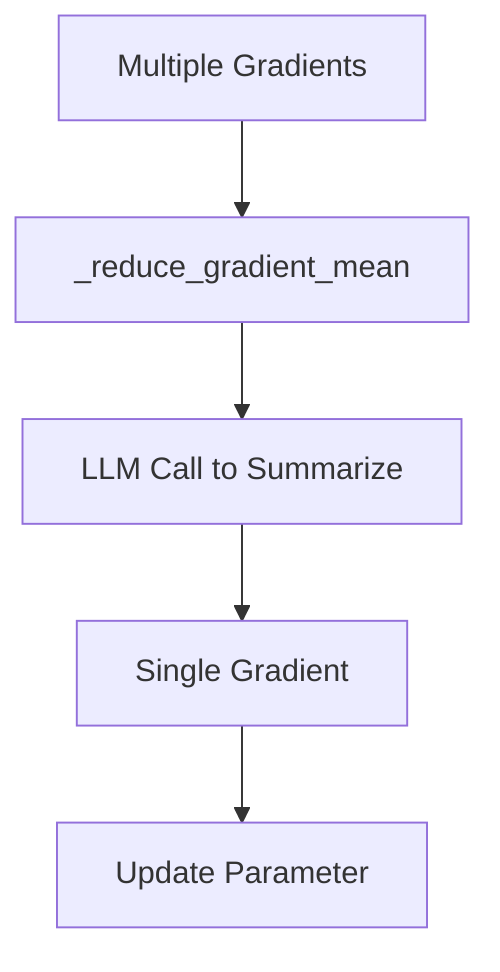
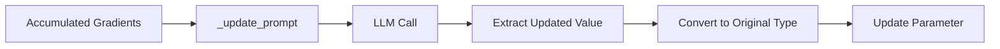
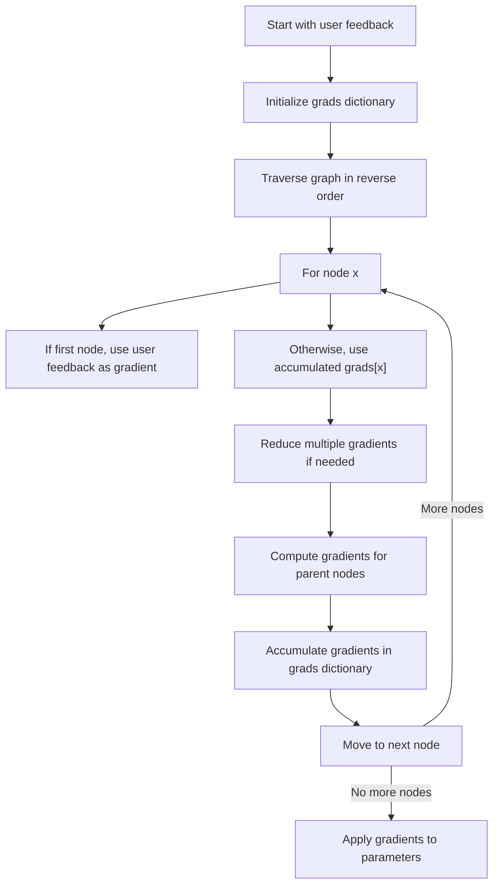
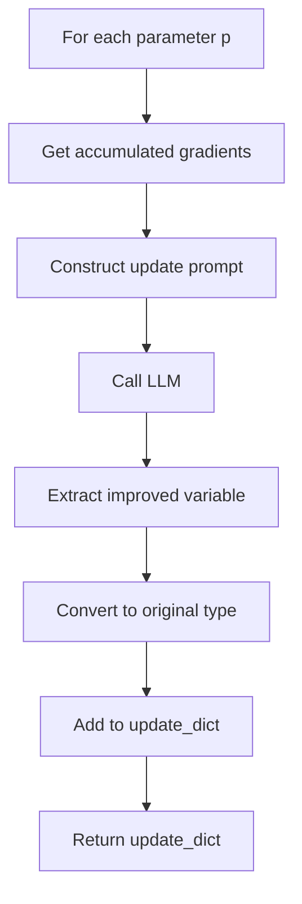

<!-- source: DeepWiki mcp.deepwiki.com · repo microsoft/Trace · page 3.2 TextGrad · fetched 2026-10-26 -->

# TextGrad

<details>
<summary>Relevant source files</summary>

The following files were used as context for generating this wiki page:

- [opto/optimizers/optoprime.py](opto/optimizers/optoprime.py)
- [opto/optimizers/textgrad.py](opto/optimizers/textgrad.py)

</details>


## Purpose and Scope

TextGrad is a text-based gradient descent optimizer within the Microsoft Trace system. It specializes in improving textual parameters through a mechanism inspired by gradient descent, but adapted for language model outputs. TextGrad leverages language models to propagate feedback through computation graphs and generate improved versions of parameters.

For information about other optimizers in the Trace system, see [OptoPrime](#3.1) and [OptoPrimeMulti and OPRO](#3.3).

## Overview

TextGrad performs optimization by treating text as a differentiable medium and using language models to simulate gradient descent. Unlike traditional numerical gradient descent, TextGrad propagates feedback through a computation graph to derive intelligent updates to parameter values.

### Key Features

- Text-based gradient descent through computation graphs
- Backward propagation of feedback using LLMs
- Support for constraints on parameters
- Ability to handle multipart gradients
- No context length issues unlike some other optimizers

### Position in the Trace System

TextGrad is one of several optimizers in the Trace framework that leverage the computation graph to improve parameters based on feedback.

## Architecture

TextGrad operates on a computation graph, propagating feedback backward from output nodes to input parameters. It uses specialized prompts to instruct language models on how to generate feedback and improvements.

### TextGrad Optimization Flow



Sources: [opto/optimizers/textgrad.py:432-497]()

### Integration with Trace System



Sources: [opto/optimizers/textgrad.py:305-431]()

## How TextGrad Works

### 1. Gradient Computation

TextGrad computes gradients by calling a language model with carefully constructed prompts that ask for feedback on how to improve parameters. The optimizer traverses the computation graph in reverse topological order:



Sources: [opto/optimizers/textgrad.py:348-383]()

### 2. Gradient Accumulation and Reduction

For nodes with multiple gradients, TextGrad reduces them to a single gradient:



Sources: [opto/optimizers/textgrad.py:385-395]()

### 3. Parameter Update

TextGrad constructs an update prompt using the accumulated gradients and sends it to the language model:



Sources: [opto/optimizers/textgrad.py:409-431](), [opto/optimizers/textgrad.py:467-486]()

## Implementation Details

### TextGrad Class

TextGrad is implemented in [opto/optimizers/textgrad.py]() and inherits from the Optimizer base class. Its core components include:

- `__init__`: Initializes the optimizer with parameters and an LLM
- `_step`: The main optimization step function
- `_grad`: Computes gradients for a node
- `_reduce_gradient_mean`: Reduces multiple gradients to one
- `_update_prompt`: Constructs a prompt for updating a parameter
- `call_llm`: Helper function to call the language model

Sources: [opto/optimizers/textgrad.py:306-523]()

### Prompt Engineering

TextGrad relies heavily on prompt engineering to instruct language models properly. The key prompts include:

| Prompt | Purpose |
|--------|---------|
| OPTIMIZER_SYSTEM_PROMPT | Instructs the LLM that it's part of an optimization system |
| TGD_PROMPT_PREFIX | Provides context about the variable to improve |
| BACKWARD_SYSTEM_PROMPT | Instructs the LLM to generate feedback |
| GRADIENT_TEMPLATE | Template for constructing gradient prompts |
| TGD_PROMPT_SUFFIX | Instructions for formatting the improved variable |

Sources: [opto/optimizers/textgrad.py:24-76](), [opto/optimizers/textgrad.py:154-175]()

### GradientInfo Class

TextGrad uses a `GradientInfo` dataclass to store gradient information:

```
@dataclass
class GradientInfo:
    gradient: str  # feedback
    gradient_context: Optional[Dict[str, str]]
```

This class stores both the gradient text and its context, enabling rich gradient propagation.

Sources: [opto/optimizers/textgrad.py:242-260]()

## Comparison with Other Optimizers

| Feature | TextGrad | OptoPrime | OPRO |
|---------|----------|-----------|------|
| Uses computation graph | Yes | Yes | No |
| Speed | Slower than OptoPrime | 2-3x faster than TextGrad | Very fast |
| Context length issues | No | Potential issues | No |
| Support for code as functions | Yes | Yes | No |
| Gradient mechanism | Text-based gradient descent | Full graph structure | Does not use computation graph |

Sources: Optimizer comparison diagram from the provided system architecture

## Usage Guide

### Initialization

To use TextGrad, you need to initialize it with a list of ParameterNode objects and optionally an LLM:

```python
from opto.optimizers.textgrad import TextGrad
from opto.utils.llm import LLM

optimizer = TextGrad(
    parameters=[param1, param2, ...],  # ParameterNode objects
    llm=LLM(),                         # Optional custom LLM
    max_tokens=4096,                   # Maximum tokens for LLM response
    log=True                           # Enable logging
)
```

### Configuration Options

TextGrad supports several configuration options:

| Option | Type | Default | Description |
|--------|------|---------|-------------|
| parameters | List[ParameterNode] | Required | List of parameters to optimize |
| llm | AbstractModel | LLM() | Language model to use |
| propagator | Propagator | None | Custom propagator for tracing |
| objective | str | None | Optimization objective |
| max_tokens | int | 4096 | Maximum tokens for LLM response |
| log | bool | False | Enable logging |

Sources: [opto/optimizers/textgrad.py:308-328]()

### Running Optimization

To run optimization with TextGrad:

```python
# Perform a single optimization step
updated_values = optimizer.step()

# Run multiple optimization steps
for _ in range(num_steps):
    optimizer.step()
```

## Limitations and Considerations

- TextGrad is slower than OptoPrime due to the text-based gradient approach
- Quality of optimization depends on the language model used
- May require more tokens/compute than other optimizers
- The quality of feedback propagation depends on the quality of the computation graph

## Internal Implementation

### Backward Propagation Algorithm

TextGrad implements backward propagation by traversing the computation graph in reverse topological order:



Sources: [opto/optimizers/textgrad.py:432-464]()

### Parameter Update Process



Sources: [opto/optimizers/textgrad.py:465-497]()

## Summary

TextGrad is a powerful text-based gradient descent optimizer within the Trace system. It leverages language models to propagate feedback through computation graphs and generate improved versions of parameters. While slower than some alternative optimizers, it offers advantages in handling complex text parameters and avoiding context length issues.

---

