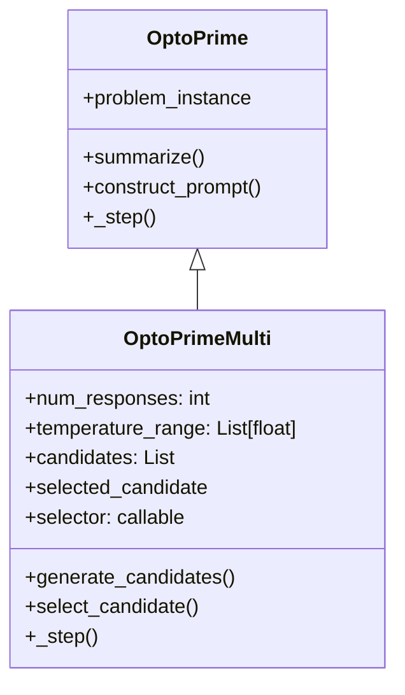
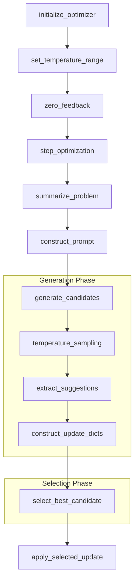
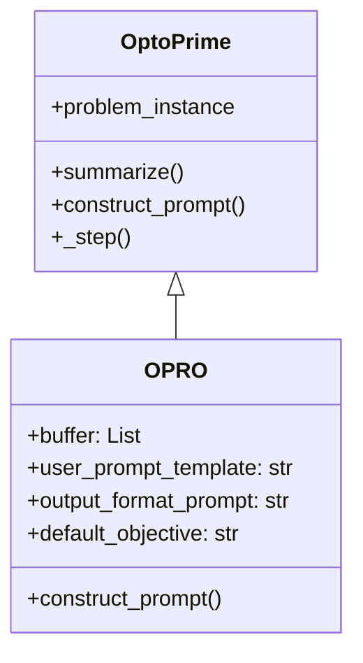
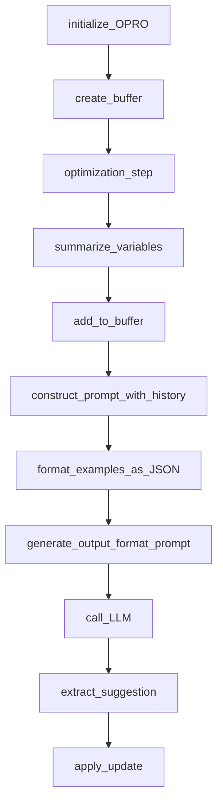
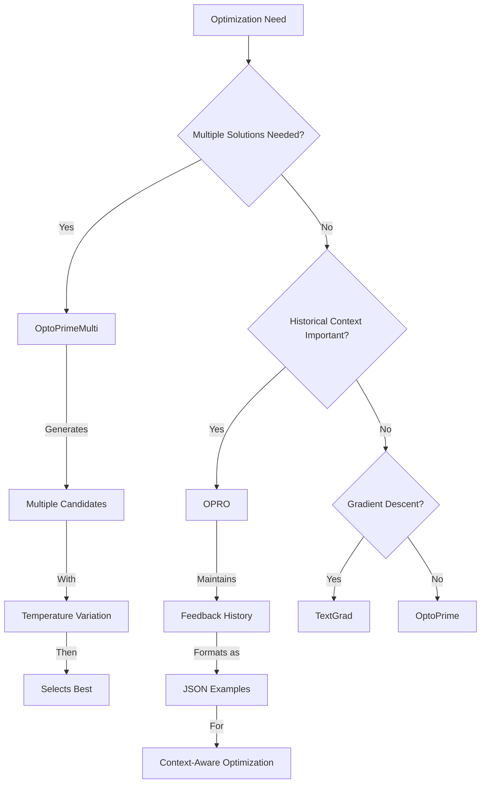

<!-- source: DeepWiki mcp.deepwiki.com · repo microsoft/Trace · page 3.3 OptoPrimeMulti and OPRO · fetched 2026-10-26 -->

# OptoPrimeMulti and OPRO

<details>
<summary>Relevant source files</summary>

The following files were used as context for generating this wiki page:

- [examples/textgrad_examples/evals/textgrad_solution_optimization.py](examples/textgrad_examples/evals/textgrad_solution_optimization.py)
- [examples/textgrad_examples/notebooks/textgrad_test_time_loss_for_code_OptoPrimeMulti.ipynb](examples/textgrad_examples/notebooks/textgrad_test_time_loss_for_code_OptoPrimeMulti.ipynb)
- [opto/optimizers/__init__.py](opto/optimizers/__init__.py)
- [opto/optimizers/opro.py](opto/optimizers/opro.py)
- [opto/optimizers/optoprimemulti.py](opto/optimizers/optoprimemulti.py)

</details>


This page documents two specialized optimizers in the Trace framework: OptoPrimeMulti and OPRO. Both extend the base OptoPrime optimizer (covered in [OptoPrime](#3.1)) but provide unique capabilities for specific optimization scenarios. OptoPrimeMulti generates multiple candidate solutions with varying temperature settings and selects the best one, while OPRO optimizes responses based on accumulated feedback from previous iterations.

## OptoPrimeMulti

OptoPrimeMulti extends the base OptoPrime optimizer by generating multiple candidate solutions with different temperature values, then selecting the most promising candidate. This approach increases the likelihood of finding an optimal solution by exploring a broader range of possibilities.

### Architecture and Components



OptoPrimeMulti inherits from OptoPrime and adds three key components:
1. **Multi-temperature generation** - Creates multiple solutions using different temperature settings
2. **Candidate storage** - Maintains a list of all generated candidates
3. **Selection mechanism** - Chooses the best candidate using either default or custom logic

The class is initialized with parameters that control the number of responses to generate and the temperature range to use:

```python
def __init__(
    self,
    *args,
    num_responses: int = 5,
    temperature_range: Optional[List[float]] = None,
    selector: Optional[callable] = None,
    **kwargs,
)
```

Sources: [opto/optimizers/optoprimemulti.py:9-25]()

### How OptoPrimeMulti Works



The key differentiator in OptoPrimeMulti is its temperature-based approach to solution generation:

1. **Temperature Range**: By default, the optimizer uses a temperature range from 1.3 (high creativity) to 0.0 (deterministic), which is calculated as a linear interpolation based on the number of responses.

2. **Candidate Generation**: For each temperature value, the optimizer generates a candidate solution by calling the LLM.

3. **Selection Mechanism**: After generating all candidates, the optimizer selects the best one using either:
   - The default selector (which returns the last candidate, typically the most deterministic one)
   - A custom selector function provided during initialization

Sources: [opto/optimizers/optoprimemulti.py:64-136](), [opto/optimizers/optoprimemulti.py:138-146]()

### Step Optimization Process

The `_step` method in OptoPrimeMulti orchestrates the entire optimization process:

1. **Problem Summarization**: First summarizes the current state of the problem
2. **Prompt Construction**: Creates system and user prompts for the LLM
3. **Candidate Generation**: Calls `generate_candidates` to create multiple solutions
4. **Update Dictionary Creation**: Converts each LLM response into an update dictionary
5. **Candidate Selection**: Selects the best candidate using the selector function
6. **Update Application**: Returns the selected candidate for application to the parameters

Sources: [opto/optimizers/optoprimemulti.py:148-214]()

## OPRO (Optimization with PRompt-based Objectives)

OPRO is a specialized optimizer that focuses on handling feedback for variables using a customized prompt template. It maintains a history of previous variables and feedback to provide context for generating improved solutions.

### Architecture and Components



The OPRO class extends OptoPrime with several unique features:
1. **Feedback Buffer** - Stores history of variables and feedback
2. **Specialized Prompt Templates** - Uses custom templates for user and system prompts
3. **JSON Output Format** - Strictly enforces JSON formatting for LLM responses

Sources: [opto/optimizers/opro.py:7-44]()

### How OPRO Works



OPRO's key innovation is its approach to handling and using feedback history:

1. **Feedback Buffer**: The optimizer maintains a buffer of previous variables and their feedback
2. **History Integration**: When constructing a prompt, OPRO includes examples from the buffer as JSON objects
3. **Structured Output**: OPRO uses a specific output format prompt that instructs the LLM to return well-structured JSON

Sources: [opto/optimizers/opro.py:47-67]()

### OPRO's Prompt Structure

OPRO uses two specific templates:

1. **User Prompt Template**: Includes examples of variables and their feedback, followed by the instruction

```
Below are some example variables and their feedbacks.

{examples}

================================

{instruction}
```

2. **Output Format Prompt**: Specifies the JSON format for the LLM's response

```
Output_format: Your output should be in the following json format...
{
"suggestion": {
    <variable_1>: <suggested_value_1>,
    <variable_2>: <suggested_value_2>,
}
}
```

Sources: [opto/optimizers/opro.py:8-39]()

## Comparative Analysis: When to Use Each Optimizer



| Optimizer | Key Features | Best For | Implementation |
|-----------|--------------|----------|----------------|
| OptoPrimeMulti | Multiple solutions with temperature variation | Problems with multiple viable solutions | `opto.optimizers.OptoPrimeMulti` |
| OPRO | Feedback history with JSON formatting | Iterative refinement with context | `opto.optimizers.OPRO` |
| OptoPrime | Base optimizer with LLM integration | General-purpose optimization | `opto.optimizers.OptoPrime` |
| TextGrad | Text-based gradient descent | Fine-tuning text with small adjustments | `opto.optimizers.TextGrad` |

Sources: [opto/optimizers/__init__.py:1-6]()

## Usage Examples

### OptoPrimeMulti for Code Optimization

The following example demonstrates using OptoPrimeMulti to optimize a function that finds the longest increasing subsequence in an array, focusing on improving its runtime complexity:

```python
# Initialize with trainable node
code = trace.node(initial_solution, trainable=True)
opt = OptoPrimeMulti([code], num_responses=5, temperature_range=[1.3, 0.0])

# Format problem and provide feedback
problem = ops.format(format_string, problem_text=problem_text, solution=code)
problem.backward("Improve the runtime complexity of the code.")

# Generate multiple candidates and select the best
opt.step()
```

This example generates five different implementations of the algorithm with varying levels of creativity, then selects the most efficient one. The temperature variation helps explore different approaches to the problem, from creative solutions (high temperature) to more standard, deterministic solutions (low temperature).

Sources: [examples/textgrad_examples/notebooks/textgrad_test_time_loss_for_code_OptoPrimeMulti.ipynb:324-337]()

### OptoPrimeMulti vs. Other Optimizers

When comparing optimizer performance on text-based tasks, the approach varies:

```python
# Optimizer selection based on algorithm parameter
if args.algo == "textgrad":
    # This runs Trace's TextGrad optimizer
    optimizer = TextGrad([instance_var], max_tokens=16383)
elif args.algo == 'opto_multi':
    # This runs Trace's OptoPrimeMulti optimizer
    optimizer = OptoPrimeMulti([instance_var],
                               prompt_symbols={'variables': '#Parameters'},
                               num_responses=3,
                               max_tokens=16383)
else:  # This runs Trace's OptoPrime optimizer
    optimizer = OptoPrime([instance_var],
                          prompt_symbols={'variables': '#Parameters'},
                          max_tokens=16383)
```

Sources: [examples/textgrad_examples/evals/textgrad_solution_optimization.py:162-174]()

## Best Practices

### When to Use OptoPrimeMulti
- When exploring a range of solutions from creative to deterministic is valuable
- For problems with complex solution spaces where multiple approaches might work
- When individual LLM responses have high variance in quality

### When to Use OPRO
- When optimization benefits from understanding the history of previous attempts
- For problems where accumulated context improves solution quality
- When structured feedback history helps guide the optimization process

### Configuration Tips
- For OptoPrimeMulti:
  - Adjust `num_responses` based on how many candidate solutions you want to explore
  - Modify `temperature_range` to control the range from creative to deterministic solutions
  - Implement a custom `selector` function when you have domain-specific selection criteria
- For OPRO:
  - Ensure feedback is consistently structured for building a useful history
  - Consider the format of examples as they will directly influence new solutions

Sources: [opto/optimizers/optoprimemulti.py:10-24]()

---

