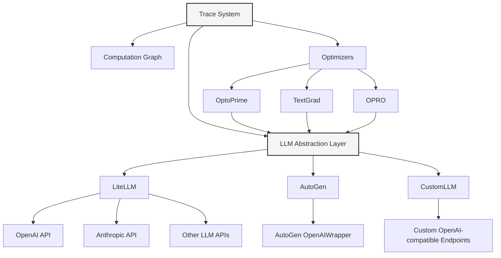
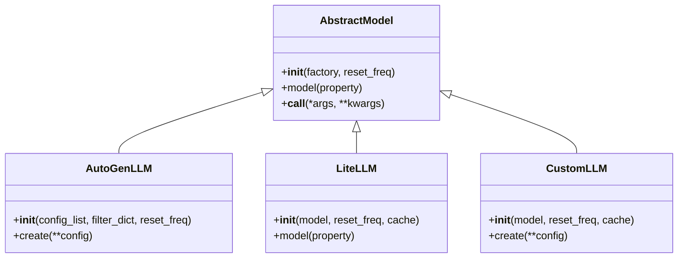
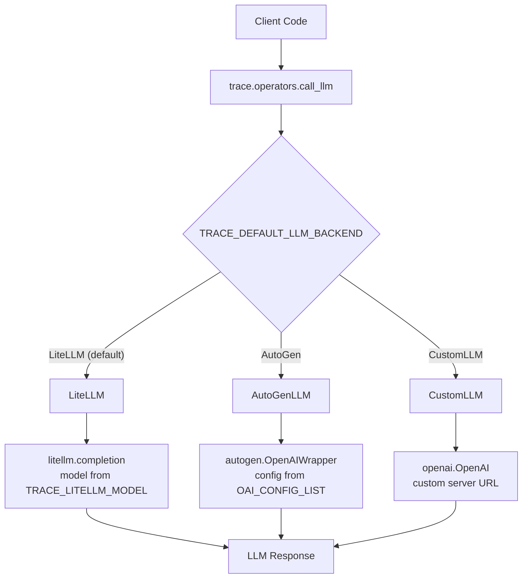

<!-- source: DeepWiki mcp.deepwiki.com · repo microsoft/Trace · page 4 LLM Integration · fetched 2026-10-26 -->

# LLM Integration

<details>
<summary>Relevant source files</summary>

The following files were used as context for generating this wiki page:

- [README.md](README.md)
- [docs/examples/basic/greeting.ipynb](docs/examples/basic/greeting.ipynb)
- [docs/images/backprop.png](docs/images/backprop.png)
- [docs/images/compare_to_textgrad3.png](docs/images/compare_to_textgrad3.png)
- [docs/images/forward_backward.png](docs/images/forward_backward.png)
- [docs/images/platform.png](docs/images/platform.png)
- [docs/images/platform2.png](docs/images/platform2.png)
- [opto/optimizers/utils.py](opto/optimizers/utils.py)
- [opto/utils/llm.py](opto/utils/llm.py)
- [tests/unit_tests/test_llm.py](tests/unit_tests/test_llm.py)

</details>


This page provides an overview of how Large Language Models (LLMs) are integrated into the Trace framework. It covers the LLM abstraction layer, available backends, configuration options, and usage patterns. For details on the specific LLM-based optimization techniques, see [Optimizers](#3).

## Overview

The Trace framework leverages LLMs as a key component in its optimization process, particularly for generating improvements to code and parameters based on feedback. To maintain flexibility across different LLM providers and APIs, Trace implements an abstraction layer that standardizes interactions with various LLM backends.



*Diagram: LLM Integration in Trace Architecture*

Sources: [README.md:274-333]()\, [opto/utils/llm.py:1-245]()

## LLM Abstraction Layer

The LLM abstraction layer provides a unified interface for interacting with different LLM providers. This allows the Trace framework to work seamlessly with various backends while maintaining a consistent API.

### Core Abstraction Classes

The abstraction is implemented through a hierarchy of classes:



*Diagram: LLM Abstraction Class Hierarchy*

Sources: [opto/utils/llm.py:16-230]()

- **AbstractModel**: Base class that provides common functionality like automatic model refreshing and state management
- **AutoGenLLM**: Implementation using Microsoft's AutoGen library
- **LiteLLM**: Implementation using the LiteLLM library which provides a unified interface to multiple LLM providers
- **CustomLLM**: Implementation for custom OpenAI-compatible servers

### Backend Selection

The active backend is determined by the `TRACE_DEFAULT_LLM_BACKEND` environment variable, which can be set to:
- `"LiteLLM"` (default)
- `"AutoGen"` 
- `"CustomLLM"`



*Diagram: LLM Backend Selection Flow*

Sources: [opto/utils/llm.py:232-244]()\, [README.md:280-290]()

## Configuration and Setup

### Environment Variables

The LLM integration in Trace is configured using several environment variables:

| Environment Variable | Description | Default |
|----------------------|-------------|---------|
| `TRACE_DEFAULT_LLM_BACKEND` | Selects the LLM backend ("LiteLLM", "AutoGen", or "CustomLLM") | "LiteLLM" |
| `TRACE_LITELLM_MODEL` | Model name to use with LiteLLM | "gpt-4o" |
| `OPENAI_API_KEY` | API key for OpenAI | None |
| `ANTHROPIC_API_KEY` | API key for Anthropic | None |
| `OAI_CONFIG_LIST` | Path to AutoGen configuration file or JSON string | None |
| `AZURE_TOKEN_PROVIDER_SCOPE` | Scope for Azure token provider (when using Azure models) | None |
| `TRACE_CUSTOMLLM_MODEL` | Model name for CustomLLM | "gpt-4o" |
| `TRACE_CUSTOMLLM_URL` | Base URL for CustomLLM server | None |
| `TRACE_CUSTOMLLM_API_KEY` | API key for CustomLLM server | None |

Sources: [README.md:278-333]()\, [opto/utils/llm.py:149-229]()

### Setting Up With LiteLLM (Default)

LiteLLM is the default backend starting from v0.1.3.5. To configure it, set the appropriate environment variables:

```python
import os
os.environ["OPENAI_API_KEY"] = "<your OpenAI API key here>"
os.environ["ANTHROPIC_API_KEY"] = "<your Anthropic API key here>"
os.environ["TRACE_LITELLM_MODEL"] = "gpt-4o"  # Optional, defaults to gpt-4o
```

Sources: [README.md:294-307]()

### Setting Up With AutoGen

For AutoGen, you need to install Trace with the AutoGen flag:

```
pip install trace-opt[autogen]
```

AutoGen uses an `OAI_CONFIG_LIST` file (or environment variable) that contains model configurations:

```json
[
    {
        "model": "gpt-4",
        "api_key": "<your OpenAI API key here>"
    },
    {
        "model": "claude-sonnet-3.5-latest",
        "api_key": "<your Anthropic API key here>"
    }
]
```

Sources: [README.md:310-331]()

### Setting Up CustomLLM

For custom OpenAI-compatible servers (like a LiteLLM proxy server):

```python
import os
os.environ["TRACE_DEFAULT_LLM_BACKEND"] = "CustomLLM"
os.environ["TRACE_CUSTOMLLM_URL"] = "http://xx.xx.xxx.xx:4000"
os.environ["TRACE_CUSTOMLLM_API_KEY"] = "sk-Xhg..."
os.environ["TRACE_CUSTOMLLM_MODEL"] = "gpt-4o"  # Optional
```

Sources: [opto/utils/llm.py:197-229]()

## Using LLMs in Trace

### Basic Usage

The most common way to interact with LLMs in Trace is through the `trace.operators.call_llm` function, which is used in bundles and models:

```python
from opto import trace

# Example from a model
response = trace.operators.call_llm(system_prompt, 
                                   user_instruction, 
                                   user_query)
```

You can also directly instantiate and use the LLM abstraction:

```python
from opto.utils.llm import LLM

llm = LLM()  # Uses the default backend
system_prompt = 'You are a helpful assistant.'
user_prompt = "Hello world."

messages = [{"role": "system", "content": system_prompt},
            {"role": "user", "content": user_prompt}]

output = llm(messages=messages)
response = output.choices[0].message.content
```

Sources: [tests/unit_tests/test_llm.py:1-24]()\, [docs/examples/basic/greeting.ipynb:182-203]()

### Integration with Trace Components

LLMs are typically used within Trace's core components:

1. In model classes to process inputs and generate responses:

```python
@trace.model
class Agent:
    def __init__(self, system_prompt):
        self.system_prompt = system_prompt
        self.instruct1 = trace.node("Decide the language", trainable=True)
        self.instruct2 = trace.node("Extract name if it's there", trainable=True)

    def __call__(self, user_query):
        response = trace.operators.call_llm(self.system_prompt,
                                           self.instruct1, user_query)
        en_or_es = self.decide_lang(response)

        user_name = trace.operators.call_llm(self.system_prompt,
                                           self.instruct2, user_query)
        greeting = self.greet(en_or_es, user_name)

        return greeting
```

2. In optimizers to generate improvements to code and parameters:

```python
from opto.optimizers import OptoPrime

optimizer = OptoPrime(agent.parameters())
optimizer.backward(greeting, feedback)
optimizer.step()  # Uses LLM to generate improvements
```

Sources: [docs/examples/basic/greeting.ipynb:173-203]()\, [docs/examples/basic/greeting.ipynb:217-248]()

## Implementation Details

### Handling Model Refreshing

The `AbstractModel` class provides a mechanism to automatically refresh LLM instances after a specified time interval. This is useful for long-running processes where token refreshing or memory management might be needed:

```python
def __call__(self, *args, **kwargs) -> Any:
    """ The call function handles refreshing the model if needed. """
    if self.reset_freq is not None and time.time() - self._init_time > self.reset_freq:
        self._model = self.factory()
        self._init_time = time.time()
    return self.model(*args, **kwargs)
```

Sources: [opto/utils/llm.py:42-47]()

### Special Handling for Azure Models

When using Azure OpenAI models with LiteLLM, there's special token provider handling:

```python
if model_name.startswith('azure/'):  # azure model
    azure_token_provider_scope = os.environ.get('AZURE_TOKEN_PROVIDER_SCOPE', None)
    if azure_token_provider_scope is not None:
        from azure.identity import DefaultAzureCredential, get_bearer_token_provider
        credential = get_bearer_token_provider(DefaultAzureCredential(), azure_token_provider_scope)
        return lambda *args, **kwargs: litellm.completion(model_name, *args,
                                                       azure_ad_token_provider=credential, **kwargs)
```

Sources: [opto/utils/llm.py:177-183]()

## Best Practices and Recommendations

1. **Model Selection**: For general optimization tasks, GPT-4o has been shown to work well. The README specifically notes that for gpt-4o, version **gpt-4o-2024-08-06** (or newer) should be used, as earlier versions had issues with structured output.

2. **Backend Selection**: 
   - Use LiteLLM (default) for most cases as it provides unified access to many providers
   - Use AutoGen if you need more advanced agent capabilities
   - Use CustomLLM for self-hosted or custom endpoints

3. **Error Handling**: When working with LLM calls, implement proper error handling to catch API failures, as shown in the greeting agent example:

```python
try:
    greeting = agent("Hello, I'm John.")
    feedback = feedback_fn(greeting.data, 'en')
except ExecutionError as e:
    greeting = e.exception_node
    feedback = greeting.data
```

Sources: [README.md:382-388]()\, [docs/examples/basic/greeting.ipynb:227-240]()

## Comparison with Other LLM Frameworks

While Trace's LLM integration is designed specifically for optimization tasks, it shares some similarities with other frameworks:

| Framework | Strengths | Use Cases |
|-----------|-----------|-----------|
| Trace LLM | Optimized for code and parameter improvements | AI systems that improve from feedback |
| AutoGen   | Complex agent systems and workflows | Multi-agent collaboration |
| LangChain | Connecting LLMs with external tools | RAG and tool integration |
| LlamaIndex | Document retrieval and knowledge bases | Q&A over structured documents |

Sources: [README.md:231-264]()

## Summary

Trace's LLM integration layer provides a flexible and unified way to interact with various LLM providers, focusing on the specific needs of the optimization framework. By abstracting away the details of different LLM APIs, it allows the optimization algorithms to work seamlessly regardless of the underlying model provider, while still providing configuration options to customize the behavior as needed.

---

