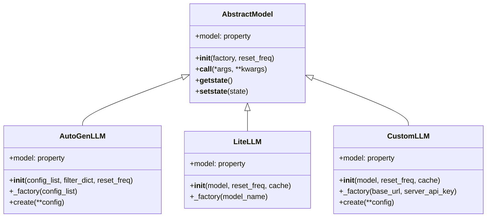
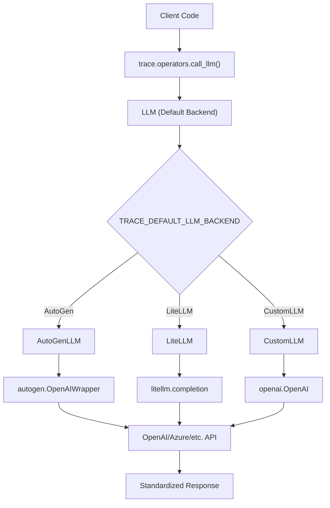
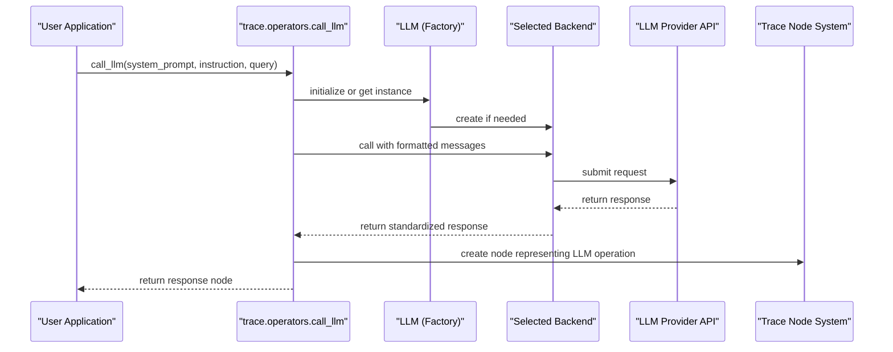

<!-- source: DeepWiki mcp.deepwiki.com · repo microsoft/Trace · page 4.1 LLM Abstraction Layer · fetched 2026-10-26 -->

# LLM Abstraction Layer

<details>
<summary>Relevant source files</summary>

The following files were used as context for generating this wiki page:

- [docs/examples/basic/greeting.ipynb](docs/examples/basic/greeting.ipynb)
- [opto/optimizers/utils.py](opto/optimizers/utils.py)
- [opto/utils/llm.py](opto/utils/llm.py)
- [tests/unit_tests/test_llm.py](tests/unit_tests/test_llm.py)

</details>


## Purpose and Scope

The LLM Abstraction Layer provides a unified interface for working with different Language Model backends within the Trace system. It enables seamless integration with various LLM providers (OpenAI, Anthropic, Azure, etc.) while maintaining a consistent API for the rest of the system to interact with.

This document covers the architecture, components, and configuration of the LLM abstraction layer. For information about how to use LLMs within Trace applications, see [Using LLMs in Trace](#4.2).

Sources: [opto/utils/llm.py:15-245]()

## Architecture Overview

The LLM Abstraction Layer is built around a base `AbstractModel` class with several concrete implementations for different backends. The system uses environment variables to determine which implementation to use by default.

### Class Hierarchy



Sources: [opto/utils/llm.py:16-230]()

### Backend Selection Flow



Sources: [opto/utils/llm.py:232-244]()

## Core Components

### AbstractModel

The `AbstractModel` class is the foundation of the LLM abstraction layer. It implements:

1. A factory pattern for model initialization
2. Automatic model refreshing based on a configurable timeout
3. Consistent calling interface
4. Serialization/deserialization support

```python
class AbstractModel:
    def __init__(self, factory: Callable, reset_freq: Union[int, None] = None) -> None:
        # factory: Creates a model instance
        # reset_freq: Time in seconds after which model should be refreshed
```

The key method is `__call__`, which ensures the model is refreshed if needed and handles the forwarding of arguments to the underlying model.

Sources: [opto/utils/llm.py:16-57]()

### Backend Implementations

#### AutoGenLLM

`AutoGenLLM` integrates with Microsoft's AutoGen library, providing:

- Automatic configuration from environment variables or configuration files
- Support for multiple model providers through AutoGen's filtering mechanisms
- Integration with AutoGen's caching and templating capabilities

```python
class AutoGenLLM(AbstractModel):
    def __init__(self, config_list: List = None, filter_dict: Dict = None, 
                 reset_freq: Union[int, None] = None) -> None:
        # config_list: List of configuration options for models
        # filter_dict: Dictionary for filtering configurations
```

Sources: [opto/utils/llm.py:59-124]()

#### LiteLLM

`LiteLLM` provides integration with the LiteLLM library, which supports a wide range of model providers with a unified API:

- Uses the `TRACE_LITELLM_MODEL` environment variable for model selection
- Supports Azure models with token-based authentication
- Simplifies access to numerous LLM providers

```python
class LiteLLM(AbstractModel):
    def __init__(self, model: Union[str, None] = None, 
                 reset_freq: Union[int, None] = None, cache=True) -> None:
        # model: Model name, defaults to TRACE_LITELLM_MODEL
```

Sources: [opto/utils/llm.py:149-195]()

#### CustomLLM

`CustomLLM` enables integration with custom OpenAI-compatible API endpoints:

- Uses the standard OpenAI client with a custom base URL
- Configures through `TRACE_CUSTOMLLM_*` environment variables
- Useful for self-hosted models or proxy servers

```python
class CustomLLM(AbstractModel):
    def __init__(self, model: Union[str, None] = None, 
                 reset_freq: Union[int, None] = None, cache=True) -> None:
        # model: Model name, defaults to TRACE_CUSTOMLLM_MODEL
```

Sources: [opto/utils/llm.py:197-230]()

## Configuration System

The LLM abstraction layer is configured primarily through environment variables:

| Environment Variable | Description | Default | Used By |
|----------------------|-------------|---------|---------|
| `TRACE_DEFAULT_LLM_BACKEND` | Selects the default backend implementation | `"LiteLLM"` | Global |
| `OAI_CONFIG_LIST` | JSON file/string with OpenAI configs | None | AutoGenLLM |
| `OPENAI_API_KEY`, `ANTHROPIC_API_KEY` | API keys used as fallback | None | AutoGenLLM |
| `TRACE_LITELLM_MODEL` | Model name for LiteLLM | `"gpt-4o"` | LiteLLM |
| `AZURE_TOKEN_PROVIDER_SCOPE` | Scope for Azure authentication | None | LiteLLM |
| `TRACE_CUSTOMLLM_MODEL` | Model name for custom endpoint | `"gpt-4o"` | CustomLLM |
| `TRACE_CUSTOMLLM_URL` | Base URL for custom endpoint | None | CustomLLM |
| `TRACE_CUSTOMLLM_API_KEY` | API key for custom endpoint | None | CustomLLM |

Sources: [opto/utils/llm.py:59-72](), [opto/utils/llm.py:149-170](), [opto/utils/llm.py:197-210](), [opto/utils/llm.py:232-244]()

## Integration Within Trace

The LLM Abstraction Layer is typically used through the `trace.operators.call_llm` function, which is integrated with the node system:



Sources: [opto/utils/llm.py:59-72](), [docs/examples/basic/greeting.ipynb:183-184]()

## Usage Examples

### Basic Usage

```python
from opto.utils.llm import LLM

# Create an instance of the default LLM backend
llm = LLM()

# Format messages as expected by the LLM
messages = [
    {"role": "system", "content": "You are a helpful assistant."},
    {"role": "user", "content": "Hello world."}
]

# Call the LLM and extract the response
output = llm(messages=messages)
response = output.choices[0].message.content
```

Sources: [tests/unit_tests/test_llm.py:1-23]()

### Within Trace Components

Within Trace applications, the LLM is typically called via the `trace.operators.call_llm` function:

```python
@trace.model
class Agent:
    def __init__(self, system_prompt):
        self.system_prompt = system_prompt
        self.instruction = trace.node("Extract information", trainable=True)
        
    def __call__(self, user_query):
        # This automatically uses the default LLM backend
        response = trace.operators.call_llm(self.system_prompt,
                                           self.instruction, user_query)
        return response
```

Sources: [docs/examples/basic/greeting.ipynb:174-202]()

## Comparison of Backends

| Feature | AutoGenLLM | LiteLLM | CustomLLM |
|---------|------------|---------|-----------|
| Base Library | AutoGen | LiteLLM | OpenAI Python |
| Configuration | OAI_CONFIG_LIST | Environment Variables | Environment Variables |
| Multiple Models | Yes (via config list) | No (single model) | No (single model) |
| Caching | Yes | Optional | Optional |
| Templating | Yes | No | No |
| Model Rotation | Yes | No | No |
| Azure Support | Yes | Yes (with token) | Via URL |
| Implementation Complexity | High | Medium | Low |

Sources: [opto/utils/llm.py:59-230]()

## Extending the Abstraction Layer

To support new LLM backends, you can create a new class that inherits from `AbstractModel`:

1. Implement the `_factory` method to create the underlying model
2. Override the `model` property to handle specific formatting requirements
3. Add any backend-specific methods (like `create`)

Example structure:
```python
class NewBackendLLM(AbstractModel):
    def __init__(self, specific_param, reset_freq=None):
        factory = lambda: self._factory(specific_param)
        super().__init__(factory, reset_freq)
        
    @classmethod
    def _factory(cls, specific_param):
        return new_backend_client(specific_param)
        
    @property
    def model(self):
        return lambda *args, **kwargs: self.create(*args, **kwargs)
        
    def create(self, **config):
        # Format config for this specific backend
        return self._model.generate(**config)
```

Sources: [opto/utils/llm.py:16-57]()

---

