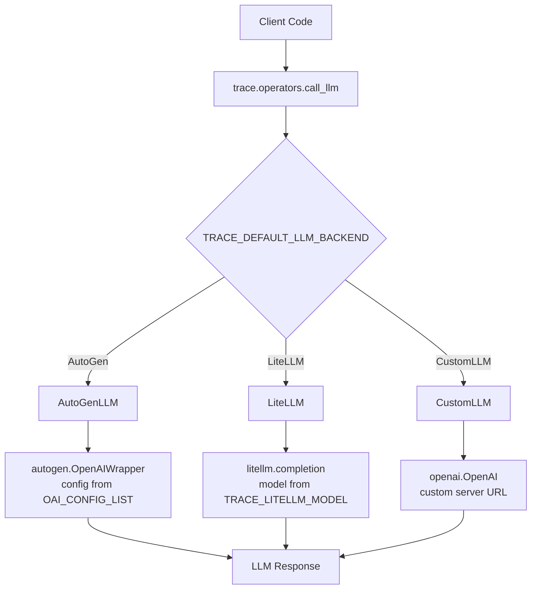
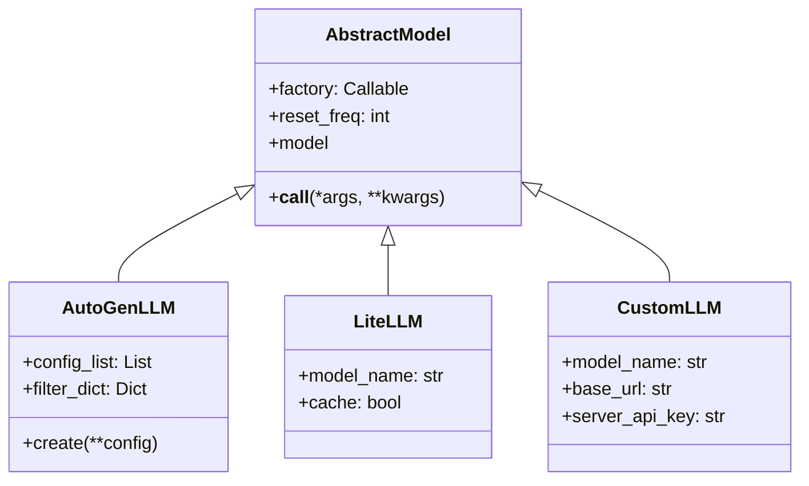
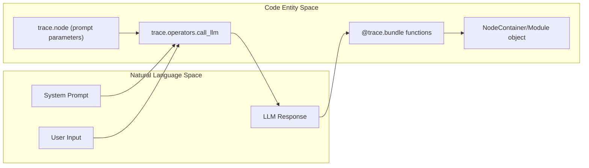
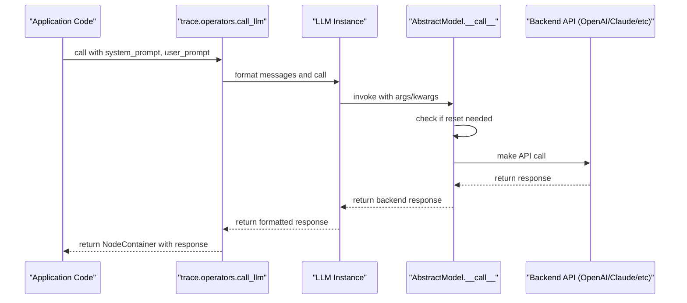

<!-- source: DeepWiki mcp.deepwiki.com · repo microsoft/Trace · page 4.2 Using LLMs in Trace · fetched 2026-10-26 -->

# Using LLMs in Trace

<details>
<summary>Relevant source files</summary>

The following files were used as context for generating this wiki page:

- [README.md](README.md)
- [docs/examples/basic/greeting.ipynb](docs/examples/basic/greeting.ipynb)
- [docs/images/backprop.png](docs/images/backprop.png)
- [docs/images/compare_to_textgrad3.png](docs/images/compare_to_textgrad3.png)
- [docs/images/forward_backward.png](docs/images/forward_backward.png)
- [docs/images/platform.png](docs/images/platform.png)
- [docs/images/platform2.png](docs/images/platform2.png)
- [examples/greeting.py](examples/greeting.py)
- [opto/optimizers/utils.py](opto/optimizers/utils.py)
- [opto/trace/__init__.py](opto/trace/__init__.py)
- [opto/utils/llm.py](opto/utils/llm.py)
- [tests/unit_tests/test_llm.py](tests/unit_tests/test_llm.py)

</details>


This page explains how to integrate and use Language Models (LLMs) within the Trace system. It covers the LLM abstraction layer, available backends, configuration options, and practical usage patterns. For information about the general LLM abstraction architecture, see [LLM Abstraction Layer](#4.1).

## LLM Architecture Overview

Trace provides a unified interface for working with various LLM backends through its abstraction layer. This allows users to switch between different LLM providers while maintaining consistent code.

### LLM Backend Selection and Flow



Sources: [opto/utils/llm.py](), [README.md]()

## LLM Backend Classes

Trace supports multiple LLM backends to provide flexibility in how you interact with language models:



Sources: [opto/utils/llm.py]()

### AbstractModel

The base class that provides common functionality:
- Factory pattern for model creation
- Optional automatic reset mechanism (via `reset_freq` parameter)
- Consistent calling interface through the `__call__` method

### AutoGenLLM

Integration with Microsoft's AutoGen library:
- Uses AutoGen's configuration mechanisms
- Compatible with AutoGen's `OpenAIWrapper`
- Supports multiple model providers via `OAI_CONFIG_LIST`

### LiteLLM

Integration with LiteLLM:
- Unified interface to many providers
- Default backend since v0.1.3.5
- Configurable via environment variables like `TRACE_LITELLM_MODEL`

### CustomLLM

For custom OpenAI-compatible endpoints:
- Connect to your own LLM server
- Compatible with OpenAI API format
- Useful for self-hosted models or proxies

Sources: [opto/utils/llm.py](), [README.md]()

## Configuring LLM Backends

Trace allows you to configure which LLM backend to use and how it should be configured through environment variables.

### Default Backend Selection

Set the default backend using the `TRACE_DEFAULT_LLM_BACKEND` environment variable:

```bash
export TRACE_DEFAULT_LLM_BACKEND="LiteLLM"  # Options: 'LiteLLM', 'AutoGen', or 'CustomLLM'
```

Or in Python:

```python
import os
os.environ["TRACE_DEFAULT_LLM_BACKEND"] = "LiteLLM"
import opto
```

### LiteLLM Configuration

When using LiteLLM (the default), set your API keys as environment variables according to LiteLLM's documentation:

```python
import os
os.environ["OPENAI_API_KEY"] = "<your OpenAI API key here>"
os.environ["ANTHROPIC_API_KEY"] = "<your Anthropic API key here>"
```

Set the default model for LiteLLM:

```bash
export TRACE_LITELLM_MODEL='gpt-4o'
```

### AutoGen Configuration

When using AutoGen backend:

1. Install Trace with AutoGen support:
   ```bash
   pip install trace-opt[autogen]
   ```

2. Create an `OAI_CONFIG_LIST` file:
   ```json
   [
       {
           "model": "gpt-4",
           "api_key": "<your OpenAI API key here>"
       },
       {
           "model": "claude-sonnet-3.5-latest",
           "api_key": "<your Anthropic API key here>"
       }
   ]
   ```

3. Or set the `OAI_CONFIG_LIST` environment variable to the location of this file.

### CustomLLM Configuration

For custom OpenAI-compatible endpoints:

```python
import os
os.environ['TRACE_CUSTOMLLM_MODEL'] = 'gpt-4o'  # Model name to request
os.environ['TRACE_CUSTOMLLM_URL'] = 'http://xx.xx.xxx.xx:4000'  # Server URL
os.environ['TRACE_CUSTOMLLM_API_KEY'] = 'sk-Xhg...'  # API key for the server
```

Sources: [README.md](), [opto/utils/llm.py]()

## LLM Integration in the Trace Computation Graph

LLMs integrate with Trace components primarily through the `trace.operators.call_llm` function, which connects natural language processing with the Trace computation graph.

### Bridging Natural Language and Code



Sources: [opto/trace/__init__.py](), [examples/greeting.py]()

### LLM Call Flow in Trace



Sources: [opto/utils/llm.py](), [examples/greeting.py]()

## Using LLMs in Trace Components

### Basic Usage Pattern

The most common pattern for using LLMs in Trace is via the `trace.operators.call_llm` function, which handles the interaction with the configured LLM backend:

```python
response = trace.operators.call_llm(system_prompt, user_prompt)
```

This function is used within bundled functions or model classes to generate text or make decisions.

### Integration with @trace.model and @trace.bundle

LLMs are commonly used within:

1. Model classes (`@trace.model`) that orchestrate LLM usage
2. Bundled functions (`@trace.bundle`) that contain LLM calls
3. Trainable nodes (`trace.node`) for prompt parameters

Here's a typical usage pattern in a model class:

```python
@trace.model
class Agent:
    def __init__(self, system_prompt):
        self.system_prompt = system_prompt
        self.instruction = trace.node("Follow these steps...", trainable=True)
        
    def __call__(self, user_input):
        response = trace.operators.call_llm(self.system_prompt, 
                                           self.instruction, 
                                           user_input)
        return self.process_response(response)
        
    @trace.bundle(trainable=True)
    def process_response(self, response):
        # This function can be optimized by Trace
        return response
```

Sources: [examples/greeting.py](), [docs/examples/basic/greeting.ipynb]()

## Practical Example: Multilingual Agent

Here's a complete example of a simple agent using LLMs via Trace to handle multilingual greetings:

```python
from opto import trace
from opto.trace import node, bundle, model, ExecutionError
from opto.optimizers import OptoPrime

@trace.model
class Agent:
    def __init__(self, system_prompt):
        self.system_prompt = system_prompt
        self.instruct1 = trace.node("Decide the language", trainable=True)
        self.instruct2 = trace.node("Extract name if it's there", trainable=True)

    def __call__(self, user_query):
        response = trace.operators.call_llm(self.system_prompt,
                                           self.instruct1, user_query)
        en_or_es = self.decide_lang(response)

        user_name = trace.operators.call_llm(self.system_prompt,
                                            self.instruct2, user_query)
        greeting = self.greet(en_or_es, user_name)

        return greeting

    @trace.bundle(trainable=True)
    def decide_lang(self, response):
        """Map the language into a variable"""
        return

    @trace.bundle(trainable=True)
    def greet(self, lang, user_name):
        """Produce a greeting based on the language"""
        greeting = "Hola"
        return f"{greeting}, {user_name}!"
```

### Optimizing LLM-based Components

You can use Trace's optimizers to improve LLM prompts and functions:

```python
def feedback_fn(generated_response, gold_label='en'):
    if gold_label == 'en' and 'Hello' in generated_response:
        return "Correct"
    elif gold_label == 'es' and 'Hola' in generated_response:
        return "Correct"
    else:
        return "Incorrect"

agent = Agent("You are a sales assistant.")
optimizer = OptoPrime(agent.parameters())

# Training loop
for i in range(3):
    try:
        greeting = agent("Hello, I'm John.")
        feedback = feedback_fn(greeting.data, 'en')
    except ExecutionError as e:
        greeting = e.exception_node
        feedback = "Incorrect"

    optimizer.zero_feedback()
    optimizer.backward(greeting, feedback)
    optimizer.step(verbose=True)

    if feedback == 'Correct':
        break
```

This example demonstrates:
1. Defining trainable nodes for LLM instructions
2. Making LLM calls with `trace.operators.call_llm`
3. Using bundled functions that can be optimized
4. Providing feedback for optimization
5. Using optimizers to improve LLM-based components

Sources: [docs/examples/basic/greeting.ipynb](), [examples/greeting.py]()

## Direct LLM Interaction

For direct interaction with LLMs (outside of the Trace graph), you can use the `LLM` class directly:

```python
from opto.utils.llm import LLM

llm = LLM()
system_prompt = 'You are a helpful assistant.'
user_prompt = "Hello world."

messages = [{"role": "system", "content": system_prompt},
            {"role": "user",   "content": user_prompt}]

output = llm(messages=messages)
response = output.choices[0].message.content
```

This approach is useful for testing or one-off LLM interactions that don't need to be part of the computation graph.

Sources: [tests/unit_tests/test_llm.py]()

## Best Practices and Recommendations

When using LLMs in Trace, consider the following best practices:

| Best Practice | Description |
|---------------|-------------|
| Make prompts trainable | Use `trace.node(prompt, trainable=True)` for prompts you want to optimize |
| Separate system/user prompts | Keep system prompts and user instructions separate for clarity |
| Handle exceptions | Use try/except with `ExecutionError` to catch LLM API issues |
| Cache LLM calls | All backends support caching to reduce API costs during development |
| Test with cheaper models | Use smaller models for development, then switch to better models for final runs |
| Set environment variables early | Configure LLM backends before importing Trace |
| Prefer bundled functions for logic | Put post-processing logic in `@trace.bundle` functions so they can be optimized |

Sources: [examples/greeting.py](), [README.md]()

---

