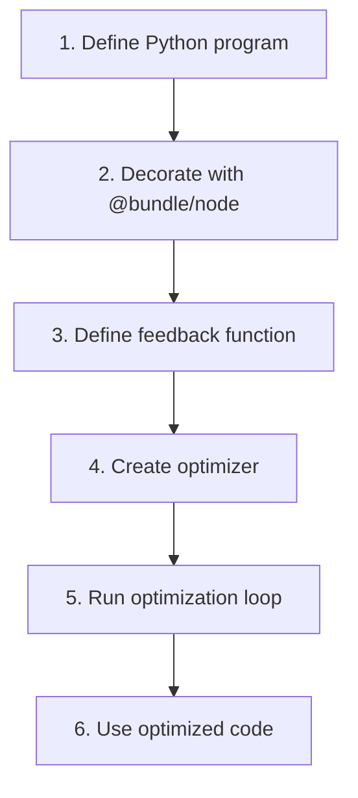
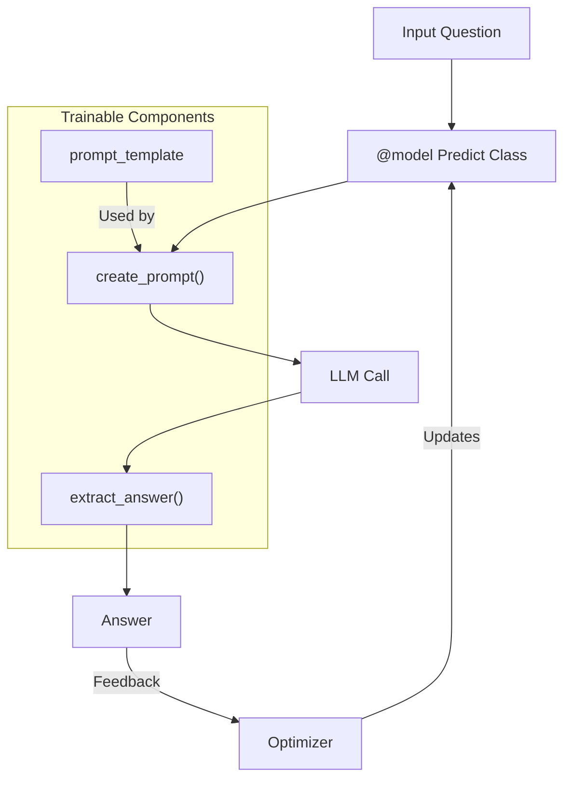
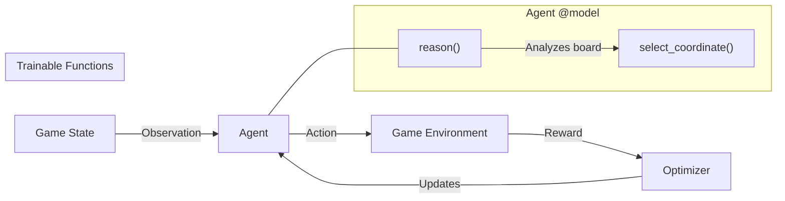
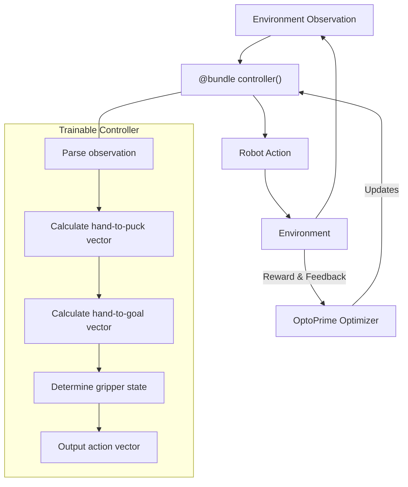
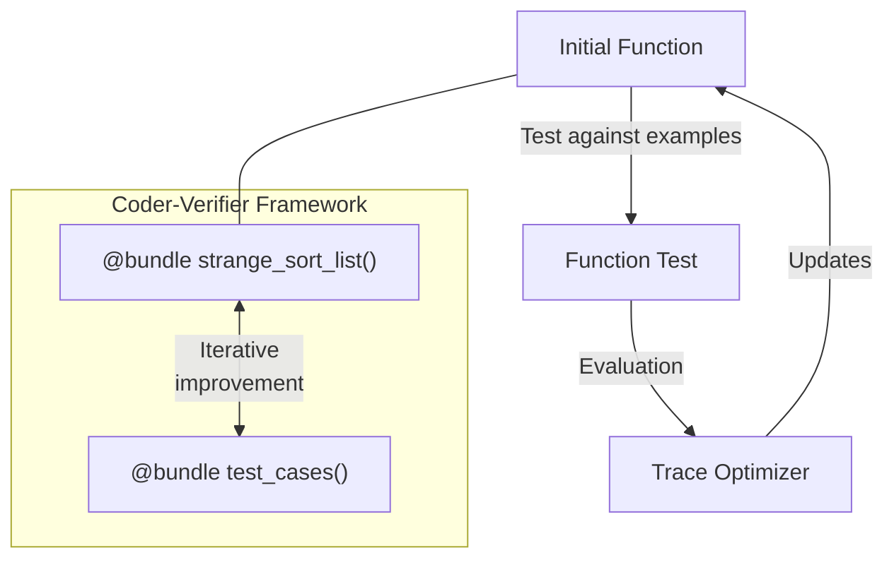
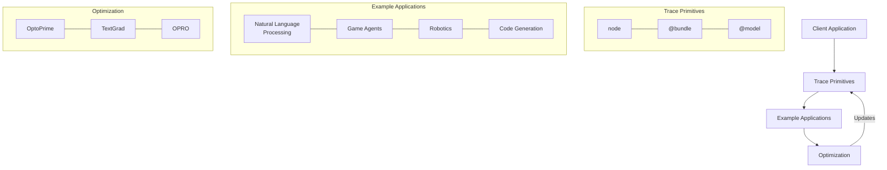
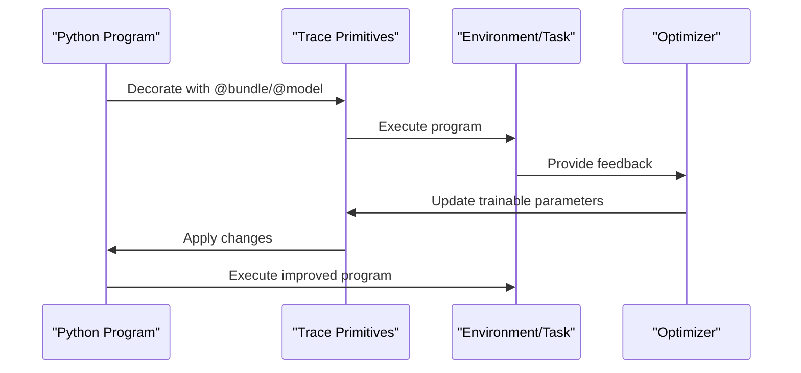

<!-- source: DeepWiki mcp.deepwiki.com · repo microsoft/Trace · page 5 Usage Examples · fetched 2026-10-26 -->

# Usage Examples

Relevant source files

The following files were used as context for generating this wiki page:

- [docs/examples/game/battleship.ipynb](docs/examples/game/battleship.ipynb)
- [docs/examples/nlp/bigbench_hard.ipynb](docs/examples/nlp/bigbench_hard.ipynb)
- [docs/examples/robotics/metaworld.ipynb](docs/examples/robotics/metaworld.ipynb)
- [docs/quickstart/quick_start.ipynb](docs/quickstart/quick_start.ipynb)
- [docs/quickstart/quick_start_2.ipynb](docs/quickstart/quick_start_2.ipynb)

This document provides practical examples of how to use the Trace system across various domains and applications. It demonstrates the versatility of Trace and how its core primitives can be applied to solve different types of problems. For general architectural details, see [Core Architecture](#2); for optimizer-specific information, see [Optimizers](#3).

## Common Usage Pattern

Trace follows a consistent pattern across applications:

Sources: [docs/quickstart/quick_start.ipynb:10-19](), [docs/examples/nlp/bigbench_hard.ipynb:7-21]()

## Natural Language Processing Applications

Trace can be used to optimize both prompts and code for natural language processing tasks. A key example is improving performance on benchmark tasks like BigBench-Hard.

### BigBench-Hard Example

This example shows how to optimize both a prompt template and an answer extraction function to improve model performance:

The main components in this example include:
- A `Predict` class decorated with `@model`
- A trainable `prompt_template` parameter
- Two trainable functions: `create_prompt` and `extract_answer`
- An optimization loop that evaluates outputs against expected answers

Key advantages demonstrated:
1. Simultaneous optimization of text (prompts) and code (answer extraction)
2. Handling heterogeneous parameters seamlessly
3. Allowing LLMs to learn from their mistakes via direct feedback

Sources: [docs/examples/nlp/bigbench_hard.ipynb:213-253](), [docs/examples/nlp/bigbench_hard.ipynb:276-301]()

## Game Agents

Trace can be used to create adaptive, self-improving agents for games and other interactive environments.

### Battleship Game Agent

This example demonstrates how to build an agent that learns to play the game of Battleship:

Key components:
- A game environment (`BattleshipBoard`) that provides observations and rewards
- An agent class decorated with `@model` containing:
  - A trainable `reason` function that analyzes the game state
  - A trainable `select_coordinate` function that selects actions
- An optimizer (`OptoPrime`) that updates the agent based on game rewards

Through interaction with the environment and optimization based on rewards, the agent develops increasingly sophisticated strategies like:
1. Prioritizing unknown cells near known hits
2. Following patterns based on ship orientations
3. Efficient search strategies to minimize moves

Sources: [docs/quickstart/quick_start_2.ipynb:386-412](), [docs/examples/game/battleship.ipynb:279-306]()

## Robotics Applications

Trace can be used to develop and optimize control policies for robotics tasks.

### Meta-World Pick and Place Task

This example shows how Trace can optimize a feedback controller for a robotic arm in a simulated environment:

Key components:
- A simulated robotic environment from LLF-Bench
- A trainable controller function decorated with `@bundle`
- An optimization loop that performs rollouts and collects feedback
- A reward system based on task success

The controller learns to:
1. Move the robot arm toward the puck
2. Close the gripper at the appropriate time
3. Move the grasped object to the goal location

Sources: [docs/examples/robotics/metaworld.ipynb:235-316]()

## Code Generation and Verification

Trace can be used to build systems that generate and verify code, creating a feedback loop of continuous improvement.

### Strange Sort Function Example

This example demonstrates a system that alternates between optimizing code and test cases:

Key aspects of this example:
- Starting with a simple Python function that needs improvement
- Using `@bundle` to make the function trainable
- Creating test cases to evaluate function performance
- Using Trace to optimize both the function and test cases
- Iteratively improving code through feedback

The optimization process creates a self-improving system where:
1. The function learns proper sorting logic
2. Test cases become more comprehensive
3. Edge cases are discovered and handled

Sources: [docs/quickstart/quick_start.ipynb:107-120](), [docs/quickstart/quick_start.ipynb:172-201]()

## Example Components and Workflow

This diagram shows how the different components of the examples connect to the core Trace system:

Sources: [docs/quickstart/quick_start.ipynb:17-19](), [docs/examples/nlp/bigbench_hard.ipynb:11-20](), [docs/examples/game/battleship.ipynb:10-15](), [docs/examples/robotics/metaworld.ipynb:11-21]()

## Comparison of Example Applications

The table below compares the key characteristics of the example applications:

| Application | Primary Primitives | Optimizer | Key Feature Demonstrated |
|-------------|-------------------|-----------|--------------------------|
| BigBench-Hard | `@model`, `@bundle`, `node` | OptoPrime | Optimizing both prompts and code extraction |
| Battleship Agent | `@model`, `@bundle` | OptoPrime | Building adaptive game agents |
| Meta-World Robot | `@bundle` | OptoPrime | Training a robotic controller |
| Strange Sort | `@bundle` | OptoPrime | Code generation and verification |

Sources: [docs/examples/nlp/bigbench_hard.ipynb:55-66](), [docs/quickstart/quick_start_2.ipynb:43-44](), [docs/examples/robotics/metaworld.ipynb:38-48](), [docs/quickstart/quick_start.ipynb:170-172]()

## Typical Optimization Loop

Most examples follow this optimization pattern:

This pattern enables a continuous improvement cycle where:
1. A program is executed and evaluated
2. Feedback is collected based on performance
3. Parameters are updated to improve performance
4. The improved program is executed again

Sources: [docs/quickstart/quick_start.ipynb:362-402](), [docs/examples/nlp/bigbench_hard.ipynb:276-301](), [docs/quickstart/quick_start_2.ipynb:610-648]()

## Integration Points

These examples demonstrate how Trace can be integrated with:

1. **LLM APIs**: Using LiteLLM, AutoGen, or custom LLM endpoints
2. **External environments**: Games, simulators, and benchmarks
3. **Python frameworks**: NumPy, PyTorch, and more
4. **Visualization tools**: Graph visualization and debugging interfaces

Sources: [docs/examples/nlp/bigbench_hard.ipynb:56-65](), [docs/examples/robotics/metaworld.ipynb:41-48](), [docs/examples/game/battleship.ipynb:35-41]()

## Usage Best Practices

Based on the examples, here are some best practices for using Trace:

1. **Focused tracing**: Only mark the parts of code that need optimization as trainable
2. **Clear feedback**: Design feedback functions that provide specific signals for improvement
3. **Structured optimization**: Use small optimization steps with clear evaluation criteria
4. **Iterative refinement**: Start simple and progressively refine your solution
5. **State preservation**: Save and reload optimized models for later use

Sources: [docs/quickstart/quick_start.ipynb:318-329](), [docs/quickstart/quick_start_2.ipynb:419-438](), [docs/examples/nlp/bigbench_hard.ipynb:235-253]()

---

