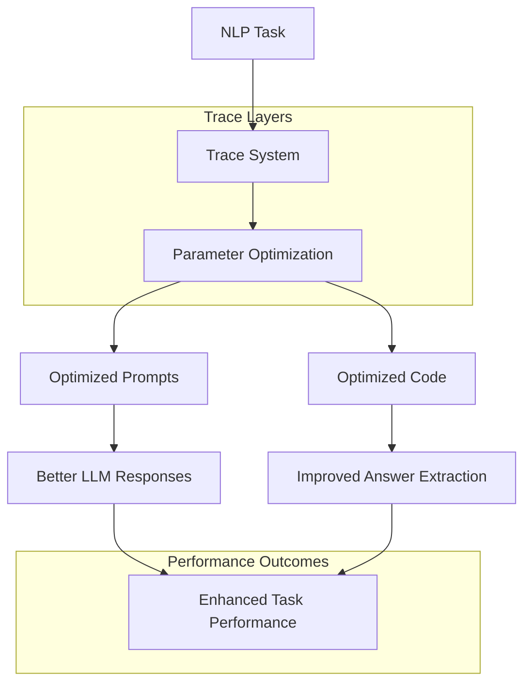
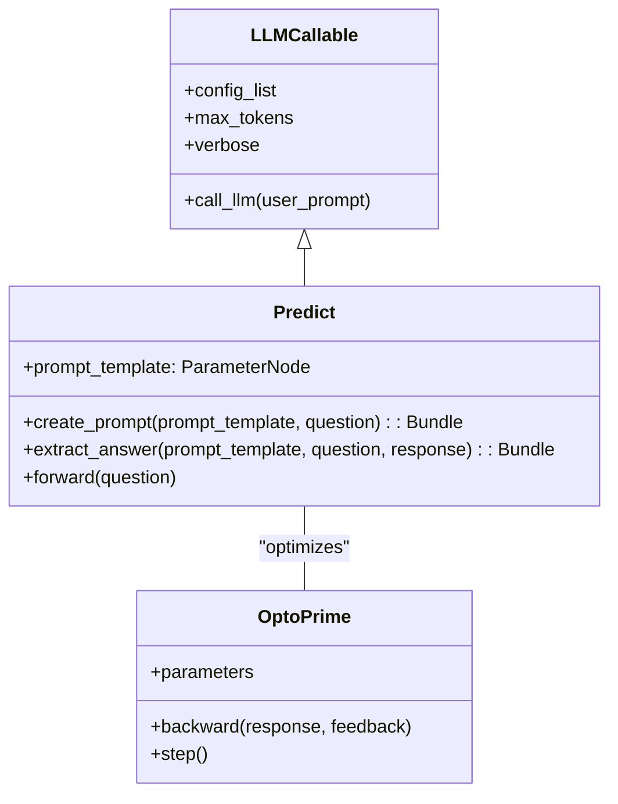
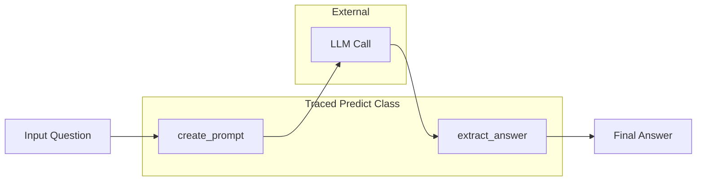
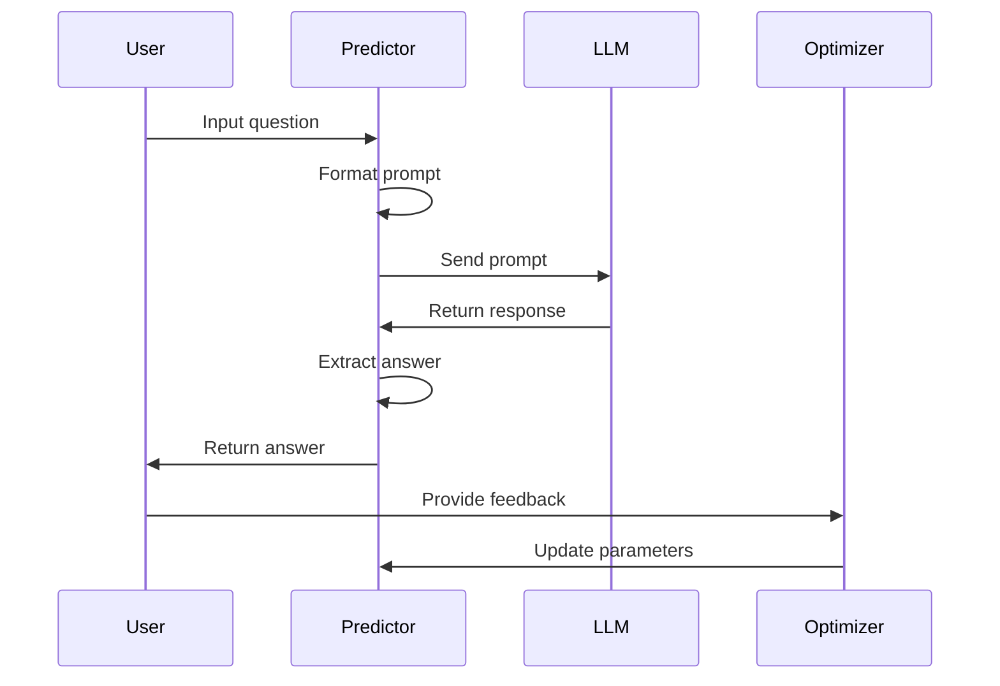
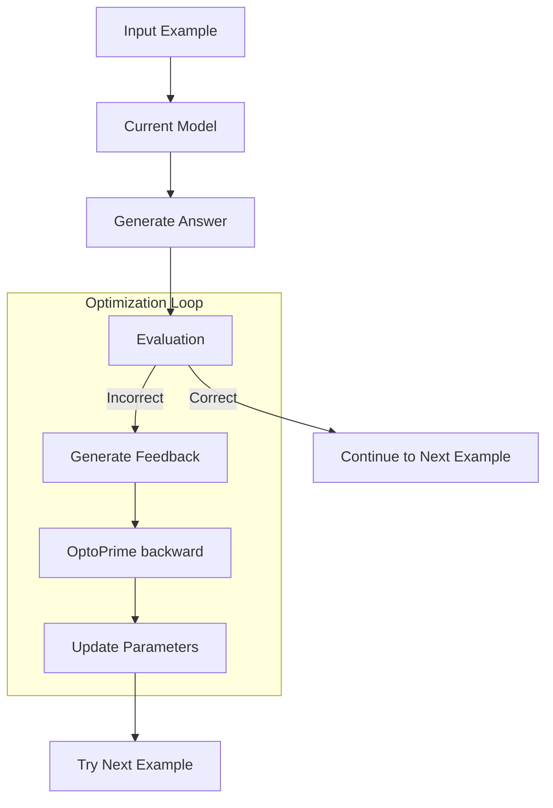
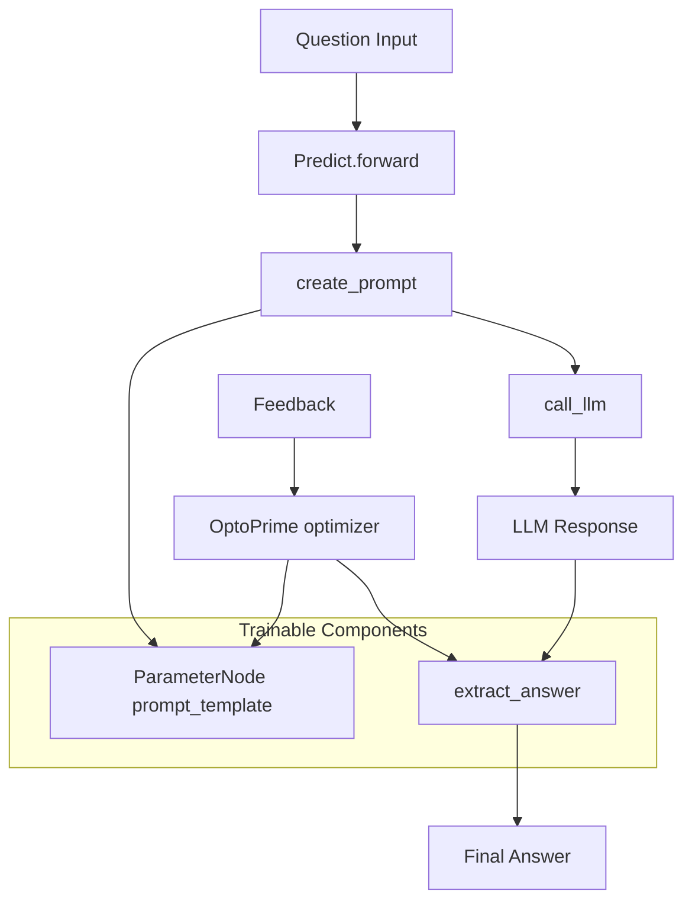
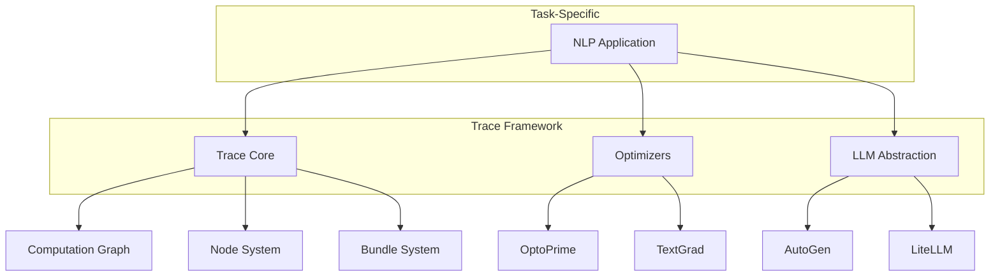

<!-- source: DeepWiki mcp.deepwiki.com · repo microsoft/Trace · page 5.1 NLP Applications · fetched 2026-10-26 -->

# NLP Applications

Relevant source files

The following files were used as context for generating this wiki page:

- [docs/examples/nlp/bigbench_hard.ipynb](docs/examples/nlp/bigbench_hard.ipynb)
- [docs/examples/robotics/metaworld.ipynb](docs/examples/robotics/metaworld.ipynb)

This page documents how the Trace framework can be used to optimize Natural Language Processing (NLP) tasks. It covers the application of Trace's optimization capabilities to various NLP challenges, with a specific focus on prompt engineering and response extraction optimization using LLMs.

For other application domains of Trace, see [Game Agents](#5.2) and [Coding and Verification](#5.3).

## Overview of NLP Applications in Trace

Trace provides a powerful framework for optimizing natural language processing workflows through its general feedback mechanisms. Unlike traditional methods that only optimize prompts, Trace enables end-to-end optimization of both prompts and code that post-processes LLM responses. This allows for improvements in:

1. Prompt templates provided to LLMs
2. Response parsing and extraction logic
3. Output formatting and transformation

The Trace system handles the optimization of heterogeneous parameters (strings, functions, etc.) seamlessly, providing a unified approach to improving NLP system performance.

Sources: [docs/examples/nlp/bigbench_hard.ipynb:1-50]()

## Example NLP Task: BigBench-Hard

A prime example of applying Trace to NLP is optimizing performance on the BigBench-Hard benchmark, which contains challenging natural language understanding tasks. Traditional approaches typically only optimize prompts while using hand-written code for answer extraction. Trace enables optimization of both components.

### Framework Components for NLP Tasks

The framework for NLP tasks in Trace typically consists of:

1. **LLM Interface**: Handles communication with language models
2. **Prediction Module**: Constructs prompts and extracts answers
3. **Optimizer**: Updates parameters based on feedback

Sources: [docs/examples/nlp/bigbench_hard.ipynb:162-253]()

### Traced Model Definition

For NLP tasks, Trace uses a model-based approach where Python classes are wrapped with `@model` to enable tracing. Below is a typical structure for an NLP task model:

The `Predict` class typically includes:

1. A prompt template stored as a `ParameterNode` that can be optimized
2. A `create_prompt` function that formats the question into a prompt
3. An `extract_answer` function that processes LLM responses
4. A `forward` method that chains these operations together

These components are exposed to the optimizer through `@bundle` and `@model` decorators, allowing Trace to modify both the prompt template and answer extraction logic based on feedback.

Sources: [docs/examples/nlp/bigbench_hard.ipynb:213-253]()

## Optimization Process for NLP Tasks

The optimization process for NLP tasks in Trace follows a sequence of steps:

### Training Loop

The training process involves:

1. Processing examples through the predictor
2. Evaluating the correctness of answers
3. Providing feedback to the optimizer 
4. Updating parameters based on feedback

The optimizer uses the feedback to adjust the prompt template and the code for extracting answers, improving the model's performance over time.

Sources: [docs/examples/nlp/bigbench_hard.ipynb:276-300]()

### Parameter Optimization

Trace's optimization process for NLP applications can handle:

1. **Prompt Templates**: Optimizing the text provided to LLMs
2. **Extraction Logic**: Improving code that processes LLM outputs
3. **Error Handling**: Adapting to different response formats

This approach enables the system to improve both the quality of the prompts sent to the LLM and the robustness of the answer extraction process.

Sources: [docs/examples/nlp/bigbench_hard.ipynb:286-300]()

## Implementation Example: BigBench-Hard

The BigBench-Hard example demonstrates how to implement a complete NLP task with Trace:

### Key Components

1. **LLMCallable Class**: Interfaces with LLM APIs using AutoGen
2. **Predict Class**: Constructs prompts and extracts answers
3. **Optimizer**: Uses OptoPrime to update parameters
4. **Training Function**: Implements the optimization loop

### Model Structure

The `Predict` class contains:

1. `prompt_template`: A ParameterNode containing the template text
2. `create_prompt`: A trainable function to format the question 
3. `extract_answer`: A trainable function to process LLM responses
4. `forward`: The main method that calls all components in sequence

Sources: [docs/examples/nlp/bigbench_hard.ipynb:213-253]()

### Optimization Results

The optimization process improves performance by:

1. Refining the prompt template to better guide the LLM
2. Enhancing the answer extraction code to handle different response formats
3. Adapting to specific requirements of the NLP task

## Integration with Trace Ecosystem

NLP applications in Trace integrate with the broader Trace ecosystem:

The NLP applications leverage multiple components of the Trace system:

1. **Core Architecture**: Uses nodes, bundles, and models
2. **Optimizers**: Employs OptoPrime or other optimizers 
3. **LLM Abstraction**: Utilizes the unified LLM interface

This integration allows NLP applications to benefit from all the capabilities of the Trace framework while focusing on the specific requirements of natural language processing tasks.

Sources: [docs/examples/nlp/bigbench_hard.ipynb:55-67]()

## Summary

Trace provides a powerful framework for optimizing NLP tasks by:

1. Enabling end-to-end optimization of both prompts and code
2. Supporting heterogeneous parameter optimization
3. Providing robust feedback mechanisms
4. Integrating with various LLM backends

This approach allows for significant improvements in performance on NLP tasks compared to traditional methods that only focus on prompt optimization. The BigBench-Hard example demonstrates how Trace can be applied to challenging natural language understanding tasks, with the potential for extension to many other NLP applications.

Sources: [docs/examples/nlp/bigbench_hard.ipynb:1-30]()

---

