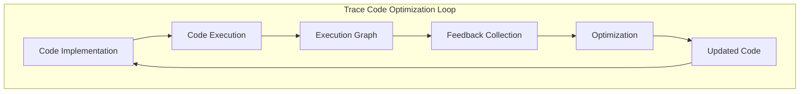
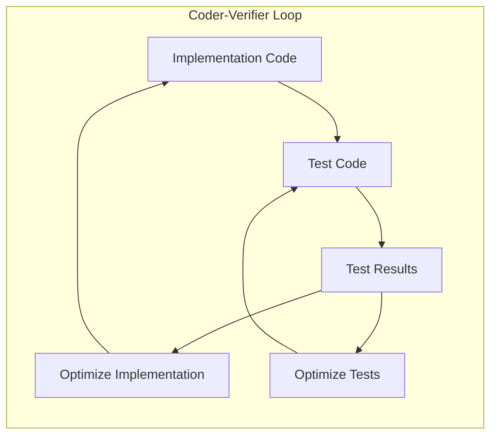
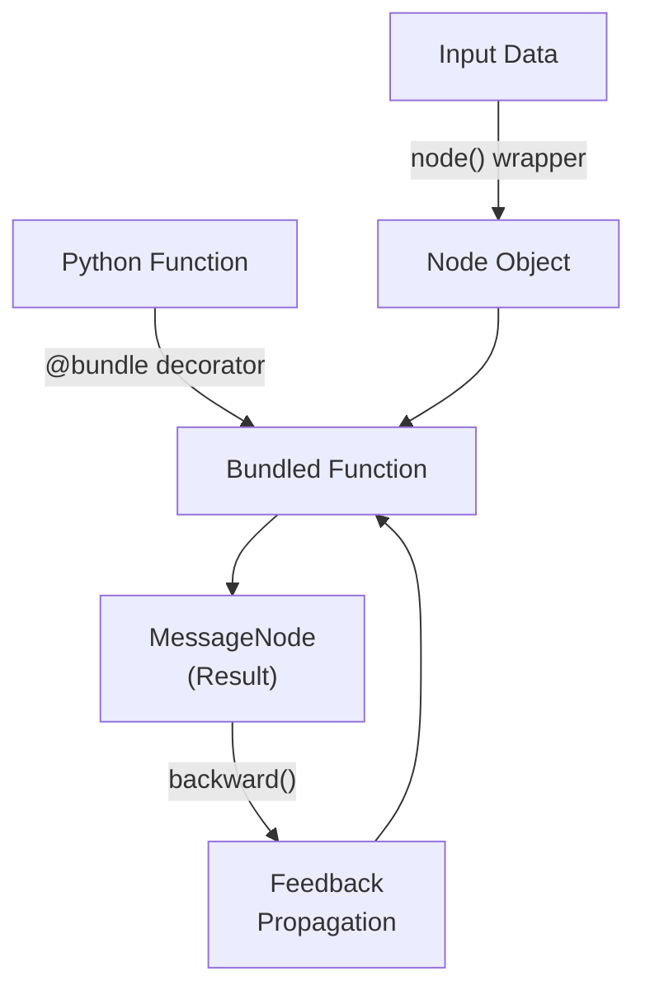
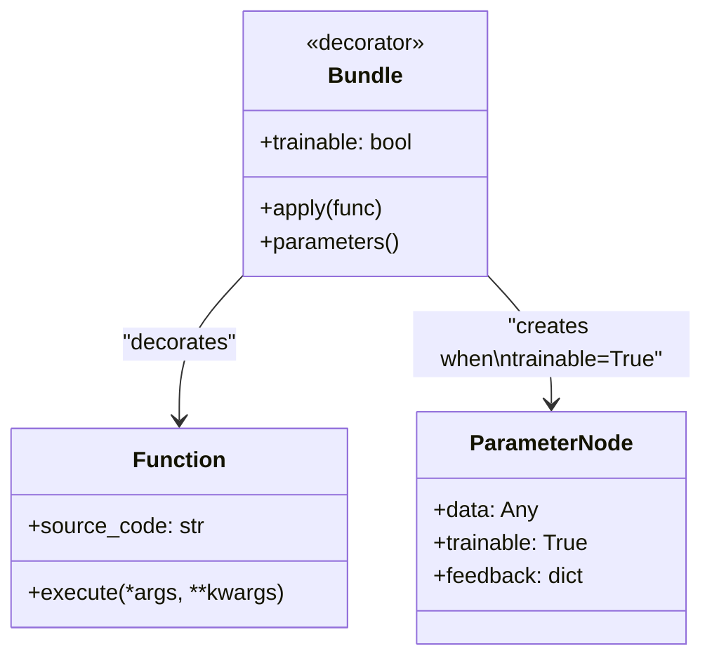
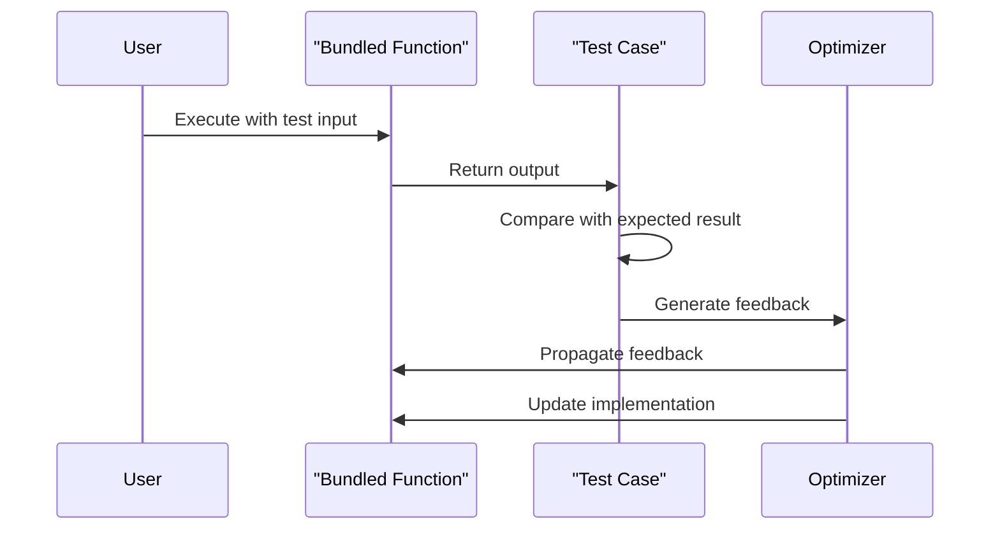
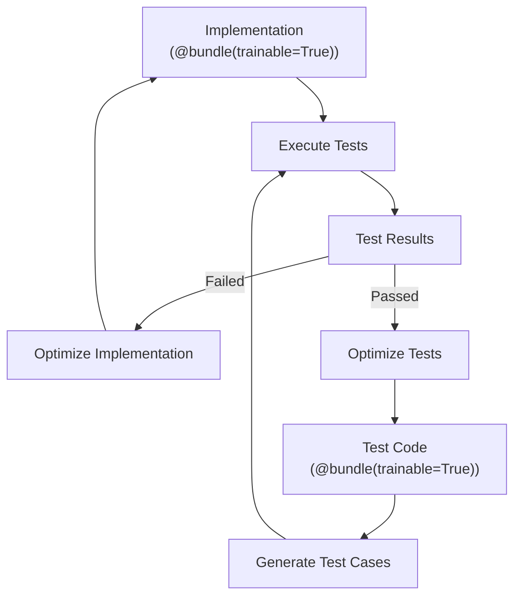
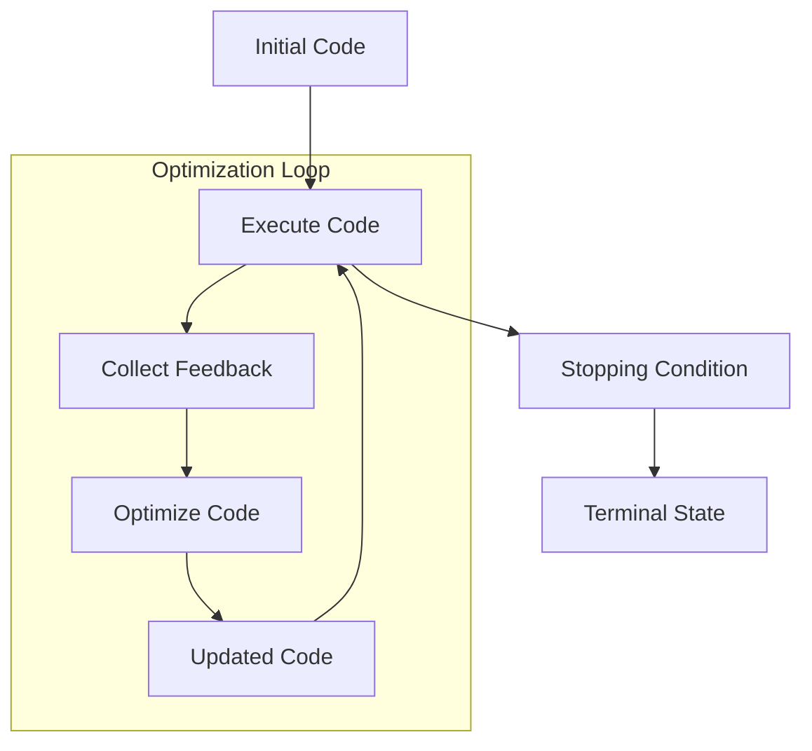
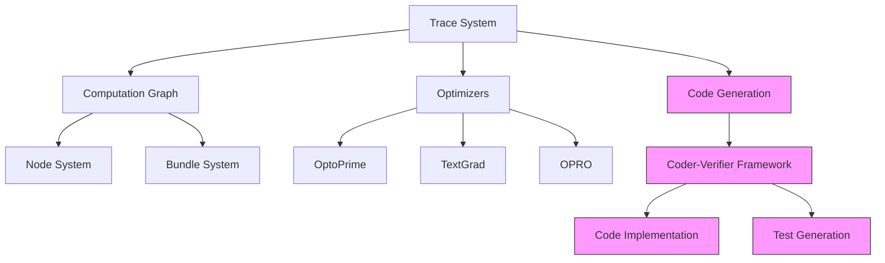

<!-- source: DeepWiki mcp.deepwiki.com · repo microsoft/Trace · page 5.3 Coding and Verification · fetched 2026-10-26 -->

# Coding and Verification

<details>
<summary>Relevant source files</summary>

The following files were used as context for generating this wiki page:

- [docs/examples/game/battleship.ipynb](docs/examples/game/battleship.ipynb)
- [docs/quickstart/quick_start.ipynb](docs/quickstart/quick_start.ipynb)
- [docs/quickstart/quick_start_2.ipynb](docs/quickstart/quick_start_2.ipynb)
- [docs/tutorials/basic_tutorial.ipynb](docs/tutorials/basic_tutorial.ipynb)
- [docs/tutorials/optimization_tutorial.ipynb](docs/tutorials/optimization_tutorial.ipynb)

</details>


This page documents the code generation and verification capabilities of the Trace framework. It explains how Trace enables automated code optimization through feedback mechanisms and describes the coder-verifier workflow that allows alternating between code generation and test verification. For information about other applications of Trace like game agents, see [Game Agents](#5.2) or for natural language processing applications, see [NLP Applications](#5.1).

## Overview

The Coding and Verification subsystem in Trace provides mechanisms to optimize executable Python code based on feedback. Unlike traditional code generation approaches that treat code as static strings, Trace enables:

1. Automatic tracing of code execution and dependencies
2. Feedback-based optimization of code through LLM-powered optimizers
3. Self-improving code through alternation between code generation and verification

This approach allows for creating systems that can iteratively improve their own code implementation based on test results or other feedback signals.



Sources: [docs/quickstart/quick_start.ipynb:14-18]()

## Coder-Verifier Framework

The Coder-Verifier framework in Trace enables the creation of self-improving code by alternating between optimizing code implementations and optimizing tests that verify the correctness of the code.



The framework consists of two main components:

1. **Coder**: Responsible for generating or modifying code implementations based on test results
2. **Verifier**: Responsible for generating tests that verify the correctness of the code

Each component can be optimized independently, creating a feedback loop that leads to continuously improving code quality and test coverage.

Sources: [docs/quickstart/quick_start.ipynb:660-671]()

## Implementation Approach

### Tracing Code Execution

The key innovation in Trace's approach to code verification is the ability to trace the execution of code and capture the computational graph. This is achieved through:

1. **Node Wrapping**: Encapsulating Python objects in `node` containers
2. **Function Bundling**: Using the `@bundle` decorator to make functions traceable
3. **Feedback Propagation**: Sending feedback signals through the computational graph



Sources: [docs/quickstart/quick_start.ipynb:170-180](), [docs/tutorials/basic_tutorial.ipynb:10-12]()

### Bundled Functions as Trainable Parameters

A key feature is the ability to treat functions themselves as trainable parameters:



When a function is marked with `@bundle(trainable=True)`, its code becomes a trainable parameter that can be modified by an optimizer.

Sources: [docs/quickstart/quick_start.ipynb:172-173](), [docs/quickstart/quick_start.ipynb:297-307]()

## Optimization Process

### Feedback Collection

The process begins by evaluating the code against some criteria, such as test cases:

1. Execute the code with test inputs
2. Compare the output with expected results
3. Generate feedback based on success or failure
4. Propagate feedback through the execution graph



Sources: [docs/quickstart/quick_start.ipynb:332-346](), [docs/tutorials/optimization_tutorial.ipynb:209-250]()

### Optimizers

Trace offers multiple optimizers for code improvement:

| Optimizer | Description | Use Case |
|-----------|-------------|----------|
| OptoPrime | LLM-based optimizer that uses full graph structure | General code optimization |
| TextGrad | Text-based gradient descent | When fine-tuned control is needed |
| OPRO | Fast optimizer that doesn't use computation graph | Quick iterations on simple problems |
| OptoPrimeMulti | Generates multiple candidate solutions | When diversity of solutions is beneficial |

The optimizers analyze the feedback and execution graph to propose modifications to the code, which can range from simple parameter changes to complete function rewrites.

Sources: [docs/quickstart/quick_start.ipynb:375-402](), [docs/tutorials/optimization_tutorial.ipynb:65-80]()

## Practical Examples

### Strange Sort Example

A classic example demonstrates optimizing a function called `strange_sort_list` that needs to implement a specific sorting algorithm:

1. Start with an incorrect implementation
2. Mark the function as trainable using `@bundle(trainable=True)`
3. Execute the function with test inputs
4. Collect feedback when output doesn't match expectations
5. Use an optimizer to update the implementation based on feedback

The optimizer analyzes the function code, error patterns, and feedback to propose an improved implementation that corrects the sorting logic.

Sources: [docs/quickstart/quick_start.ipynb:107-119](), [docs/quickstart/quick_start.ipynb:177-189](), [docs/quickstart/quick_start.ipynb:375-402]()

### Coder-Verifier Alternation

The coder-verifier pattern extends this concept by having two trainable components:



This allows for increasingly sophisticated tests as the implementation improves, leading to a virtuous cycle of code and test improvement.

Sources: [docs/quickstart/quick_start.ipynb:671-683]()

## Advanced Techniques

### Adding Constraints to Code Generation

Constraints can be specified to guide the optimizer in generating appropriate code:

```python
x = node(value, trainable=True, constraint="Description of constraints")
```

These constraints act as guard rails for the optimization process, ensuring that the generated code adheres to specific requirements or maintains certain properties.

Sources: [docs/tutorials/optimization_tutorial.ipynb:466-484]()

### Multi-Step Optimization Loops

For complex code generation tasks, a multi-step optimization loop can be used:



This allows for incremental improvement of the code, with each iteration building on the results of the previous one until a satisfactory solution is found.

Sources: [docs/tutorials/optimization_tutorial.ipynb:114-143](), [docs/examples/game/battleship.ipynb:402-769]()

## Integration with the Trace Ecosystem

The Coding and Verification subsystem integrates with the broader Trace ecosystem:



By leveraging the core components of Trace, the Coding and Verification subsystem provides a powerful framework for developing self-improving code systems.

Sources: [docs/quickstart/quick_start.ipynb:10-20](), [docs/quickstart/quick_start_2.ipynb:10-20]()

## Best Practices

When using the Coding and Verification subsystem, consider the following best practices:

1. **Clear Feedback**: Provide detailed, actionable feedback that helps the optimizer understand what needs to be improved.
2. **Comprehensive Tests**: Develop tests that cover a wide range of edge cases to ensure robust code generation.
3. **Incremental Complexity**: Start with simple problems and gradually increase complexity as the system improves.
4. **Constraints**: Use the constraint parameter to guide the code generation process and prevent unwanted behaviors.
5. **Multiple Iterations**: Allow for multiple optimization cycles to reach the best solution.

Sources: [docs/quickstart/quick_start.ipynb:319-325](), [docs/tutorials/optimization_tutorial.ipynb:466-484]()

## Summary

The Coding and Verification subsystem in Trace provides a powerful framework for creating self-improving code through:

1. Tracing code execution to build computational graphs
2. Collecting and propagating feedback through these graphs
3. Using LLM-powered optimizers to improve code based on feedback
4. Alternating between code generation and test verification

This approach enables the development of systems that can evolve and improve their own code implementations over time, leading to more robust and efficient solutions.

Sources: [docs/quickstart/quick_start.ipynb:10-20](), [docs/quickstart/quick_start.ipynb:660-671]()

---

