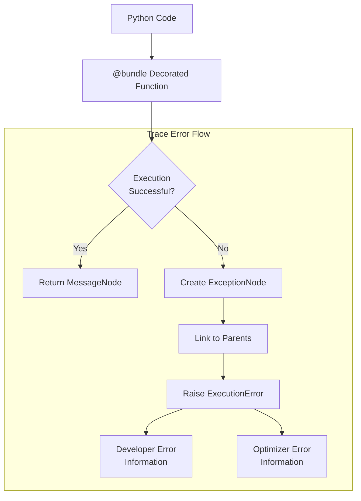
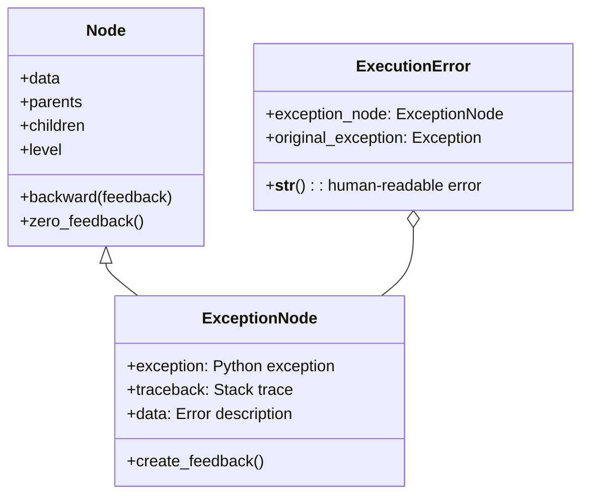
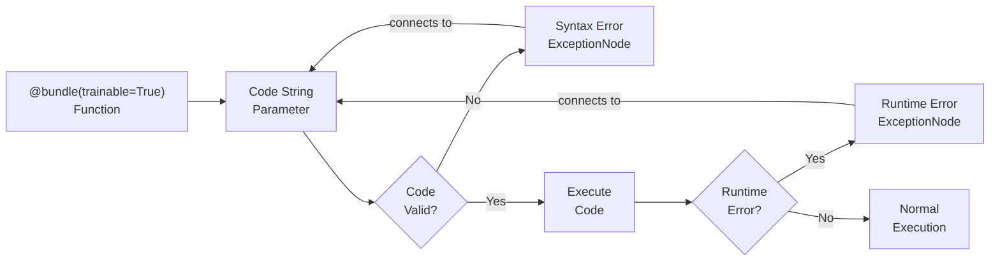
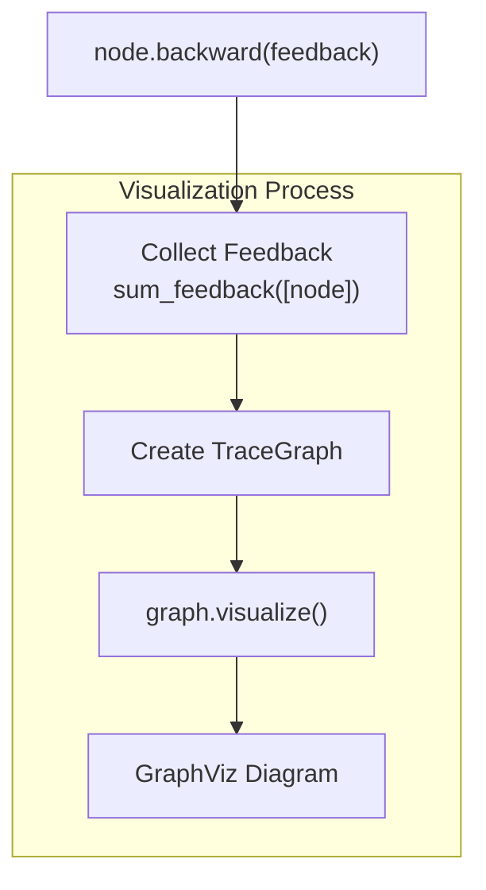
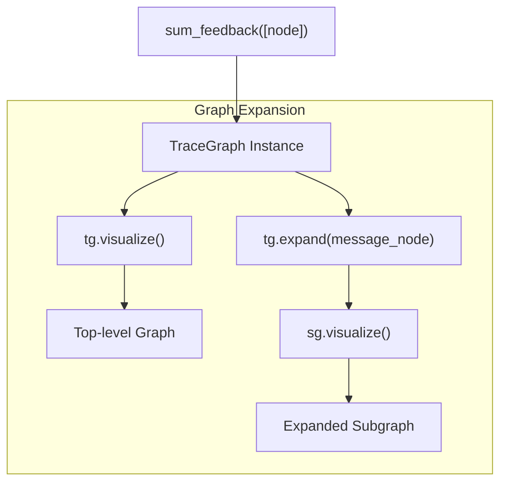
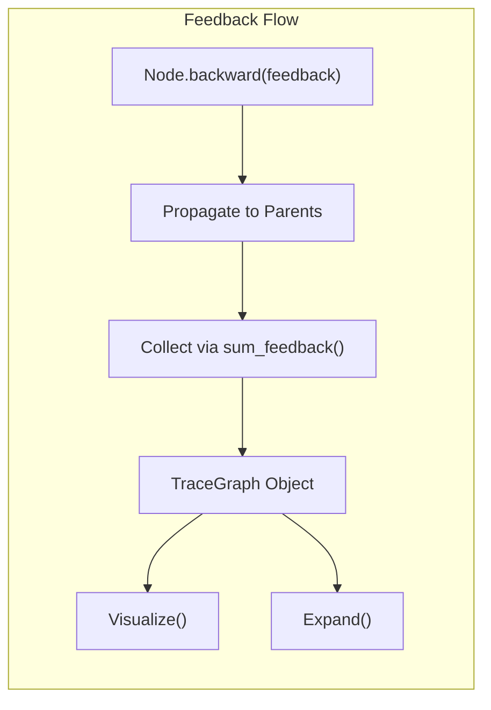
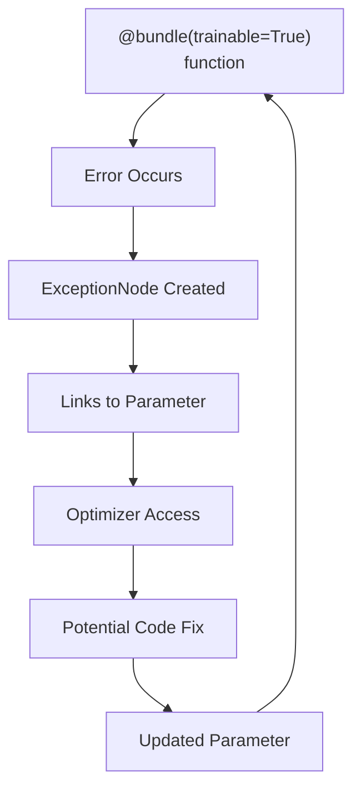
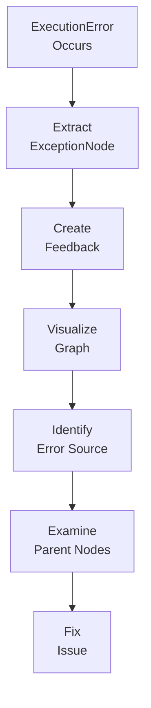
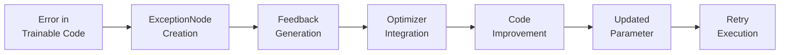

<!-- source: DeepWiki mcp.deepwiki.com · repo microsoft/Trace · page 6 Error Handling and Debugging · fetched 2026-10-26 -->

# Error Handling and Debugging

<details>
<summary>Relevant source files</summary>

The following files were used as context for generating this wiki page:

- [.gitignore](.gitignore)
- [OAI_CONFIG_LIST_sample](OAI_CONFIG_LIST_sample)
- [opto/trace/propagators/graph_propagator.py](opto/trace/propagators/graph_propagator.py)
- [tests/unit_tests/test_dependencies.py](tests/unit_tests/test_dependencies.py)
- [tests/unit_tests/test_error_handling.py](tests/unit_tests/test_error_handling.py)
- [tests/unit_tests/test_randomness.py](tests/unit_tests/test_randomness.py)

</details>


## Purpose and Scope

This document provides a comprehensive overview of the error handling mechanisms and debugging tools available in Microsoft Trace. The Trace system implements sophisticated error handling that integrates with its computation graph architecture, allowing errors to be captured, analyzed, and potentially optimized through feedback loops.

For information on using optimizers to improve code based on error feedback, see [Optimizers](#3).

## Error Handling Architecture

Trace implements a specialized error handling system that preserves the computation graph structure even when errors occur. This approach differs from traditional Python exception handling by maintaining relationships between nodes and enabling optimization based on error feedback.



Sources: `tests/unit_tests/test_error_handling.py:13-26`, `tests/unit_tests/test_error_handling.py:30-44`

### Core Error Components

The error handling system in Trace is built around two key components:

1. **ExceptionNode**: A specialized node in the computation graph that contains error information
2. **ExecutionError**: A custom exception type that wraps Python exceptions occurring in traced code



Sources: `tests/unit_tests/test_error_handling.py:13-26`

When an error occurs in traced code, the system:
1. Captures the original exception
2. Creates an `ExceptionNode` with error details
3. Connects the `ExceptionNode` to relevant parent nodes in the graph
4. Raises an `ExecutionError` containing the `ExceptionNode`

This approach preserves computation graph integrity while providing rich error context.

## Error Handling Contexts

Trace handles errors differently based on the context in which they occur:

### Direct Function Errors

When errors occur in direct function calls, they are captured and linked to input parameters:

```python
x = Node(1, name="node_x")
y = Node(0, name="node_y")  # Will cause division by zero

def bug_program(x: Node, y: Node):
    z = x / y
    return z

try:
    bug_program(x, y)
except ExecutionError as e:
    # e.exception_node contains error details
    # e.exception_node.parents includes x and y
```

### Decorated Function Errors

Functions decorated with `@bundle()` automatically wrap errors in `ExecutionError`:

```python
@bundle()
def error_fun():
    x = None
    x.append(1)  # AttributeError
    return x

try:
    error_fun()
except ExecutionError as e:
    # e.exception_node contains detailed error information
```

### Trainable Code Errors

Errors in trainable code (with `trainable=True`) are specially handled to facilitate optimization:



Sources: `tests/unit_tests/test_error_handling.py:87-113`, `tests/unit_tests/test_error_handling.py:115-133`

Trace distinguishes between syntax errors (detected during parsing) and runtime errors (detected during execution) in trainable code.

### Nested Errors

When errors occur in nested function calls, the system maintains proper context and parent relationships:

```python
def error_fun():
    x = None
    x.append(1)  # AttributeError
    return x

@bundle()
def top_fun(x):
    x += 1
    error_fun()  # Error occurs here but is caught in top_fun
    return 2
```

Sources: `tests/unit_tests/test_error_handling.py:63-81`, `tests/unit_tests/test_error_handling.py:138-156`

## Debugging Tools

The Trace system provides several tools for debugging computation graphs and understanding errors.

### Graph Visualization

The `TraceGraph` class includes visualization capabilities for inspecting computation graphs:



Key visualization features:
- Nodes are styled according to type (Parameter, Message, Exception)
- Edges show dependencies between nodes
- Nodes are organized by their level in the computation
- Print limits can be set for large graphs

Example code for visualization:

```python
try:
    output = function()
except ExecutionError as e:
    # Create feedback from the exception node
    feedback = e.exception_node.create_feedback()
    # Visualize the graph to understand error context
    graph = feedback.visualize()
```

Sources: `opto/trace/propagators/graph_propagator.py:88-121`

### Graph Expansion

For debugging nested computations, Trace provides graph expansion capabilities:



This functionality allows developers to drill down into complex nested computations to identify error sources.

Sources: `opto/trace/propagators/graph_propagator.py:54-77`, `tests/unit_tests/test_dependencies.py:46-53`

### Feedback Propagation

Understanding how feedback propagates through a graph is crucial for debugging:



Trace provides methods for tracking feedback propagation through the computation graph, essential for understanding error origins and impacts.

Sources: `opto/trace/propagators/graph_propagator.py:15-53`, `opto/trace/propagators/graph_propagator.py:123-153`

## Common Error Patterns

### Typical Errors in Trace

| Error Type | Description | Common Causes |
|------------|-------------|---------------|
| Division by Zero | Occurs in mathematical operations | Missing input validation |
| None Reference | Accessing attributes on None | Improper initialization |
| Syntax Errors | Invalid code syntax | Code string parsing issues |
| Type Errors | Operations on incompatible types | Incorrect function inputs |
| Hidden Errors | Errors deep in call stacks | Complex nested dependencies |

Sources: `tests/unit_tests/test_error_handling.py:13-26`, `tests/unit_tests/test_error_handling.py:30-44`, `tests/unit_tests/test_error_handling.py:87-113`

### Error in Trainable Code

Errors in trainable code are particularly important as they can be optimized:



The system captures errors in trainable code and creates `ExceptionNode` instances that link back to the code parameter, enabling optimizers to potentially fix the code.

Sources: `tests/unit_tests/test_error_handling.py:97-113`, `tests/unit_tests/test_error_handling.py:115-133`

## Debugging Strategies

### Examining Exception Nodes

When debugging Trace applications, examining `ExceptionNode` contents is essential:

```python
try:
    result = function()
except ExecutionError as e:
    # Developer-facing error information
    print(f"Developer error: {e}")
    
    # Optimizer-facing error information
    print(f"Optimizer feedback: {e.exception_node.data}")
    
    # Inspect parent nodes to find error source
    for parent in e.exception_node.parents:
        print(f"Parent: {parent}")
```

This approach provides rich context about the error and its origins in the computation graph.

Sources: `tests/unit_tests/test_error_handling.py:19-26`, `tests/unit_tests/test_error_handling.py:38-44`

### Using Optimizer Feedback

For errors in trainable code, optimizers can use error information to suggest improvements:

```python
try:
    output = agent.act()
except ExecutionError as e:
    # Create feedback from the exception
    feedback = e.exception_node.create_feedback()
    
    # Apply the feedback through an optimizer
    optimizer = OptoPrime(agent.parameters())
    optimizer.backward(e.exception_node, feedback)
    optimizer.step()  # May fix the error
```

Sources: `tests/unit_tests/test_error_handling.py:234-246`

### Visualization for Debugging

Graph visualization is a powerful debugging tool:



The visualization helps identify error sources, track dependencies, and understand the execution context when errors occur.

Sources: `opto/trace/propagators/graph_propagator.py:88-121`, `tests/unit_tests/test_dependencies.py:38-44`

## Best Practices

### Error Handling Recommendations

1. **Use `catch_execution_error` parameter** for critical functions:
   ```python
   @bundle(catch_execution_error=True)
   def critical_function():
       # Errors will be caught and wrapped
   ```

2. **Handle lambda function errors** explicitly:
   ```python
   @bundle()
   def test(a, b):
       try:
           return a(b)  # a might be a lambda with errors
       except TypeError:
           # Handle specific error types
           return fallback_value
   ```

3. **Test with diverse inputs** to catch errors early:
   ```python
   for test_input in [0, None, "string", []]:
       try:
           result = function(test_input)
       except ExecutionError as e:
           print(f"Error with input {test_input}: {e}")
   ```

4. **Create feedback from exceptions** for optimization:
   ```python
   try:
       output = function()
   except ExecutionError as e:
       feedback = e.exception_node.create_feedback()
       # Use feedback for optimization
   ```

Sources: `tests/unit_tests/test_error_handling.py:184-192`, `tests/unit_tests/test_error_handling.py:196-212`

## Error Handling for Optimization

The Trace error handling system is designed not just for debugging but also for optimization. Error information can be used to improve trainable code:



This integration between error handling and optimization is one of the distinctive features of the Trace system, enabling automatic improvement of code based on errors.

Sources: `tests/unit_tests/test_error_handling.py:216-248`

For more details on how optimizers use error feedback, see [Optimizers](#3) and [OptoPrime](#3.1) pages.

---

