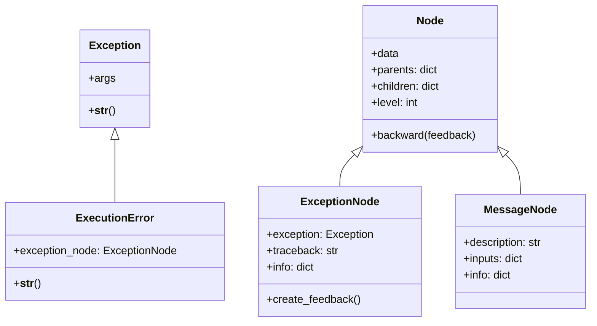
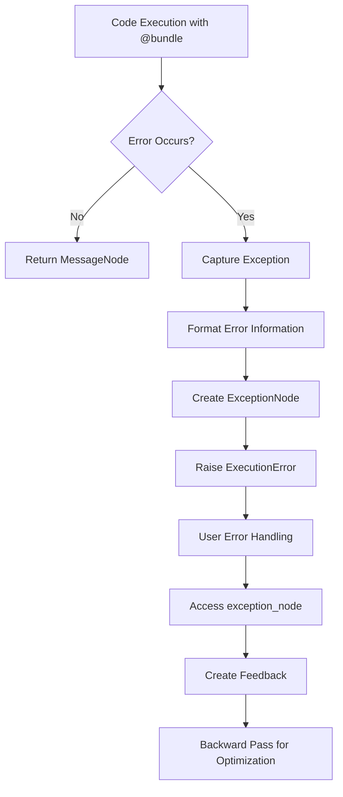
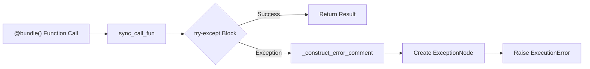
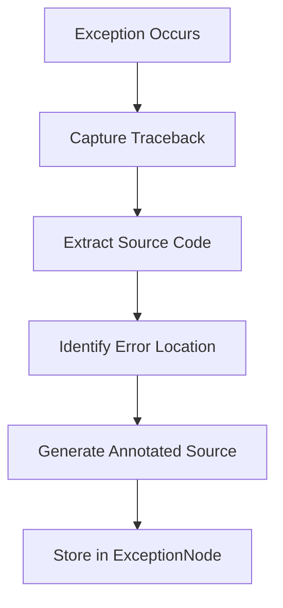
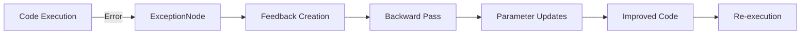

<!-- source: DeepWiki mcp.deepwiki.com · repo microsoft/Trace · page 6.1 Error Handling System · fetched 2026-10-26 -->

# Error Handling System

<details>
<summary>Relevant source files</summary>

The following files were used as context for generating this wiki page:

- [.gitignore](.gitignore)
- [OAI_CONFIG_LIST_sample](OAI_CONFIG_LIST_sample)
- [opto/trace/bundle.py](opto/trace/bundle.py)
- [tests/unit_tests/test_asyncio.py](tests/unit_tests/test_asyncio.py)
- [tests/unit_tests/test_error_handling.py](tests/unit_tests/test_error_handling.py)
- [tests/unit_tests/test_randomness.py](tests/unit_tests/test_randomness.py)

</details>


The Trace framework includes a comprehensive error handling system that captures, processes, and utilizes exceptions as part of its computational graph. This system provides detailed error information for developers while also enabling error-driven optimization through the graph structure. This document explains how errors are represented, captured, and used within the Trace framework.

For information about visualizing and debugging errors, see [Visualization and Debugging](#6.2).

## 1. Error Handling Architecture

The error handling system in Trace revolves around three key components:

1. **Exception Nodes** - Special nodes in the computation graph that represent errors
2. **ExecutionError** - Custom exception class that wraps exception nodes
3. **Error Capturing Mechanisms** - Methods for catching and processing different types of errors



Sources: [opto/trace/bundle.py:13-25](), [tests/unit_tests/test_error_handling.py:1-3]()

### 1.1 Error Flow Process

When an error occurs in a Trace-decorated function, it follows this flow:



Sources: [opto/trace/bundle.py:414-432](), [opto/trace/bundle.py:433-451]()

## 2. Exception Nodes and Error Types

### 2.1 ExceptionNode

`ExceptionNode` is a specialized Node subclass that represents exceptions within the computation graph. It stores:

- The original exception object
- Formatted traceback information
- References to parent nodes (inputs that contributed to the error)
- Additional context in the info dictionary

When created, an ExceptionNode maintains the dependency relationships, allowing the error to be traced back to its causes in the computation graph.

Sources: [opto/trace/bundle.py:20-23](), [opto/trace/bundle.py:580-587]()

### 2.2 ExecutionError

`ExecutionError` is a custom exception class that wraps an `ExceptionNode`. It serves as the interface between the graph-based error representation and Python's exception handling system. When a bundled function encounters an error, it:

1. Creates an `ExceptionNode` to represent the error in the graph
2. Wraps the node in an `ExecutionError` exception
3. Raises the `ExecutionError` to be caught by user code

This dual-nature allows errors to be both handled traditionally by developers and utilized for optimization.

Sources: [opto/trace/bundle.py:13](), [opto/trace/bundle.py:580-587]()

## 3. Error Capturing Mechanisms

The Trace framework provides several mechanisms for capturing errors across different execution contexts.

### 3.1 Synchronous Error Handling

For regular synchronous functions, the `@bundle` decorator enables error capturing through the `catch_execution_error` parameter (default is `True`). When enabled, any exception in the function is:

1. Caught and processed by `sync_call_fun`
2. Transformed into an `ExceptionNode` and `ExecutionError`
3. Propagated to the caller



Sources: [opto/trace/bundle.py:414-432](), [opto/trace/bundle.py:586-587]()

### 3.2 Asynchronous Error Handling

For asynchronous functions, Trace provides parallel error handling through `async_call_fun`. This enables error capturing in async contexts, including concurrent execution with `asyncio.gather()`.

The same error processing flow applies, but adapted for async/await execution patterns.

Sources: [opto/trace/bundle.py:433-451](), [tests/unit_tests/test_asyncio.py:53-100]()

### 3.3 Trainable Code Error Handling

Trace provides special error handling for trainable code (functions decorated with `@bundle(trainable=True)`). Two types of errors receive specialized handling:

1. **Syntax Errors** - Errors in the code definition itself
2. **Execution Errors** - Errors that occur when running the trainable code

For trainable code, errors are traced back to the parameter node that contains the code, enabling optimization of the code itself based on the errors it produces.

Sources: [opto/trace/bundle.py:176-235](), [tests/unit_tests/test_error_handling.py:87-133]()

## 4. Error Information Processing

### 4.1 Tracebacks and Source Code Annotation

A key feature of Trace's error handling is its ability to annotate source code with error information:



The `_construct_error_comment` method processes the Python traceback, identifies the error location, and generates an annotated version of the source code with error messages inserted directly at the problematic lines.

Sources: [opto/trace/bundle.py:364-412](), [opto/trace/bundle.py:622-636]()

### 4.2 Dual Audience Error Messages

Trace provides two different views of errors:

1. **Developer Messages** - Detailed information including source code, line numbers, and stack traces intended for human debugging
2. **Optimizer Messages** - Structured error information usable by optimizers to improve parameters

This dual approach allows both human developers and optimization algorithms to respond effectively to errors.

Sources: [tests/unit_tests/test_error_handling.py:18-26](), [tests/unit_tests/test_error_handling.py:37-44]()

## 5. Error-Driven Optimization

One of the most powerful features of Trace's error handling is the ability to use errors to drive optimization.



When an error occurs, the resulting `ExceptionNode` can be used to:

1. Generate feedback (typically negative)
2. Propagate that feedback through the graph via `backward()`
3. Update parameters (including code parameters) to avoid the error

This enables a form of error-driven learning where the system can automatically improve code to eliminate errors.

Sources: [tests/unit_tests/test_error_handling.py:215-248]()

## 6. Usage Examples

### 6.1 Basic Error Handling

The simplest form of error handling in Trace involves catching `ExecutionError` exceptions:

```python
@bundle()
def error_fun():
    x = None
    x.append(1)  # This will raise an AttributeError

try:
    result = error_fun()
except ExecutionError as e:
    # Developer view
    print(f"Error message to developer:\n{e}")
    
    # Optimizer view
    print(f"Error message to optimizer:\n{e.exception_node.data}")
    
    # Access the exception node for optimization
    exception_node = e.exception_node
```

Sources: [tests/unit_tests/test_error_handling.py:29-44]()

### 6.2 Nested Error Handling

Trace can handle errors in nested function calls, tracing the error through multiple levels:

```python
def error_fun():
    x = None
    x.append(1)  # Error occurs here

@bundle()
def top_fun(x):
    x += 1
    error_fun()  # Error propagates from here
    return 2

try:
    top_fun(1)
except ExecutionError as e:
    # Error information includes the nested call stack
    print(f"Error message to developer:\n{e}")
```

Sources: [tests/unit_tests/test_error_handling.py:62-82]()

### 6.3 Trainable Code Error Handling

For trainable code, errors provide feedback for improvement:

```python
@bundle(trainable=True)
def bug_program(x):
    x + 10
    x / 0  # Division by zero error
    return

try:
    bug_program(1)
except ExecutionError as e:
    # The exception node's parent includes the code parameter
    assert bug_program.parameter in e.exception_node.parents
    
    # This can be used for optimization
    feedback = e.exception_node.create_feedback()
    optimizer.backward(e.exception_node, feedback)
```

Sources: [tests/unit_tests/test_error_handling.py:115-133](), [tests/unit_tests/test_error_handling.py:215-248]()

### 6.4 Asynchronous Error Handling

Trace seamlessly integrates with async/await:

```python
@bundle()
async def error(a=0):
    raise ValueError('error')

async def main():
    a = trace.node('a')
    try:
        x = await error(a)
    except trace.ExecutionError as e:
        # Handle error as with synchronous functions
        x = e.exception_node
```

Sources: [tests/unit_tests/test_asyncio.py:53-76]()

## 7. Configuration Options

The error handling system can be configured through the `@bundle` decorator:

| Parameter | Default | Description |
|-----------|---------|-------------|
| `catch_execution_error` | `True` | Whether to catch exceptions during operator execution |
| `traceable_code` | `False` | Whether the operator's code is traceable by Trace |
| `trainable` | `False` | Whether the code block is treated as a variable in optimization |
| `allow_external_dependencies` | `False` | Whether to allow external dependencies |

Sources: [opto/trace/bundle.py:28-70]()

## Summary

The error handling system in Trace transforms traditional exceptions into first-class graph objects that can be:

1. Inspected by developers for detailed debugging
2. Used by optimizers to improve code and parameters
3. Tracked through the computation graph to identify root causes

This integration of error handling with the graph structure is a key enabler for code optimization and self-improvement capabilities in the Trace framework.

---

