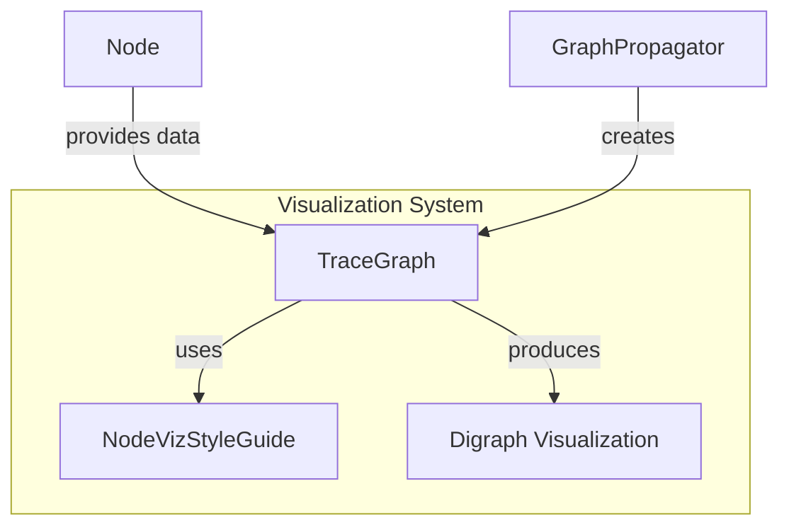
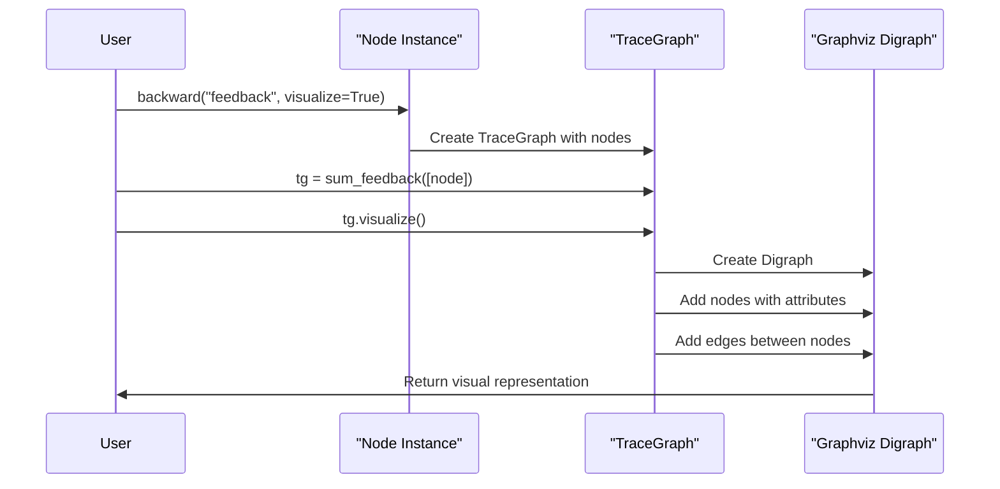
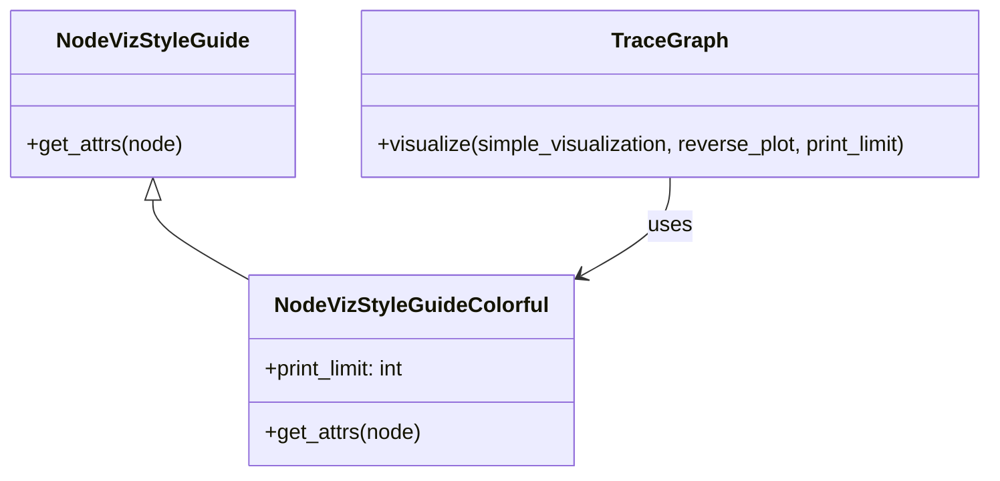
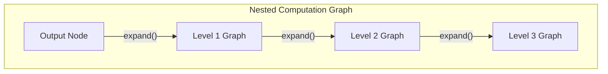
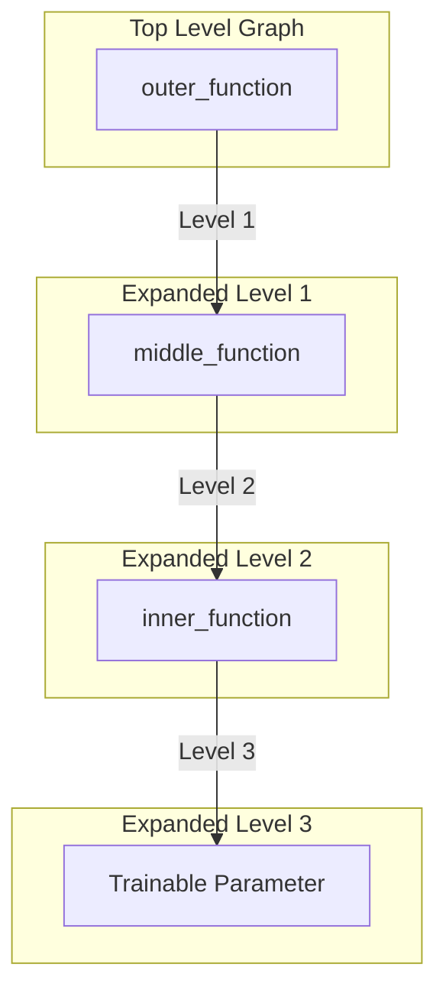
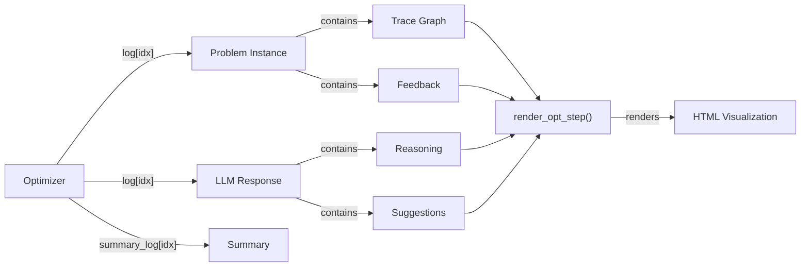
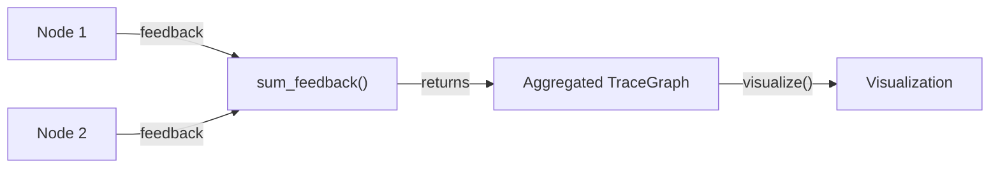

<!-- source: DeepWiki mcp.deepwiki.com · repo microsoft/Trace · page 6.2 Visualization and Debugging · fetched 2026-10-26 -->

# Visualization and Debugging

<details>
<summary>Relevant source files</summary>

The following files were used as context for generating this wiki page:

- [opto/trace/propagators/graph_propagator.py](opto/trace/propagators/graph_propagator.py)
- [opto/trace/utils.py](opto/trace/utils.py)
- [tests/unit_tests/test_dependencies.py](tests/unit_tests/test_dependencies.py)

</details>


This page documents the tools and techniques available in the Trace system for visualizing computation graphs and debugging Trace execution. These visualization capabilities are essential for understanding how nodes are connected, how feedback propagates through the system, and for diagnosing issues in complex Trace applications. For information about how errors are captured and processed within Trace, see [Error Handling System](#6.1).

## Graph Visualization System

The Trace system provides built-in visualization tools that allow users to render computation graphs as visual diagrams. These visualizations help in understanding the structure and relationships between nodes in the computation graph.



The primary class for graph visualization is `TraceGraph`, which is a feedback container used by `GraphPropagator`. It maintains a priority queue of nodes in the subgraph, ordered from roots to leaves, and provides methods to visualize the graph structure.

Sources: [opto/trace/propagators/graph_propagator.py:16-121]()

### Visualizing Node Graphs

To visualize a graph, you can use the `visualize` method of a `TraceGraph` instance. This method generates a directed graph representation using the Graphviz library. 



When you call the `backward` method on a node with `visualize=True`, or manually call `TraceGraph.visualize()`, the system:
1. Creates a Graphviz Digraph object
2. Adds nodes to the graph with styling attributes
3. Adds edges between nodes based on parent-child relationships
4. Returns the complete visualization

Sources: [opto/trace/propagators/graph_propagator.py:88-121](), [tests/unit_tests/test_dependencies.py:38-43]()

### Customizing Node Appearance

The visualization system uses a styling guide to determine the appearance of nodes in the graph. The `NodeVizStyleGuideColorful` class provides attributes for different node types.



The style guide determines attributes like node shape, color, and label formatting based on the node type. The `print_limit` parameter controls how much of a node's data is displayed in the visualization.

Sources: [opto/trace/propagators/graph_propagator.py:91](), [opto/trace/nodes.py]() (referenced but not shown in provided files)

## Graph Expansion and Exploration

One of the key debugging features in Trace is the ability to expand nested nodes to visualize their internal structure. This is particularly useful when working with bundled functions that create nested computation graphs.



The `expand` method in `TraceGraph` allows you to visualize the subgraph within a `MessageNode`, revealing the internal computation structure that wouldn't be visible at the top level.

Sources: [opto/trace/propagators/graph_propagator.py:54-77](), [tests/unit_tests/test_dependencies.py:46-52]()

### Traversing Multi-Level Graphs

When working with nested function calls (created using `@bundle`), you can traverse through different levels of the computation graph to debug specific components:



To explore these levels:
1. Start with the top-level graph by calling `visualize()`
2. Identify expandable dependencies using `node.expandable_dependencies`
3. Expand specific nodes with `tg.expand(node).visualize()`
4. Continue this process to dive deeper into nested structures

Sources: [tests/unit_tests/test_dependencies.py:86-126]()

## Optimization Visualization

The Trace system includes tools for visualizing optimization steps, which is crucial for understanding how the system is improving parameters based on feedback.



The `render_opt_step` function in `utils.py` provides a way to visualize individual optimization steps with detailed information about:
- The trace graph at that step
- The feedback received
- The reasoning applied by the optimizer
- The improvements or suggestions made

Sources: [opto/trace/utils.py:66-153]()

### Interactive HTML Display

The optimization step visualization is rendered as HTML for interactive display in environments like Jupyter notebooks. This visualization includes:

```
+----------------------+
| Trace Graph          |
|                      |
+----------------------+
| Feedback             |
|                      |
+----------------------+
| Reasoning            |
|                      |
+----------------------+
| Improvement          |
|                      |
+----------------------+
```

Each section is color-coded and includes both the content and an index reference (g₁, f₁, r₂, a₂) to help track the progression of optimization steps.

Sources: [opto/trace/utils.py:102-152]()

## Practical Debugging Techniques

### Visualizing Dependencies

Understanding dependencies between nodes is crucial for debugging Trace applications. You can visualize these dependencies using the following techniques:

| Dependency Type | Description | How to Visualize |
|----------------|-------------|------------------|
| Parameter Dependencies | Direct connections to trainable parameters | Check `node.parameter_dependencies` |
| Expandable Dependencies | Nodes that can be expanded to show nested structure | Check `node.expandable_dependencies` |
| Hidden Dependencies | Parameters not visible at the current graph level | Revealed through graph expansion |

To check if a node is present in a container of nodes, use the `contain` utility function which checks for identity rather than value equality.

Sources: [opto/trace/utils.py:18-21](), [tests/unit_tests/test_dependencies.py:12-14]()

### Aggregating Feedback

When debugging feedback propagation, you can aggregate feedback from multiple nodes using the `sum_feedback` utility:



This is particularly useful for understanding how feedback flows through complex graphs with multiple parameters.

Sources: [opto/trace/utils.py:14-16](), [tests/unit_tests/test_dependencies.py:41-43]()

### Debugging Complex Nested Structures

When working with deeply nested bundled functions, use this progressive approach to debug:

1. Start by visualizing the top-level graph
   ```python
   output.backward('feedback')
   tg = sum_feedback([parameter])
   tg.visualize()
   ```

2. Identify expandable dependencies and visualize the next level
   ```python
   expandable = list(output.expandable_dependencies)[0]
   tg.expand(output).visualize()
   ```

3. Continue diving deeper by following expandable dependencies
   ```python
   next_level = list(expandable.info['output'].expandable_dependencies)[0]
   tg.expand(next_level).visualize()
   ```

This approach allows you to systematically explore the computation graph at different levels of abstraction.

Sources: [tests/unit_tests/test_dependencies.py:104-126]()

## Summary

The visualization and debugging tools in Trace provide powerful capabilities for understanding and troubleshooting computation graphs. By visualizing the structure of nodes and their relationships, tracing the flow of feedback, and exploring nested computation structures, you can gain insights into how your Trace applications work and identify issues when they arise.

---

