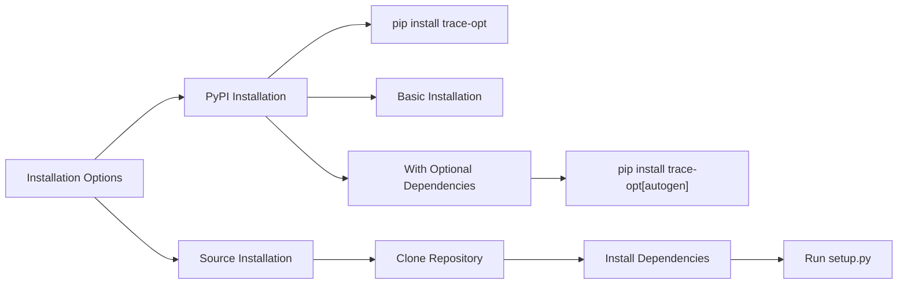
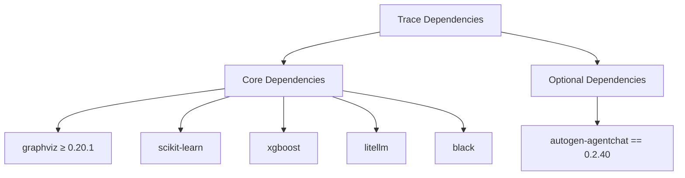
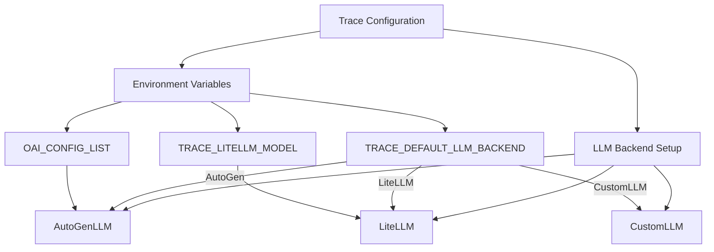

<!-- source: DeepWiki mcp.deepwiki.com · repo microsoft/Trace · page 7 Installation and Setup · fetched 2026-10-26 -->

# Installation and Setup

<details>
<summary>Relevant source files</summary>

The following files were used as context for generating this wiki page:

- [docs/_config.yml](docs/_config.yml)
- [docs/_static/custom.css](docs/_static/custom.css)
- [pyproject.toml](pyproject.toml)
- [setup.py](setup.py)

</details>


This document provides instructions for installing and configuring the Trace system. It covers installation methods, dependencies, environment setup, and initial configuration. For specific information about using LLMs with Trace, see [LLM Integration](#4) and [LLM Abstraction Layer](#4.1).

## Installation Options

Trace can be installed using pip or from source. The package is published on PyPI as `trace-opt`.



Sources: [setup.py:19-31](), [pyproject.toml:6-10]()

### Prerequisites

Before installing Trace, ensure you have:

- Python 3.9 or higher
- pip (Python package manager)
- Development tools for building packages (if installing from source)

Sources: [setup.py:30]()

### Installing via pip

The simplest way to install Trace is using pip:

```bash
pip install trace-opt
```

To install with optional dependencies like AutoGen support:

```bash
pip install trace-opt[autogen]
```

Sources: [pyproject.toml:18-19]()

### Installing from source

To install from source:

1. Clone the repository:
   ```bash
   git clone https://github.com/microsoft/Trace.git
   cd Trace
   ```

2. Install the package:
   ```bash
   pip install -e .
   ```

   This will install in development mode, allowing you to modify the code and see changes immediately.

Sources: [setup.py:19-31]()

## Dependencies

Trace relies on several dependencies to function properly.



Sources: [setup.py:11-17](), [pyproject.toml:18-19]()

### Core Dependencies

The following packages are automatically installed when you install Trace:

| Dependency | Purpose |
|------------|---------|
| graphviz (≥ 0.20.1) | Graph visualization for the computation graph |
| scikit-learn | Machine learning utilities |
| xgboost | Gradient boosting framework |
| litellm | Unified interface for LLM APIs |
| black | Code formatting |

Sources: [setup.py:11-17]()

### Optional Dependencies

| Dependency | Purpose | Installation |
|------------|---------|-------------|
| autogen-agentchat (0.2.40) | Support for AutoGen framework | `pip install trace-opt[autogen]` |

Sources: [pyproject.toml:18-19]()

## Configuration

After installation, you'll need to configure Trace to work with your environment, particularly for LLM integration.



### Environment Variables

Trace uses the following environment variables for configuration:

| Variable | Purpose | Possible Values |
|----------|---------|-----------------|
| TRACE_DEFAULT_LLM_BACKEND | Specifies which LLM backend to use | "AutoGen", "LiteLLM", "CustomLLM" |
| TRACE_LITELLM_MODEL | Model to use with LiteLLM backend | Depends on LiteLLM support (e.g., "gpt-4") |
| OAI_CONFIG_LIST | Configuration file for AutoGen | Path to a configuration JSON file |

Example setup in Python:

```python
import os
# Configure to use LiteLLM with GPT-4
os.environ["TRACE_DEFAULT_LLM_BACKEND"] = "LiteLLM"
os.environ["TRACE_LITELLM_MODEL"] = "gpt-4"
```

### LLM Backend Configuration

#### AutoGen Backend

When using the AutoGen backend:

1. Install the AutoGen optional dependency:
   ```bash
   pip install trace-opt[autogen]
   ```

2. Set up your `OAI_CONFIG_LIST` environment variable or file. This should point to a JSON configuration file containing your API keys and settings.

#### LiteLLM Backend

For LiteLLM backend:

1. Set `TRACE_DEFAULT_LLM_BACKEND` to "LiteLLM"
2. Set `TRACE_LITELLM_MODEL` to your desired model (e.g., "gpt-4")
3. Configure your API keys according to the LiteLLM documentation

#### Custom Backend

For a custom LLM backend:

1. Set `TRACE_DEFAULT_LLM_BACKEND` to "CustomLLM"
2. Configure the custom server URL according to your setup

## Verifying Installation

To verify that Trace has been installed correctly, you can run a simple test:

```python
import opto
print(f"Trace version: {opto.__version__}")

# Test node creation
from opto.trace import node
test_node = node("Hello World")
print(f"Node created: {test_node}")
```

If this runs without errors, your installation is working correctly.

## Troubleshooting

### Common Installation Issues

| Issue | Solution |
|-------|----------|
| Missing dependencies | Ensure all dependencies are installed with `pip install -e ".[autogen]"` |
| Python version mismatch | Verify you're using Python 3.9 or higher |
| ImportError for AutoGen | Install optional dependency with `pip install trace-opt[autogen]` |
| Graphviz visualization errors | Ensure graphviz is properly installed on your system |

### Getting Help

If you encounter issues not covered here:

1. Check the [GitHub repository](https://github.com/microsoft/Trace) for open issues
2. Consult the documentation at https://microsoft.github.io/Trace/
3. Contact the Trace team at the email listed in the setup.py file

Sources: [setup.py:22-24](), [docs/_config.yml:25-28]()

---

