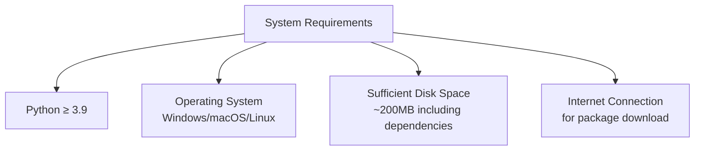
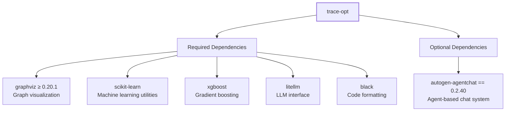
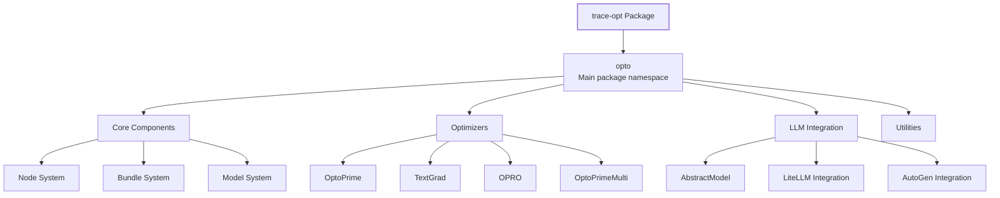

<!-- source: DeepWiki mcp.deepwiki.com · repo microsoft/Trace · page 7.1 Installation · fetched 2026-10-26 -->

# Installation

<details>
<summary>Relevant source files</summary>

The following files were used as context for generating this wiki page:

- [pyproject.toml](pyproject.toml)
- [setup.py](setup.py)

</details>


This page provides detailed instructions for installing the Microsoft Trace framework, which allows you to create self-adapting AI agents using general feedback mechanisms. For information about configuring Trace after installation, see [Configuration](#7.2).

## System Requirements

Before installing Trace, ensure your system meets the following requirements:



Sources: [setup.py:30]()

## Installation Methods

Trace can be installed using one of the following methods:

### Standard Installation via pip

The recommended way to install Trace is through pip using the package name `trace-opt`:

```
pip install trace-opt
```

This will install Trace with all required dependencies.

Sources: [setup.py:19-31](), [pyproject.toml:6-8]()

### Installation with Optional Dependencies

Trace offers optional dependencies for specific functionality. To install Trace with AutoGen support:

```
pip install "trace-opt[autogen]"
```

Sources: [pyproject.toml:18-19]()

### Installation from Source

For the latest development version or to contribute to Trace, you can install directly from the GitHub repository:

```
git clone https://github.com/microsoft/Trace.git
cd Trace
pip install -e .
```

Sources: [pyproject.toml:23-25]()

## Dependencies Overview

Trace relies on several dependencies that are automatically installed when using pip.



Sources: [setup.py:11-17](), [pyproject.toml:18-19]()

## Package Structure

After installation, the Trace package is organized as follows:



Sources: [setup.py:28]()

## Verifying Installation

To verify that Trace has been installed correctly, run the following Python code:

```python
import opto
print(opto.__version__)
```

If the installation was successful, this should print the version number of Trace without any errors.

## Troubleshooting Common Installation Issues

### Missing Dependencies

If you encounter errors related to missing dependencies, try installing them individually:

```
pip install graphviz scikit-learn xgboost litellm black
```

### GraphViz Installation

The `graphviz` Python package requires the GraphViz software to be installed on your system:

- **Windows**: Download and install from the [GraphViz website](https://graphviz.org/download/)
- **macOS**: `brew install graphviz`
- **Ubuntu/Debian**: `sudo apt-get install graphviz`

### Python Version Issues

If you receive errors about Python version compatibility, ensure you're using Python 3.9 or later:

```
python --version
```

## Next Steps

After successfully installing Trace, proceed to the [Configuration](#7.2) page to learn how to set up Trace with different LLM backends and customize settings for your specific use case.

Sources: [setup.py:19-31](), [pyproject.toml:6-26]()

---

