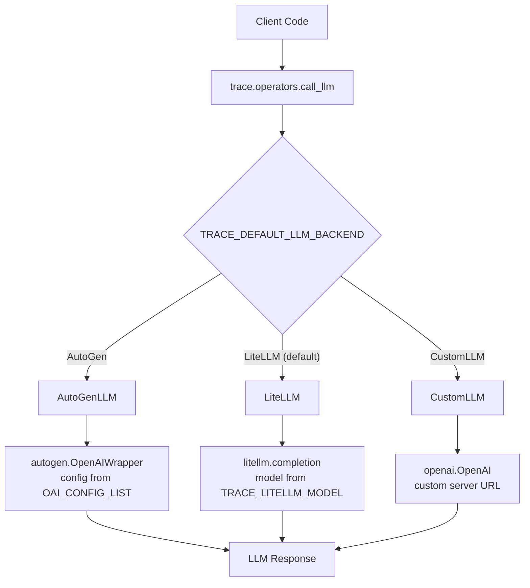
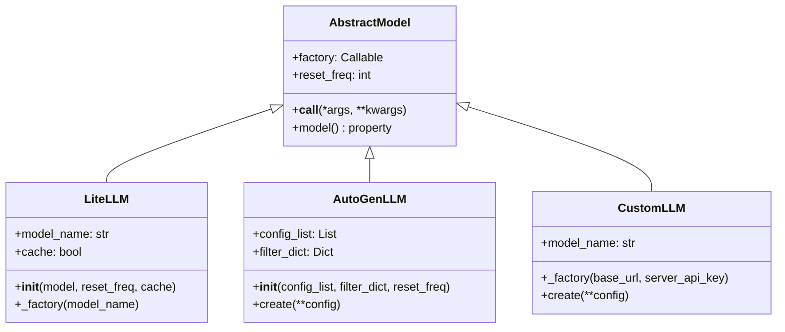
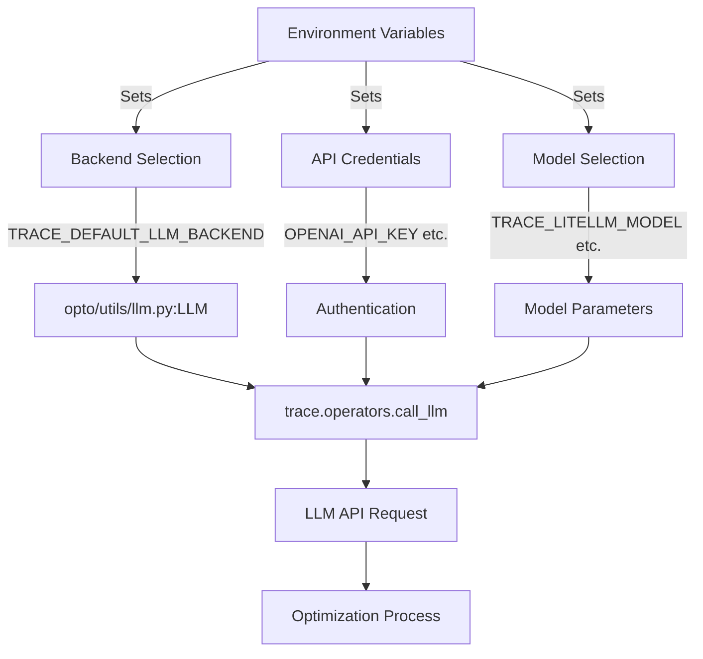

<!-- source: DeepWiki mcp.deepwiki.com · repo microsoft/Trace · page 7.2 Configuration · fetched 2026-10-26 -->

# Configuration

<details>
<summary>Relevant source files</summary>

The following files were used as context for generating this wiki page:

- [README.md](README.md)
- [docs/examples/basic/greeting.ipynb](docs/examples/basic/greeting.ipynb)
- [docs/images/backprop.png](docs/images/backprop.png)
- [docs/images/compare_to_textgrad3.png](docs/images/compare_to_textgrad3.png)
- [docs/images/forward_backward.png](docs/images/forward_backward.png)
- [docs/images/platform.png](docs/images/platform.png)
- [docs/images/platform2.png](docs/images/platform2.png)
- [opto/optimizers/utils.py](opto/optimizers/utils.py)
- [opto/utils/llm.py](opto/utils/llm.py)
- [tests/unit_tests/test_llm.py](tests/unit_tests/test_llm.py)

</details>


This page documents the configuration options for the Trace framework, focusing on how to set up and configure the LLM backends that power the optimization process. For information about general installation, see [Installation](#7.1).

## Overview of Configuration in Trace

Trace provides flexibility in which Language Model (LLM) backend you use for optimization and inference. The configuration system primarily uses environment variables to control which backend is selected and how it's configured.

The main configuration aspects include:
- Selecting the LLM backend (LiteLLM, AutoGen, or CustomLLM)
- Setting API keys for model providers
- Configuring model parameters and behavior
- Setting up proxy servers or custom endpoints if needed

## LLM Backend Selection

Trace supports three LLM backends, each with different capabilities and configuration requirements:



Sources: [opto/utils/llm.py:233-244](), [README.md:281-290]()

Set the default backend using the `TRACE_DEFAULT_LLM_BACKEND` environment variable:

```python
# In Python before importing opto
import os
os.environ["TRACE_DEFAULT_LLM_BACKEND"] = "LiteLLM"  # or "AutoGen" or "CustomLLM"
import opto
```

Or in a terminal:

```bash
export TRACE_DEFAULT_LLM_BACKEND="LiteLLM"
```

## Backend Configuration Options

Each backend has specific configuration parameters and methods:



Sources: [opto/utils/llm.py:16-230]()

### Common Configuration Parameters

All LLM backends inherit from `AbstractModel` and support:

- `reset_freq`: Time in seconds after which the model client is refreshed (useful for long-running processes)

## Configuring LiteLLM (Default Backend)

LiteLLM is the default backend since v0.1.3.5 and provides access to various LLM providers through the [LiteLLM library](https://github.com/BerriAI/litellm).

### Required Environment Variables

```python
import os
os.environ["OPENAI_API_KEY"] = "<your OpenAI API key here>"
os.environ["ANTHROPIC_API_KEY"] = "<your Anthropic API key here>"
```

### Model Selection

Set the default model using:

```bash
export TRACE_LITELLM_MODEL="gpt-4o"
```

### Azure Support

For Azure models:

```python
# The model name should start with 'azure/'
os.environ["TRACE_LITELLM_MODEL"] = "azure/your-deployment-name"

# Optional: Set the Azure token provider scope
os.environ["AZURE_TOKEN_PROVIDER_SCOPE"] = "https://cognitiveservices.azure.com/.default"
```

Sources: [opto/utils/llm.py:149-194](), [README.md:294-307]()

## Configuring AutoGen Backend

AutoGen provides additional capabilities like caching and API key management.

### Installation

First, install Trace with AutoGen support:

```bash
pip install trace-opt[autogen]
```

### Configuration Methods

AutoGen supports two configuration methods:

1. **OAI_CONFIG_LIST File**:
   Create a JSON file named `OAI_CONFIG_LIST` in your working directory:

   ```json
   [
       {
           "model": "gpt-4",
           "api_key": "<your OpenAI API key here>"
       },
       {
           "model": "claude-sonnet-3.5-latest",
           "api_key": "<your Anthropic API key here>"
       }
   ]
   ```

2. **Environment Variables**:
   If no config file is found, Trace will attempt to construct one from:
   
   ```python
   os.environ["OPENAI_API_KEY"] = "<your OpenAI API key here>"
   os.environ["ANTHROPIC_API_KEY"] = "<your Anthropic API key here>"
   ```

Sources: [opto/utils/llm.py:59-123](), [README.md:310-332]()

## Configuring CustomLLM Backend

CustomLLM connects to custom OpenAI-compatible server endpoints (like LiteLLM proxy servers).

```python
os.environ["TRACE_DEFAULT_LLM_BACKEND"] = "CustomLLM"
os.environ["TRACE_CUSTOMLLM_MODEL"] = "gpt-4o"  # Default model
os.environ["TRACE_CUSTOMLLM_URL"] = "http://your-server-url:4000"  # Server URL
os.environ["TRACE_CUSTOMLLM_API_KEY"] = "sk-Xhg..."  # Server API key
```

Sources: [opto/utils/llm.py:197-230]()

## Environment Variables Summary

The following table summarizes all environment variables used for configuration:

| Environment Variable | Description | Default |
|----------------------|-------------|---------|
| `TRACE_DEFAULT_LLM_BACKEND` | Default LLM backend | "LiteLLM" |
| `TRACE_LITELLM_MODEL` | Default model for LiteLLM | "gpt-4o" |
| `OPENAI_API_KEY` | OpenAI API key | None |
| `ANTHROPIC_API_KEY` | Anthropic API key | None |
| `OAI_CONFIG_LIST` | Path to AutoGen config file or JSON string | None |
| `TRACE_CUSTOMLLM_MODEL` | Model for CustomLLM | "gpt-4o" |
| `TRACE_CUSTOMLLM_URL` | Server URL for CustomLLM | "http://xx.xx.xxx.xx:4000" |
| `TRACE_CUSTOMLLM_API_KEY` | API key for CustomLLM | None |
| `AZURE_TOKEN_PROVIDER_SCOPE` | Scope for Azure token provider | None |

Sources: [README.md:277-332](), [opto/utils/llm.py:149-244]()

## Configuration Flow

The following diagram illustrates how environment variables flow into the Trace system:



Sources: [opto/utils/llm.py:233-244](), [README.md:281-290]()

## Model Version Recommendations

For OpenAI's GPT-4o model, use version **gpt-4o-2024-08-06** or later, which fixes structured output issues present in earlier versions. This is important since Trace optimizers rely on proper JSON output:

```python
os.environ["TRACE_LITELLM_MODEL"] = "gpt-4o-2024-08-06"
```

Sources: [README.md:382-388]()

## Testing Your Configuration

You can verify your LLM configuration works correctly with this simple test:

```python
from opto.utils.llm import LLM
from opto.optimizers.utils import print_color

llm = LLM()
system_prompt = 'You are a helpful assistant.'
user_prompt = "Hello world."

messages = [{"role": "system", "content": system_prompt},
            {"role": "user",   "content": user_prompt}]

output = llm(messages=messages)
response = output.choices[0].message.content

print_color(f'System: {system_prompt}', 'red')
print_color(f'User: {user_prompt}', 'blue')
print_color(f'LLM: {response}', 'green')
```

Sources: [tests/unit_tests/test_llm.py:1-24]()

## Complete Configuration Example

Here's a comprehensive example showing how to configure and use Trace:

```python
import os
from opto import trace
from opto.trace import node, bundle, model
from opto.optimizers import OptoPrime

# Set configuration through environment variables
os.environ["TRACE_DEFAULT_LLM_BACKEND"] = "LiteLLM"
os.environ["TRACE_LITELLM_MODEL"] = "gpt-4o-2024-08-06"
os.environ["OPENAI_API_KEY"] = "your-openai-api-key"

# Define a simple agent that uses the configured LLM
@trace.model
class Agent:
    def __init__(self, system_prompt):
        self.system_prompt = system_prompt
        self.instruct = trace.node("Extract important information", trainable=True)
    
    def __call__(self, user_query):
        response = trace.operators.call_llm(self.system_prompt,
                                          self.instruct, user_query)
        return response

# Use the configured system
agent = Agent("You are a helpful assistant.")
response = agent("Hello, world!")
```

Sources: [docs/examples/basic/greeting.ipynb:173-203]()

By following this configuration guide, you should be able to set up Trace to work with your preferred LLM backend and model provider.