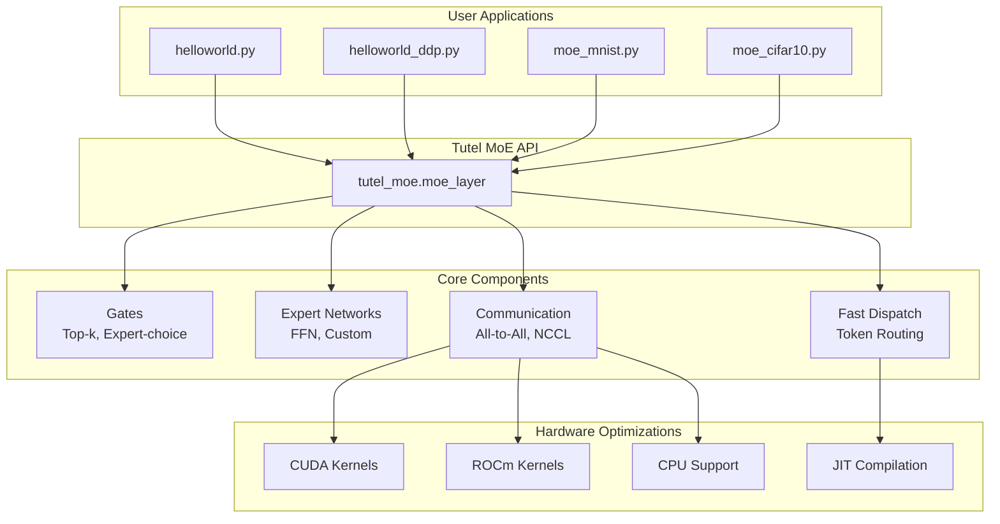
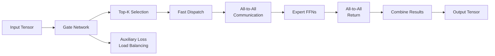
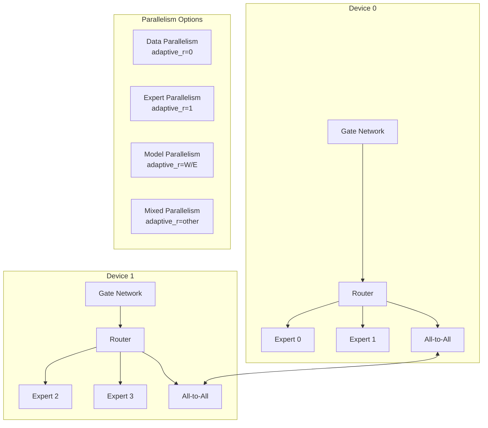
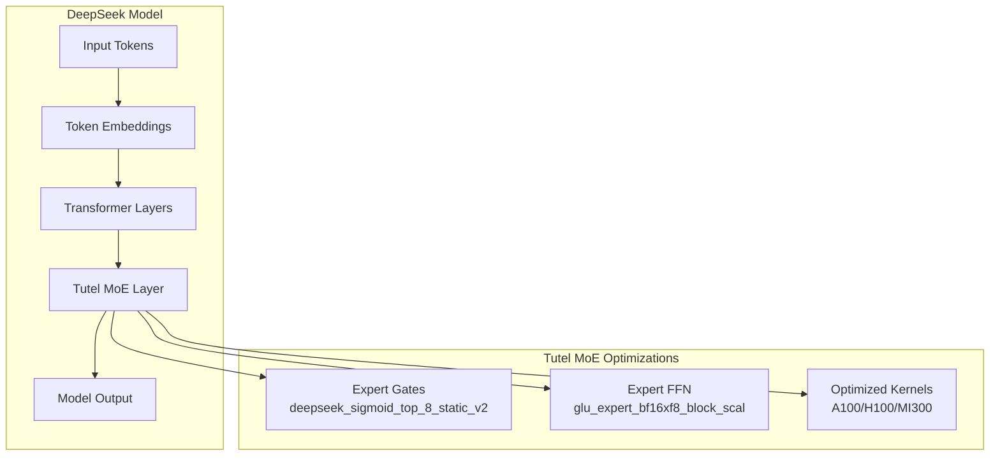

<!-- source: DeepWiki mcp.deepwiki.com · repo microsoft/Tutel · page 1 Overview · fetched 2026-10-26 -->

# Overview

<details>
<summary>Relevant source files</summary>

The following files were used as context for generating this wiki page:

- [README.md](README.md)

</details>


This document provides a high-level overview of Tutel, an optimized Mixture-of-Experts (MoE) implementation designed for deep learning frameworks, with a primary focus on PyTorch. Tutel delivers high-performance infrastructure for training and serving large language models with MoE architectures, including specialized optimizations for models like DeepSeek 671B.

For more detailed information about specific components, please refer to the [Core Components](#2) section. For usage examples, see the [Examples and Usage](#5) section.

## What is Tutel?

Tutel is a specialized library that implements the Mixture-of-Experts (MoE) architecture with numerous optimizations for performance and flexibility. MoE is a neural network technique that uses a gating mechanism to selectively activate a subset of specialized sub-networks (experts) for each input token, enabling models to scale to massive parameter counts while keeping compute requirements manageable.

Tutel is particularly notable for introducing "No-penalty Parallelism/Sparsity/Capacity Switching" that allows dynamic behavior changes during training and inference without performance penalties.

**Key features:**
- Support for multiple frameworks (primarily PyTorch ≥ 1.10)
- Hardware support for CUDA GPUs, ROCm GPUs, and CPUs
- Specialized optimizations for DeepSeek 671B model inference
- Multiple parallelism strategies for distributed training and inference
- Optimized communication patterns for all-to-all operations
- Custom CUDA/ROCm kernels for maximum performance
- Flexible expert and gate configurations

Sources: [README.md:3-7]()

## System Architecture

The following diagram provides a high-level overview of Tutel's architecture:

**Tutel High-Level Architecture**


Sources: [README.md:3-8](), [README.md:237-249]()

## How MoE Works in Tutel

Mixture of Experts (MoE) is a technique where only a subset of a neural network (the "experts") processes each input token, allowing models to scale to enormous parameter counts while keeping computation manageable. Tutel implements this architecture with high-performance optimizations.

**MoE Data Flow in Tutel**


During forward pass:
1. The input tensor is processed by a gate network
2. The gate selects the top-k experts for each token
3. Tokens are dispatched to their assigned experts
4. All-to-all communication distributes tokens to the right devices
5. Experts process their assigned tokens
6. Results are gathered through another all-to-all operation
7. Final outputs are combined and returned

This architecture allows the model to dynamically route different parts of the input to specialized sub-networks, improving efficiency and capacity.

Sources: [README.md:234-264]()

## Hardware Support and Performance

Tutel supports a variety of hardware platforms:

- NVIDIA GPUs (CUDA): A100/A800, H100/H800
- AMD GPUs (ROCm): MI300
- CPU: Both multi-core and single-core

Performance varies by hardware platform. For example, with DeepSeek 671B FP4 models:

| Hardware Configuration | Performance (Decode TPS) |
|------------------------|--------------------------|
| A100/A800 × 8          | 57 Decode TPS           |
| H100/H800 × 8          | 81 Decode TPS           |
| MI300 × 8 (FP4)        | 107 Decode TPS          |
| MI300 × 8 (FP8)        | 110 Decode TPS          |

Tutel includes specialized optimizations for each hardware platform, ensuring maximum performance across different environments.

Sources: [README.md:5-7](), [README.md:12-23]()

## Key Components

**MOE Layer**
The central component of Tutel is the `moe_layer` class, which implements the Mixture-of-Experts architecture. This layer handles:
- Expert selection through gating mechanisms
- Token routing to appropriate experts
- Parallel execution of experts
- Result combination and auxiliary loss calculation

**Fast Dispatch**
Optimized token routing and expert selection mechanisms that efficiently map tokens to experts, particularly important for performance at scale.

**Gates**
Gating mechanisms determine which experts process which tokens. Tutel provides various gate implementations:
- Top-k gating (selects k experts per token)
- Expert-choice routing
- Custom gate implementations

**Experts**
The actual neural networks that process tokens. Tutel provides built-in implementations:
- FFN (Feed-Forward Network) experts
- Custom expert implementations

**Communication Primitives**
Optimized communication operations:
- All-to-all operations for token exchange
- NCCL-based communication
- Overlapped communication and computation

Sources: [README.md:280-307]()

## Distributed Execution

Tutel supports various parallelism strategies for distributed execution:

**Distributed Execution Model**


Tutel introduces the concept of "No-penalty Parallelism/Sparsity/Capacity Switching," allowing dynamic changes to parallelism strategies:
- Data Parallelism (DP): Each device has a complete set of experts
- Expert Parallelism (EP): Experts are sharded across devices
- Model Parallelism (MP): Model layers are distributed across devices
- Mixed parallelism: Combinations of the above strategies

These parallelism strategies can be adjusted dynamically during execution via the `adaptive_r` parameter.

Sources: [README.md:136-146]()

## Installation and Usage

Tutel requires PyTorch (recommended version ≥ 1.10) and can be installed either from source or via pip:

```
# Install Tutel Online:
python3 -m pip uninstall tutel -y
python3 -m pip install -v -U --no-build-isolation git+https://github.com/microsoft/tutel@main

# Build Tutel from Source:
git clone https://github.com/microsoft/tutel --branch main
python3 -m pip uninstall tutel -y
python3 ./tutel/setup.py install --user
```

Basic usage example:

```python
import torch
from tutel import moe as tutel_moe

# Create input tensor
x = torch.ones([6, 1024], device='cuda:0')

# Create MoE layer
moe_layer = tutel_moe.moe_layer(
    gate_type={'type': 'top', 'k': 2},
    model_dim=x.shape[-1],
    experts={
        'num_experts_per_device': 2,
        'type': 'ffn', 
        'hidden_size_per_expert': 2048, 
        'activation_fn': lambda x: torch.nn.functional.relu(x)
    },
    scan_expert_func = lambda name, param: setattr(param, 'skip_allreduce', True),
)

# Move to GPU
moe_layer = moe_layer.to('cuda:0')

# Forward pass
y = moe_layer(x)
```

For distributed training and more advanced usage, see the [Examples and Usage](#5) section.

Sources: [README.md:156-198](), [README.md:234-264]()

## Dynamic Configuration

One of Tutel's unique features is its ability to dynamically adjust various parameters without recompilation or model reinitialization:

| Parameter | Description | Usage |
|-----------|-------------|-------|
| `a2a_ffn_overlap_degree` | Controls overlap between all-to-all communication and computation | Set to 1 for no overlap, >1 for increasing degrees of overlap |
| `adaptive_r` | Controls parallelism strategy | 0 for DP, 1 for DP+EP, W/E for MP+EP, others for mixed parallelism |
| `capacity_factor` | Controls token capacity | Positive for padding, negative for no-padding, 0 for dropless MoE |
| `top_k` | Controls sparsity | Number of experts to route each token to |
| `megablocks_size` | Controls use of Megablocks optimization | 0 for disabled, >0 for block size |

These parameters can be adjusted on-the-fly during the forward pass:

```python
# Dynamically adjust configuration during forward pass
output = moe_layer.forward(
    x, 
    a2a_ffn_overlap_degree=2,
    adaptive_r=1,
    capacity_factor=1.0,
    top_k=2
)
```

This dynamic configuration capability enables flexible experimentation and adaptation to different workloads without model reinitialization.

Sources: [README.md:136-146](), [README.md:122-134]()

## DeepSeek Integration

Tutel includes specialized optimizations for DeepSeek models, particularly the 671B parameter variants:

**DeepSeek Integration**


Tutel provides specific optimizations for different hardware platforms when running DeepSeek models:
- Custom kernels for A100/A800, H100/H800, and MI300 GPUs
- Support for FP4 and FP8 quantization
- Specialized operations like `deepseek_sigmoid_top_8_static_v2` for gating and `glu_expert_bf16xf8_block_scal` for expert FFNs

These optimizations enable efficient inference of the massive 671B parameter DeepSeek models across various hardware platforms.

Sources: [README.md:9-23](), [README.md:27-49]()

## Summary

Tutel provides a highly optimized implementation of the Mixture-of-Experts architecture, with specialized support for various hardware platforms and model architectures. Key features include:

1. Flexible parallelism strategies that can be dynamically adjusted
2. Optimized communication primitives for efficient distributed execution
3. Custom CUDA/ROCm kernels for maximum performance
4. Specialized support for DeepSeek 671B models
5. Dynamic configuration of various parameters without model reinitialization

Tutel is particularly valuable for scaling large language models efficiently across distributed hardware, with special focus on performance optimization and flexibility.

For more details on specific components and usage examples, please refer to the other sections of this documentation.

Sources: [README.md:3-8](), [README.md:267-279]()

---

