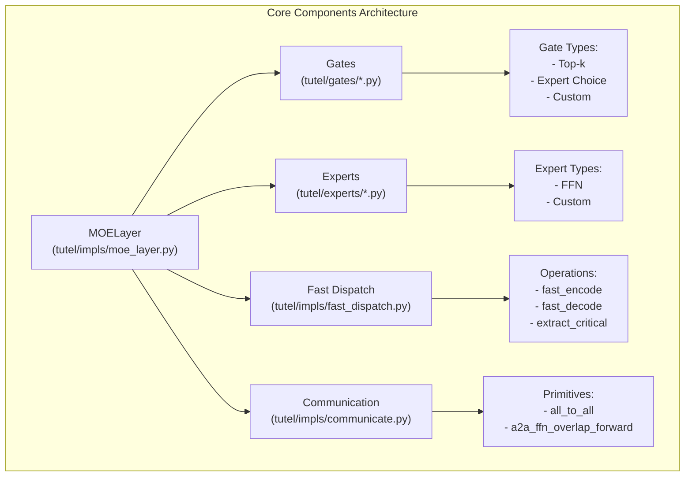
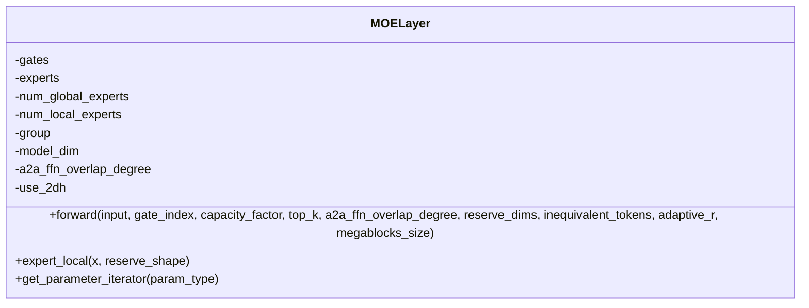
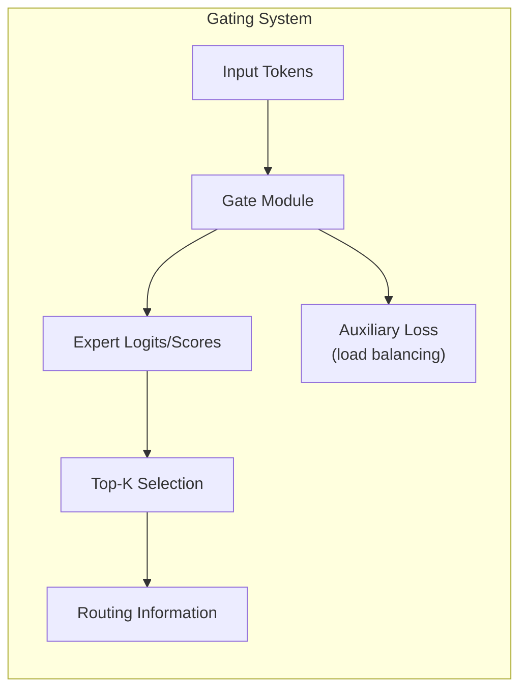
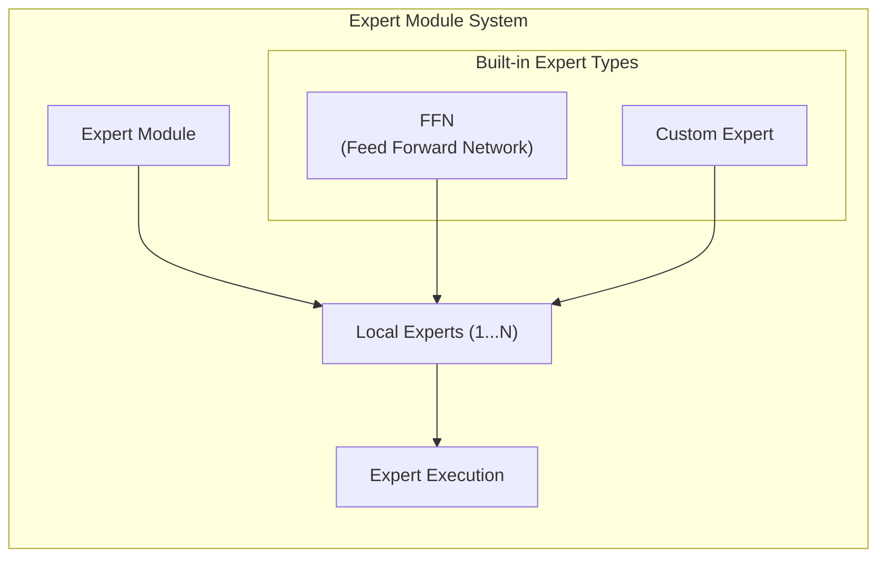
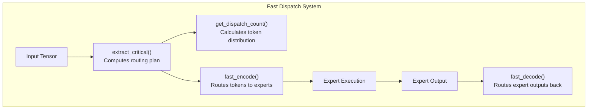
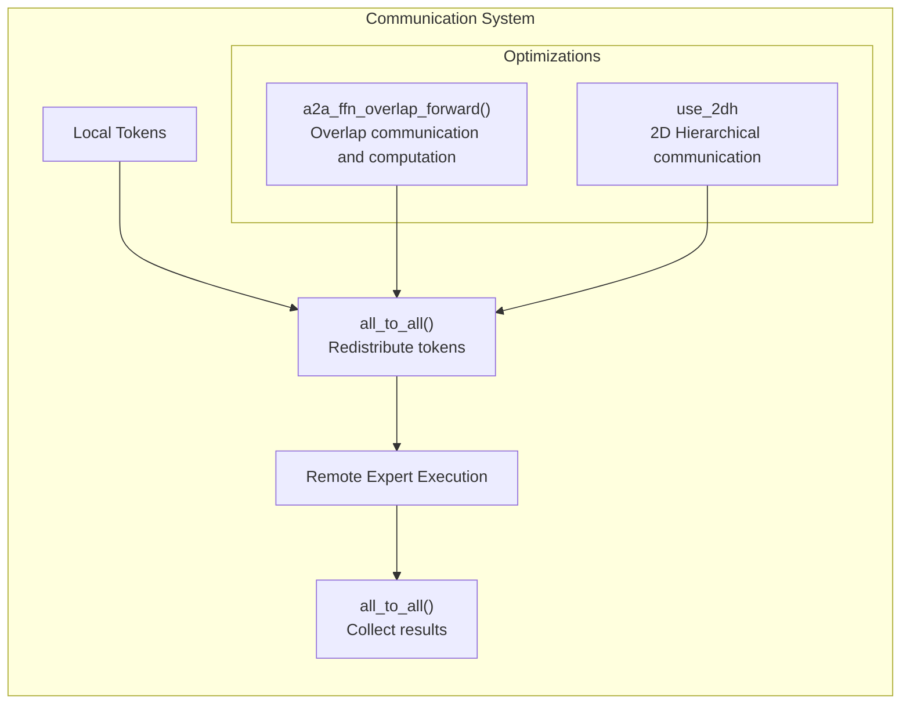
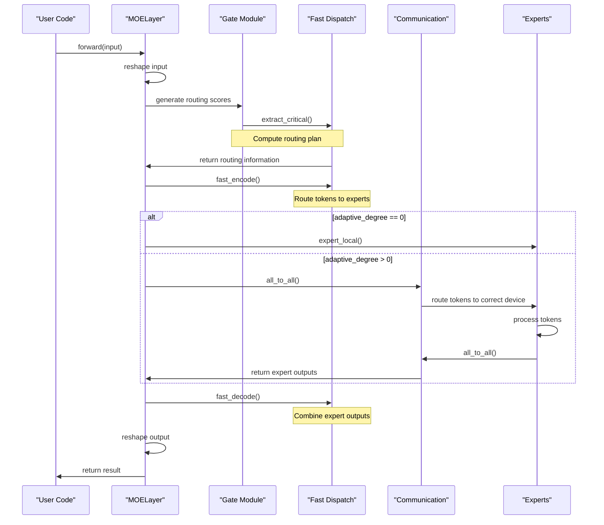

<!-- source: DeepWiki mcp.deepwiki.com · repo microsoft/Tutel · page 2 Core Components · fetched 2026-10-26 -->

# Core Components

<details>
<summary>Relevant source files</summary>

The following files were used as context for generating this wiki page:

- [README.md](README.md)
- [tutel/impls/moe_layer.py](tutel/impls/moe_layer.py)

</details>


This page provides an overview of the main components that make up Tutel's Mixture-of-Experts (MoE) implementation. It focuses on the core classes and functions that enable efficient MoE operation across various hardware platforms, including CUDA, ROCm, and CPU environments.

For information about system infrastructure and low-level optimizations, see [System Infrastructure](#3). For usage examples, see [Examples and Usage](#5).

## Core Architecture Overview

Tutel's MoE implementation consists of several key components working together to efficiently route tokens to specialized expert networks. The following diagram illustrates how these components interact:



Sources: [tutel/impls/moe_layer.py:42-366]()

## MOELayer

The `MOELayer` class is the central component of Tutel's MoE implementation. It orchestrates the routing of input tokens to experts and the aggregation of expert outputs.



The `MOELayer` accepts various configuration parameters in its constructor that define the behavior of the MoE system:

| Parameter | Description |
|-----------|-------------|
| `gate_type` | Dictionary or list of dictionaries specifying gating mechanism (e.g., `{'type': 'top', 'k': 2}`) |
| `model_dim` | Number of channels for MOE's input tensor |
| `experts` | Dictionary specifying expert network configuration |
| `scan_expert_func` | Lambda function to iterate over expert parameters (e.g., for parameter tagging) |
| `result_func` | Lambda function to format MoE output and auxiliary loss |
| `group` | Specific communication group for all-to-all operations |
| `seeds` | Tuple of seeds for deterministic initialization |
| `a2a_ffn_overlap_degree` | Controls the overlap of communication and computation |
| `parallel_type` | Parallelism method ('auto', 'data', 'model', or 'adaptive:N') |

The `forward` method implements the MoE execution flow, orchestrating:
1. Input reshaping and type conversion
2. Token routing via gates
3. Expert selection and token dispatch
4. Parallel expert execution
5. Result collection and reshaping

Sources: [tutel/impls/moe_layer.py:42-364](), [README.md:280-307]()

## Gates

Gates are responsible for determining which experts should process each token. They produce scores that are used to route tokens to the most appropriate experts.



Tutel supports several gating mechanisms:

| Gate Type | Description | Configuration |
|-----------|-------------|---------------|
| Top-k | Routes each token to the top k experts | `{'type': 'top', 'k': 2, 'capacity_factor': 1.0}` |
| Expert Choice | Experts select tokens rather than tokens selecting experts | `{'type': 'expert_choice', ...}` |
| Custom | User-defined gating mechanism | `{'type': 'custom', 'module': YourGateClass}` |

Gate parameters also include:
- `gate_noise`: Noise added to logits during training (default: 0.0)
- `capacity_factor`: Controls expert capacity (default: 1.0)
- `batch_prioritized_routing`: Prioritizes token routing based on batch (default: False)
- `normalize_gate`: Normalizes gate scores (default: True)

Sources: [tutel/impls/moe_layer.py:196-230](), [README.md:284-289]()

## Experts

Experts are specialized neural networks that process subsets of the input data. In a typical MoE system, each expert specializes in different aspects of the input space.



The default expert type is FFN (Feed-Forward Network), but Tutel also supports custom expert implementations. Expert configuration is specified in the `experts` dictionary:

| Parameter | Description |
|-----------|-------------|
| `type` | Expert type ('ffn' or 'custom') |
| `num_experts_per_device` | Number of local experts per device (default: 1) |
| `hidden_size_per_expert` | Hidden dimension size for FFN experts |
| `activation_fn` | Activation function for FFN |
| `has_fc1_bias` | Whether to include bias in first FC layer (default: True) |
| `has_fc2_bias` | Whether to include bias in second FC layer (default: True) |

For custom experts, additional configuration options include:
- `module`: The custom expert module class
- Other custom parameters specific to the expert implementation

Sources: [tutel/impls/moe_layer.py:160-195](), [README.md:299-307]()

## Fast Dispatch

The Fast Dispatch system efficiently routes tokens to experts and collects results. It's implemented in the `fast_dispatch.py` module and consists of several key functions:



Key functions in the Fast Dispatch system:

| Function | Purpose |
|----------|---------|
| `extract_critical` | Computes the routing plan based on gate scores, including indices, locations, and token weights |
| `fast_encode` | Efficiently routes tokens to their assigned experts based on the routing plan |
| `fast_decode` | Collects outputs from experts and combines them according to the routing plan |
| `get_dispatch_count` | Calculates how many tokens are dispatched to each expert |

The dispatch system handles various routing strategies:
- Top-k routing (each token goes to k experts)
- Load balancing across experts
- Capacity management (padding or dropping tokens)

Sources: [tutel/impls/moe_layer.py:304-359]()

## Communication Infrastructure

In distributed training settings, Tutel implements efficient communication primitives to move data between devices.



Key communication features:

| Feature | Description |
|---------|-------------|
| `all_to_all` | Primitive for redistributing tokens to devices that own the required experts |
| `a2a_ffn_overlap_forward` | Overlaps communication with computation for improved efficiency |
| `use_2dh` | 2D Hierarchical communication for better scaling at large node counts |
| `adaptive_r` | Controls the parallelism strategy (data parallelism, model parallelism, or hybrid) |

The `a2a_ffn_overlap_degree` parameter controls the granularity of overlap between communication and computation. When set to values greater than 1, it divides the work into smaller chunks to enable pipelining.

Sources: [tutel/impls/moe_layer.py:344-351](), [README.md:136-146]()

## MoE Execution Flow

The following diagram illustrates the end-to-end execution flow within Tutel's MoE implementation:



Sources: [tutel/impls/moe_layer.py:255-363]()

## Parameter Configuration

The `MOELayer` provides extensive configuration options that control the behavior of the MoE system:

| Category | Parameter | Dynamic? | Description |
|----------|-----------|----------|-------------|
| Routing | `top_k` | Yes | Number of experts per token |
| Routing | `capacity_factor` | Yes | Controls expert capacity |
| Parallelism | `adaptive_r` | Yes | Controls parallelism strategy |
| Communication | `a2a_ffn_overlap_degree` | Yes | Controls overlap of communication and computation |
| Communication | `use_2dh` | No | Enables 2D hierarchical communication |
| Optimization | `megablocks_size` | Yes | Enables megablocks optimization for inference |

Many parameters can be dynamically changed during inference by passing them to the `forward` method:

```python
# Example of dynamic parameter switching
moe_layer.forward(x, top_k=2)  # Change top-k at runtime
moe_layer.forward(x, capacity_factor=1.5)  # Change capacity factor at runtime
moe_layer.forward(x, a2a_ffn_overlap_degree=2)  # Change overlap degree at runtime
moe_layer.forward(x, adaptive_r=1)  # Change parallelism strategy at runtime
```

Sources: [tutel/impls/moe_layer.py:255-363](), [README.md:136-146]()

---

