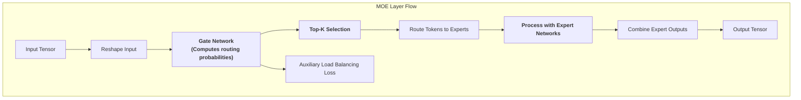
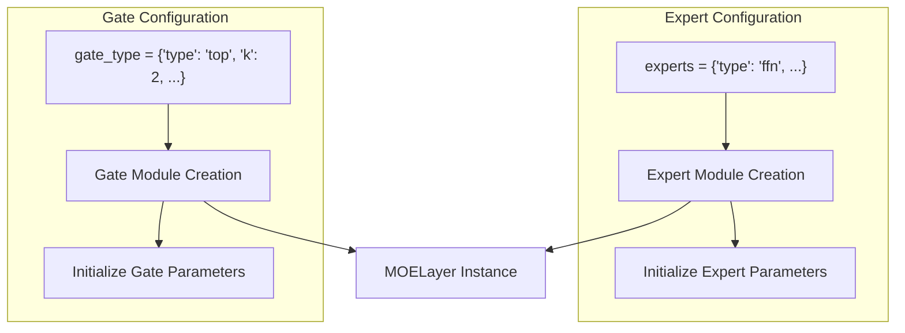
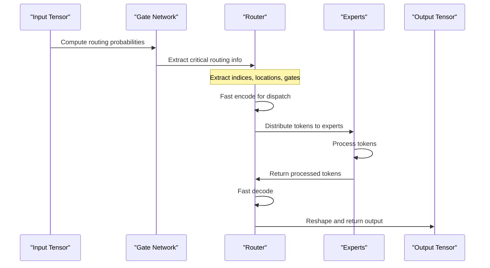
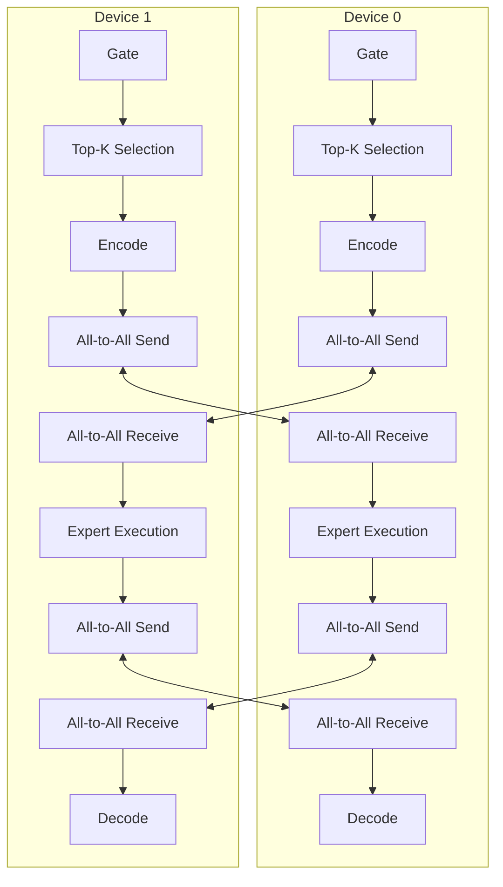
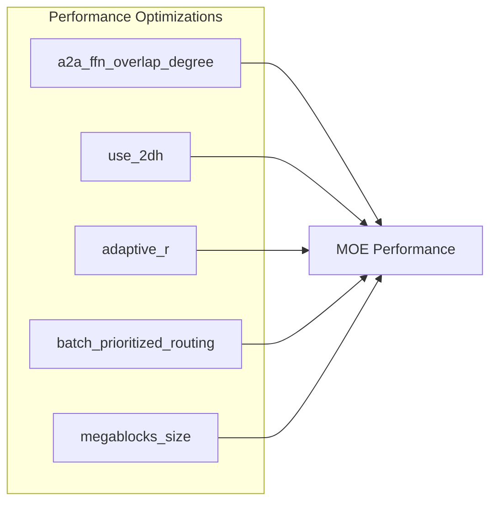
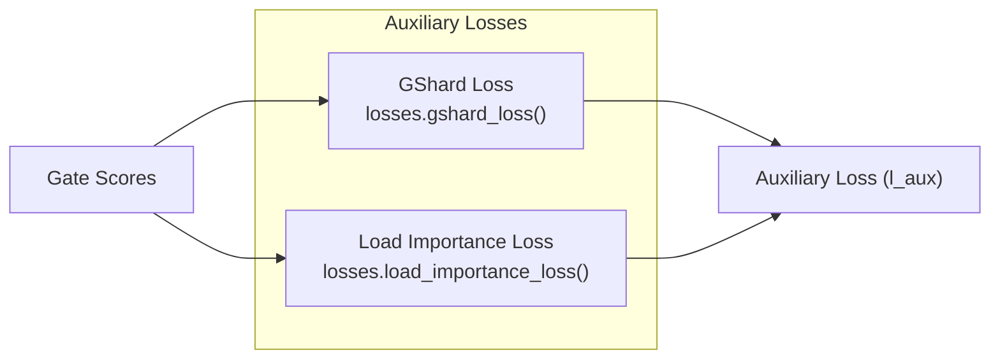
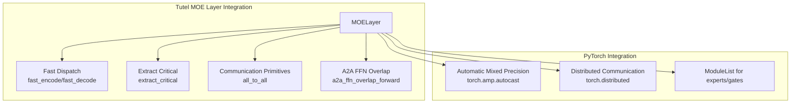

<!-- source: DeepWiki mcp.deepwiki.com · repo microsoft/Tutel · page 2.1 MOE Layer · fetched 2026-10-26 -->

# MOE Layer

<details>
<summary>Relevant source files</summary>

The following files were used as context for generating this wiki page:

- [tutel/impls/moe_layer.py](tutel/impls/moe_layer.py)

</details>


The MOE (Mixture of Experts) Layer is the central component of Tutel's architecture, providing an optimized implementation of the mixture of experts pattern for deep learning models. This document details the implementation, interfaces, and behaviors of the MOE Layer, which serves as the backbone for efficient distributed execution of expert-based neural networks.

For information about specific gating mechanisms used within MOE Layers, see [Gates](#2.3). For information about expert network implementations, see [Experts](#2.4).

## Overview

The MOE Layer orchestrates the routing of tokens to specialized expert networks and combines their outputs. It implements the core functionality of selecting which experts process which tokens, distributing the computation across available devices, and collecting the results.



Sources: [tutel/impls/moe_layer.py:250-363]()

## Implementation

The MOE Layer is implemented as a PyTorch module (`torch.nn.Module`) in the Tutel codebase. It combines gating mechanisms for expert selection with distributed communication primitives for efficient routing of tokens.

```mermaid
classDiagram
    class MOELayer {
        +gates: ModuleList
        +experts: ModuleList
        +group: ProcessGroup
        +num_global_experts: int
        +num_local_experts: int
        +model_dim: int
        +forward(input, gate_index, capacity_factor, top_k, ...)
        +expert_local(x, reserve_shape)
        +get_parameter_iterator(param_type)
    }
    MOELayer --|> torch.nn.Module : inherits from
    MOELayer --o "Gate" : contains 1+
    MOELayer --o "ExpertModule" : contains
    
    class Gate {
        +top_k: int
        +gate_noise: float
        +capacity_factor: float
        +forward(x)
    }

    class ExpertModule {
        +forward(x, ctx)
    }
```

Sources: [tutel/impls/moe_layer.py:42-365]()

## Initialization and Configuration

The MOE Layer requires several parameters to be configured during initialization:

| Parameter | Description |
|-----------|-------------|
| `gate_type` | Configuration for routing mechanism (top-k/expert-choice) |
| `model_dim` | Embedding dimension of input data |
| `experts` | Expert networks configuration |
| `group` | Process group for distributed training |
| `a2a_ffn_overlap_degree` | Degree of overlap between communication and computation |
| `normalize_gate` | Whether to normalize gate scores |
| `parallel_type` | Parallelism strategy (data/model/adaptive) |
| `use_2dh` | Whether to use 2D hierarchical all-to-all |

The initialization process sets up gate networks, expert networks, and configures the distributed execution strategy based on the provided parameters.

Sources: [tutel/impls/moe_layer.py:84-234]()

## Expert and Gate Configuration

The MOE Layer supports multiple types of expert networks and gating mechanisms:



The MOE Layer can load experts and gates from built-in implementations or custom modules:

1. **Built-in experts**: Specified with `type` (e.g., 'ffn')
2. **Custom experts**: Specified with `type: 'custom'` and a `module` parameter
3. **Built-in gates**: Specified with `type` (e.g., 'top', 'hash')
4. **Custom gates**: Specified with `type: 'custom'` and a `module` parameter

Sources: [tutel/impls/moe_layer.py:156-230]()

## Forward Pass Execution Flow

The forward pass of the MOE Layer follows these steps:

1. **Input reshaping**: Reshape input tensor for gate network
2. **Gate computation**: Compute routing probabilities
3. **Top-K selection**: Select top-k experts for each token
4. **Token dispatching**: Route tokens to selected experts
5. **Expert execution**: Process tokens with expert networks
6. **Output combination**: Combine expert outputs according to routing probabilities



Sources: [tutel/impls/moe_layer.py:255-363]()

## Distributed Execution

The MOE Layer supports distributed execution across multiple devices, with several parallelism strategies:

| Parallelism Strategy | Description |
|------------|-------------|
| Data Parallelism | Each device has a complete set of experts |
| Model Parallelism | Experts are partitioned across devices |
| Adaptive Parallelism | Dynamic adjustment between data and model parallelism |

The distributed execution uses All-to-All communication primitives to route tokens between devices:



Sources: [tutel/impls/moe_layer.py:330-358]()

## Performance Optimizations

The MOE Layer includes several optimizations to improve performance:

1. **All-to-All and FFN Overlap**: Configurable with `a2a_ffn_overlap_degree`
2. **2D Hierarchical Communication**: Enabled with `use_2dh`
3. **Adaptive Routing**: Controlled with `adaptive_r`
4. **Batch Prioritized Routing**: Prioritizes tokens based on gate scores
5. **MegaBlocks**: Efficient routing for when the number of local experts is greater than 1



Sources: [tutel/impls/moe_layer.py:274-325]()

## Load Balancing and Auxiliary Losses

The MOE Layer supports auxiliary losses to promote balanced expert utilization:

1. **GShard Loss**: Based on the paper "GShard: Scaling Giant Models with Conditional Computation"
2. **Load Importance Loss**: Alternative loss that considers importance of tokens

These losses encourage uniform utilization of experts and discourage tokens from always selecting the same experts.



Sources: [tutel/impls/moe_layer.py:291-296]()

## Integration with PyTorch and Tutel Components

The MOE Layer is designed to integrate seamlessly with PyTorch and other Tutel components:



Sources: [tutel/impls/moe_layer.py:21-25](), [tutel/impls/moe_layer.py:314-359]()

## Usage Example

The MOELayer is typically used as a replacement for a standard feedforward network in transformer architectures. It accepts an input tensor and returns an output tensor of the same shape as the input (with potentially different dimensions along the feature axis, depending on the expert implementation).

Basic usage pattern:

1. Initialize the MOELayer with gate and expert configurations
2. Pass input tensors through the layer as part of a neural network
3. Optionally use the auxiliary loss (`l_aux`) for load balancing

The auxiliary loss is attached to the output tensor as `output.l_aux` and can be accessed for inclusion in the overall training loss.

Sources: [tutel/impls/moe_layer.py:255-363]()

## Conclusion

The MOE Layer is the cornerstone of Tutel's implementation of the Mixture of Experts pattern. It provides a highly optimized and configurable approach to expert-based computation, with support for distributed execution, various parallelism strategies, and performance optimizations. The layer's design allows it to scale efficiently to large-scale models and distributed training environments.

---

