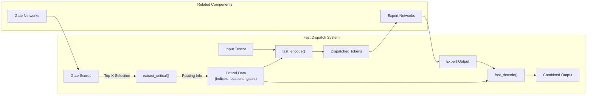
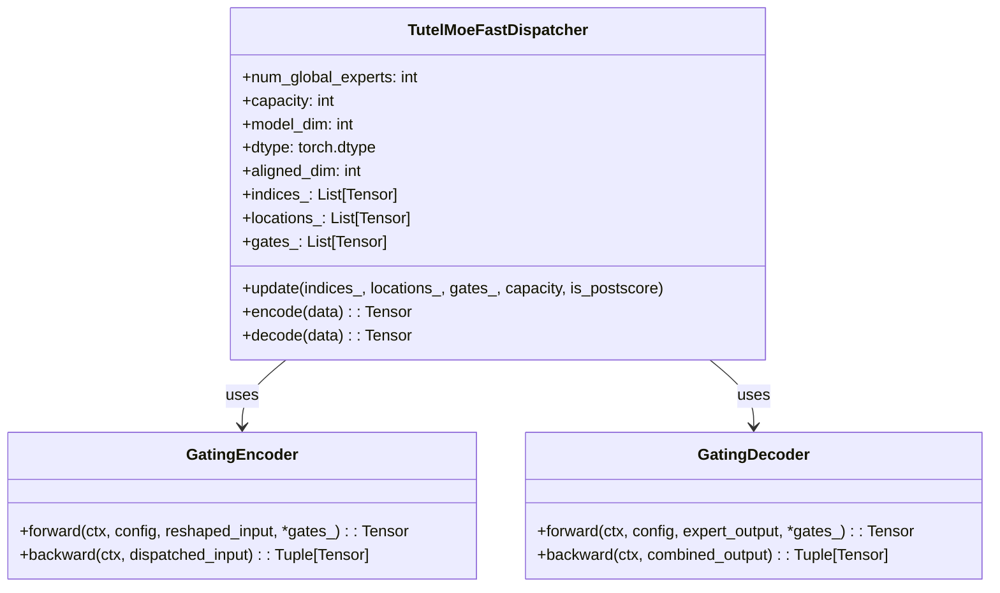
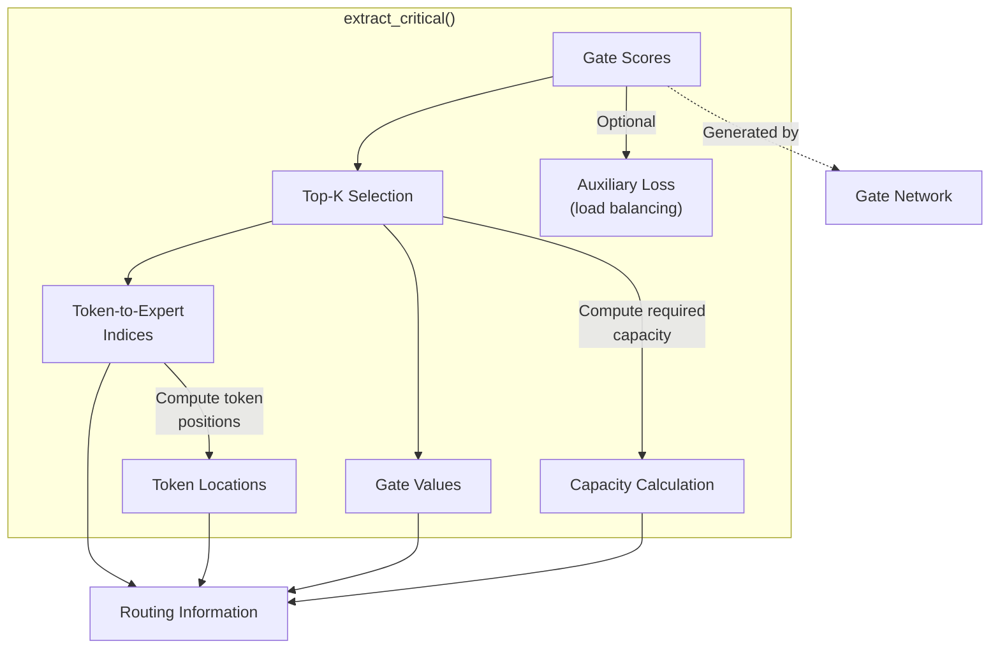
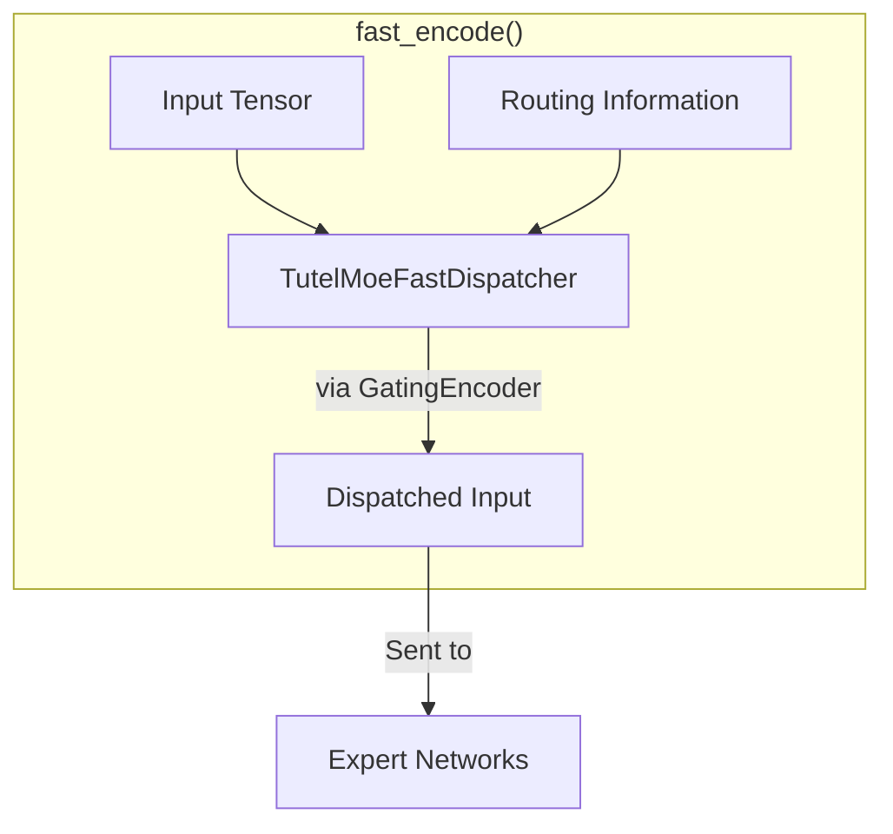
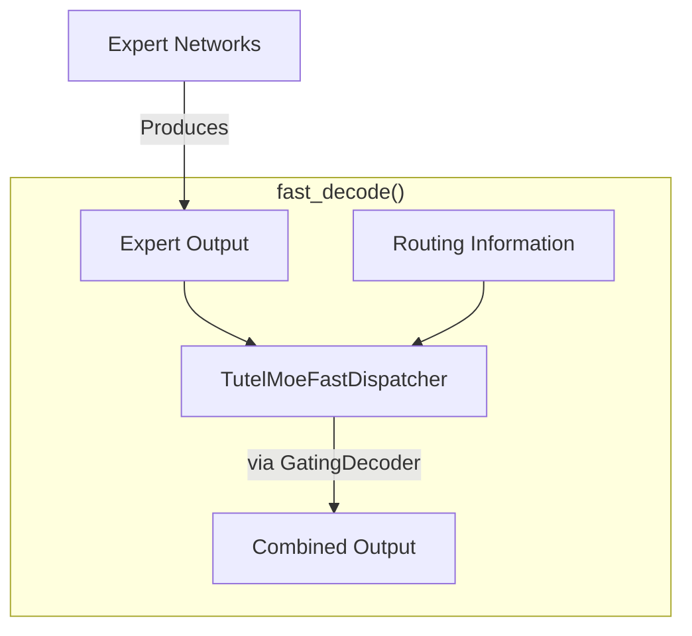
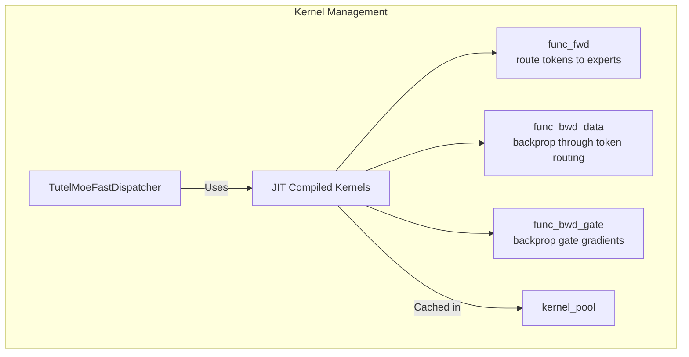
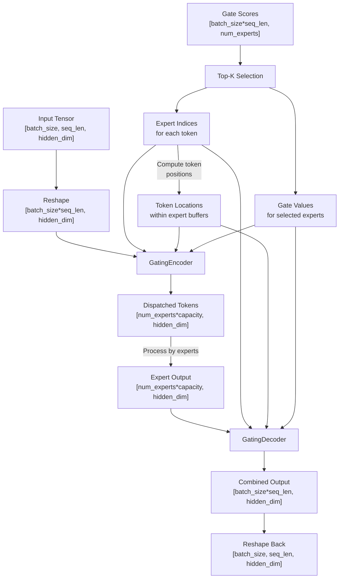
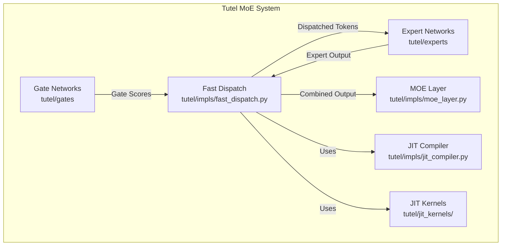

<!-- source: DeepWiki mcp.deepwiki.com · repo microsoft/Tutel · page 2.2 Fast Dispatch · fetched 2026-10-26 -->

# Fast Dispatch

<details>
<summary>Relevant source files</summary>

The following files were used as context for generating this wiki page:

- [tutel/impls/fast_dispatch.py](tutel/impls/fast_dispatch.py)

</details>


## Purpose and Scope

Fast Dispatch is a core component of the Tutel Mixture of Experts (MoE) implementation that handles efficient token routing between the input tensor and expert networks. This component is responsible for sending each token to its selected experts during the forward pass and gathering results during the backward pass. Fast Dispatch provides optimized implementations of the token routing mechanisms with support for various hardware platforms and data types.

For information about the gating mechanisms that determine which experts handle which tokens, see [Gates](#2.3). For the expert network implementations that process the routed tokens, see [Experts](#2.4).

## Architecture Overview

Fast Dispatch sits at the critical junction between gate networks and expert execution in the MoE architecture, acting as the "traffic controller" that efficiently routes tokens to their designated experts.



Sources: [tutel/impls/fast_dispatch.py:143-221]()

## Key Components

The Fast Dispatch system consists of several key components that work together to enable efficient token routing:

### TutelMoeFastDispatcher

The central class that manages the token routing process. It initializes and maintains the dispatch state and provides methods for token encoding (input to experts) and decoding (experts back to output).



Sources: [tutel/impls/fast_dispatch.py:85-136]()

### Routing Information Extraction

The `extract_critical` function processes gate scores to produce the essential routing information needed by the dispatcher:

```
routing_info = (num_global_experts, indices_s, locations_s, gates_s, capacity, locations2)
```

Where:
- `indices_s`: Which expert should process each token
- `locations_s`: Where each token should be placed within each expert's buffer
- `gates_s`: The weight/importance of each expert for each token
- `capacity`: Maximum number of tokens per expert

Sources: [tutel/impls/fast_dispatch.py:143-204]()

## Token Routing Workflow

The Fast Dispatch token routing process consists of several distinct steps:

### 1. Critical Information Extraction



Sources: [tutel/impls/fast_dispatch.py:143-204]()

### 2. Token Encoding (Forward Pass)

The encoding process routes input tokens to their assigned experts based on the routing information:



Sources: [tutel/impls/fast_dispatch.py:209-214]()

### 3. Token Decoding (Backward Pass)

The decoding process combines the outputs from experts back into the original sequence order:



Sources: [tutel/impls/fast_dispatch.py:216-221]()

## Implementation Details

### Custom CUDA Kernels

Fast Dispatch relies on optimized CUDA/ROCm kernels for high-performance token routing. These kernels are dynamically compiled and cached for efficient execution:



Sources: [tutel/impls/fast_dispatch.py:109-116]()

### Autograd Functions

The `GatingEncoder` and `GatingDecoder` classes are custom PyTorch autograd functions that enable efficient forward and backward pass operations with proper gradient tracking:

| Function | Forward Operation | Backward Operation |
|----------|------------------|-------------------|
| `GatingEncoder` | Routes tokens from input to experts based on routing info | Computes gradients for input tensor and gate values |
| `GatingDecoder` | Combines expert outputs back to original sequence | Computes gradients for expert outputs and gate values |

Sources: [tutel/impls/fast_dispatch.py:16-82]()

## Data Flow Details

The following diagram shows the detailed data flow through the Fast Dispatch system, highlighting how tokens are routed from input to experts and back:



Sources: [tutel/impls/fast_dispatch.py:16-82](), [tutel/impls/fast_dispatch.py:209-221]()

## Performance Considerations

### Dispatch Type Handling

Fast Dispatch automatically handles different data types and adjusts the internal processing accordingly:

- For HIP (ROCm) devices or non-float16 inputs, it uses float32 internally
- For float16 inputs on CUDA devices, it optimizes for half-precision
- The aligned_dim calculation ensures proper memory alignment for different data types

Sources: [tutel/impls/fast_dispatch.py:95-98]()

### Capacity Management

The system provides flexible capacity management to balance routing efficiency and memory usage:

- `capacity_factor > 0`: Capacity is calculated as a factor of the average number of tokens per expert
- `capacity_factor < 0`: Capacity is determined dynamically based on actual token distribution, but capped
- `capacity_factor = 0`: Capacity is set to the maximum number of tokens routed to any expert
- Additional alignment adjustment to ensure memory alignment requirements are met

Sources: [tutel/impls/fast_dispatch.py:189-199]()

### Batch Prioritized Routing

An optional routing strategy that prioritizes tokens based on their importance scores:

- When enabled, tokens with lower maximum gate scores are processed first
- This can help balance the load across experts and improve training stability
- Implemented via the `compute_sorted_location` function

Sources: [tutel/impls/fast_dispatch.py:138-141](), [tutel/impls/fast_dispatch.py:155-159]()

## Integration with Other Components

Fast Dispatch integrates with other components of the Tutel MoE system:



Sources: [tutel/impls/fast_dispatch.py:10-14]()

## Common Usage Patterns

Fast Dispatch is typically used within the MOE Layer implementation, but can also be used directly for custom token routing implementations:

```python
# Extract critical routing information
routing_info, aux_loss = extract_critical(
    scores=gate_scores,         # Gate scores from gate network
    top_k=top_k,                # Number of experts per token
    capacity_factor=1.5,        # Buffer factor for expert capacity
    batch_prioritized_routing=True  # Whether to prioritize by importance
)

# Route tokens to experts
dispatched_input = fast_encode(input_tensor, routing_info)

# Each expert processes its assigned tokens
expert_output = process_by_experts(dispatched_input)

# Combine expert outputs back to original sequence
combined_output = fast_decode(expert_output, routing_info)
```

Sources: [tutel/impls/fast_dispatch.py:143-221]()

## Summary

Fast Dispatch is a critical component in the Tutel MoE architecture that handles the efficient routing of tokens between the input and expert networks. It provides optimized implementations for token dispatching with support for various hardware and data types. The component includes features for efficient token routing, load balancing, capacity management, and gradient computation.

---

