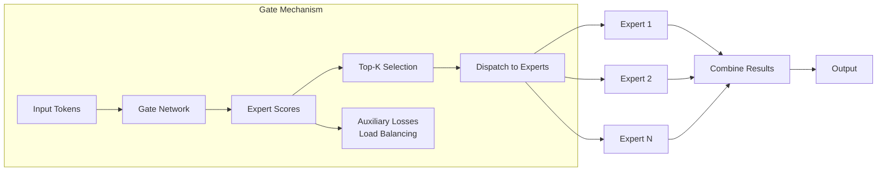
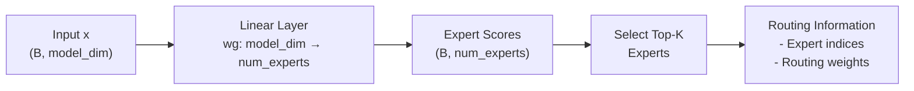
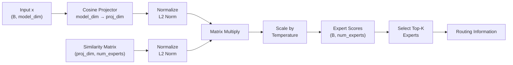
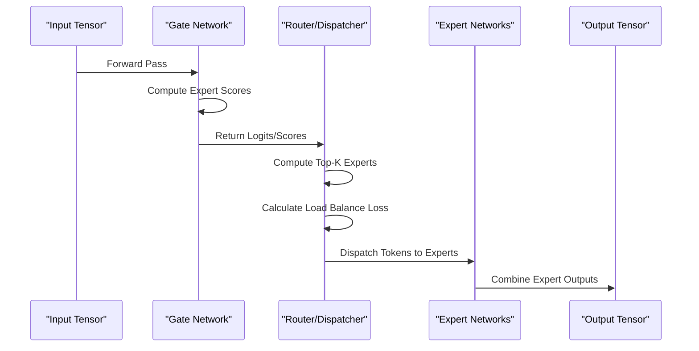
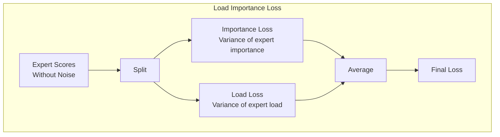
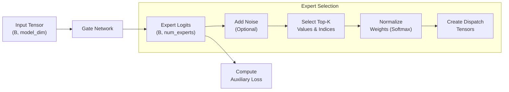

<!-- source: DeepWiki mcp.deepwiki.com · repo microsoft/Tutel · page 2.3 Gates · fetched 2026-10-26 -->

# Gates

<details>
<summary>Relevant source files</summary>

The following files were used as context for generating this wiki page:

- [tutel/experts/__init__.py](tutel/experts/__init__.py)
- [tutel/gates/__init__.py](tutel/gates/__init__.py)
- [tutel/gates/cosine_top.py](tutel/gates/cosine_top.py)
- [tutel/gates/top.py](tutel/gates/top.py)
- [tutel/impls/losses.py](tutel/impls/losses.py)

</details>


## Purpose and Scope

This document details the gating mechanisms in Tutel's Mixture of Experts (MoE) implementation. Gates are responsible for routing input tokens to the appropriate experts, functioning as the "router" that determines which expert(s) should process each token. This page covers the implemented gating algorithms, their parameters, and associated load balancing losses. For information about the experts themselves, see [Experts](#2.4), and for details on how gates integrate with the MoE layer, see [MOE Layer](#2.1).

## Overview of Gates in Tutel

Gates in Mixture of Experts models serve as the routers that select which experts will process each input token. Typically, they compute a score for each expert based on the input, select the top-K experts with the highest scores, and route the input to those experts with appropriate weighting.



Sources: [tutel/gates/top.py](), [tutel/gates/cosine_top.py](), [tutel/impls/losses.py]()

## Gate Types

Tutel implements multiple gating mechanisms to accommodate different routing strategies, each with its own characteristics and trade-offs.

### LinearTopKGate

The `LinearTopKGate` is the simplest and most commonly used gating mechanism. It uses a linear projection to calculate scores for each expert.



**Key Features:**
- Simple linear projection from input dimension to the number of experts
- Optional floating-point precision control via `fp32_gate` parameter
- Returns raw logits which are later processed for top-K selection

Sources: [tutel/gates/top.py:6-25]()

### CosineTopKGate

The `CosineTopKGate` uses cosine similarity between projected input features and learned expert embeddings to determine routing scores.



**Key Features:**
- Projects inputs to a lower-dimensional space (default: 256)
- Uses cosine similarity rather than direct linear mapping
- Includes a learnable temperature parameter to control the sharpness of the distribution
- Normalizes both the projected input and expert embeddings

Sources: [tutel/gates/cosine_top.py:7-37]()

## Gate Parameters and Configuration

Both gate types share common parameters while having some specific configurations.

| Parameter | Description | Applies To |
|-----------|-------------|------------|
| `model_dim` | Dimension of input features | Both |
| `num_global_experts` | Total number of experts | Both |
| `k` | Number of experts to route each token to | Both |
| `fp32_gate` | Whether to compute gate logits in FP32 | Both |
| `proj_dim` | Dimension for projecting input features | CosineTopKGate |
| `init_t` | Initial temperature value (1/init_t) | CosineTopKGate |
| `capacity_factor` | Scaling factor for expert capacity | Both (optional) |
| `gate_noise` | Noise added to scores for load balancing | Both (optional) |

Sources: [tutel/gates/top.py:7-14](), [tutel/gates/cosine_top.py:8-16]()

## Gate Integration in MOE Layer

Gates are instantiated and used within the MOE layer. The typical flow of a gate operation in the MOE layer is:



Sources: [tutel/gates/top.py:20-22](), [tutel/gates/cosine_top.py:22-34]()

## Load Balancing and Auxiliary Losses

One of the challenges in MoE models is ensuring balanced expert utilization. Tutel implements two types of auxiliary losses to encourage balanced routing:

### GShard Loss

The GShard loss encourages uniform assignment of tokens to experts.

```python
# Simplified pseudocode for GShard loss
def gshard_loss(scores, top_expert_ids):
    # Create one-hot mask for selected experts
    mask = one_hot(top_expert_ids, num_experts) * (num_experts / batch_size)
    
    # Compute mean importance per expert
    mean_importance = sum(scores, dim=0)  # Sum over batch
    
    # Compute expert assignment counts
    expert_counts = sum(mask, dim=0)  # Sum over batch
    
    # The loss is the dot product of importance and counts, normalized
    loss = sum(mean_importance * expert_counts) / batch_size
    return loss
```

Sources: [tutel/impls/losses.py:12-19]()

### Load Importance Loss

This loss balances both expert importance (how often they're selected) and load (how much computation they perform).



Sources: [tutel/impls/losses.py:21-43]()

## Comparison of Gate Mechanisms

| Feature | LinearTopKGate | CosineTopKGate |
|---------|----------------|----------------|
| Computation Complexity | Lower | Higher |
| Parameters | Fewer | More |
| Similarity Measure | Direct Linear Projection | Cosine Similarity |
| Temperature Scaling | No | Yes |
| Feature Normalization | No | Yes |
| Use Cases | General Purpose | When input magnitudes vary |

Both gates serve the same purpose but have different characteristics that make them suitable for different scenarios. LinearTopKGate is simpler and computationally more efficient, while CosineTopKGate provides potentially better routing when dealing with inputs of varying magnitudes due to its normalization properties.

Sources: [tutel/gates/top.py](), [tutel/gates/cosine_top.py]()

## Gate and Expert Selection Process

The gate's output (logits) is used to select experts through the following process:



The expert selection and routing process:

1. The gate computes logits (scores) for each expert
2. Optional noise is added to scores for better load balancing
3. Top-K experts are selected for each token
4. The weights for these experts are normalized (typically with softmax)
5. Dispatch tensors are created to route tokens to their assigned experts
6. Auxiliary losses are computed to encourage balanced routing

Sources: [tutel/gates/top.py](), [tutel/gates/cosine_top.py](), [tutel/impls/losses.py]()

## Summary

Gates are a crucial component of the Mixture of Experts architecture, determining which experts process each token. Tutel provides multiple gating mechanisms with different characteristics, allowing users to choose the most appropriate one for their specific needs. The gating process is complemented by auxiliary loss functions that help ensure balanced expert utilization, which is essential for efficient computation in MoE models.

---

