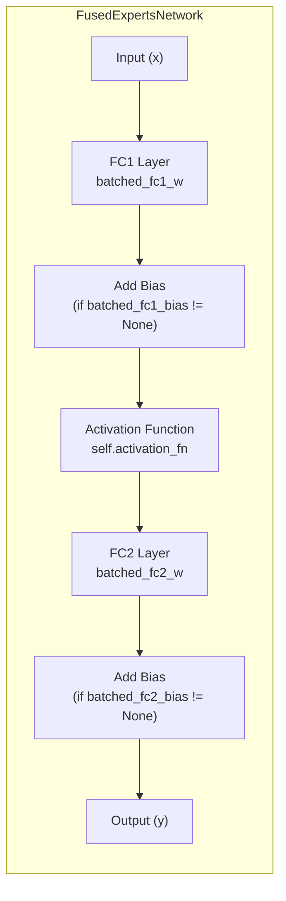
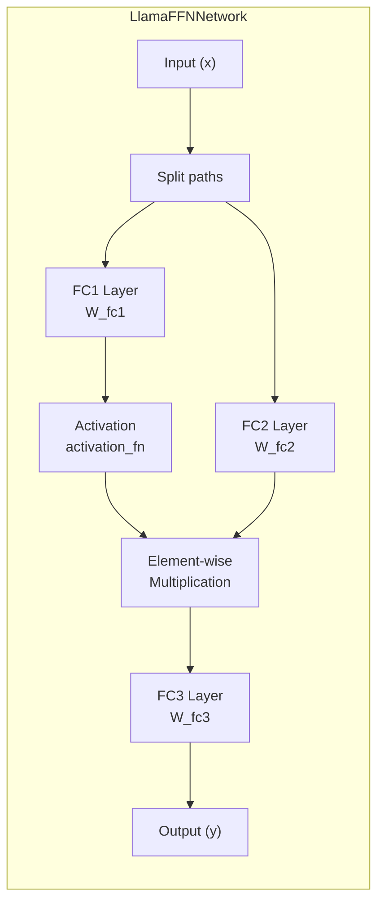
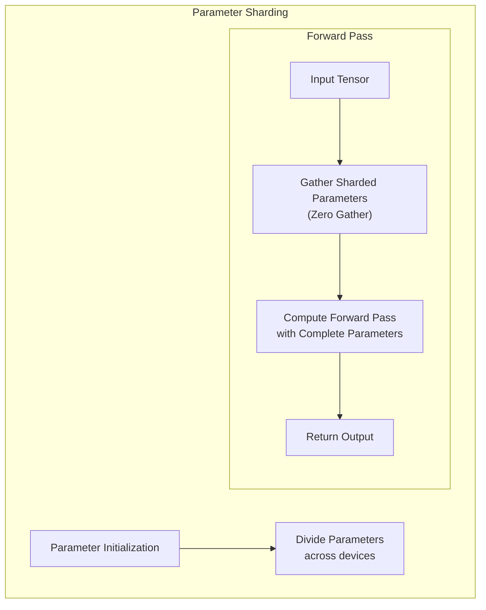
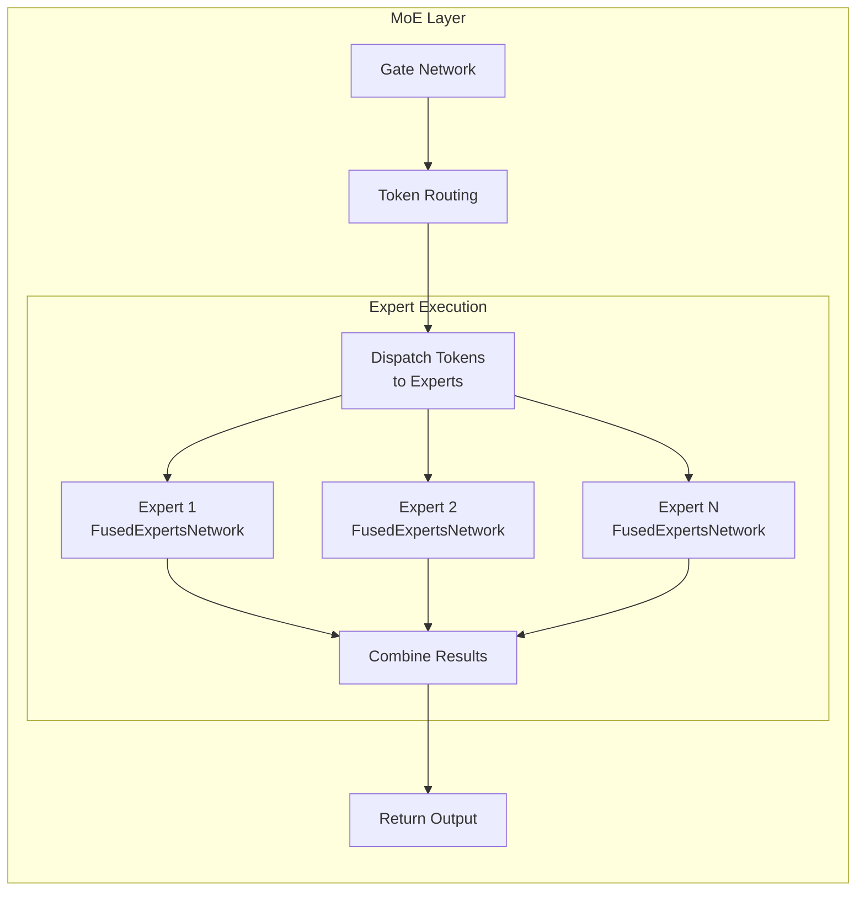
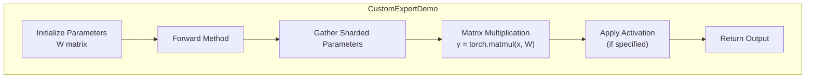
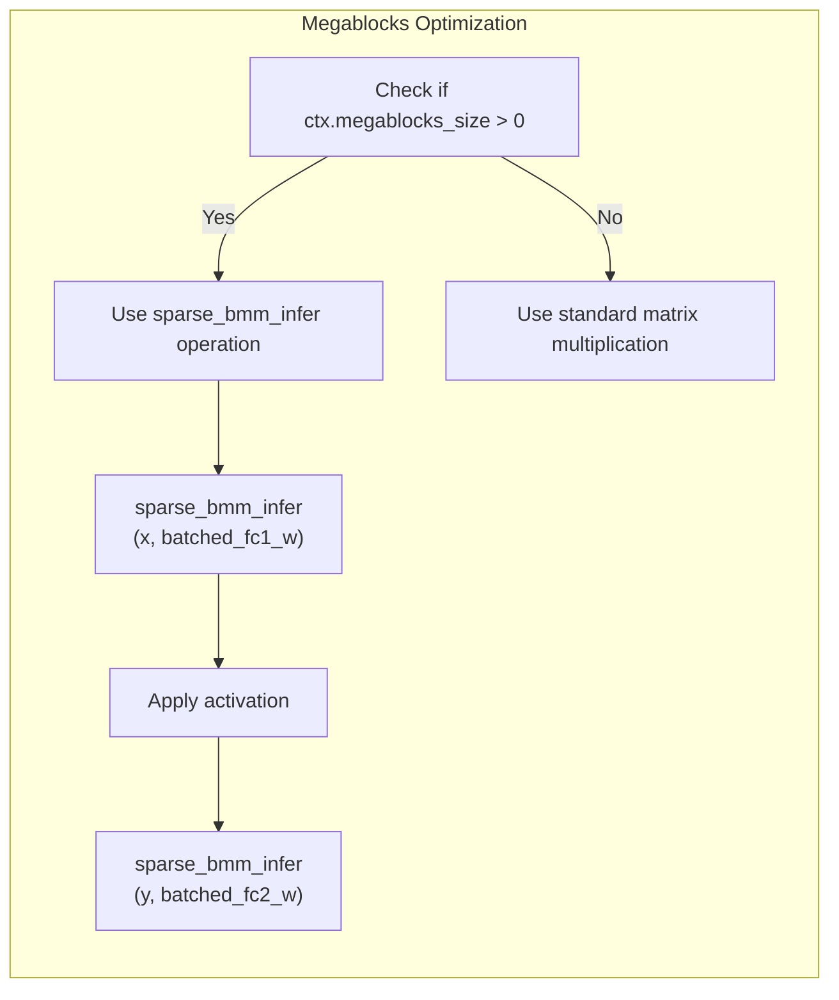

<!-- source: DeepWiki mcp.deepwiki.com · repo microsoft/Tutel · page 2.4 Experts · fetched 2026-10-26 -->

# Experts

<details>
<summary>Relevant source files</summary>

The following files were used as context for generating this wiki page:

- [tutel/examples/helloworld_custom_expert_sharded.py](tutel/examples/helloworld_custom_expert_sharded.py)
- [tutel/examples/helloworld_switch.py](tutel/examples/helloworld_switch.py)
- [tutel/experts/ffn.py](tutel/experts/ffn.py)
- [tutel/experts/llama_ffn.py](tutel/experts/llama_ffn.py)

</details>


## Purpose and Scope
This document describes the expert networks implementation in Tutel's Mixture of Experts (MoE) architecture. Expert networks are specialized neural network modules that process the tokens routed to them by the gate mechanism. In the MoE paradigm, each expert specializes in a different part of the input space, and the gate determines which expert should process which input tokens. For information about the gating mechanisms that route tokens to experts, see [Gates](#2.3). For information about the overall MoE layer implementation, see [MOE Layer](#2.1).

## Expert Implementations

Tutel provides several built-in expert network implementations, with the two main ones being:

1. **FusedExpertsNetwork** - The standard Feed-Forward Network (FFN) expert
2. **LlamaFFNNetwork** - A specialized implementation for LLaMA-style models

### FusedExpertsNetwork

The `FusedExpertsNetwork` is the default expert implementation, consisting of a two-layer feed-forward network with customizable activation functions and optional bias terms.



Sources: [tutel/experts/ffn.py:7-121]()

Key features of `FusedExpertsNetwork`:
- Supports parameter sharding across devices
- Handles both single-device and multi-device execution
- Includes optimizations for sparse computation (megablocks)
- Supports custom activation functions
- Configurable hidden size and output dimensions
- Optional bias terms

### LlamaFFNNetwork

The `LlamaFFNNetwork` implements the specific FFN architecture used in LLaMA models, which involves a gated activation pattern.



Sources: [tutel/experts/llama_ffn.py:7-48]()

Key features of `LlamaFFNNetwork`:
- Implements a gated FFN architecture specific to LLaMA models
- Uses SiLU activation by default
- Supports parameter sharding like the standard FFN

## Parameter Sharding Architecture

Expert parameter sharding is a key optimization in Tutel that enables efficient distributed execution of MoE models.



Sources: [tutel/experts/ffn.py:83-110](), [tutel/experts/llama_ffn.py:9-16]()

The sharding process:
1. During initialization, parameters are divided into chunks across devices
2. In the forward pass, the sharded parameters are gathered to form complete matrices
3. Computation is performed using the complete matrices
4. Results are returned to the MoE layer for further processing

## Expert Execution in MoE Context

To understand how experts fit into the overall MoE execution, here's the data flow during the forward pass:



Sources: [tutel/experts/ffn.py:57-121]()

During the MoE forward pass:
1. The gate network determines which experts should process each token
2. Tokens are dispatched to assigned experts using the routing information
3. Each expert processes its assigned tokens independently
4. Results are combined according to the original routing decisions

## Custom Expert Implementation

Tutel supports custom expert implementations through a flexible interface. Custom experts must:
1. Inherit from `torch.nn.Module`
2. Implement `__init__` method with parameters matching the expected signature
3. Implement `forward` method that accepts input tensor and context object

Here's an example of a simple custom expert from the example code:



Sources: [tutel/examples/helloworld_custom_expert_sharded.py:63-90]()

To use a custom expert with the MoE layer:

```python
# Configure MoE layer with custom expert
moe_layer = tutel_moe.moe_layer(
    gate_type = {'type': 'top', 'k': top_value, 'fp32_gate': args.fp32_gate},
    experts = {'type': 'custom', 'module': CustomExpertDemo, 'num_experts_per_device': num_local_experts, 'my_config': None},
    model_dim = model_dim,
    ...
)
```

## Special Optimizations

### Megablocks Optimization

The `FusedExpertsNetwork` includes an optimization based on the Megablocks paper (https://arxiv.org/pdf/2211.15841.pdf) that benefits decoder inference on single-GPU when there are multiple local experts. This optimizes sparse computation by using specialized sparse matrix multiplication kernels.



Sources: [tutel/experts/ffn.py:68-81]()

### Adaptive Degree

When running in a distributed setting, the `FusedExpertsNetwork` supports an "adaptive degree" parameter that controls how parameters are sharded and gathered. This allows Tutel to balance computation and communication based on the execution environment.

## Integration with MoE Layer

To use the built-in expert networks in an MoE layer:

```python
# Configure MoE layer with standard FFN experts
moe_layer = tutel_moe.moe_layer(
    gate_type = {'type': 'top', 'k': top_value},
    experts = {
        'type': 'ffn', 
        'num_experts_per_device': num_local_experts, 
        'hidden_size_per_expert': hidden_size, 
        'activation_fn': lambda x: F.relu(x)
    },
    model_dim = model_dim,
    ...
)
```

Sources: [tutel/examples/helloworld_switch.py:68-76]()

## Performance Considerations

When using expert networks in Tutel, consider the following factors that impact performance:

| Factor | Impact on Performance |
|--------|----------------------|
| Number of experts | More experts increase model capacity but require more memory |
| Hidden size | Larger hidden sizes provide more capacity but increase computation |
| Sharded count | Higher sharding can reduce memory per device but increases communication |
| Activation function | Choice affects both computation speed and model performance |
| Expert type | Different expert implementations have different computational profiles |
| Adaptive degree | Controls trade-off between computation and communication |

---

