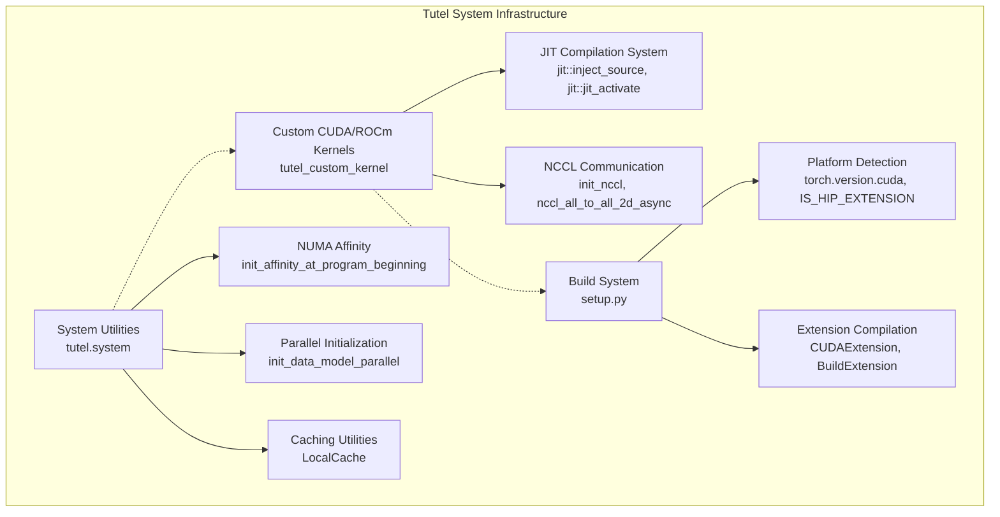
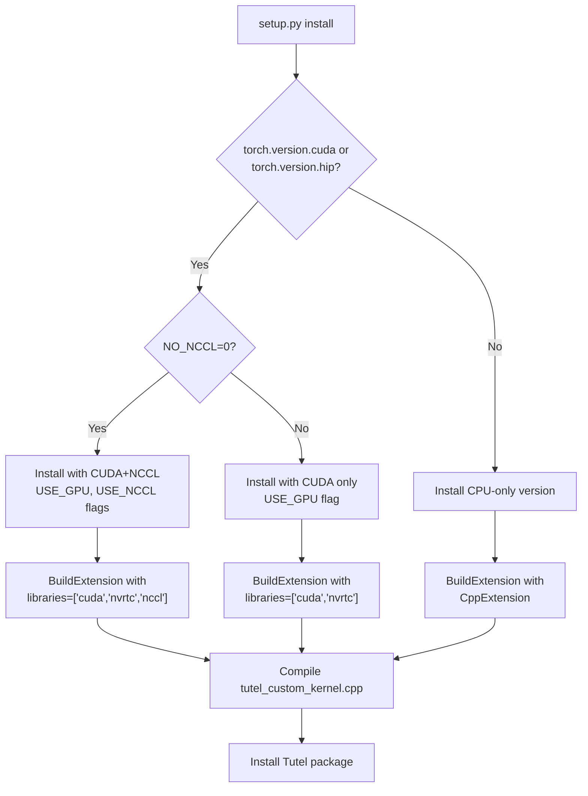
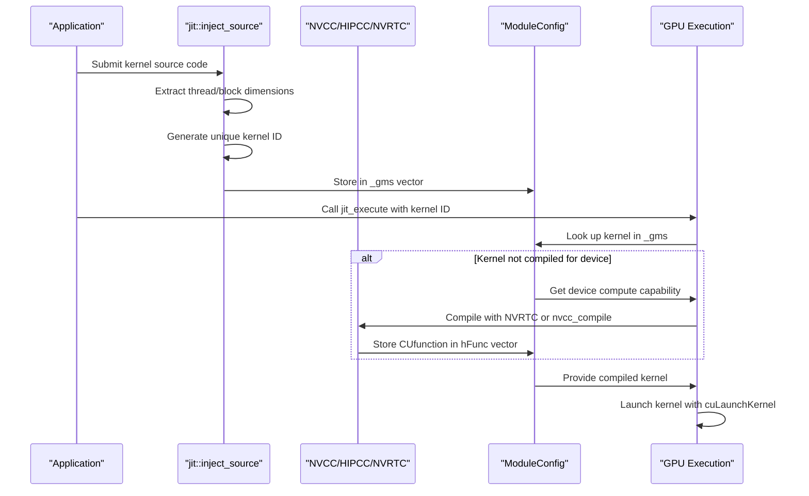
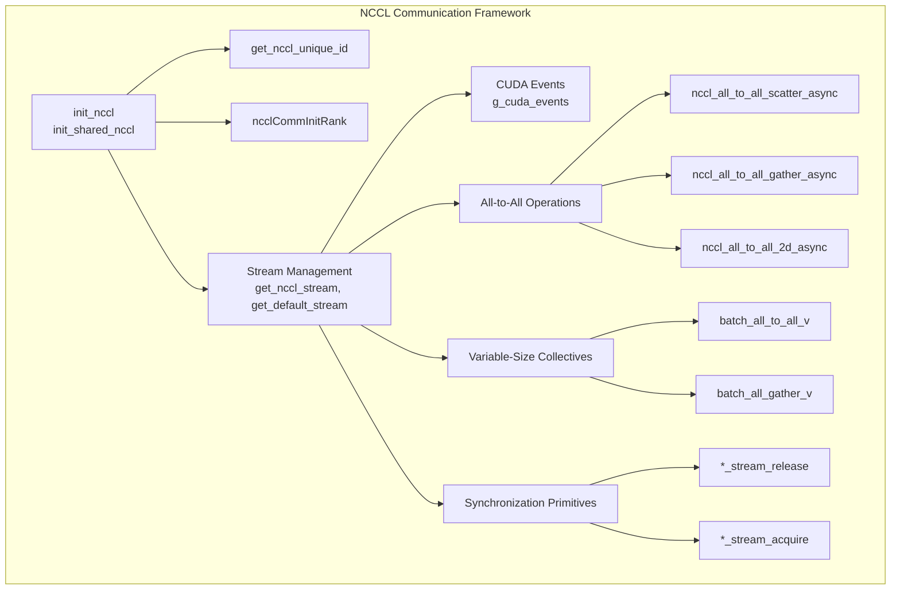
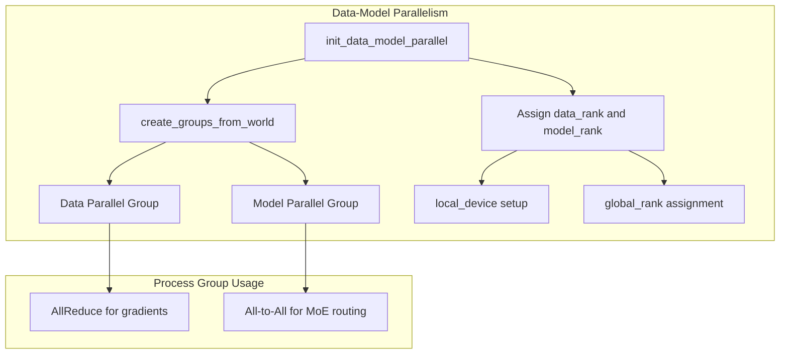

<!-- source: DeepWiki mcp.deepwiki.com · repo microsoft/Tutel · page 3 System Infrastructure · fetched 2026-10-26 -->

# System Infrastructure

<details>
<summary>Relevant source files</summary>

The following files were used as context for generating this wiki page:

- [setup.py](setup.py)
- [tutel/custom/custom_kernel.cpp](tutel/custom/custom_kernel.cpp)
- [tutel/system.py](tutel/system.py)

</details>


This page documents the technical infrastructure that powers Tutel's Mixture-of-Experts (MoE) implementation. The system infrastructure provides the foundation for high-performance execution across different hardware platforms, enabling efficient distributed training and inference of MoE models. For information about the MoE layer implementation itself, see [MOE Layer](#2.1), and for details on communication primitives, see [Communication Primitives](#3.3).

## Core Components Overview

The Tutel system infrastructure consists of several interconnected components that work together to provide a robust foundation for MoE operations.

**System Infrastructure Architecture**


Sources: [tutel/custom/custom_kernel.cpp:1-861](), [tutel/system.py:1-101](), [setup.py:1-153]()

## Build and Installation System

Tutel's build system is designed to adapt to different hardware configurations, automatically detecting the presence of CUDA/ROCm and NCCL/RCCL to optimize compilation for the target platform.

**Build System Flow**


The build process follows these steps:

1. Detects hardware capabilities (CUDA/ROCm availability)
2. Determines NCCL/RCCL availability
3. Selects appropriate compilation options (`CUDAExtension` or `CppExtension`)
4. Compiles the custom kernel with necessary flags and dependencies
5. Installs the Tutel package with optimized extensions

The `setup.py` script dynamically selects compilation flags based on the detected capabilities:

```python
if torch.version.cuda or torch.version.hip:
    if int(os.environ.get('NO_NCCL', 0)) == 0:
        # Install with NCCL support
        install(use_cuda=True, use_nccl=True)
    else:
        # Install without NCCL
        install(use_cuda=True, use_nccl=False)
else:
    # CPU-only installation
    install(use_cuda=False, use_nccl=False)
```

Sources: [setup.py:58-152]()

## JIT Compilation System

Tutel employs a Just-In-Time (JIT) compilation system that dynamically generates and compiles CUDA/ROCm kernels at runtime, enabling optimized execution without pre-compiling multiple variants.

**JIT Compilation Flow**


The JIT compilation system has three key components:

1. **Source Injection and Parsing** (`jit::inject_source`): Processes source code to extract thread/block dimensions and register the kernel.
2. **Kernel Activation** (`jit::jit_activate`): Compiles the kernel for a specific device if not already compiled.
3. **Kernel Execution** (`jit::jit_execute`): Prepares arguments and launches the compiled kernel.

The `ModuleConfig` struct maintains state for each kernel, including:
- Compiled function handles per device (`hFunc`)
- Block and thread dimensions
- Source code and function name

This system supports both NVRTC (runtime compilation) and NVCC/HIPCC (command-line compilation) paths, with automatic fallback mechanisms.

Sources: [tutel/custom/custom_kernel.cpp:54-286]()

## NCCL Communication Framework

Tutel's distributed communication framework leverages NCCL (NVIDIA Collective Communication Library) or RCCL (ROCm Collective Communication Library) to provide high-performance collective operations for distributed MoE training.

**NCCL Communication Infrastructure**


### NCCL Initialization

NCCL communication begins with initialization:

1. Generate a unique ID (`get_nccl_unique_id`)
2. Initialize NCCL communicators with `ncclCommInitRank`
3. Set up stream and event infrastructure for asynchronous operations

Tutel supports both global world communicators (`init_nccl`) and shared communicators (`init_shared_nccl`) for different collective operation scopes.

### Stream Management

Efficient GPU operations require careful management of execution streams:

- `get_default_stream()`: Returns the default CUDA stream
- `get_nccl_stream()`: Returns a dedicated stream for NCCL operations
- CUDA events (`g_cuda_events`) provide synchronization points between streams

### All-to-All Communication Optimizations

A critical aspect of MoE performance is the All-to-All communication pattern for token routing. Tutel implements multiple optimized variants:

1. **Scatter-based All-to-All** (`nccl_all_to_all_scatter_async`): 
   - Divides data into slices and scatters them asynchronously
   - Supports pipelining via event-based synchronization
   
2. **Gather-based All-to-All** (`nccl_all_to_all_gather_async`):
   - Inverse of scatter-based operation
   - Efficiently aggregates partial results
   
3. **2D All-to-All** (`nccl_all_to_all_2d_async`):
   - Hierarchical approach for multi-node, multi-GPU setups
   - Optimizes communication by first performing intra-node All-to-All, then inter-node

The 2D All-to-All significantly reduces communication overhead for multi-node scenarios by leveraging the hierarchical nature of distributed systems.

Sources: [tutel/custom/custom_kernel.cpp:334-784]()

## Data-Model Parallelism

Tutel provides an infrastructure for managing data parallelism and model parallelism in distributed training scenarios through the `init_data_model_parallel` function in the system module.

**Data-Model Parallelism Architecture**


The parallelism system provides:

1. **Process Group Creation**: Creates process groups for both data and model parallelism
2. **Rank Assignment**: Assigns appropriate ranks within each parallel dimension
3. **Device Mapping**: Associates processes with the correct GPU devices
4. **Clean Shutdown**: Ensures proper process group destruction on exit

This infrastructure enables MoE models to efficiently scale across multiple nodes and GPUs by optimizing both data and model distribution.

Sources: [tutel/system.py:27-47]()

## System Utilities

### NUMA Affinity Management

For multi-socket systems, Tutel provides NUMA affinity management to ensure optimal hardware utilization:

```python
def init_affinity_at_program_beginning():
    # ...
    group_rank = int(os.environ.get('LOCAL_RANK', '0'))
    nodes = sorted([int(x[4:]) for x in os.listdir('/sys/devices/system/node') if re.match('node[0-9]+', x)])
    cpus = [sorted([int(x[3:]) for x in os.listdir('/sys/devices/system/node/node%d' % node_id) if re.match('cpu[0-9]+', x)]) for node_id in nodes]
    sel_node = (group_rank // numa_type) % len(nodes)
    os.sched_setaffinity(0, cpus[sel_node])
    # ...
```

This function:
1. Detects available NUMA nodes
2. Identifies CPUs associated with each NUMA node
3. Assigns processes to specific NUMA nodes based on their local rank
4. Sets CPU affinity to ensure processes use the correct CPU cores

### Performance Measurement

The system module includes utilities for performance measurement:

- `record_time()`: Records timestamps with appropriate CUDA synchronization
- `perform()`: Benchmarks functions with statistical reporting

### Local Cache

The `LocalCache` class provides a simple key-value caching mechanism:

```python
class LocalCache:
    _CACHE = dict()
    
    @staticmethod
    def reset():
        LocalCache._CACHE = dict()
        
    @staticmethod
    def set(key, val):
        LocalCache._CACHE[key] = val
        
    @staticmethod
    def get(key=None):
        if key not in LocalCache._CACHE:
            return [LocalCache._CACHE[x] for x in LocalCache._CACHE]
        return LocalCache._CACHE[key]
```

This cache is used throughout Tutel to store and retrieve frequently accessed data and configuration information.

Sources: [tutel/system.py:10-100]()

## Custom CUDA Kernels

Beyond the JIT compilation system, Tutel includes several specialized CUDA kernels optimized for MoE operations:

1. **Fast Cumulative Sum** (`warp_cumsum`): Optimized parallel implementation of cumulative sum operations
2. **Sparse Batch Matrix Multiplication** (`warp_sparse_bmm_infer`): Efficient sparse matrix operations for MoE inference
3. **Type Conversion Operations**:
   - `warp_to_float32`: Converts tensors to FP32 with scaling
   - `warp_to_bfloat16`: Converts tensors to BF16 with scaling
4. **DeepSeek-Specific Operations**:
   - `warp_gemm_nt_bf16xfp8_block_scal`: Optimized matrix multiplication for mixed precision
   - `warp_rmsnorm_bf16`: RMSNorm operation with BF16 support
   - `warp_deepseek_sigmoid_top_8_static_v2`: Specialized gating operation

These kernels provide highly optimized implementations for critical operations in MoE models, enabling efficient execution on GPU hardware.

Sources: [tutel/custom/custom_kernel.cpp:863-1535]()

## Hardware Support and Optimizations

Tutel supports a variety of hardware platforms with platform-specific optimizations:

| Hardware Platform | Support Level | Key Optimizations |
|------------------|---------------|-------------------|
| NVIDIA CUDA | Full | JIT CUDA kernels, NVRTC compilation, NCCL communication |
| AMD ROCm | Full | HIP kernels, RCCL communication, adapted memory management |
| CPU | Basic | Fallback implementations for all operations |

The system detects hardware capabilities at build time and runtime to ensure optimal execution:

```python
# At build time
if torch.version.cuda or torch.version.hip:
    # Configure for GPU
else:
    # Configure for CPU

# At runtime
if USE_GPU:
    # Use GPU-optimized path
else:
    # Use CPU fallback
```

Additionally, the system provides specialized optimizations for different NVIDIA GPU architectures by detecting compute capability and generating appropriate JIT-compiled code.

Sources: [tutel/custom/custom_kernel.cpp:46-53](), [setup.py:58-152]()

## Conclusion

The Tutel system infrastructure provides a comprehensive foundation for high-performance MoE execution through:

1. A flexible build system that adapts to different hardware platforms
2. An efficient JIT compilation system for dynamic kernel generation
3. Optimized NCCL-based communication primitives for distributed execution
4. Data-model parallelism infrastructure for scalable training
5. System-level optimizations including NUMA affinity and custom CUDA kernels

These components work together to enable efficient training and inference of large-scale MoE models across various hardware platforms. For more details on specific subsystems, refer to the dedicated pages for [Custom CUDA Kernels](#3.1), [JIT Compilation](#3.2), and [Communication Primitives](#3.3).

---

