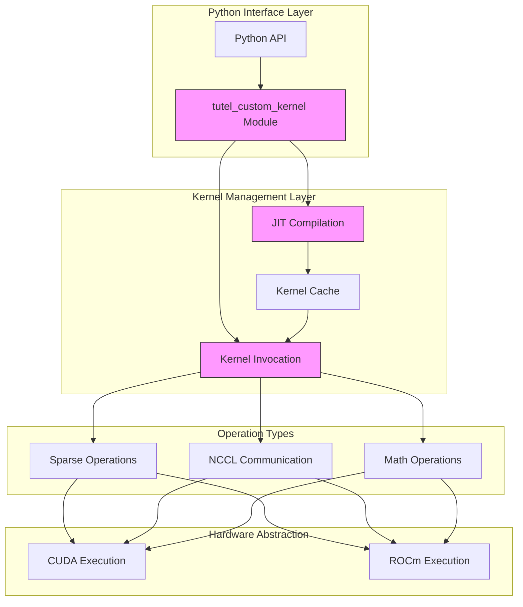
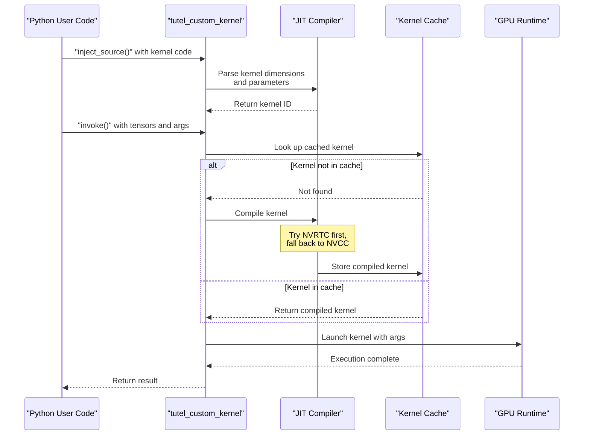
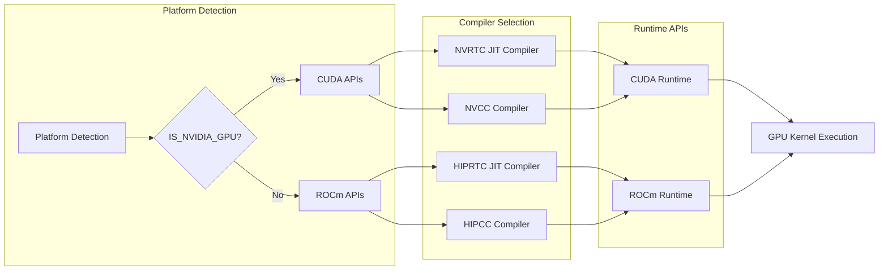

<!-- source: DeepWiki mcp.deepwiki.com · repo microsoft/Tutel · page 3.1 Custom CUDA Kernels · fetched 2026-10-26 -->

# Custom CUDA Kernels

<details>
<summary>Relevant source files</summary>

The following files were used as context for generating this wiki page:

- [doc/DeepSeekR1-tutel-accel.png](doc/DeepSeekR1-tutel-accel.png)
- [tutel/custom/antares_ops.h](tutel/custom/antares_ops.h)
- [tutel/custom/backend.hpp](tutel/custom/backend.hpp)
- [tutel/custom/custom_kernel.cpp](tutel/custom/custom_kernel.cpp)

</details>


## Purpose and Scope

This document describes the custom CUDA kernel infrastructure within Tutel, which provides high-performance GPU implementations for critical operations in Mixture-of-Experts (MoE) models. These kernels are particularly important for efficient token routing, sparse operations, and distributed communication in MoE architectures. For information about the JIT compilation system that powers these kernels, see [JIT Compilation](#3.2).

## Architecture Overview

Tutel's custom CUDA kernel system provides specialized GPU operations for critical MoE operations. The architecture is designed to optimize performance by implementing operations closer to the hardware level, with support for both NVIDIA CUDA and AMD ROCm platforms.



Sources: [tutel/custom/custom_kernel.cpp:4-23](). [tutel/custom/custom_kernel.cpp:45-102]().

## Kernel Compilation System

The custom kernel module provides Just-In-Time (JIT) compilation capabilities, allowing for dynamic compilation and execution of CUDA/ROCm kernels.



The JIT compilation system supports two compilation methods:
1. NVRTC (NVIDIA Runtime Compilation) - Preferred for faster compilation
2. NVCC (NVIDIA CUDA Compiler) - Fallback when NVRTC fails

The system caches compiled kernels to avoid recompilation overhead during repeated invocations. Kernel metadata (block/thread dimensions) is parsed from the source code.

Sources: [tutel/custom/custom_kernel.cpp:103-134](). [tutel/custom/custom_kernel.cpp:242-262](). [tutel/custom/custom_kernel.cpp:788-802]().

## Kernel Invocation Interface

The module provides two primary functions for users:

1. **Inject Source**: Adds a kernel to the system
   ```
   inject_source(headless_code) -> kernel_id
   ```

2. **Invoke**: Executes a kernel with provided arguments
   ```
   invoke(tensors, arguments, blocks, kernel_id)
   ```

When invoking kernels, the system:
1. Verifies tensor devices match the target CUDA device
2. Sets up kernel arguments from tensor pointers and scalar values
3. Determines appropriate block/grid dimensions
4. Executes the kernel on the current CUDA stream

Sources: [tutel/custom/custom_kernel.cpp:264-286](). [tutel/custom/custom_kernel.cpp:788-802]().

## Core Operations

### Sparse Operations

Tutel provides optimized sparse operations for MoE routing, which are critical for dispatching tokens to experts efficiently:

| Operation | Description | CPU Fallback |
|-----------|-------------|--------------|
| Forward | Routes tokens to experts based on gating scores | ✓ |
| Backward Data | Collects expert outputs back to input layout | ✓ |
| Backward Gate | Computes gradients for the gating mechanism | ✓ |

These operations implement the core routing mechanisms for MoE architectures, handling the sparse activation patterns that make MoE models efficient.

Sources: [tutel/custom/custom_kernel.cpp:289-332]().

### NCCL Communication Operations

The custom kernel module provides optimized wrapper functions for NCCL operations, which are essential for distributed MoE training:

| Operation | Description |
|-----------|-------------|
| All-to-All Scatter Async | Distributes tokens to appropriate devices |
| All-to-All Gather Async | Collects processed tokens back from devices |
| All-to-All 2D Async | 2D implementation for improved hierarchical communication |
| Batch All-to-All-V | Batched variant of All-to-All with variable message sizes |
| Batch All-Gather-V | Batched variant of All-Gather with variable message sizes |

These operations enable efficient communication for distributed MoE implementations, with specific optimizations for 2D device topologies and pipelined execution.

Sources: [tutel/custom/custom_kernel.cpp:566-784]().

### Additional Utility Operations

The module also provides several utility operations:

1. **Fast Cumulative Sum**: Optimized cumsum implementation using shared memory
2. **Sparse Block Matrix Multiplication**: Efficient sparse BMM for expert computation
3. **Memory Stride Copy**: Optimized memory copy for communication

These operations support the core MoE functionality and provide performance-critical building blocks for the overall system.

Sources: [tutel/custom/custom_kernel.cpp:866-935]().

## Hardware Support and Abstraction

The custom kernel system is designed to support both NVIDIA CUDA and AMD ROCm platforms through a unified interface. This is achieved through conditional compilation and API abstraction.



Key hardware abstraction features:
1. Platform detection via preprocessor macros
2. API call remapping for ROCm compatibility
3. Fallback compilation strategies
4. Architecture-specific optimizations

Sources: [tutel/custom/custom_kernel.cpp:6-53](). [tutel/custom/backend.hpp:24-61]().

## Integration with Antares

Tutel includes optional integration with the Antares framework for additional operator capabilities through the `antares_ops.h` interface. This provides:

1. Dynamic loading of pre-compiled operator modules
2. Efficient argument handling and type conversion
3. Output shape inference

The Antares integration extends Tutel's capabilities with more specialized operations, particularly for newer hardware features and custom operations.

Sources: [tutel/custom/antares_ops.h:82-260](). [tutel/custom/backend.hpp:64-224]().

## DeepSeek-Specific Optimizations

The custom kernel system includes specialized operations for DeepSeek models:

1. **BF16/FP8 Block Scaling**: Operations for quantized expert networks
2. **Sigmoid Top-K Gating**: Custom gating implementation for DeepSeek
3. **Multi-head Latent RoPE**: Efficient implementation of rotary position embeddings

These optimizations are designed specifically for DeepSeek model architectures and enable efficient execution on various hardware platforms.

Sources: [tutel/custom/custom_kernel.cpp:1054-1116]().

## Memory Management

The kernel system includes careful memory management to ensure optimal performance:

1. **Event-based Synchronization**: Coordination between computation and communication streams
2. **CUDA Stream Management**: Separation of compute and communication for overlap
3. **Memory Recording**: Tracking tensor usage across streams

These techniques enable efficient pipelining of communication and computation, a critical optimization for distributed MoE models.

Sources: [tutel/custom/custom_kernel.cpp:430-458](). [tutel/custom/backend.hpp:97-133]().

## Performance Considerations

When using custom CUDA kernels, several factors affect performance:

1. **JIT Compilation Overhead**: First-time kernel invocation includes compilation time
2. **Stream Management**: Proper synchronization impacts throughput
3. **Device Selection**: Operations must target the correct GPU device
4. **Memory Layout**: Contiguous tensors provide best performance

For optimal performance, ensure tensors are contiguous and reuse compiled kernels where possible.

Sources: [tutel/custom/custom_kernel.cpp:105-172](). [tutel/custom/custom_kernel.cpp:227-233]().

---

