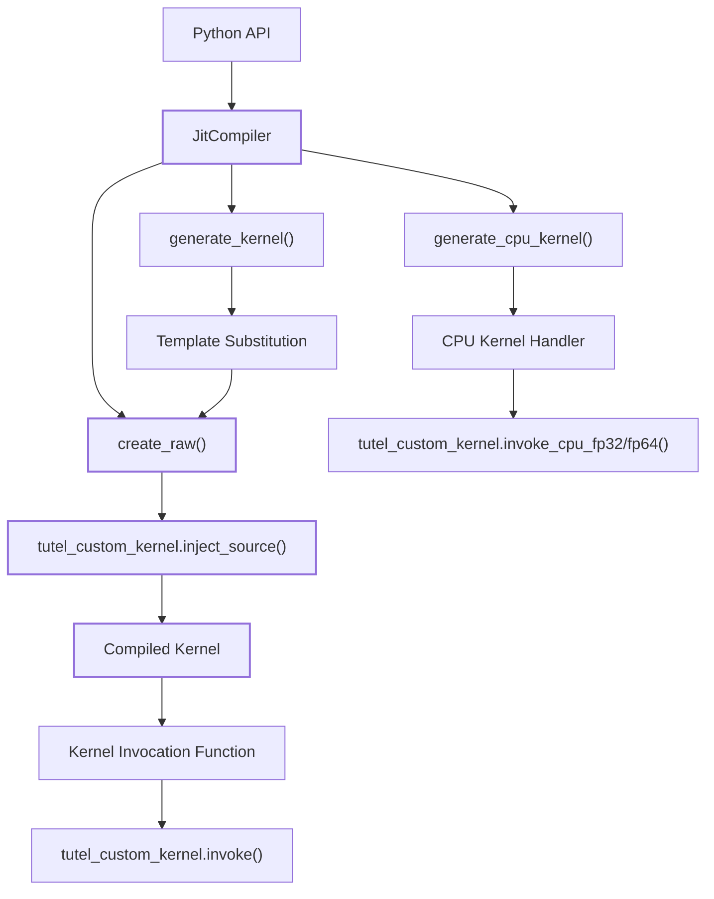
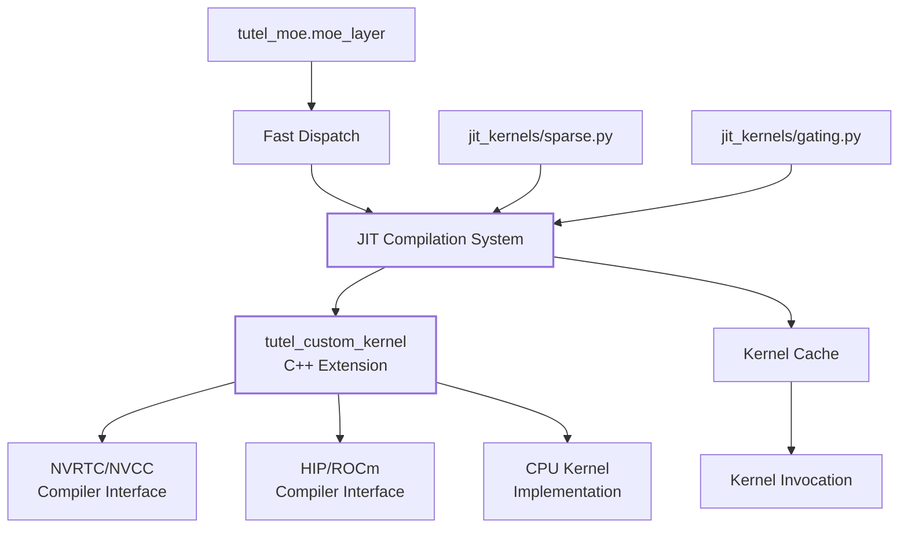
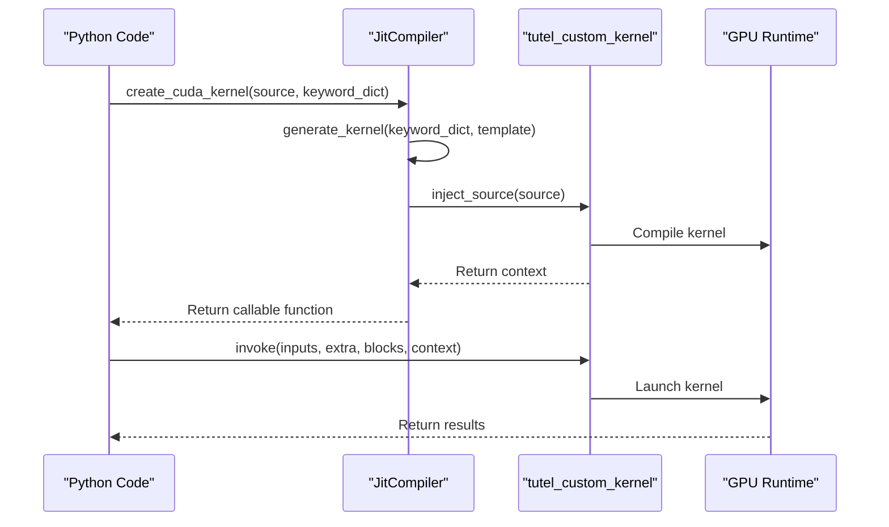
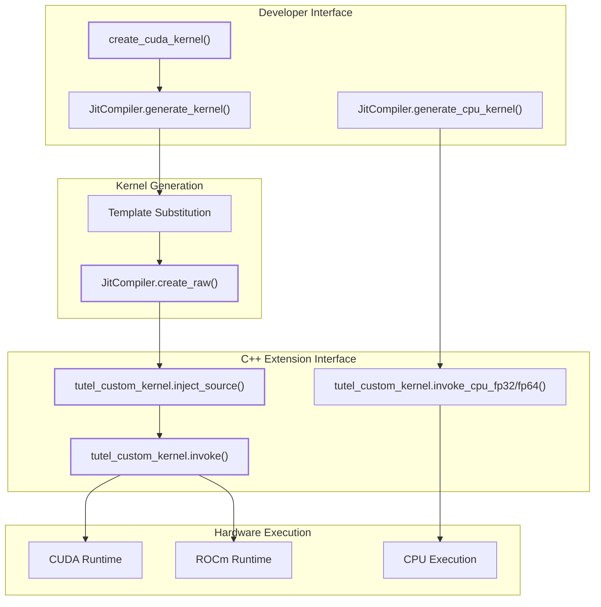

<!-- source: DeepWiki mcp.deepwiki.com · repo microsoft/Tutel · page 3.2 JIT Compilation · fetched 2026-10-26 -->

# JIT Compilation

<details>
<summary>Relevant source files</summary>

The following files were used as context for generating this wiki page:

- [tutel/impls/jit_compiler.py](tutel/impls/jit_compiler.py)
- [tutel/jit_kernels/gating.py](tutel/jit_kernels/gating.py)
- [tutel/jit_kernels/sparse.py](tutel/jit_kernels/sparse.py)
- [tutel/launcher/run.py](tutel/launcher/run.py)

</details>


## Introduction

The Just-In-Time (JIT) Compilation system in Tutel provides runtime compilation capabilities for optimized GPU kernel execution. This component is responsible for dynamically generating, compiling, and caching hardware-specific kernels that power critical operations in the Mixture-of-Experts (MoE) architecture. The JIT compilation system primarily targets CUDA and ROCm platforms but also provides CPU fallback mechanisms when GPU acceleration is unavailable.

For information about the custom CUDA kernels that are compiled using this system, see [Custom CUDA Kernels](#3.1).

Sources: [tutel/impls/jit_compiler.py:24-54]()

## Architecture Overview

The JIT compilation system in Tutel follows a template-based approach for kernel generation and utilizes platform-specific compilers (NVRTC/NVCC for CUDA, HIP for ROCm) to produce optimized machine code. The system interacts with the `tutel_custom_kernel` C++ extension module, which handles the low-level compilation and kernel invocation details.

### JIT Compilation Workflow



Sources: [tutel/impls/jit_compiler.py:24-54]()

## Key Components

### JitCompiler Class

The `JitCompiler` class is the central component of the JIT compilation system. It provides static methods for kernel creation and management:

1. `create_raw(source)` - Creates a kernel directly from CUDA/ROCm source code
2. `generate_kernel(keyword_dict, template)` - Generates a kernel by substituting variables in a template
3. `generate_cpu_kernel(kernel_type)` - Creates a CPU fallback implementation for a specific kernel type

The class abstracts away the complex details of kernel compilation, providing a simple interface for the rest of the codebase.

Sources: [tutel/impls/jit_compiler.py:24-53]()

### Module Dependencies



Sources: [tutel/impls/jit_compiler.py:9-21](), [tutel/jit_kernels/gating.py:1-24](), [tutel/jit_kernels/sparse.py:1-15]()

## Kernel Generation Process

### Template-Based Compilation

The JIT compiler uses a template substitution approach where kernel code contains placeholders (`@VARIABLE@`) that are replaced with actual values during compilation. This allows for creating specialized variants of the same kernel for different data types, block sizes, or algorithm parameters.

For example, when creating a sparse operator, the system:

1. Determines the appropriate CUDA/ROCm type based on the tensor's data type
2. Substitutes template variables in the kernel source
3. Compiles the resulting source code
4. Returns a callable function that invokes the compiled kernel

Sources: [tutel/impls/jit_compiler.py:36-40](), [tutel/jit_kernels/sparse.py:8-15]()

### Kernel Invocation Interface



Sources: [tutel/impls/jit_compiler.py:24-34]()

## Kernel Types

### CUDA/ROCm Kernels

The JIT compilation system primarily targets GPU acceleration through CUDA (for NVIDIA GPUs) and ROCm (for AMD GPUs). The `create_cuda_kernel` function (a thin wrapper around `JitCompiler.generate_kernel`) is the main entry point for creating GPU-accelerated kernels.

Sources: [tutel/impls/jit_compiler.py:54-56]()

### CPU Fallback Kernels

For environments without GPU support, the system provides CPU fallback implementations through `generate_cpu_kernel`. These kernels are specialized for different floating-point precisions (fp32 and fp64) and are implemented natively in the `tutel_custom_kernel` extension.

Sources: [tutel/impls/jit_compiler.py:42-52]()

## Integration with Tutel Operations

### Gating Operations

The JIT compilation system plays a crucial role in optimizing gating operations, which are fundamental to MoE models. The `tutel/jit_kernels/gating.py` module uses JIT compilation for fast cumulative sum operations that are essential for token routing.

When possible, the system uses specialized GPU kernels exposed through `torch.ops.tutel_ops.cumsum` for maximum performance, with fallback to PyTorch's native implementation when necessary.

Sources: [tutel/jit_kernels/gating.py:1-24]()

### Sparse Operations

The `tutel/jit_kernels/sparse.py` module contains several JIT-compiled kernels for critical sparse operations in MoE models:

1. **Forward Pass** - Dispatches input tokens to selected experts
2. **Backward Data** - Computes gradients for the input data
3. **Backward Gate** - Computes gradients for the gating network

Each of these operations is implemented with specialized kernels for different data types (float16, float32) and platforms (CUDA, CPU).

Sources: [tutel/jit_kernels/sparse.py:16-134]()

## Performance Optimizations

### Environment Detection

The JIT compiler automatically detects the available GPU runtime environment (CUDA or ROCm) and configures itself accordingly. It uses the `torch.utils.cpp_extension` module to identify the SDK home directory and communicates this information to the `tutel_custom_kernel` extension.

```python
SDK_HOME = CUDA_HOME if not IS_HIP_EXTENSION else ROCM_HOME
tutel_custom_kernel.update_sdk_home(torch.tensor([ord(x) for x in SDK_HOME] + [0], dtype=torch.int8, device='cpu'))
```

Sources: [tutel/impls/jit_compiler.py:9-21]()

### Error Handling

The JIT compiler includes robust error handling to manage cases where CUDA support is unavailable or the `tutel_custom_kernel` extension cannot be loaded. In such cases, it provides informative error messages and falls back to CPU implementations when possible.

Sources: [tutel/impls/jit_compiler.py:9-21](), [tutel/impls/jit_compiler.py:27-29]()

## Technical Implementation Details

### Kernel Execution Configuration

The JIT-compiled kernels are carefully designed with optimal execution configurations, including thread block sizes and grid dimensions. For example, sparse operations use thread block sizes of 1024 or 32 depending on the specific kernel requirements.

The `JitCompiler.create_raw` method generates a callable function that handles kernel invocation with the appropriate execution configuration:

```python
def func(*inputs, extra=[], blocks=[]):
    tutel_custom_kernel.invoke(inputs, extra, blocks, __ctx__)
```

Sources: [tutel/impls/jit_compiler.py:32-34](), [tutel/jit_kernels/sparse.py:21-35](), [tutel/jit_kernels/sparse.py:71-134]()

### Dataflow in JIT Compilation System



Sources: [tutel/impls/jit_compiler.py:24-56]()

## Conclusion

The JIT compilation system in Tutel is a critical component that bridges the gap between high-level MoE operations and optimized hardware execution. By dynamically generating and compiling specialized kernels, it enables maximum performance on diverse hardware platforms while maintaining a clean, high-level API for the rest of the codebase.

The system's design emphasizes flexibility (supporting multiple platforms and data types), performance (through optimized kernel implementations), and fallback mechanisms (ensuring operation even when GPU acceleration is unavailable).

---

