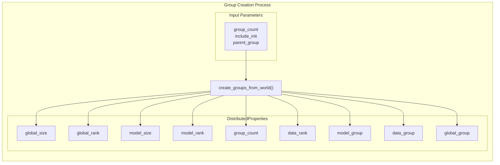
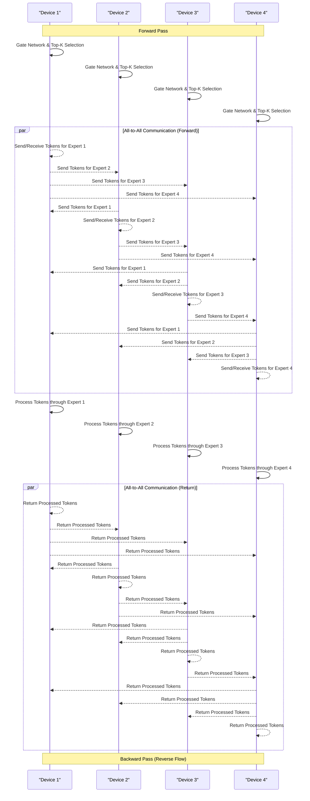
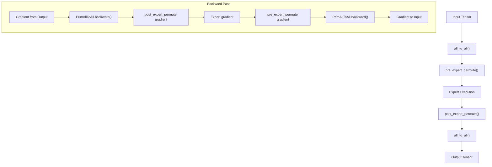
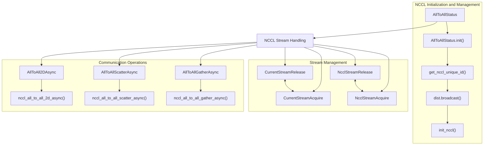
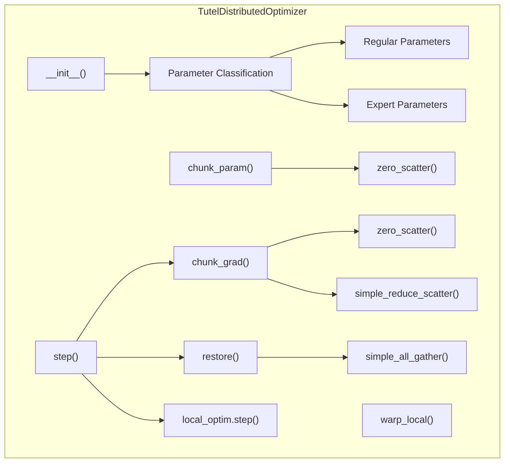

<!-- source: DeepWiki mcp.deepwiki.com · repo microsoft/Tutel · page 3.3 Communication Primitives · fetched 2026-10-26 -->

# Communication Primitives

<details>
<summary>Relevant source files</summary>

The following files were used as context for generating this wiki page:

- [tutel/examples/helloworld_from_scratch.py](tutel/examples/helloworld_from_scratch.py)
- [tutel/impls/communicate.py](tutel/impls/communicate.py)
- [tutel/net.py](tutel/net.py)

</details>


## Purpose and Scope

This document describes the communication primitives in Tutel, which provide essential distributed communication capabilities for Mixture-of-Experts (MoE) models. These primitives enable efficient token routing across multiple devices and support various distributed execution patterns. For information about how these primitives integrate with the MoE layer implementation, see [MOE Layer](#2.1).

## Overview

Tutel's communication primitives are a collection of functions and classes that facilitate distributed training and inference in MoE models. They handle communication patterns such as all-to-all, all-reduce, all-gather, and reduce-scatter operations, with special optimizations for the MoE architecture.

```mermaid
flowchart TD
    subgraph "Communication Primitives Architecture"
        CP["communicate.py"]
        
        subgraph "Basic Operations"
            BO1["get_world_size/rank"]
            BO2["barrier"]
            BO3["create_groups_from_world"]
        end
        
        subgraph "Simple Operations"
            SO1["simple_all_reduce"]
            SO2["simple_all_to_all"]
            SO3["simple_split"]
            SO4["simple_reduce_scatter"]
            SO5["simple_all_gather"]
        end
        
        subgraph "Autograd Operations"
            AO1["PrimAllToAll"]
            AO2["PrimBwdAllreduce"]
            AO3["PrimFwdAllreduce"]
            AO4["PrimReducescatter"]
            AO5["PrimAllgather"]
            AO6["PrimSpatialSplit"]
        end
        
        subgraph "Batch Operations"
            BatchOps["batch_all_to_all_v\nbatch_all_gather_v"]
        end
        
        subgraph "Async Operations"
            AsyncOps["AllToAllStatus\nAllToAll2DAsync\nAllToAllScatterAsync\nAllToAllGatherAsync"]
        end
        
        CP --> BO1 & BO2 & BO3
        CP --> SO1 & SO2 & SO3 & SO4 & SO5
        CP --> AO1 & AO2 & AO3 & AO4 & AO5 & AO6
        CP --> BatchOps
        CP --> AsyncOps
    end
    
    CP --> CustomKernels["Custom CUDA Kernels"]
    CP --> TorchDist["torch.distributed"]
    
    MOELayer["MOE Layer\ntutel_moe.moe_layer"] --> CP
```



Sources: [tutel/impls/communicate.py:1-633]()

## Communication Types

Tutel's communication primitives can be categorized into three main types based on their backward computation behavior:

1. **Simple Communication** - Basic operations without backward computation support
2. **Autograd Communication** - Operations with backward computation support via PyTorch autograd
3. **Batch-based Communication** - Operations that handle variable-sized data across processes

The table below summarizes the key communication primitives in each category:

| Type | Operations | Description |
|------|------------|-------------|
| Simple | `simple_all_reduce` | Combines tensors from all processes and distributes result |
|        | `simple_all_to_all` | Exchanges tensors between all processes |
|        | `simple_split` | Splits a tensor among processes |
|        | `simple_reduce_scatter` | Combines tensors and scatters the result |
|        | `simple_all_gather` | Gathers tensors from all processes |
| Autograd | `all_to_all` | All-to-all with gradient computation |
|          | `all_to_all_single` | Single tensor all-to-all with gradient computation |
|          | `all_gather` | All-gather with gradient computation |
|          | `reduce_scatter` | Reduce-scatter with gradient computation |
|          | `allreduce_forward` | Forward-only all-reduce |
|          | `allreduce_backward` | Backward-only all-reduce |
| Batch | `batch_all_to_all_v` | All-to-all for variable-sized data |
|       | `batch_all_gather_v` | All-gather for variable-sized data |

Sources: [tutel/impls/communicate.py:170-242](), [tutel/impls/communicate.py:439-631]()

## Basic Group Management

Tutel provides functions to create and manage process groups for distributed communication:

1. `create_standalone_group()` - Creates a group containing only the current process
2. `create_groups_from_world(group_count)` - Divides the world processes into groups for model and data parallelism

These functions return a `DistributedProperties` object containing group configurations and metadata about the distributed environment.



Sources: [tutel/impls/communicate.py:43-168]()

## All-to-All Communication

All-to-All is the most critical communication pattern for MoE models, as it's used to route tokens to their assigned experts across devices. Tutel provides several implementations with different optimizations:

1. `simple_all_to_all` - A basic implementation without gradient support
2. `PrimAllToAll` - Implementation with gradient support through PyTorch autograd
3. `AllToAll2DAsync` - Asynchronous 2D implementation for improved performance
4. `AllToAllScatterAsync` and `AllToAllGatherAsync` - Specialized scatter and gather variants

The diagram below illustrates the data flow during an all-to-all operation in an MoE model:



Sources: [tutel/impls/communicate.py:170-192](), [tutel/impls/communicate.py:346-397]()

## Special Communication Patterns for MoE

Tutel implements specialized communication patterns for MoE models:

1. `pre_expert_permute` and `post_expert_permute` - Functions that handle tensor reshaping before and after expert execution
2. `RestoreBackward` - Ensures proper backward gradient flow in MoE layers
3. `PrimAllToAll2D` - Specialized 2D all-to-all implementation for certain MoE configurations



Sources: [tutel/impls/communicate.py:606-624](), [tutel/examples/helloworld_from_scratch.py:56-65]()

## NCCL Optimizations

Tutel includes several optimizations for NCCL-based communication:

1. `AllToAllStatus` - Manages NCCL initialization and provides context for optimized communication
2. Stream management classes (`CurrentStreamRelease`, `CurrentStreamAcquire`, etc.) - Handle CUDA stream synchronization
3. Shared NCCL contexts - Allow reuse of NCCL communicators for improved performance



Sources: [tutel/impls/communicate.py:257-397]()

## Integration with Distributed Optimization

The communication primitives integrate with Tutel's distributed optimization capabilities through the `TutelDistributedOptimizer` class in `tutel/net.py`. This optimizer handles parameter sharding and gradient synchronization for distributed training.

Key features include:
1. Chunking parameters across devices
2. Distributed gradient aggregation
3. Transparent wrapping of local optimizers (like SGD, Adam)



Sources: [tutel/net.py:15-59]()

## Example Usage

The communication primitives are used throughout the MoE implementation, particularly in the token routing process. A basic example of using all-to-all communication in an MoE model is shown in the `helloworld_from_scratch.py` example:

```python
def forward(self, x, k=2):
    logits = self.gate(x)
    scores = F.softmax(logits, dim=-1)
    crit, l_aux = moe.top_k_routing(scores, top_k=k)
    y = moe.fast_encode(x, crit)
    # All-to-all to send tokens to the right experts
    y = net.all_to_all(y, 1, 0)
    y = self.expert(y)
    # All-to-all to gather tokens back
    y = net.all_to_all(y, 0, 1)
    output = moe.fast_decode(y, crit)
    return output, l_aux
```

Sources: [tutel/examples/helloworld_from_scratch.py:56-65]()

## Performance Considerations

Several performance optimizations are available in Tutel's communication primitives:

1. **Shared NCCL Contexts**: Reusing NCCL communicators to avoid initialization overhead
2. **Asynchronous Communication**: Background operations that overlap computation and communication
3. **2D Communication**: Optimized communication patterns for specific device layouts
4. **Custom CUDA Kernels**: Direct NCCL operations from custom kernels for lower overhead

The `TUTEL_SKIP_A2A` environment variable can be used to disable all-to-all communication for debugging or when running on a single device.

Sources: [tutel/impls/communicate.py:38-40](), [tutel/impls/communicate.py:148-165]()

## Relationship to PyTorch Distributed

Tutel's communication primitives build on top of PyTorch's distributed communication but add several enhancements:

1. Autograd support for backpropagation through communication operations
2. Specialized patterns for MoE execution
3. Performance optimizations specific to MoE workloads
4. Integration with custom CUDA kernels for higher performance

All primitives fall back to basic operations when running in non-distributed environments (world size = 1).

Sources: [tutel/impls/communicate.py:14-36]()

---

