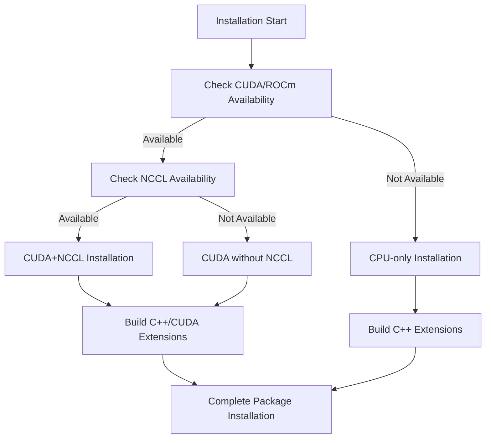
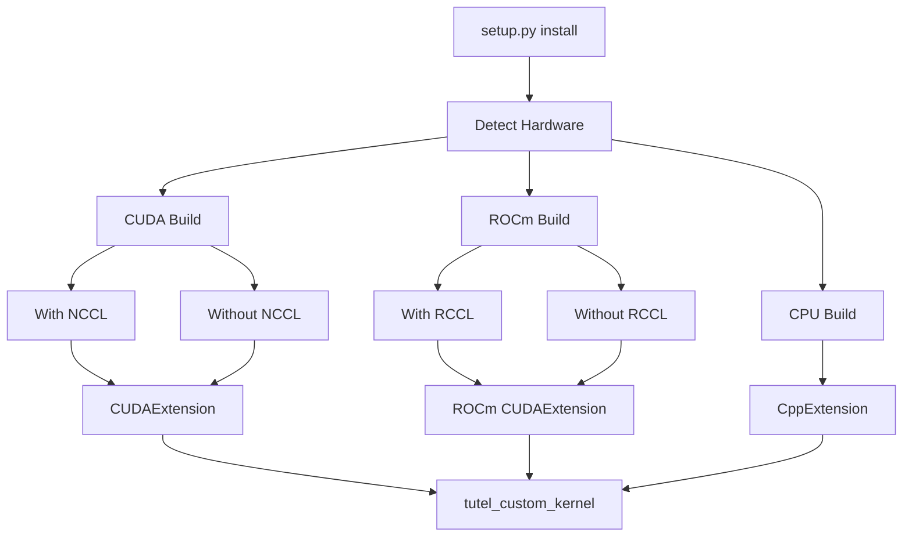
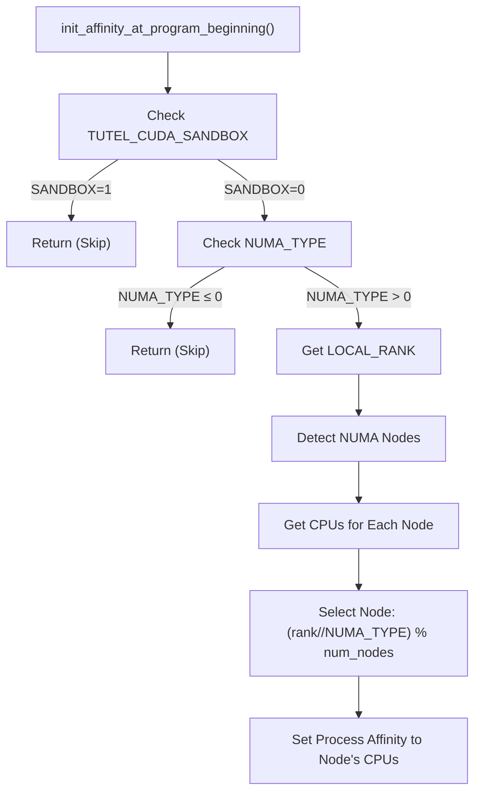
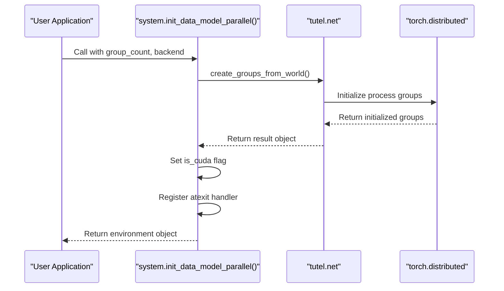

<!-- source: DeepWiki mcp.deepwiki.com · repo microsoft/Tutel · page 3.4 Installation and Setup · fetched 2026-10-26 -->

# Installation and Setup

<details>
<summary>Relevant source files</summary>

The following files were used as context for generating this wiki page:

- [setup.py](setup.py)
- [tutel/system.py](tutel/system.py)

</details>


This page provides detailed instructions for installing and configuring the Tutel Mixture-of-Experts (MoE) implementation. It covers installation options, system requirements, environment configuration, and initialization steps for different hardware platforms. For information about the core MoE functionality, see [MOE Layer](#2.1), and for details on distributed training configuration, see [Distributed Training](#5.3).

## Installation Methods

Tutel can be installed either from the GitHub repository or via pip. The installation process automatically detects the available hardware and configures the build accordingly.

### Installing from GitHub

```bash
git clone https://github.com/microsoft/Tutel.git
cd Tutel
python setup.py install
```

### Installing via pip

```bash
pip install tutel
```

### Installation Flow

The installation process determines the appropriate build configuration based on your hardware:



Sources: [setup.py:143-152]()

## System Requirements

### Hardware Requirements
- **CPU**: Any x86-64 compatible processor
- **GPU**: NVIDIA GPUs with CUDA support or AMD GPUs with ROCm support (optional but recommended for performance)
- **Memory**: Dependent on model size and batch size

### Software Requirements
- **Python**: 3.6 or higher
- **PyTorch**: Compatible version with CUDA/ROCm if using GPU
- **CUDA/ROCm**: For GPU acceleration
- **NCCL/RCCL**: For multi-GPU communication (optional)

### Dependencies
Tutel requires the following Python packages:
- numpy

Additional packages for testing:
- GPUtil (>= 1.4.0)
- pytest-subtests (>= 0.4.0)
- pytest (>= 6.2.2)

Sources: [setup.py:82-123]()

## Environment Configuration

Tutel's behavior can be controlled through environment variables:

| Environment Variable | Description | Default |
|----------------------|-------------|---------|
| `NO_CUDA` | Set to 1 to force CPU-only installation | 0 |
| `NO_NCCL` | Set to 1 to disable NCCL support | 0 |
| `TUTEL_CUDA_SANDBOX` | Controls CUDA sandbox mode | 0 |
| `NUMA_TYPE` | Controls NUMA affinity configuration | 1 |
| `LOCAL_RANK` | Local rank of the current process for distributed training | 0 |

Sources: [setup.py:143-152](), [tutel/system.py:8](), [tutel/system.py:14-15]()

## Build Configuration

The setup process includes several configuration options for different platforms and hardware:



Sources: [setup.py:58-81](), [setup.py:125-132]()

## System Initialization

### Initializing NUMA Affinity

For systems with NUMA (Non-Uniform Memory Access) nodes, Tutel provides a function to optimize CPU affinity:

```python
from tutel import system
system.init_affinity_at_program_beginning()
```

This function assigns each process to a specific NUMA node based on its local rank and the NUMA configuration:



Sources: [tutel/system.py:10-25]()

### Initializing Data-Model Parallelism

For distributed training, Tutel provides a function to initialize data and model parallelism:

```python
from tutel import system
env = system.init_data_model_parallel(group_count=1, backend='nccl')
```

The function returns an environment object with the following attributes:
- `global_rank`: Global rank of the current process
- `data_rank`: Rank within the data-parallel group
- `model_rank`: Rank within the model-parallel group
- `local_device`: Local device (CPU or CUDA)
- `is_cuda`: Boolean indicating if CUDA is available



Sources: [tutel/system.py:27-47]()

## Testing the Installation

To verify the installation, you can run the included tests:

```bash
python setup.py test
```

This command executes all tests in the `tests/` directory using pytest.

Sources: [setup.py:36-56]()

## Usage Example

Here's a simple example to initialize Tutel for a distributed training setup:

```python
import torch
from tutel import system

# Initialize NUMA affinity (optional, for CPU performance)
system.init_affinity_at_program_beginning()

# Initialize distributed environment
env = system.init_data_model_parallel(group_count=8, backend='nccl')

# Print information about the current process
print(f"Global Rank: {env.global_rank}")
print(f"Data Rank: {env.data_rank}")
print(f"Model Rank: {env.model_rank}")
print(f"Using CUDA: {env.is_cuda}")
```

For more advanced usage examples, see [Basic Usage](#5.1) and [Distributed Training](#5.3).

Sources: [tutel/system.py:10-25](), [tutel/system.py:27-47]()

## Troubleshooting

### CUDA/NCCL Issues

If you encounter issues with CUDA or NCCL during installation, you can force a CPU-only build:

```bash
export NO_CUDA=1
python setup.py install
```

Or install without NCCL support:

```bash
export NO_NCCL=1
python setup.py install
```

### NUMA Configuration

If you encounter issues with NUMA configuration, you can disable it by setting:

```bash
export NUMA_TYPE=0
```

Sources: [setup.py:143-152](), [tutel/system.py:14-15]()

---

