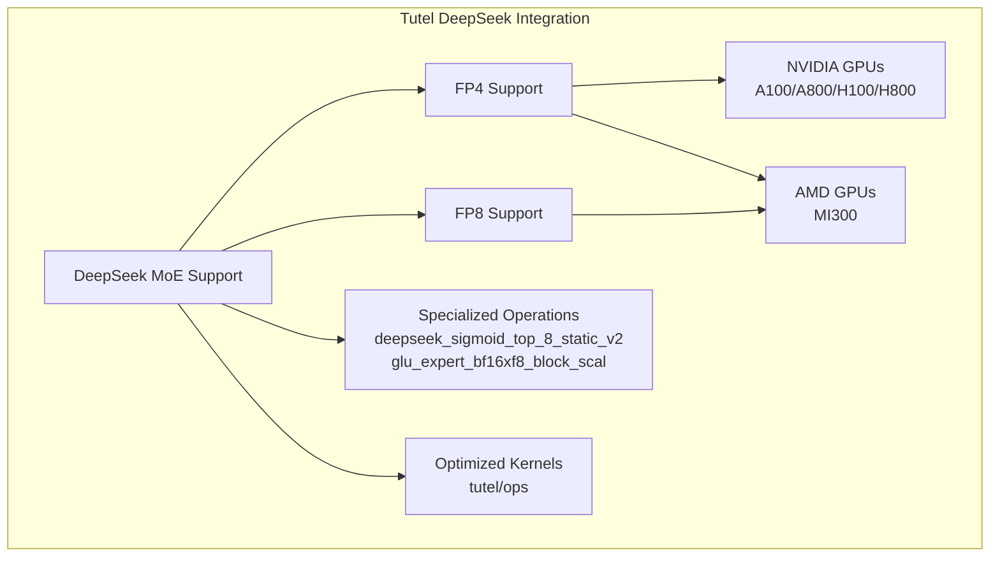
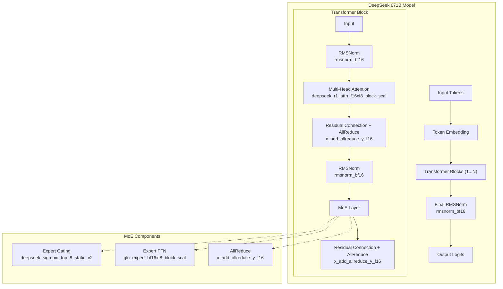
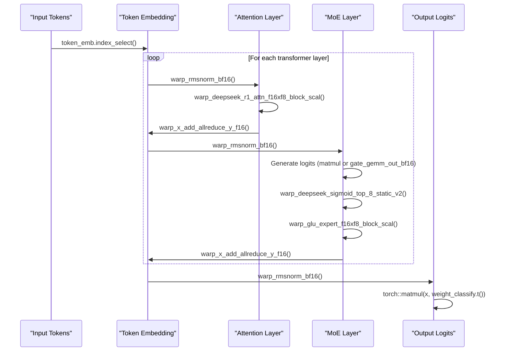
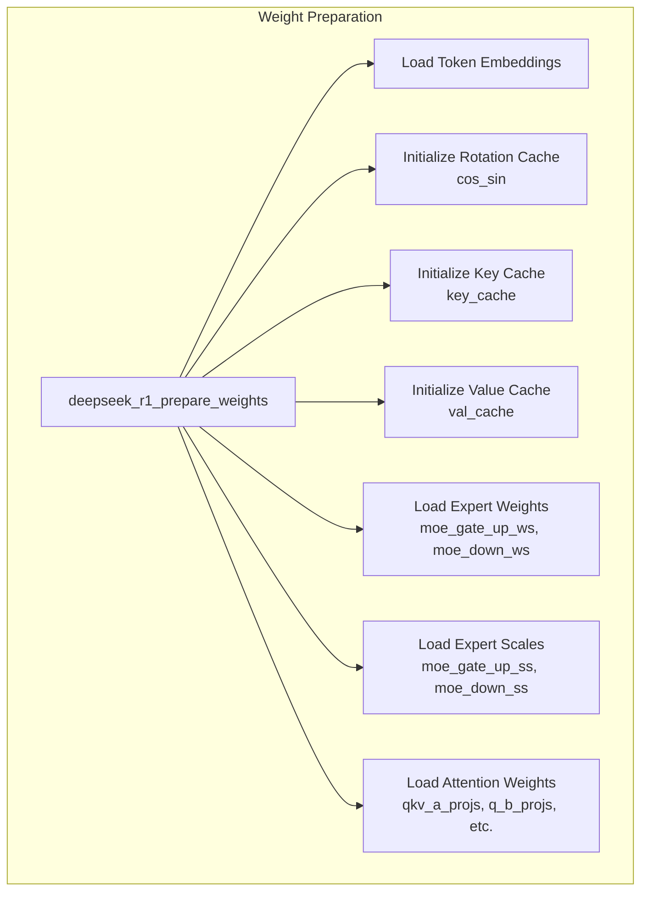
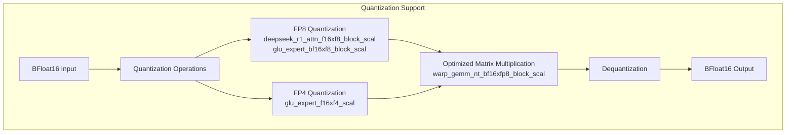
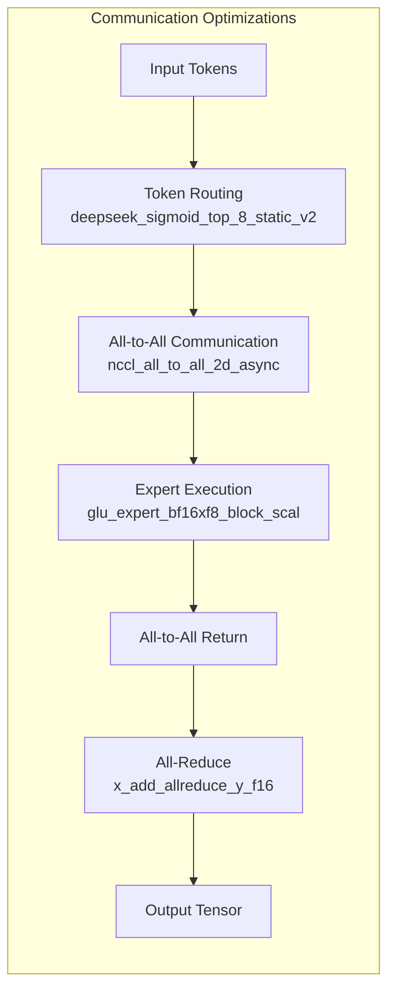

<!-- source: DeepWiki mcp.deepwiki.com · repo microsoft/Tutel · page 4 DeepSeek Integration · fetched 2026-10-26 -->

# DeepSeek Integration

<details>
<summary>Relevant source files</summary>

The following files were used as context for generating this wiki page:

- [README.md](README.md)
- [tutel/custom/custom_kernel.cpp](tutel/custom/custom_kernel.cpp)

</details>


This document describes Tutel's integration with DeepSeek large language models, specifically focusing on optimization for the DeepSeek 671B model which features a Mixture-of-Experts (MoE) architecture. Tutel provides specialized infrastructure to enable efficient inference with DeepSeek models across a variety of hardware platforms, with particular emphasis on optimized execution for FP4/FP8 precision levels.

## Overview of DeepSeek Support

Tutel is the first system to support DeepSeek 671B NVFP4 inference using A100/A800/H100/MI300 GPUs. The integration includes specialized operations, optimized communication patterns, and hardware-specific implementations to maximize throughput for both inference and reasoning tasks.



Sources: [README.md:9-23](), [tutel/custom/custom_kernel.cpp:1036-1074](), [tutel/custom/custom_kernel.cpp:1359-1420]()

## Performance Benchmarks

Tutel significantly outperforms other frameworks when running DeepSeek models, as shown in the following performance measurements:

| Model | Machine Type | TRT-LLM | SGLANG | Tutel |
|-------|--------------|---------|--------|-------|
| DeepSeek-R1-FP4 | A100/A800 x 8 | Not Supported | Not Supported | 57 Decode TPS for bsz = 1 |
| DeepSeek-R1-FP4 | H100/H800 x 8 | Not Supported | Not Supported | 81 Decode TPS for bsz = 1 |
| DeepSeek-R1-FP4 | MI300 x 8 | Not Supported | Not Supported | 107 Decode TPS for bsz = 1 |
| DeepSeek-R1 (FP8) | A100/H100 x 8 | OoM | OoM | OoM |
| DeepSeek-R1 (FP8) | MI300 x 8 | Not Supported | 42 Decode TPS for bsz = 1 | 110 Decode TPS for bsz = 1 |

Sources: [README.md:12-23]()

## DeepSeek Model Architecture

The DeepSeek 671B model uses a specialized Mixture-of-Experts architecture with optimized components implemented in Tutel.



Sources: [tutel/custom/custom_kernel.cpp:1422-1629](), [tutel/custom/custom_kernel.cpp:1053-1074](), [tutel/custom/custom_kernel.cpp:1359-1420]()

## Specialized DeepSeek Operations

Tutel implements several specialized operations to optimize DeepSeek model execution:

1. **Expert Gating**: The `deepseek_sigmoid_top_8_static_v2` function implements a specialized sigmoid-based gating mechanism that selects the top-8 experts for each token.

2. **Expert Execution**: The `glu_expert_bf16xf8_block_scal` function implements the Gated Linear Unit (GLU) activation for experts with block-wise scaling for quantized weights.

3. **Attention Mechanism**: The `deepseek_r1_attn_f16xf8_block_scal` function implements an optimized multi-head attention mechanism specific to DeepSeek R1 models.

4. **Normalized Activation**: The `rmsnorm_bf16` function implements RMSNorm (Root Mean Square Layer Normalization) optimized for bfloat16 data type.

5. **All-Reduce**: The `x_add_allreduce_y_f16` function implements an optimized residual connection with distributed all-reduce.

Sources: [tutel/custom/custom_kernel.cpp:1053-1074](), [tutel/custom/custom_kernel.cpp:1359-1420](), [tutel/custom/custom_kernel.cpp:1118-1209](), [tutel/custom/custom_kernel.cpp:1048-1052](), [tutel/custom/custom_kernel.cpp:1292-1306]()

## Model Forward Pass

The following diagram illustrates the forward pass through a DeepSeek model using Tutel's optimized operations:



Sources: [tutel/custom/custom_kernel.cpp:1587-1629]()

## Weight Preparation and Cache Management

Before inference, DeepSeek models require specialized weight preparation and cache initialization:



Sources: [tutel/custom/custom_kernel.cpp:1422-1497](), [tutel/custom/custom_kernel.cpp:1500-1585]()

## Hardware-Specific Optimizations

Tutel implements various hardware-specific optimizations for different GPU architectures:

### NVIDIA GPUs (A100/A800, H100/H800)

- Optimized block sizes for kernel execution
- Specialized memory management for GPU memory
- Tensor core utilization for mixed precision operations
- NCCL communication optimizations for multi-GPU setups

### AMD MI300 GPUs

- Custom HIP kernels for AMD architecture
- ROCm-specific optimizations
- Specialized memory handling for MI300's architecture

Sources: [tutel/custom/custom_kernel.cpp:46-285](), [README.md:15-17]()

## FP8/FP4 Quantization Support

Tutel provides specialized support for FP8 and FP4 quantization:



Sources: [tutel/custom/custom_kernel.cpp:1011-1046](), [tutel/custom/custom_kernel.cpp:1337-1356]()

## Usage Example

To use DeepSeek models with Tutel, you would typically follow these steps:

1. Download the model:
```
huggingface-cli download nvidia/DeepSeek-R1-FP4 --local-dir ./nvidia/DeepSeek-R1-FP4
```

2. Run inference using the appropriate Docker container:
```
# For A100/A800 (80G x 8):
docker run -it --rm --ipc=host --privileged -p 8000:8000 \
    --shm-size=1g --ulimit memlock=-1 --ulimit stack=67108864 --gpus=all -v /:/host -w /host$(pwd) \
    tutelgroup/deepseek-671b:a100x8-chat-20250401 --model_path ./nvidia/DeepSeek-R1-FP4 \
    --prompt "Calculate the indefinite integral of 1/sin(x) + x"
```

Sources: [README.md:27-49]()

## Communication Patterns for MoE

The DeepSeek integration leverages Tutel's optimized communication primitives for efficient execution of the Mixture-of-Experts architecture:



Sources: [tutel/custom/custom_kernel.cpp:702-783](), [tutel/custom/custom_kernel.cpp:1292-1306](), [tutel/custom/custom_kernel.cpp:1053-1074](), [tutel/custom/custom_kernel.cpp:1359-1420]()

---

