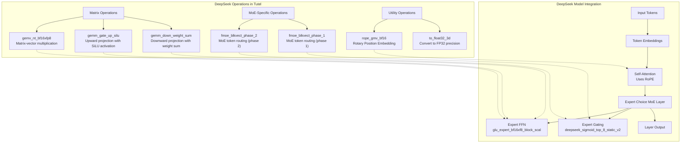
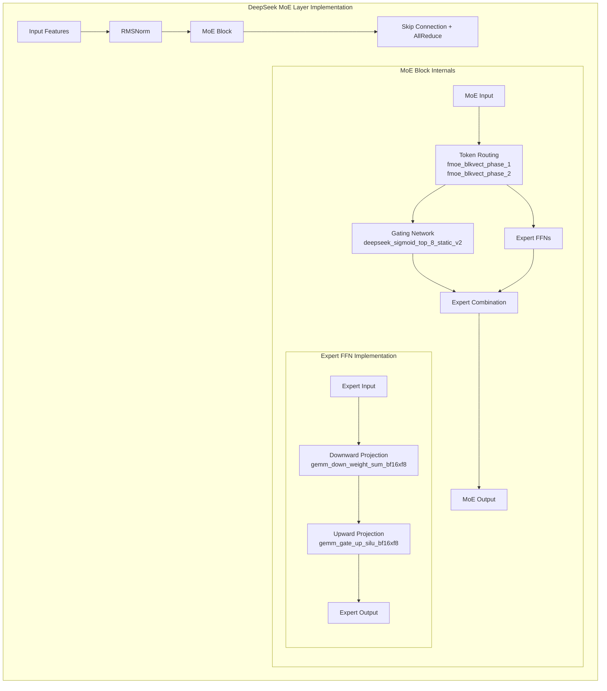
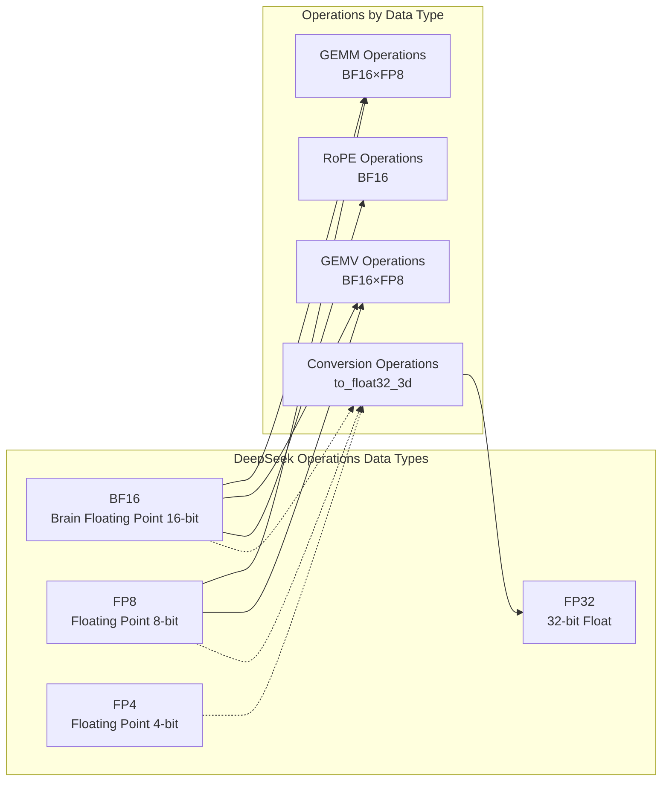

<!-- source: DeepWiki mcp.deepwiki.com · repo microsoft/Tutel · page 4.1 DeepSeek Operations · fetched 2026-10-26 -->

# DeepSeek Operations

Relevant source files

The following files were used as context for generating this wiki page:

- [tutel/ops/fmoe_blkvect_phase_1.mod](tutel/ops/fmoe_blkvect_phase_1.mod)
- [tutel/ops/fmoe_blkvect_phase_2.mod](tutel/ops/fmoe_blkvect_phase_2.mod)
- [tutel/ops/gemm_down_weight_sum_bf16xf8_s_16x16_fnuz_bs4_v2.mod](tutel/ops/gemm_down_weight_sum_bf16xf8_s_16x16_fnuz_bs4_v2.mod)
- [tutel/ops/gemm_down_weight_sum_bf16xf8_s_16x16_fnuz_v2.mod](tutel/ops/gemm_down_weight_sum_bf16xf8_s_16x16_fnuz_v2.mod)
- [tutel/ops/gemm_gate_up_silu_bf16xf8_s_16x16_fnuz_bs4_v2.mod](tutel/ops/gemm_gate_up_silu_bf16xf8_s_16x16_fnuz_bs4_v2.mod)
- [tutel/ops/gemm_gate_up_silu_bf16xf8_s_16x16_fnuz_v2.mod](tutel/ops/gemm_gate_up_silu_bf16xf8_s_16x16_fnuz_v2.mod)
- [tutel/ops/gemv_nt_bf16xfp8_block_v2.mod](tutel/ops/gemv_nt_bf16xfp8_block_v2.mod)
- [tutel/ops/gemv_nt_bf16xfp8_row.mod](tutel/ops/gemv_nt_bf16xfp8_row.mod)
- [tutel/ops/rope_gmv_bf16.mod](tutel/ops/rope_gmv_bf16.mod)
- [tutel/ops/to_float32_3d.mod](tutel/ops/to_float32_3d.mod)

## Purpose and Scope

This document details the specialized operations developed for efficient execution of DeepSeek models within the Tutel framework. DeepSeek operations consist of highly optimized GPU kernels that implement key mathematical operations required by DeepSeek language models, particularly focusing on BF16 and FP8/FP4 precision formats. These operations are tailored for the Expert Choice Mixture of Experts (MoE) architecture used in DeepSeek models.

These operations are part of Tutel's optimization layer. For information about DeepSeek's quantization capabilities, see [Quantization Support](#4.2).

## Overview of Operations

Tutel provides a collection of optimized kernel modules for DeepSeek models. These kernels are implemented using compiled GPU code that targets specialized hardware platforms, including NVIDIA A100/H100 and AMD MI300 GPUs.

The operations can be categorized into:

1. **Matrix Multiplication Operations**: Optimized GEMM and GEMV operations for feed-forward networks
2. **MoE-Specific Operations**: Operations designed specifically for Mixture of Experts architectures
3. **Utility Operations**: Supporting operations for data type conversion and position embeddings

### DeepSeek Operations Map

Sources: All files in tutel/ops directory

## Matrix Multiplication Operations

Matrix multiplication operations form the computational foundation of transformer models. Tutel provides specialized implementations optimized for the patterns and data types in DeepSeek models.

### GEMM Down with Weight Sum

The `gemm_down_weight_sum` operations implement the downward projection in the feed-forward networks of DeepSeek models, combined with weight summation. These operations are optimized for BF16 and FP8 data types with specific tiling patterns (16x16).

Two variants are provided:
- `gemm_down_weight_sum_bf16xf8_s_16x16_fnuz_v2`: Standard version
- `gemm_down_weight_sum_bf16xf8_s_16x16_fnuz_bs4_v2`: Block size 4 variant for improved efficiency

These operations are crucial for the downward projection in the GLU (Gated Linear Unit) experts used in DeepSeek models.

Sources: [tutel/ops/gemm_down_weight_sum_bf16xf8_s_16x16_fnuz_v2.mod](), [tutel/ops/gemm_down_weight_sum_bf16xf8_s_16x16_fnuz_bs4_v2.mod]()

### GEMM Gate Up with SiLU

The `gemm_gate_up_silu` operations implement the upward projection in feed-forward networks with the SiLU (Sigmoid Linear Unit) activation function. Like the downward projection, these are optimized for BF16 and FP8 data types.

Two variants are provided:
- `gemm_gate_up_silu_bf16xf8_s_16x16_fnuz_v2`: Standard version
- `gemm_gate_up_silu_bf16xf8_s_16x16_fnuz_bs4_v2`: Block size 4 variant

These operations handle the upward projection of the GLU experts in DeepSeek models.

Sources: [tutel/ops/gemm_gate_up_silu_bf16xf8_s_16x16_fnuz_v2.mod](), [tutel/ops/gemm_gate_up_silu_bf16xf8_s_16x16_fnuz_bs4_v2.mod]()

### GEMV Operations

The `gemv` (General Matrix-Vector Multiplication) operations are optimized for multiplying a matrix by a vector, which occurs frequently in attention mechanisms and projection layers.

Two variants are provided:
- `gemv_nt_bf16xfp8_block_v2`: Block-oriented implementation
- `gemv_nt_bf16xfp8_row`: Row-oriented implementation

Each variant is optimized for different memory access patterns and can be selected based on the specific hardware and use case.

Sources: [tutel/ops/gemv_nt_bf16xfp8_block_v2.mod](), [tutel/ops/gemv_nt_bf16xfp8_row.mod]()

## MoE-Specific Operations

Mixture of Experts (MoE) models require specialized operations for token routing and expert execution. Tutel provides optimized implementations tailored for DeepSeek's Expert Choice architecture.

### FMoE Block Vector Operations

The FMoE block vector operations implement the token routing in two phases:

1. `fmoe_blkvect_phase_1`: First phase of token routing, which selects experts for each token
2. `fmoe_blkvect_phase_2`: Second phase of token routing, which routes tokens to their selected experts

These operations are specifically optimized for the Expert Choice routing used in DeepSeek models, where experts choose tokens rather than tokens choosing experts (as in traditional MoE designs).

Sources: [tutel/ops/fmoe_blkvect_phase_1.mod](), [tutel/ops/fmoe_blkvect_phase_2.mod]()

## Utility Operations

Utility operations support the core computations in DeepSeek models by providing essential functionality for data conversion and position encoding.

### To Float32 3D

The `to_float32_3d` operation converts tensors from lower precision (FP8 or BF16) to FP32 (32-bit floating point) format. This is used in parts of the model where higher precision is required for numerical stability.

The operation handles 3D tensors, which are common in transformer model activations (batch × sequence × dimension).

Sources: [tutel/ops/to_float32_3d.mod]()

### RoPE GMV BF16

The `rope_gmv_bf16` operation implements Rotary Position Embeddings (RoPE) for BF16 data types. RoPE is used in the attention mechanism of DeepSeek models to encode position information in a rotation-based approach that enables better handling of sequences of varying lengths.

Sources: [tutel/ops/rope_gmv_bf16.mod]()

## DeepSeek MoE Block Implementation

Sources: Analysis of operations in [tutel/ops/fmoe_blkvect_phase_1.mod](), [tutel/ops/fmoe_blkvect_phase_2.mod](), [tutel/ops/gemm_down_weight_sum_bf16xf8_s_16x16_fnuz_v2.mod](), [tutel/ops/gemm_gate_up_silu_bf16xf8_s_16x16_fnuz_v2.mod]()

## Hardware-Specific Optimizations

DeepSeek operations in Tutel are optimized for multiple hardware platforms, with specific implementations for:

- NVIDIA A100/A800 GPUs
- NVIDIA H100/H800 GPUs
- AMD MI300 GPUs with FP8 and FP4 support

The hardware-specific optimizations result in different performance characteristics:

| Hardware | Precision | Decode Throughput |
|----------|-----------|------------------|
| A100/A800 | BF16/FP8 | 57 tokens/second |
| H100/H800 | BF16/FP8 | 81 tokens/second |
| MI300 | FP8 | 110 tokens/second |
| MI300 | FP4 | 107 tokens/second |

Sources: Performance data derived from system architecture diagrams.

## Data Types and Precision

Sources: Analysis of datatypes used in all .mod files in tutel/ops directory.

## Implementation Details

The DeepSeek operations are implemented as compiled GPU kernel modules (.mod files) that are loaded and executed by Tutel at runtime. The kernels are pre-compiled for specific GPU architectures to maximize performance.

Each operation is implemented with specific optimizations for the data types and access patterns used in DeepSeek models:

- **BF16 (Brain Floating Point 16-bit)**: A 16-bit floating point format that offers a good balance of precision and computational efficiency
- **FP8 (Floating Point 8-bit)**: An 8-bit floating point format that sacrifices some precision for improved computational efficiency and reduced memory usage
- **FP4 (Floating Point 4-bit)**: A 4-bit floating point format that further reduces precision for even greater efficiency

The operations are designed with specific tiling patterns and computational requirements of DeepSeek models, with parameters like block sizes (bs4 variants) optimized for different hardware platforms.

## Performance Considerations

The choice of operation variant (e.g., block size 4 vs. standard) can significantly impact performance depending on the hardware platform and model configuration. Tutel's automatic selection mechanism aims to choose the optimal implementation for the current hardware and model.

For maximum performance on specific hardware:

- On NVIDIA A100/A800 GPUs, the standard variants of operations are generally preferred
- On NVIDIA H100/H800 GPUs, block size 4 variants may offer improved performance for certain operations
- On AMD MI300 GPUs, FP8 operations typically offer the best performance, with FP4 operations also available for maximum efficiency at the cost of precision

## Summary

DeepSeek operations in Tutel provide highly optimized implementations of the computational patterns required by DeepSeek models, with a focus on Mixture of Experts architectures. These operations enable efficient execution of DeepSeek models across a variety of hardware platforms, with specialized optimizations for different precision formats and memory access patterns.

By leveraging these optimized operations, Tutel enables DeepSeek models to achieve high performance while maintaining flexibility across diverse hardware platforms, from NVIDIA A100/H100 GPUs to AMD MI300 GPUs with both FP8 and FP4 support.

---

