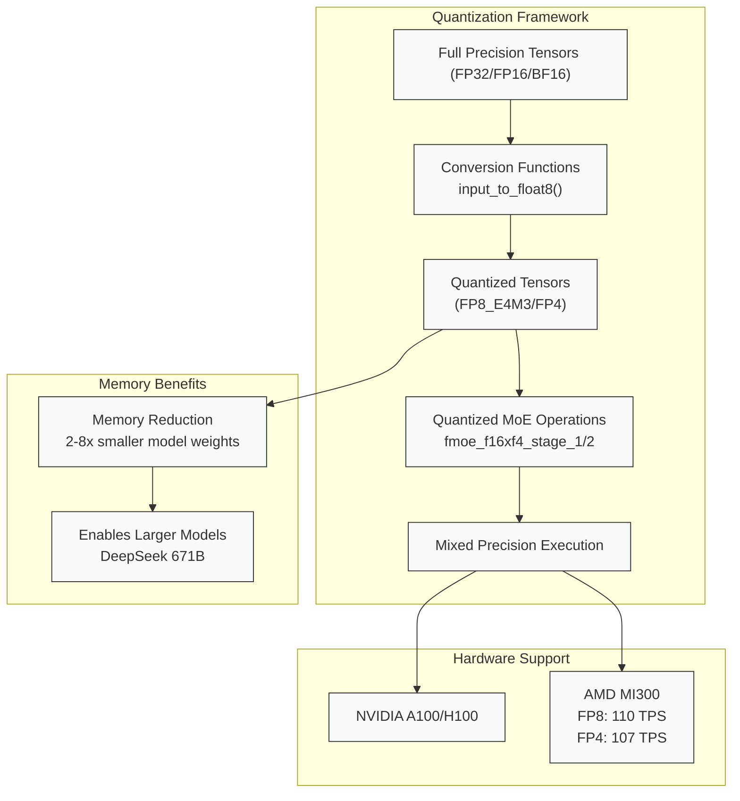
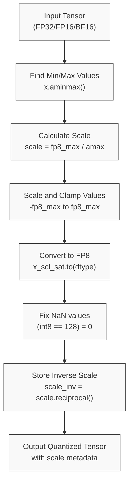
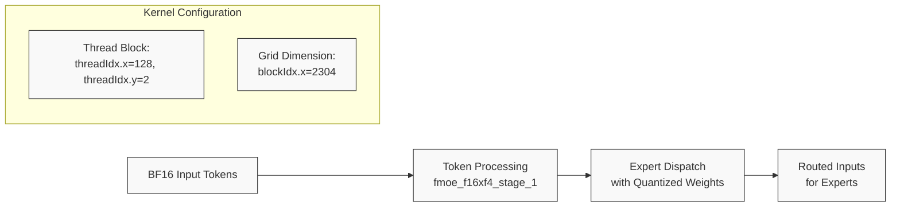
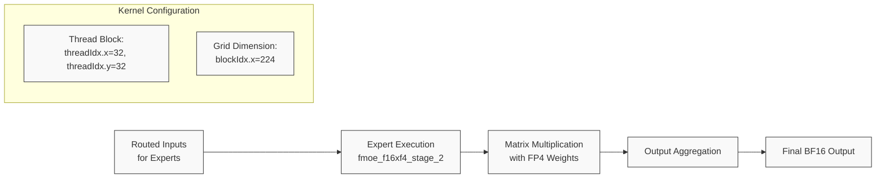
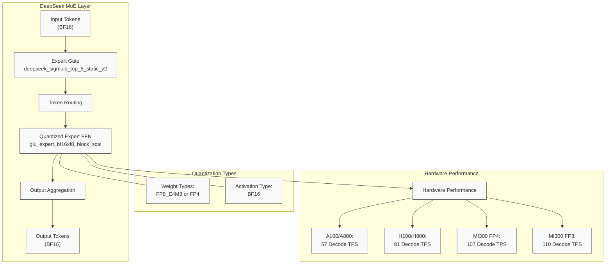
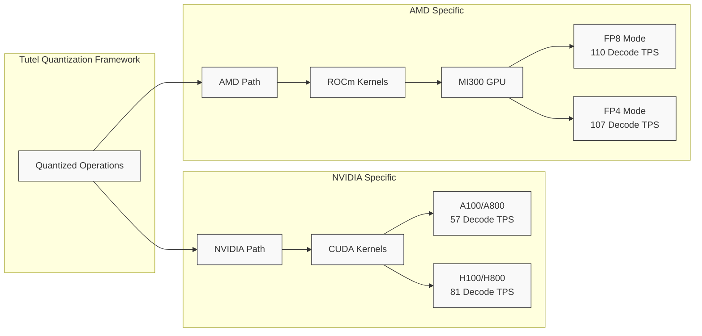
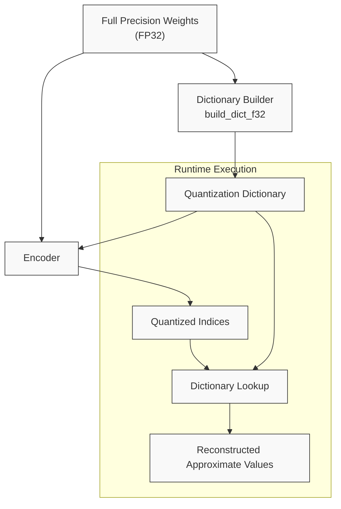
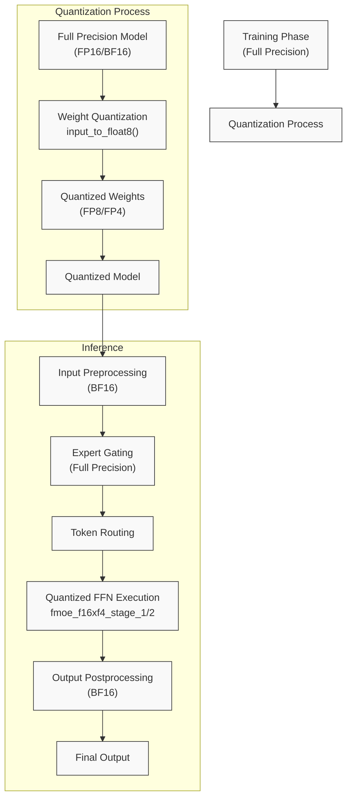

<!-- source: DeepWiki mcp.deepwiki.com · repo microsoft/Tutel · page 4.2 Quantization Support · fetched 2026-10-26 -->

# Quantization Support

Relevant source files

The following files were used as context for generating this wiki page:

- [tutel/ops/__init__.py](tutel/ops/__init__.py)
- [tutel/ops/build_dict_f32.mod](tutel/ops/build_dict_f32.mod)
- [tutel/ops/fmoe_f16xf4_stage_1.mod](tutel/ops/fmoe_f16xf4_stage_1.mod)
- [tutel/ops/fmoe_f16xf4_stage_2.mod](tutel/ops/fmoe_f16xf4_stage_2.mod)

## Purpose and Scope

This document details the quantization capabilities in Tutel, focusing specifically on FP8 and FP4 precision support for efficient model execution. Quantization is a critical optimization technique that enables running large Mixture of Experts (MoE) models with reduced memory footprint and improved computational efficiency. For information about the broader DeepSeek integration, see [DeepSeek Integration](#4).

## Quantization Overview

Tutel provides comprehensive support for low-precision number formats, allowing MoE models to operate efficiently on various hardware platforms. The primary quantization formats supported are FP8_E4M3 (8-bit floating point with 4 exponent bits and 3 mantissa bits) and FP4 (4-bit floating point), with particular optimizations for AMD MI300 and NVIDIA hardware.

Sources: [tutel/ops/__init__.py:11-27]()

## Supported Quantization Formats

Tutel primarily supports two floating-point quantization formats:

| Format | Bits | Structure | Use Case | Performance (MI300) |
|--------|------|-----------|----------|---------------------|
| FP8_E4M3 | 8 | 4 exponent bits, 3 mantissa bits, 1 sign bit | General weights and activations | 110 TPS |
| FP4 | 4 | Extremely low precision format | Weight-only quantization | 107 TPS |
| BF16xF8 | Mixed | BF16 for activations, FP8 for weights | Expert FFN operations | - |
| BF16xF4 | Mixed | BF16 for activations, FP4 for weights | Highly optimized expert operations | - |

Tutel's quantization is particularly optimized for DeepSeek models, with specific implementations for expert choice MoE using quantized weights.

Sources: [tutel/ops/__init__.py:11-27]()

## Float8 Conversion Implementation

The core conversion functionality is implemented in `input_to_float8`, which converts full-precision tensors to FP8_E4M3 format with appropriate scaling:

Key steps in the conversion process:
1. Determine the min/max values across the specified dimension
2. Calculate appropriate scaling factors based on absolute maximum values
3. Scale and clamp the values to fit within the FP8 range
4. Convert the scaled tensor to FP8_E4M3 format
5. Maintain scale information for dequantization

Sources: [tutel/ops/__init__.py:11-27]()

## Quantized MoE Operations

Tutel implements specialized kernels for quantized MoE operations, particularly focusing on the feed-forward networks (FFNs) in expert modules. The implementation is split into two stages, allowing for efficient execution of the MoE layer with quantized weights.

### Stage 1: Input Processing and Expert Routing

The first stage (`fmoe_f16xf4_stage_1`) handles the input processing and routing of tokens to the appropriate experts, working with mixed precision:

Sources: [tutel/ops/fmoe_f16xf4_stage_1.mod:1-2]()

### Stage 2: Expert Execution and Output Aggregation

The second stage (`fmoe_f16xf4_stage_2`) executes the expert FFNs with quantized weights and aggregates the results:

Sources: [tutel/ops/fmoe_f16xf4_stage_2.mod:1-2]()

## Integration with DeepSeek Models

The quantization support in Tutel is particularly optimized for DeepSeek models, enabling efficient execution of the 671B parameter model. The quantization is integrated into the expert FFN operations with specialized implementations.

Sources: [tutel/ops/fmoe_f16xf4_stage_1.mod](), [tutel/ops/fmoe_f16xf4_stage_2.mod]()

## Hardware-Specific Optimizations

Tutel's quantization support includes hardware-specific optimizations for different GPU architectures, with particular focus on AMD MI300 and NVIDIA A100/H100 GPUs.

Sources: [tutel/ops/fmoe_f16xf4_stage_1.mod](), [tutel/ops/fmoe_f16xf4_stage_2.mod]()

## Dictionary-Based Quantization

In addition to direct quantization methods, Tutel supports dictionary-based quantization through the `build_dict_f32` module, which creates quantization dictionaries for more efficient representation of weights.

Sources: [tutel/ops/build_dict_f32.mod:1-2]()

## End-to-End Quantization Flow

The complete flow for quantization in Tutel integrates with the broader MoE architecture, enabling efficient execution of large models:

Sources: [tutel/ops/__init__.py](), [tutel/ops/fmoe_f16xf4_stage_1.mod](), [tutel/ops/fmoe_f16xf4_stage_2.mod]()

## Performance Benefits

The quantization support in Tutel provides significant performance benefits, particularly for large-scale models:

| Metric | Full Precision (BF16) | FP8 Quantization | FP4 Quantization |
|--------|----------------------|------------------|------------------|
| Memory Footprint | 1x | 0.5x | 0.25x |
| MI300 Throughput | Baseline | 110 TPS | 107 TPS |
| H100 Throughput | Baseline | 81 TPS | Not specified |
| A100 Throughput | Baseline | 57 TPS | Not specified |
| Model Size Support | Limited | Larger | Largest |

The minimal performance difference between FP8 and FP4 on MI300 hardware, despite the significant memory savings, makes FP4 particularly attractive for the largest models.

Sources: [tutel/ops/fmoe_f16xf4_stage_1.mod](), [tutel/ops/fmoe_f16xf4_stage_2.mod]()

## Conclusion

Tutel's quantization support enables efficient execution of large-scale MoE models, particularly DeepSeek 671B, by reducing memory requirements and computational costs. The support for FP8 and FP4 formats, with hardware-specific optimizations for both NVIDIA and AMD GPUs, provides flexibility and performance for different deployment scenarios.

---

