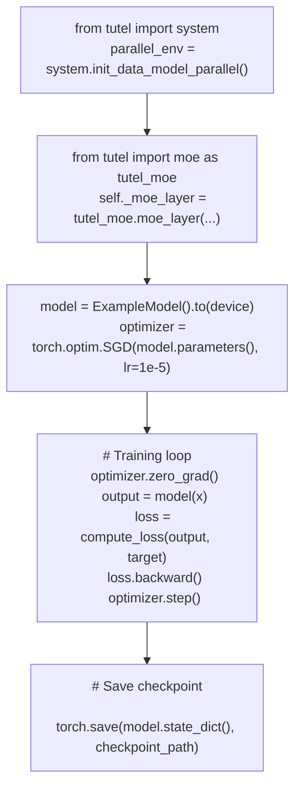
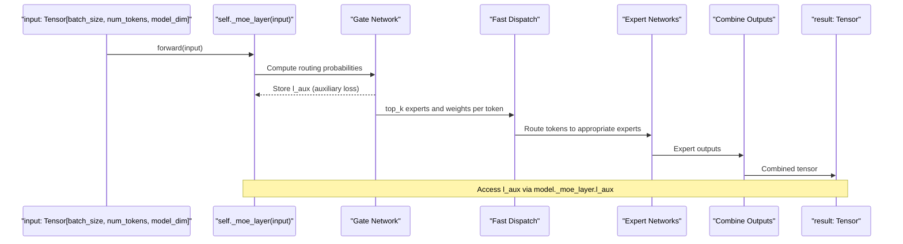

<!-- source: DeepWiki mcp.deepwiki.com · repo microsoft/Tutel · page 5 Examples and Usage · fetched 2026-10-26 -->

# Examples and Usage

<details>
<summary>Relevant source files</summary>

The following files were used as context for generating this wiki page:

- [tutel/examples/helloworld.py](tutel/examples/helloworld.py)

</details>


## Introduction

This page provides a technical overview of how to use Tutel's Mixture of Experts (MoE) implementation in various scenarios. Tutel provides an efficient MoE layer implementation that works with PyTorch, supporting different configurations, parallelism strategies, and optimization techniques.

For detailed instructions on specific usage patterns, see:
- [Basic Usage](#5.1) - Getting started with simple examples
- [Automatic Mixed Precision](#5.2) - Using Tutel with mixed precision training
- [Distributed Training](#5.3) - Setting up and running distributed MoE models
- [Custom Experts and Gates](#5.4) - Implementing custom expert networks and gating mechanisms
- [Framework Integration](#5.5) - Integrating Tutel with other frameworks

## Basic Usage Workflow

The typical workflow for using Tutel involves these key steps:



Sources: [tutel/examples/helloworld.py:47-49](), [tutel/examples/helloworld.py:72-98](), [tutel/examples/helloworld.py:126-140](), [tutel/examples/helloworld.py:159-160]()

## Code Structure and Key Components

```mermaid
classDiagram
    class torch.nn.Module {
        +forward()
    }
    
    class ExampleModel {
        +_moe_layer: tutel_moe.moe_layer
        +forward(input: Tensor): Tensor
    }
    
    class tutel_moe.moe_layer {
        +gate_type: dict
        +experts: dict
        +model_dim: int
        +parallel_type: str
        +forward(input: Tensor): Tensor
        +l_aux: Tensor
        +get_parameter_iterator(param_type: str)
    }
    
    torch.nn.Module <|-- ExampleModel
    ExampleModel o-- "tutel_moe.moe_layer" : contains
```

Source: [tutel/examples/helloworld.py:72-98]()

## Parallel Environment Initialization

The first step in using Tutel is initializing the parallel environment with `system.init_data_model_parallel`:

```python
from tutel import system
parallel_env = system.init_data_model_parallel(backend='nccl' if args.device == 'cuda' else 'gloo')
dist_rank, dist_world_size, dist_print = parallel_env.global_rank, parallel_env.global_size, parallel_env.dist_print
args.local_rank = parallel_env.local_device.index
```

This initializes the distributed environment and provides important information including:
- `global_rank`: The rank of the current process in the global process group
- `global_size`: The total number of processes in the global process group
- `local_device`: The local GPU or CPU device
- `dist_print`: A function for printing in a distributed environment

Source: [tutel/examples/helloworld.py:47-49]()

## Creating an MoE Model

The core component of Tutel is the MoE layer, implemented in `tutel_moe.moe_layer`:

```python
class ExampleModel(torch.nn.Module):
    def __init__(self):
        super().__init__()

        self._moe_layer = tutel_moe.moe_layer(
            gate_type = {'type': 'top', 'k': top_value, 'fp32_gate': args.fp32_gate, 'capacity_factor': args.capacity_factor},
            experts = {'type': args.expert_type, 'num_experts_per_device': num_local_experts, 'hidden_size_per_expert': hidden_size, 'activation_fn': lambda x: F.relu(x)},
            model_dim = model_dim,
            scan_expert_func = lambda name, param: setattr(param, 'skip_allreduce', True),
            seeds = (1, dist_rank + 1, 1),
            a2a_ffn_overlap_degree = a2a_ffn_overlap_degree,
            parallel_type = args.parallel_type,
            use_2dh=args.use_2dh,
        )

    def forward(self, input):
        result = self._moe_layer(input)
        result = F.log_softmax(torch.sum(result, dim=2), dim=1)
        return result
```

Source: [tutel/examples/helloworld.py:72-98]()

## MoE Layer Configuration Options

The MoE layer in Tutel is highly configurable. Here are the key configuration parameters for `tutel_moe.moe_layer`:

### Gate Configuration (`gate_type` parameter)

| Option | Description |
|--------|-------------|
| `type` | Type of gating mechanism (e.g., 'top') |
| `k` | Number of top experts to route each token to |
| `fp32_gate` | Whether to use FP32 precision for gate computation |
| `capacity_factor` | Factor controlling token capacity per expert |

### Expert Configuration (`experts` parameter)

| Option | Description |
|--------|-------------|
| `type` | Type of expert network (e.g., 'ffn') |
| `num_experts_per_device` | Number of experts on each device |
| `hidden_size_per_expert` | Hidden size of each expert network |
| `activation_fn` | Activation function to use |

### Other Options

| Option | Description |
|--------|-------------|
| `model_dim` | Dimension of input and output tensors |
| `scan_expert_func` | Function to apply to expert parameters |
| `seeds` | Random seeds for initialization |
| `a2a_ffn_overlap_degree` | Degree of overlap between all-to-all and FFN |
| `parallel_type` | Type of parallelism to use |
| `use_2dh` | Whether to use 2D-H optimization |

Source: [tutel/examples/helloworld.py:76-85]()

## Data Flow in MoE Execution



This diagram shows how data flows through the MoE layer during the forward pass.

Source: [tutel/examples/helloworld.py:92-97]()

## Training and Evaluation

Training and evaluation with Tutel follow standard PyTorch patterns, with special handling for distributed training:

```python
for i in range(num_steps):
    if not args.eval:
        optimizer.zero_grad()
        output = model(x)
        loss = F.nll_loss(output, y)
        if args.l_aux_wt:
            loss += args.l_aux_wt * model._moe_layer.l_aux
        loss.backward()
        if dist_world_size > 1:
            for p in params_for_all_reduce:
                p.grad /= dist_world_size
                p.grad = net.simple_all_reduce(p.grad)
        optimizer.step()
    else:
        with torch.no_grad():
            output = model(x)
            loss = F.nll_loss(output, y)
```

Key points:
1. Forward pass through the model
2. Compute loss (potentially including auxiliary loss from `model._moe_layer.l_aux`)
3. Backward pass to compute gradients
4. For distributed training, synchronize gradients across devices using `net.simple_all_reduce`
5. Update model parameters with `optimizer.step()`

Source: [tutel/examples/helloworld.py:126-145]()

## Advanced Features

### Checkpointing

Tutel supports saving and loading model checkpoints with special handling for distributed environments:

```python
if args.checkpoint_path:
    checkpoint_path = system.apply_rank_size_from_pattern(args.checkpoint_path, rank=parallel_env.global_rank, size=parallel_env.global_size)
    torch.save(model.state_dict(), checkpoint_path)
```

The `system.apply_rank_size_from_pattern` function helps create unique checkpoint paths for each process in a distributed setting.

Source: [tutel/examples/helloworld.py:159-160]()

### Mixed Precision

Set different data types for different parts of the model:

```python
if args.dtype == 'float32':
    torch.set_default_dtype(torch.float32)
elif args.dtype == 'float16':
    torch.set_default_dtype(torch.float16)
elif args.dtype == 'bfloat16':
    torch.set_default_dtype(torch.bfloat16)
```

Additionally, you can use FP32 specifically for gate computation with the `fp32_gate` parameter:
```python
gate_type = {'type': 'top', 'k': top_value, 'fp32_gate': args.fp32_gate, 'capacity_factor': args.capacity_factor}
```

Source: [tutel/examples/helloworld.py:60-69](), [tutel/examples/helloworld.py:77]()

### Communication and Computation Overlap

The `a2a_ffn_overlap_degree` parameter controls the overlap between all-to-all communication and FFN computation:

```python
a2a_ffn_overlap_degree = args.a2a_ffn_overlap_degree
```

This parameter is used to configure the MoE layer and can improve performance by overlapping communication and computation.

Source: [tutel/examples/helloworld.py:82]()

## Performance Monitoring

Tutel includes utilities for monitoring the performance of MoE models:

```python
t_start = system.record_time()
# ... execution ...
t_stop = system.record_time()

tflops = (batch_size * num_tokens * model_dim * hidden_size) * 4 * mm_ceof * cap_ceof * 1e-12 / (t_stop - t_start)
dist_print('STEP-%s: loss = %.5f, step_time = %.6f sec, perf = %.2f tflops.' % (i, float(loss.data), t_stop - t_start, tflops))
```

This calculates the throughput in TFLOPS and prints it along with the loss and step time using the specialized `dist_print` function that works in distributed environments.

Source: [tutel/examples/helloworld.py:126-127](), [tutel/examples/helloworld.py:146-147](), [tutel/examples/helloworld.py:150-151]()

## Command-Line Interface

Tutel's example applications provide a command-line interface for configuring MoE models. Here are some key options:

| Argument | Description | Default |
|----------|-------------|---------|
| `--batch_size` | Batch size for training | 16 |
| `--num_tokens` | Number of tokens per sample | 512 |
| `--model_dim` | Model dimension | 2048 |
| `--hidden_size` | Hidden size of expert networks | 2048 |
| `--num_local_experts` | Number of experts per device | 2 |
| `--dtype` | Data type | 'float32' |
| `--top` | Number of top experts to route to | 2 |
| `--parallel_type` | Type of parallelism | 'adaptive:1' |
| `--capacity_factor` | Token capacity factor | 1.0 |
| `--device` | Device to use | 'cuda' if available |
| `--use_2dh` | Use 2D-H optimization | False |
| `--a2a_ffn_overlap_degree` | All-to-all FFN overlap degree | 1 |

Source: [tutel/examples/helloworld.py:19-40]()

## Common Usage Patterns

### Basic Single-Device MoE

```python
from tutel import moe as tutel_moe
from tutel import system

# Initialize environment
parallel_env = system.init_data_model_parallel()
device = parallel_env.local_device

# Create model
model = ExampleModel().to(device)
optimizer = torch.optim.SGD(model.parameters(), lr=1e-5)

# Training loop
for i in range(num_steps):
    optimizer.zero_grad()
    output = model(x)
    loss = F.nll_loss(output, y)
    loss.backward()
    optimizer.step()
```

### Distributed MoE with Expert Parallelism

```python
from tutel import moe as tutel_moe
from tutel import system
from tutel import net

# Initialize environment
parallel_env = system.init_data_model_parallel(backend='nccl')
device = parallel_env.local_device
dist_world_size = parallel_env.global_size

# Create model with specific parallel_type
model = ExampleModel().to(device)  # ExampleModel configures parallel_type='expert'
optimizer = torch.optim.SGD(model.parameters(), lr=1e-5)

# Get parameters that need gradient synchronization
params_for_all_reduce = [p for p in model.parameters() if not hasattr(p, 'skip_allreduce') and getattr(p, 'requires_grad', False)]

# Training loop
for i in range(num_steps):
    optimizer.zero_grad()
    output = model(x)
    loss = F.nll_loss(output, y)
    loss.backward()
    
    # Synchronize gradients
    if dist_world_size > 1:
        for p in params_for_all_reduce:
            p.grad /= dist_world_size
            p.grad = net.simple_all_reduce(p.grad)
            
    optimizer.step()
```

## Conclusion

Tutel provides a flexible and efficient implementation of Mixture of Experts layers for PyTorch. By following the patterns demonstrated in the examples, you can create and train complex MoE models with various configurations and optimizations.

For more advanced usage, refer to the specific subpages linked at the beginning of this document.

---

