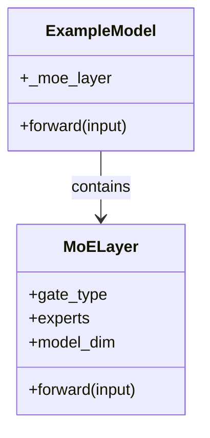
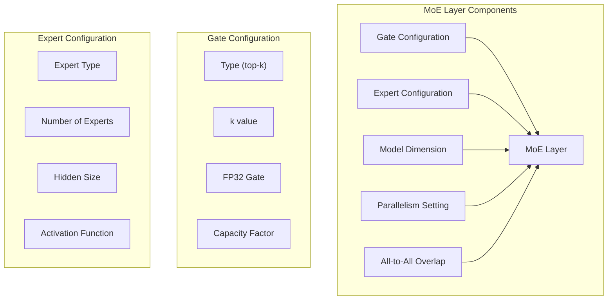

<!-- source: DeepWiki mcp.deepwiki.com · repo microsoft/Tutel · page 5.1 Basic Usage · fetched 2026-10-26 -->

# Basic Usage

<details>
<summary>Relevant source files</summary>

The following files were used as context for generating this wiki page:

- [tutel/examples/helloworld.py](tutel/examples/helloworld.py)

</details>


This page documents the basic usage of Tutel's Mixture-of-Experts (MoE) implementation through its "hello world" example. It covers model creation, configuration, and running a simple training loop. For more advanced topics, see [Automatic Mixed Precision](#5.2), [Distributed Training](#5.3), or [Custom Experts and Gates](#5.4).

## Overview of the Hello World Example

Tutel provides a simple example to demonstrate its core functionality. This example creates a basic MoE model with configurable parameters, trains it on random data, and reports performance metrics.


Sources: [tutel/examples/helloworld.py:16-161]()

## Environment and Configuration Setup

Before creating a model, you need to initialize the environment and configure your settings.

### Environment Initialization

The basic example initializes the distributed environment and sets device information:

```python
parallel_env = system.init_data_model_parallel(backend='nccl' if args.device == 'cuda' else 'gloo')
dist_rank, dist_world_size, dist_print = parallel_env.global_rank, parallel_env.global_size, parallel_env.dist_print
args.local_rank = parallel_env.local_device.index
device = parallel_env.local_device
```

Sources: [tutel/examples/helloworld.py:47-49](), [tutel/examples/helloworld.py:58]()

### Configuration Parameters

The hello world example supports numerous configuration parameters:

| Parameter | Description | Default |
|-----------|-------------|---------|
| `batch_size` | Number of samples per batch | 16 |
| `num_tokens` | Number of tokens per sample | 512 |
| `model_dim` | Model dimension | 2048 |
| `hidden_size` | Hidden dimension size | 2048 |
| `num_local_experts` | Number of experts per device | 2 |
| `top` | Top-k experts to select | 2 |
| `l_aux_wt` | Auxiliary loss weight | 0.0 |
| `a2a_ffn_overlap_degree` | Degree of all-to-all FFN overlap | 1 |
| `parallel_type` | Parallelism strategy | 'adaptive:1' |
| `capacity_factor` | Expert capacity factor | 1.0 |

Sources: [tutel/examples/helloworld.py:17-40]()

## Creating a Basic MoE Model

The hello world example defines a simple model class with a single MoE layer:



Sources: [tutel/examples/helloworld.py:72-98]()

### MoE Layer Configuration

The MoE layer is the core component of the model. Here's how it's configured in the example:



Key components in the layer configuration:

1. **Gate Type**: Controls how tokens are routed to experts
   ```python
   gate_type = {'type': 'top', 'k': top_value, 'fp32_gate': args.fp32_gate, 'capacity_factor': args.capacity_factor}
   ```

2. **Experts**: Defines the expert network configuration
   ```python
   experts = {'type': args.expert_type, 'num_experts_per_device': num_local_experts, 'hidden_size_per_expert': hidden_size, 'activation_fn': lambda x: F.relu(x)}
   ```

3. **Model Dimension**: The dimension of the input tensor
   ```python
   model_dim = model_dim
   ```

4. **Parallelism Type**: Controls how computation is distributed
   ```python
   parallel_type = args.parallel_type
   ```

Sources: [tutel/examples/helloworld.py:76-85]()

## Training and Inference

### Data Preparation

The example uses randomly generated data:

```python
x = torch.tensor(torch.randn([batch_size, num_tokens, model_dim], dtype=torch.float32, device='cpu').detach().numpy(), dtype=torch.get_default_dtype(), requires_grad=False, device=device)
y = torch.LongTensor(batch_size).random_(1).to(device)
```

Sources: [tutel/examples/helloworld.py:113-114]()

### Training Loop

The training loop follows a standard PyTorch pattern with some MoE-specific elements:


Key MoE-specific aspects:
1. **Auxiliary Loss**: Optional additional loss for load balancing
   ```python
   if args.l_aux_wt:
       loss += args.l_aux_wt * model._moe_layer.l_aux
   ```

2. **Gradient Reduction**: In distributed settings, gradients are averaged across workers
   ```python
   if dist_world_size > 1:
       for p in params_for_all_reduce:
           p.grad /= dist_world_size
           p.grad = net.simple_all_reduce(p.grad)
   ```

Sources: [tutel/examples/helloworld.py:126-140]()

### Evaluation Mode

For evaluation, the example uses `torch.no_grad()` to disable gradient calculation:

```python
with torch.no_grad():
    output = model(x)
    loss = F.nll_loss(output, y)
```

Sources: [tutel/examples/helloworld.py:142-144]()

## Performance Measurement

The example measures performance in TFLOPS (trillion floating-point operations per second):

```python
tflops = (batch_size * num_tokens * model_dim * hidden_size) * 4 * mm_ceof * cap_ceof * 1e-12 / (t_stop - t_start)
```

Where:
- `mm_ceof`: Matrix multiplication coefficient (3 for training, 1 for eval)
- `cap_ceof`: Capacity coefficient (min of top-k and number of global experts)

Sources: [tutel/examples/helloworld.py:148-150]()

## Running the Example

To run the hello world example with default settings:

```bash
python -m tutel.examples.helloworld
```

With custom settings:

```bash
python -m tutel.examples.helloworld --batch_size 32 --num_local_experts 4 --top 2 --model_dim 1024 --hidden_size 1024
```

Sources: [tutel/examples/helloworld.py:17-40]()

## Checkpoint Management

The example supports saving and loading model checkpoints:

```python
if args.checkpoint_path:
    checkpoint_path = system.apply_rank_size_from_pattern(args.checkpoint_path, rank=parallel_env.global_rank, size=parallel_env.global_size)
    if os.path.exists(checkpoint_path):
        model.load_state_dict(torch.load(checkpoint_path))
    else:
        print('Checkpoint not loaded: file `%s` is not found. Will train the model from start.' % checkpoint_path)
```

```python
if args.checkpoint_path:
    torch.save(model.state_dict(), checkpoint_path)
```

Sources: [tutel/examples/helloworld.py:103-108](), [tutel/examples/helloworld.py:159-160]()

## Parallelism Options

Tutel supports different parallelism strategies controlled by the `parallel_type` parameter:

| Parallel Type | Description |
|---------------|-------------|
| `'data'` | Data parallelism - each device has a full model copy |
| `'expert'` | Expert parallelism - experts are distributed across devices |
| `'adaptive:R'` | Combined data and expert parallelism with ratio R |

The example uses `'adaptive:1'` by default, which balances data and expert parallelism.

Sources: [tutel/examples/helloworld.py:32](), [tutel/examples/helloworld.py:84]()

---

