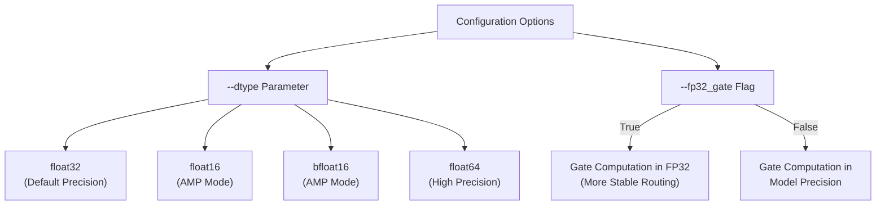
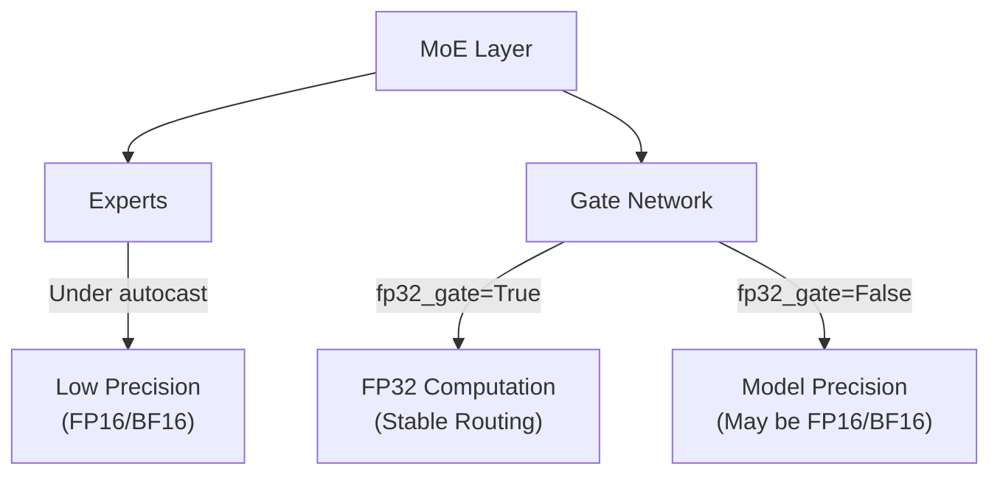
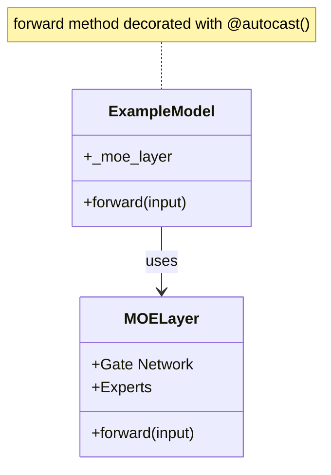
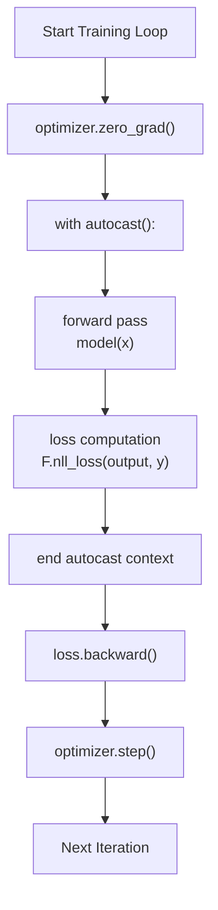

<!-- source: DeepWiki mcp.deepwiki.com · repo microsoft/Tutel · page 5.2 Automatic Mixed Precision · fetched 2026-10-26 -->

# Automatic Mixed Precision

Relevant source files

The following files were used as context for generating this wiki page:

- [tutel/examples/helloworld_amp.py](tutel/examples/helloworld_amp.py)
- [tutel/examples/helloworld_ddp_tutel.py](tutel/examples/helloworld_ddp_tutel.py)

## Purpose and Scope

This document explains how to leverage Automatic Mixed Precision (AMP) with Tutel's Mixture of Experts (MoE) implementation. AMP enables more efficient model training by using lower precision formats (like float16 or bfloat16) where appropriate, while maintaining model accuracy. For general information about basic usage, see [Basic Usage](#5.1), and for distributed training configurations, see [Distributed Training](#5.3).

## What is Automatic Mixed Precision?

Automatic Mixed Precision is a technique that utilizes both lower and higher precision data types during model training to improve performance while maintaining accuracy. Typically, this involves:

1. Storing model weights in FP32 (float32)
2. Computing forward and backward passes using FP16 (float16) or BF16 (bfloat16)
3. Keeping a master copy of weights in FP32 for updates
4. Automatically handling loss scaling to prevent underflow

This approach can significantly accelerate training on hardware with specialized units for low-precision math operations, such as NVIDIA Tensor Cores.

**AMP Data Flow**

Sources: [tutel/examples/helloworld_amp.py:76-80](), [tutel/examples/helloworld_amp.py:101-105]()

## Configuring AMP in Tutel

### Data Type Configuration

Tutel allows configuring the default data type for the model through the `--dtype` parameter. Supported options include:

| Data Type | Description | Best For |
|-----------|-------------|----------|
| float32   | Standard 32-bit floating point | Highest accuracy, CPU training |
| float16   | 16-bit floating point | GPU training with Tensor Cores |
| bfloat16  | Brain Floating Point format | Training with wider dynamic range than float16 |
| float64   | 64-bit floating point | Applications requiring extreme precision |

The data type can be set either through command-line arguments or directly in your code:

**Precision Configuration Options**

Sources: [tutel/examples/helloworld_amp.py:26-27](), [tutel/examples/helloworld_amp.py:47-56]()

### Special Handling for Gates

Mixture of Experts models contain gate networks that route tokens to experts. These gate computations can sometimes benefit from higher precision, even when using AMP for the rest of the model. Tutel provides the `--fp32_gate` flag to force gate calculations to be done in FP32, which can improve training stability.

When configuring a MoE layer with AMP, the gate precision can be set independently:

**Gate Precision Control**

Sources: [tutel/examples/helloworld_amp.py:64]()

## Implementing AMP in Your Model

### Model Definition with AMP

To use AMP with Tutel, you'll need to:

1. Import the autocast utility: `from torch.cuda.amp import autocast`
2. Apply autocast to your model's forward pass

Here's how you can structure your model to use AMP:

**Model Structure with AMP**

Sources: [tutel/examples/helloworld_amp.py:59-80]()

### Training Loop with AMP

The training loop with AMP requires wrapping the forward and loss computation steps with an `autocast()` context manager:

**AMP Training Loop**

Sources: [tutel/examples/helloworld_amp.py:98-112]()

## Complete Example

The `helloworld_amp.py` example demonstrates a complete implementation of AMP with Tutel. Key components include:

1. Setting the default data type for the model
2. Configuring the MoE layer with optional FP32 gate computation
3. Using the `@autocast()` decorator on the model's forward method
4. Wrapping the forward pass and loss computation in the training loop with `with autocast()`

This approach allows the model to automatically use lower precision computation where appropriate, falling back to higher precision for operations that require it.

## Performance Considerations

When using AMP with Tutel, consider these performance factors:

| Setting | Impact on Performance | Impact on Accuracy |
|---------|------------------------|-------------------|
| float16 | Fastest on modern GPUs with Tensor Cores | Potential for numerical instability |
| bfloat16 | Good balance of speed and stability | Better dynamic range than float16 |
| fp32_gate=True | Slightly slower gate computation | More stable expert routing |
| Top-k value | Higher values increase computation | May improve model quality |

For most applications on modern NVIDIA GPUs, using float16 with fp32_gate=True provides an optimal balance of performance and stability.

## Implementation Details

The implementation in Tutel directly leverages PyTorch's native AMP support through the `torch.cuda.amp` module. This integration ensures compatibility with the PyTorch ecosystem while benefiting from Tutel's optimized MoE implementation.

Key files involved:
- `helloworld_amp.py`: Complete example of AMP with Tutel
- `moe_layer.py`: Core MoE implementation that works seamlessly with AMP

Sources: [tutel/examples/helloworld_amp.py]()

## Troubleshooting

Common issues when using AMP with Tutel:

1. **NaN or Inf values during training**: Consider using fp32_gate=True or switching to bfloat16 instead of float16
2. **Slower performance than expected**: Ensure you're using hardware with specialized acceleration for low-precision operations
3. **Decreased model accuracy**: Experiment with different precision settings or consider a hybrid approach

For models that are particularly sensitive to precision issues, consider starting with full FP32 training and gradually transitioning to AMP as you confirm stability.

---

