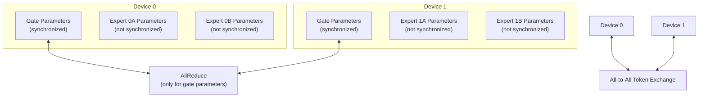
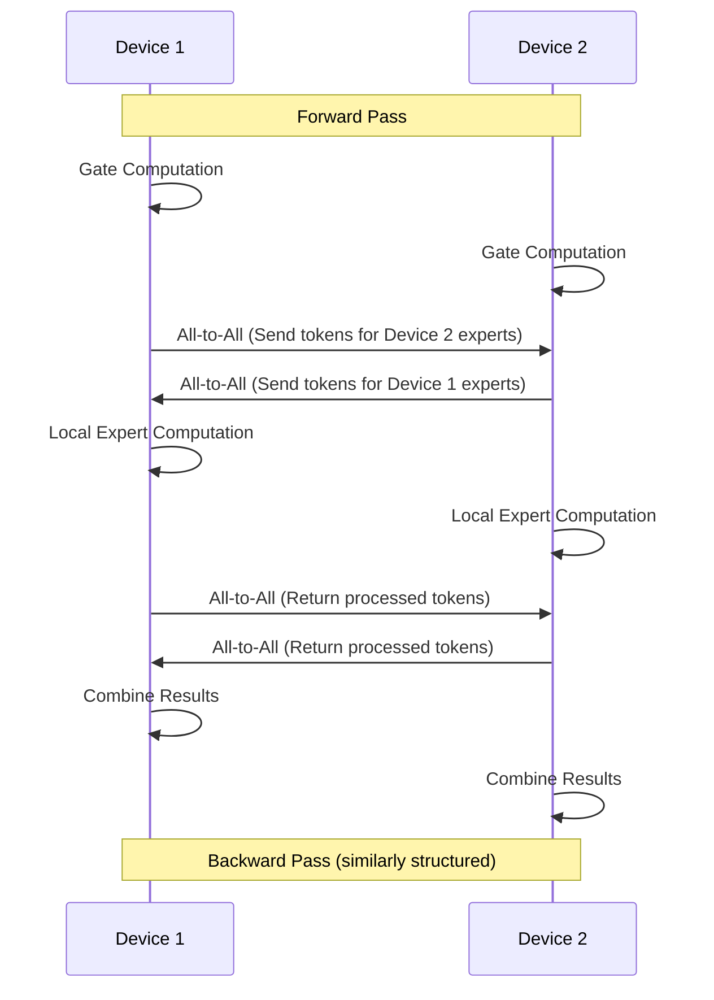
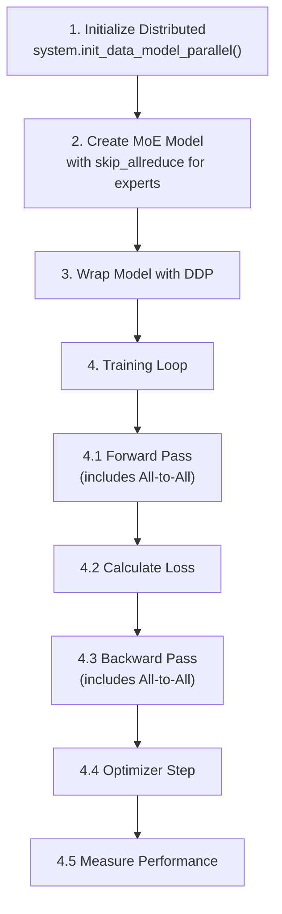

<!-- source: DeepWiki mcp.deepwiki.com · repo microsoft/Tutel · page 5.3 Distributed Training · fetched 2026-10-26 -->

# Distributed Training

<details>
<summary>Relevant source files</summary>

The following files were used as context for generating this wiki page:

- [tutel/examples/helloworld_ddp.py](tutel/examples/helloworld_ddp.py)

</details>


## Purpose and Scope

This document explains how to implement distributed training with Tutel's Mixture-of-Experts (MoE) architecture. It covers the initialization of distributed environments, configuration of data and model parallelism, and the integration with PyTorch's DistributedDataParallel (DDP). For general MoE layer usage, see [Basic Usage](#5.1), and for framework integration options, see [Framework Integration](#5.5).

## Overview of Distributed Training in Tutel

Tutel's distributed training capabilities leverage both data parallelism and expert parallelism to efficiently scale MoE models across multiple devices. The implementation uses PyTorch's distributed communication primitives while adding specialized optimizations for the unique communication patterns in MoE architectures.


Sources: [tutel/examples/helloworld_ddp.py:35-37](), [tutel/examples/helloworld_ddp.py:97-98]()

## Setting Up Distributed Training

### Initialization

To set up distributed training with Tutel, you need to initialize the distributed environment using Tutel's `system.init_data_model_parallel()` function, which creates and configures the necessary process groups.

```python
from tutel import system
parallel_env = system.init_data_model_parallel(backend='nccl' if args.device == 'cuda' else 'gloo')
dist_rank = parallel_env.global_rank
dist_world_size = parallel_env.global_size
dist_print = parallel_env.dist_print
local_rank = parallel_env.local_device.index
device = parallel_env.local_device
```

Sources: [tutel/examples/helloworld_ddp.py:35-37](), [tutel/examples/helloworld_ddp.py:46]()

### Key Configuration Parameters

Tutel's distributed training requires configuration of several parameters that control the distribution of experts and communication patterns:

| Parameter | Description | Example Value |
|-----------|-------------|---------------|
| `num_local_experts` | Number of experts per device | 2 |
| `backend` | Communication backend | 'nccl' (GPU) or 'gloo' (CPU) |
| `a2a_ffn_overlap_degree` | Overlapping of All-to-All with FFN | 1 |
| `top` | Number of experts selected by gate | 2 |

Sources: [tutel/examples/helloworld_ddp.py:26](), [tutel/examples/helloworld_ddp.py:29-30](), [tutel/examples/helloworld_ddp.py:35]()

## MoE Model Structure for Distributed Training

When creating an MoE model for distributed training, there are special considerations for parameter synchronization and expert placement:



Sources: [tutel/examples/helloworld_ddp.py:64-71](), [tutel/examples/helloworld_ddp.py:83-95]()

### Expert Parameter Handling

A crucial aspect of distributed MoE training is properly handling expert parameters. With Tutel, expert parameters should skip the AllReduce operation typically performed by PyTorch's DistributedDataParallel. This is because experts are specialized and distributed across devices, so their parameters should not be synchronized.

```python
# Marking expert parameters to skip AllReduce
scan_expert_func = lambda name, param: setattr(param, 'skip_allreduce', True)

# Adding marked parameters to DDP's skip list
for name, param in model.named_parameters():
    if hasattr(param, 'skip_allreduce'):
        model.add_param_to_skip_allreduce(name)
```

Sources: [tutel/examples/helloworld_ddp.py:68](), [tutel/examples/helloworld_ddp.py:83-95]()

## Integration with PyTorch's DistributedDataParallel

After properly configuring expert parameters, the model is wrapped with PyTorch's DistributedDataParallel:

```python
if torch.distributed.is_initialized():
    model = torch.nn.parallel.DistributedDataParallel(model, device_ids=[args.local_rank])
```

This integration enables efficient distributed training while maintaining the specialized handling of MoE components.

Sources: [tutel/examples/helloworld_ddp.py:97-98]()

## Communication Patterns in Distributed MoE



The key communication pattern in distributed MoE is the All-to-All operation, which routes tokens to the appropriate experts across devices. Tutel provides optimizations for this pattern through the `a2a_ffn_overlap_degree` parameter, which controls the overlapping of communication with computation.

Sources: [tutel/examples/helloworld_ddp.py:30](), [tutel/examples/helloworld_ddp.py:70]()

## Monitoring and Performance Measurement

Tutel provides utilities for performance monitoring in distributed training:

```python
# Record time for performance measurement
t_start = system.record_time()
# ... training step ...
t_stop = system.record_time()

# Calculate global expert count
num_global_experts = tutel_moe.moe_layer.global_expert_count(
    num_local_experts, 
    group=system.get_local_session().model_group
)

# Calculate TFLOPS
tflops = (batch_size * num_tokens * model_dim * hidden_size) * 4 * args.top * 3 * 1e-12 / (t_stop - t_start)
```

Sources: [tutel/examples/helloworld_ddp.py:114](), [tutel/examples/helloworld_ddp.py:122](), [tutel/examples/helloworld_ddp.py:124-126]()

## Complete Distributed Training Example

Below is the structure of a complete distributed training example with Tutel:



Sources: [tutel/examples/helloworld_ddp.py:35-37](), [tutel/examples/helloworld_ddp.py:60-99](), [tutel/examples/helloworld_ddp.py:111-131]()

## Best Practices for Distributed MoE Training

1. **Expert Parameter Handling**: Always ensure expert parameters skip AllReduce operations
2. **Device Selection**: Use 'nccl' backend for GPU training and 'gloo' for CPU training
3. **Expert Distribution**: Balance the number of experts per device based on available resources
4. **Communication Optimization**: Experiment with `a2a_ffn_overlap_degree` to find the optimal setting for your hardware
5. **Model Dimension Sizing**: Choose model dimensions that efficiently utilize the available hardware

Sources: [tutel/examples/helloworld_ddp.py:35](), [tutel/examples/helloworld_ddp.py:30](), [tutel/examples/helloworld_ddp.py:68]()

## Additional Considerations

### Scaling Efficiency

The efficiency of distributed MoE training depends on several factors:

| Factor | Impact |
|--------|--------|
| Number of experts | More experts increase model capacity but require more communication |
| Top-K value | Higher K values increase computation and communication overhead |
| Batch size | Larger batches improve throughput but require more memory |
| Network bandwidth | Higher bandwidth reduces communication bottlenecks |

### Expert Load Balancing

In distributed MoE training, it's important to ensure balanced expert utilization across devices. Tutel calculates global expert count to manage this aspect:

```python
num_global_experts = tutel_moe.moe_layer.global_expert_count(
    num_local_experts, 
    group=system.get_local_session().model_group
)
```

Sources: [tutel/examples/helloworld_ddp.py:124-126]()

## Conclusion

Distributed training with Tutel's MoE implementation combines the efficiency of distributed data parallelism with the specialized token routing and expert parallelism of MoE architectures. By properly configuring expert parameters, communication patterns, and integrating with PyTorch's DistributedDataParallel, you can efficiently scale MoE models across multiple devices.

For advanced parallelism techniques, see [Model Parallelism](#6.3), and for communication optimizations, see [NCCL Communication Optimization](#6.2).

---

