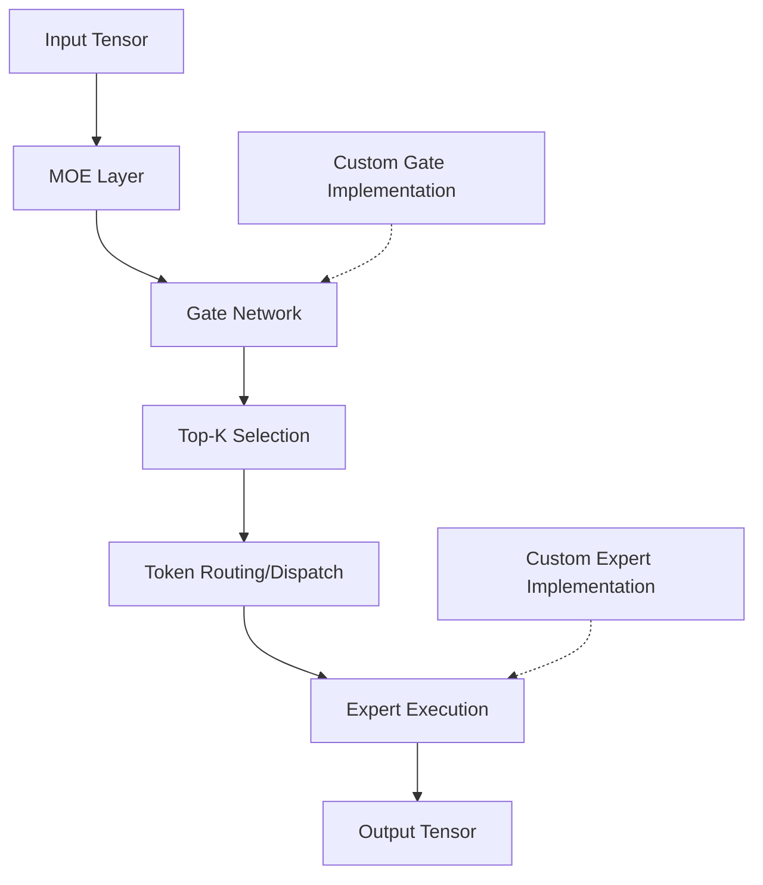
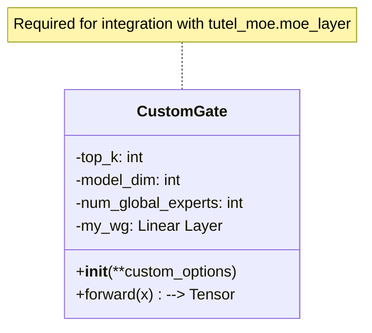
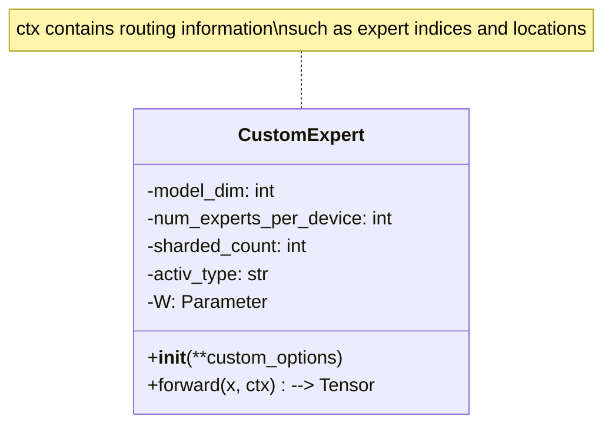
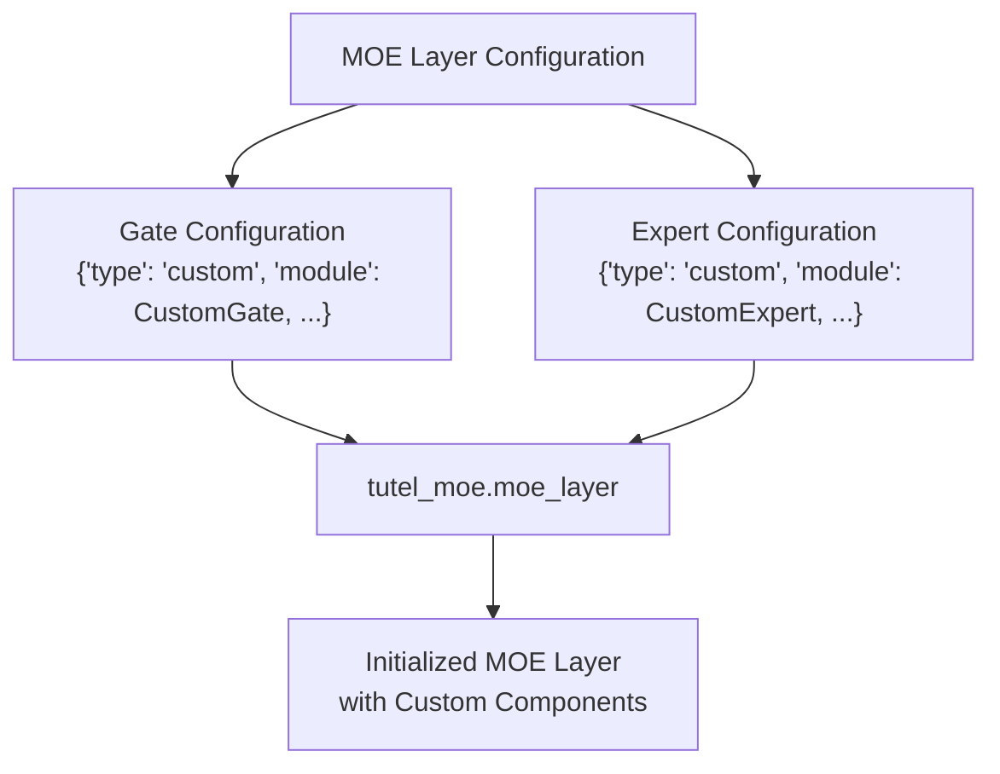
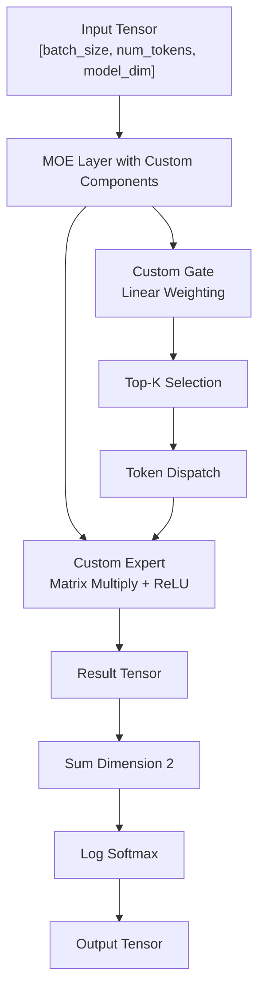
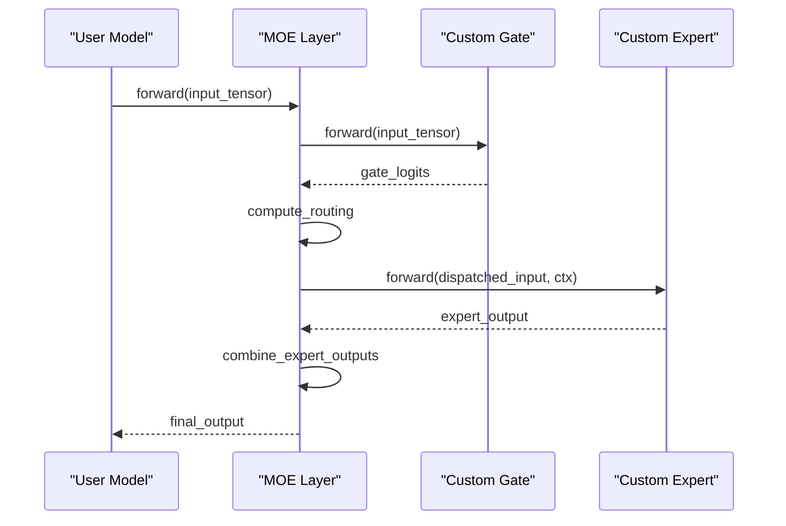

<!-- source: DeepWiki mcp.deepwiki.com · repo microsoft/Tutel · page 5.4 Custom Experts and Gates · fetched 2026-10-26 -->

# Custom Experts and Gates

<details>
<summary>Relevant source files</summary>

The following files were used as context for generating this wiki page:

- [tutel/examples/helloworld_custom_gate_expert.py](tutel/examples/helloworld_custom_gate_expert.py)
- [tutel/examples/moe_cifar10.py](tutel/examples/moe_cifar10.py)
- [tutel/examples/moe_mnist.py](tutel/examples/moe_mnist.py)

</details>


## Purpose and Scope

This document explains how to implement and use custom expert networks and gating mechanisms in Tutel's Mixture-of-Experts (MoE) system. Custom implementations allow users to define specialized behavior beyond the standard built-in experts and gates provided by Tutel. This page covers the interfaces required for custom components, integration with the MoE layer, and complete working examples.

For information about the core MoE layer implementation, see [MOE Layer](#2.1). For details on standard gates, see [Gates](#2.3), and for information on standard expert implementations, see [Experts](#2.4).

## MoE Customization Architecture

The Tutel MoE layer design allows for customized components to be plugged into the standard MoE architecture. The following diagram shows where custom gates and experts fit within the overall system:



Sources: [tutel/examples/helloworld_custom_gate_expert.py:53-99]()

## Creating Custom Gates

Custom gates must be implemented as PyTorch modules that receive model inputs and produce gate scores for each expert. The main requirements are:

1. Accept initialization parameters through `**custom_options`
2. Implement a `forward()` method that produces logits/scores for each expert

### Custom Gate Interface



Sources: [tutel/examples/helloworld_custom_gate_expert.py:53-68]()

### Example Implementation

The following example shows a custom gate implementation with a simple linear transformation for expert selection:

```python
class CustomGate(torch.nn.Module):
    def __init__(self, **custom_options):
        super().__init__()
        for key in custom_options:
            if key == 'top_k':
                self.top_k = custom_options[key]
            elif key in ('model_dim', 'num_global_experts'):
                setattr(self, key, custom_options[key])
            else:
                raise Exception(f'Unhandled option key `{key}` for CustomGate')

        self.my_wg = torch.nn.Linear(self.model_dim, self.num_global_experts, bias=False)

    def forward(self, x):
        return self.my_wg(x)
```

Sources: [tutel/examples/helloworld_custom_gate_expert.py:53-68]()

## Creating Custom Experts

Custom experts must also be implemented as PyTorch modules. They receive token features and a context object containing routing information, and produce transformed features.

### Custom Expert Interface



Sources: [tutel/examples/helloworld_custom_gate_expert.py:70-99]()

### Example Implementation

Here's an example of a custom expert with a simple matrix multiplication and optional activation:

```python
class CustomExpert(torch.nn.Module):
    def __init__(self, **custom_options):
        super().__init__()
        for key in custom_options:
            if key in ('model_dim', 'num_experts_per_device', 'sharded_count'):
                setattr(self, key, custom_options[key])
            elif key == 'my_activ_type':
                self.activ_type = custom_options[key]
            else:
                raise Exception(f'Unhandled option key `{key}` for CustomExpert')

        self.W = torch.nn.Parameter(torch.empty(self.num_experts_per_device, model_dim, model_dim))
        self.my_activation = torch.nn.functional.relu if self.activ_type == 'relu' else None
        self.reset_parameters()

    def forward(self, x, ctx):
        if ctx.sharded_count > 1:
          raise Exception("Model parallel is disabled in this example.")
        y = torch.matmul(x, self.W)
        if self.my_activation is not None:
          y = self.my_activation(y)
        return y
```

Sources: [tutel/examples/helloworld_custom_gate_expert.py:70-99]()

## Integration with MOE Layer

To use custom gates and experts in a Tutel MoE layer, you need to specify them in the configuration dictionary when creating the MoE layer.

### Configuration Process



Sources: [tutel/examples/helloworld_custom_gate_expert.py:102-114]()

### Integration Example

The key configuration parameters for custom components are:

1. For gates: Set `'type': 'custom'` and provide the custom class via `'module': CustomGate` 
2. For experts: Set `'type': 'custom'` and provide the custom class via `'module': CustomExpert`
3. Include any additional parameters needed by your custom implementations

```python
moe_layer = tutel_moe.moe_layer(
    gate_type = {'type': 'custom', 'module': CustomGate, 'top_k': top_value},
    experts = {'type': 'custom', 'module': CustomExpert, 
              'num_experts_per_device': num_local_experts, 
              'my_activ_type': 'relu'},
    model_dim = model_dim,
    scan_expert_func = lambda name, param: setattr(param, 'skip_allreduce', True),
    seeds = (1, dist_rank + 1, 1),
    a2a_ffn_overlap_degree = a2a_ffn_overlap_degree,
)
```

Sources: [tutel/examples/helloworld_custom_gate_expert.py:106-113]()

## Complete Example Model

Here's a complete model using custom gate and expert implementations:



Sources: [tutel/examples/helloworld_custom_gate_expert.py:102-118]()

The full example implementation is available in the Tutel repository at [tutel/examples/helloworld_custom_gate_expert.py]().

## Parameter Handling in Custom Components

Both custom gates and experts receive parameters via the `**custom_options` dictionary during initialization. The following table shows common parameters and their handling:

| Component Type | Parameter | Description | Handling |
|---------------|-----------|-------------|----------|
| Gate | `top_k` | Number of experts to select | Store as instance attribute |
| Gate | `model_dim` | Dimensionality of input features | Store as instance attribute |
| Gate | `num_global_experts` | Total number of experts across all devices | Store as instance attribute |
| Expert | `model_dim` | Dimensionality of input features | Store as instance attribute |
| Expert | `num_experts_per_device` | Number of experts on current device | Store as instance attribute |
| Expert | `sharded_count` | For model parallel support | Check for compatibility |
| Expert | Custom (e.g., `my_activ_type`) | User-defined parameters | Process as needed |

Sources: [tutel/examples/helloworld_custom_gate_expert.py:53-99]()

## Best Practices

When implementing custom gates and experts, consider the following recommendations:

1. **Parameter Validation**: Check all received parameters and handle unexpected ones explicitly
2. **Distributed Compatibility**: Ensure your implementation works with distributed training
3. **Performance Optimizations**: Consider the computational efficiency, especially for gates
4. **Error Handling**: Provide clear error messages for unsupported configurations
5. **Documentation**: Document any special parameters your implementation requires

## Application Examples

Tutel includes several examples that demonstrate MoE usage, which can be extended with custom components:

1. **MNIST Classification**: [tutel/examples/moe_mnist.py]() shows MoE application for MNIST digit recognition
2. **CIFAR10 Classification**: [tutel/examples/moe_cifar10.py]() demonstrates MoE for image classification
3. **Custom Components Example**: [tutel/examples/helloworld_custom_gate_expert.py]() provides a complete example of custom gates and experts

Sources: [tutel/examples/moe_mnist.py:31-42](), [tutel/examples/moe_cifar10.py:31-42](), [tutel/examples/helloworld_custom_gate_expert.py:53-118]()

## Forward Pass Flow with Custom Components



Sources: [tutel/examples/helloworld_custom_gate_expert.py:102-118]()

This diagram illustrates the flow of data during the forward pass when using custom gate and expert components.

---

