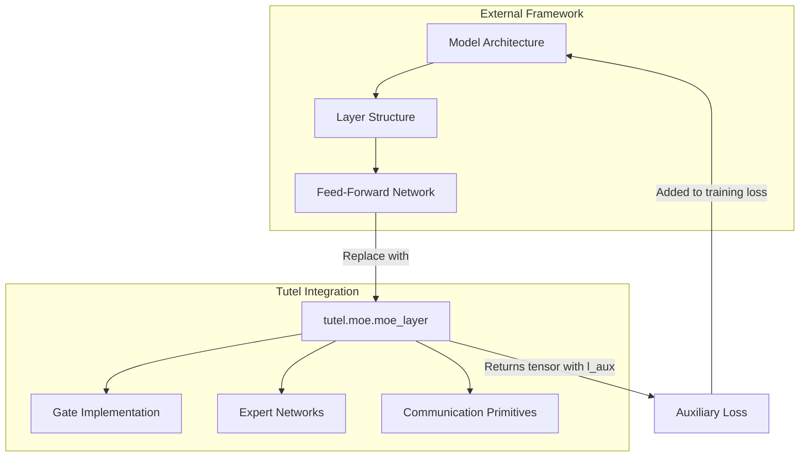
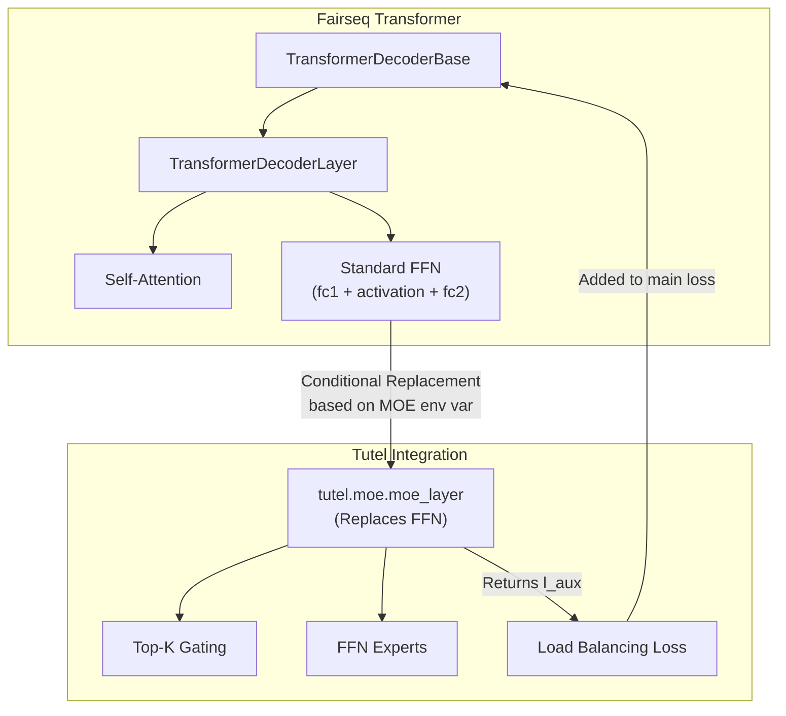
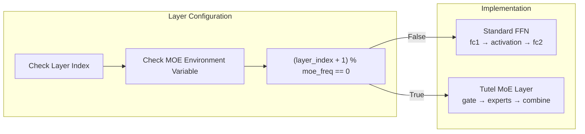
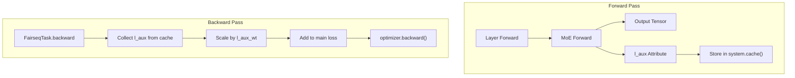
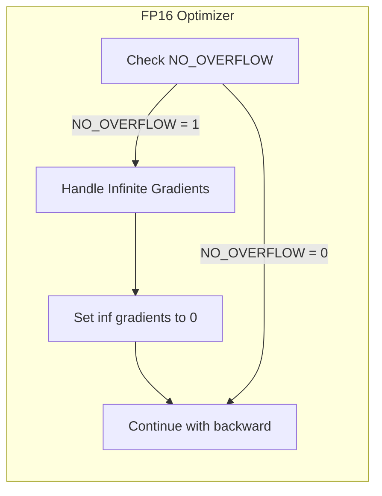

<!-- source: DeepWiki mcp.deepwiki.com · repo microsoft/Tutel · page 5.5 Framework Integration · fetched 2026-10-26 -->

# Framework Integration

<details>
<summary>Relevant source files</summary>

The following files were used as context for generating this wiki page:

- [tutel/examples/fairseq_moe/README.md](tutel/examples/fairseq_moe/README.md)
- [tutel/examples/fairseq_moe/fairseq_patch.diff](tutel/examples/fairseq_moe/fairseq_patch.diff)
- [tutel/examples/fairseq_moe/run_fairseq.sh](tutel/examples/fairseq_moe/run_fairseq.sh)

</details>


## Purpose and Scope

This document describes how to integrate Tutel's Mixture of Experts (MoE) implementation with other deep learning frameworks. The primary focus is on the integration with Fairseq, a sequence modeling toolkit developed by Facebook Research. This page covers the necessary code modifications, configuration options, and practical usage examples to incorporate Tutel's efficient MoE layers into existing framework architectures.

For basic usage of Tutel as a standalone library, see [Basic Usage](#5.1). For information about distributed training configuration, see [Distributed Training](#5.3).

## Integration Architecture Overview

Tutel's MoE implementation is designed to be framework-agnostic, allowing it to be integrated into various deep learning frameworks. The integration typically involves replacing standard feed-forward networks in transformer layers with Tutel's MoE layer implementation.



Sources: [tutel/examples/fairseq_moe/fairseq_patch.diff](tutel/examples/fairseq_moe/fairseq_patch.diff)

## Fairseq Integration

Fairseq is a sequence modeling toolkit that enables the training of custom models for translation, summarization, language modeling, and other text generation tasks. Tutel provides an example integration with Fairseq to replace standard transformer feed-forward networks with MoE layers.

### Integration Mechanism

The integration with Fairseq works by selectively replacing feed-forward networks in transformer decoder layers with Tutel's MoE implementation. This is controlled by an environment variable `MOE` that specifies the frequency of MoE layer insertion.



Sources: [tutel/examples/fairseq_moe/fairseq_patch.diff:21-94](tutel/examples/fairseq_moe/fairseq_patch.diff)

## Implementation Details

### Patch Application

To integrate Tutel with Fairseq, a patch is applied to Fairseq's codebase. The patch modifies three main files:

1. `transformer_decoder.py`: Adds layer indexing for conditional MoE application
2. `transformer_layer.py`: Replaces feed-forward networks with Tutel MoE layers
3. `fairseq_task.py`: Adds auxiliary loss handling for MoE load balancing

### Key Code Modifications

#### Decoder Layer Modification

The TransformerDecoderLayerBase is modified to conditionally use Tutel's MoE implementation based on the layer index and an environment variable:



The MoE layer is configured with the following parameters:
- Gate type: top-k with k=2
- Expert type: feed-forward network (FFN)
- Expert count: 1 per device

Sources: [tutel/examples/fairseq_moe/fairseq_patch.diff:21-94](tutel/examples/fairseq_moe/fairseq_patch.diff)

#### Auxiliary Loss Handling

The auxiliary loss from the MoE layer is captured and added to the main loss during backward propagation:



The weight of the auxiliary loss is controlled by the `L_AUX_WT` environment variable.

Sources: [tutel/examples/fairseq_moe/fairseq_patch.diff:111-131](tutel/examples/fairseq_moe/fairseq_patch.diff)

### Mixed Precision Support

Tutel's integration with Fairseq includes support for mixed-precision training (FP16). The patch adds handling for infinity values in gradients when using the `NO_OVERFLOW` environment variable:



Sources: [tutel/examples/fairseq_moe/fairseq_patch.diff:95-110](tutel/examples/fairseq_moe/fairseq_patch.diff)

## Usage Example with Fairseq

### Setup and Installation

To integrate Tutel with Fairseq, follow these steps:

1. Install Tutel:
   ```bash
   git clone https://github.com/microsoft/tutel --branch main
   python3 -m pip uninstall tutel -y
   python3 ./tutel/setup.py
   ```

2. Install and patch Fairseq:
   ```bash
   cd ./tutel/tutel/examples/fairseq_moe
   git clone https://github.com/facebookresearch/fairseq --branch main
   cd fairseq/ && git checkout b5e7b250913120409b872a940fbafec4d43c7b13
   git apply ../fairseq_patch.diff
   python3 -m pip install omegaconf==2.3.0 hydra-core==1.3.2
   python3 -m pip install --no-deps --editable .
   ```

Sources: [tutel/examples/fairseq_moe/README.md:1-19](tutel/examples/fairseq_moe/README.md)

### Training with MoE

The example provided in the repository demonstrates training a language model on the WikiText-103 dataset using Tutel's MoE implementation:

1. Prepare the dataset:
   ```bash
   curl -LO https://s3.amazonaws.com/research.metamind.io/wikitext/wikitext-103-v1.zip && unzip wikitext-103-v1.zip
   fairseq-preprocess --only-source --trainpref wikitext-103/wiki.train.tokens --validpref wikitext-103/wiki.valid.tokens --testpref wikitext-103/wiki.test.tokens --destdir ./wikitext-103 --workers 20
   ```

2. Train with FP32:
   ```bash
   MOE=1 L_AUX_WT=0.01 ../run_fairseq.sh ./wikitext-103
   ```

3. Train with FP16:
   ```bash
   FP16=1 NO_OVERFLOW=0 MOE=1 L_AUX_WT=0.01 ../run_fairseq.sh ./wikitext-103
   ```

The environment variables control the MoE configuration:
- `MOE`: Frequency of MoE layers (1 = every layer, 2 = every other layer)
- `L_AUX_WT`: Weight of the load balancing auxiliary loss
- `FP16`: Enable mixed precision training
- `NO_OVERFLOW`: Handle infinite gradients in FP16 training

Sources: [tutel/examples/fairseq_moe/README.md:20-47](tutel/examples/fairseq_moe/README.md), [tutel/examples/fairseq_moe/run_fairseq.sh:1-18](tutel/examples/fairseq_moe/run_fairseq.sh)

## Configuration Options for Framework Integration

When integrating Tutel with other frameworks, several configuration options are available:

| Parameter | Description | Example Value |
|-----------|-------------|---------------|
| `gate_type` | Configuration for the gating mechanism | `{'type': 'top', 'k': 2, 'capacity_factor': 0.0, 'fp32_gate': True, 'gate_noise': 1.0}` |
| `model_dim` | Dimension of the model embeddings | Same as the embedding dimension in the framework |
| `experts` | Expert network configuration | `{'num_experts_per_device': 1, 'type': 'ffn', 'hidden_size_per_expert': ffn_dim}` |
| `scan_expert_func` | Function to mark expert parameters | Used to handle parameter masking in distributed settings |

These options can be customized based on the specific requirements of the framework being integrated.

Sources: [tutel/examples/fairseq_moe/fairseq_patch.diff:47-53](tutel/examples/fairseq_moe/fairseq_patch.diff)

## Integrating with Other Frameworks

While the example provided focuses on Fairseq, the same principles can be applied to integrate Tutel with other frameworks:

1. Identify the feed-forward network components in transformer layers
2. Replace these components with Tutel's MoE layer implementation
3. Configure the MoE layer according to the model's requirements
4. Implement auxiliary loss handling for load balancing

The key is understanding the model architecture of the target framework and identifying the appropriate points for MoE integration.

## Limitations and Considerations

When integrating Tutel with other frameworks, consider the following:

1. The Fairseq patch only works with the `legacy_ddp` backend
2. Checkpoint activations must be disabled (`--checkpoint-activations` must be off)
3. For mixed precision training, proper handling of gradient overflow is important
4. The auxiliary loss weight needs to be tuned for optimal load balancing

These considerations should be taken into account when adapting the integration approach to other frameworks.

Sources: [tutel/examples/fairseq_moe/README.md:14-16](tutel/examples/fairseq_moe/README.md)

---

