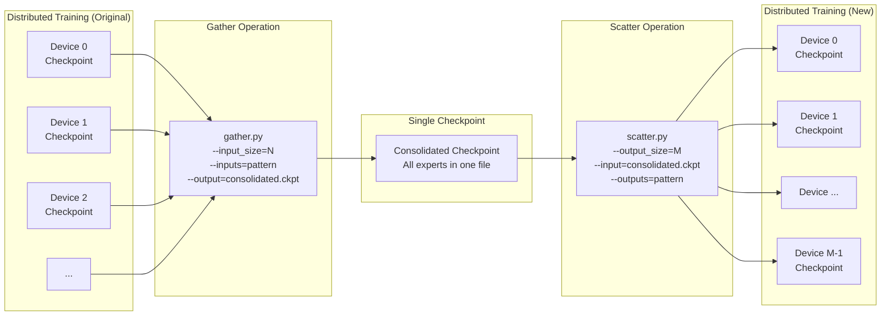
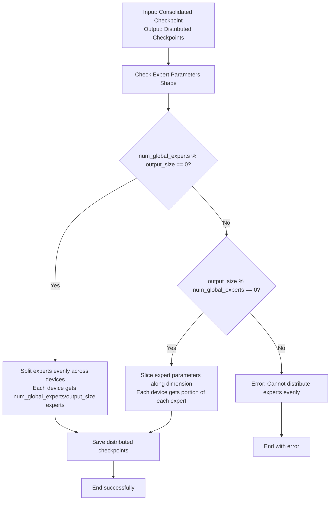
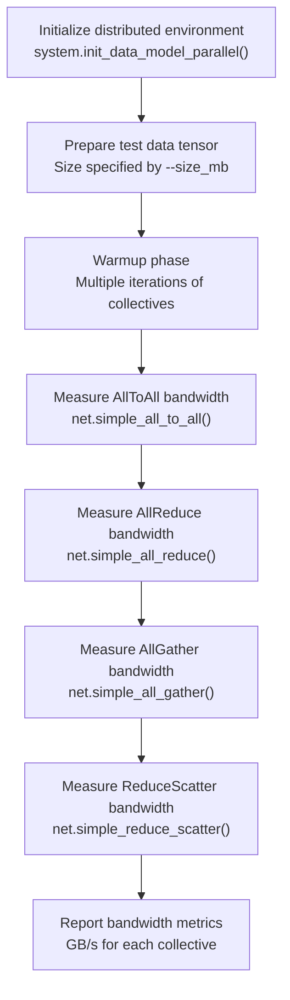
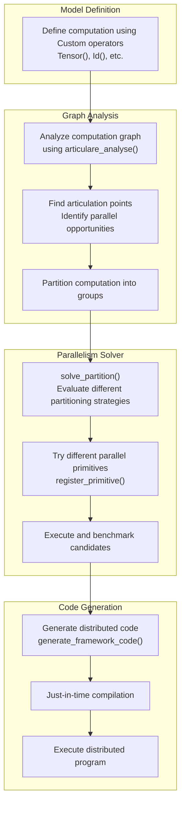

<!-- source: DeepWiki mcp.deepwiki.com · repo microsoft/Tutel · page 6 Advanced Features · fetched 2026-10-26 -->

# Advanced Features

<details>
<summary>Relevant source files</summary>

The following files were used as context for generating this wiki page:

- [doc/CHECKPOINT.md](doc/CHECKPOINT.md)
- [tutel/checkpoint/__init__.py](tutel/checkpoint/__init__.py)
- [tutel/checkpoint/gather.py](tutel/checkpoint/gather.py)
- [tutel/checkpoint/scatter.py](tutel/checkpoint/scatter.py)
- [tutel/examples/bandwidth_test.py](tutel/examples/bandwidth_test.py)
- [tutel/parted/backend/torch/config.py](tutel/parted/backend/torch/config.py)
- [tutel/parted/backend/torch/executor.py](tutel/parted/backend/torch/executor.py)
- [tutel/parted/solver.py](tutel/parted/solver.py)
- [tutel/parted/spmdx.py](tutel/parted/spmdx.py)

</details>


This page documents the advanced capabilities in Tutel that enable sophisticated distributed training, efficient checkpointing, and automated parallelism. These features are designed for users who need fine-grained control over how MoE models are trained, distributed, and optimized across hardware.

For basic usage of Tutel, see [Basic Usage](#5.1). For information about integrating Tutel with other frameworks, see [Framework Integration](#5.5).

## Checkpointing

Tutel provides robust checkpointing capabilities that allow MoE models to be adapted for different distributed configurations. This is especially important for large-scale MoE models where expert parameters are sharded across multiple devices.

### Checkpoint Operations

The checkpoint module provides two primary operations:

1. **Gather**: Combines distributed MoE checkpoints (from multiple devices) into a single consolidated checkpoint file
2. **Scatter**: Distributes a consolidated checkpoint into multiple files for distributed training with a different number of devices

These operations are essential when:
- Changing the number of devices used for training or inference
- Converting between different parallelism strategies
- Storing a model in a standard format that can be adapted to various hardware configurations



Sources: [tutel/checkpoint/gather.py](), [tutel/checkpoint/scatter.py](), [doc/CHECKPOINT.md]()

### Expert Parameter Distribution

During checkpoint transformation, expert parameters are automatically redistributed to maintain model consistency. This process handles two key cases:

1. **Expert Expansion**: When the number of devices increases (fewer experts per device)
2. **Expert Consolidation**: When the number of devices decreases (more experts per device)

The scatter operation reshapes expert parameters using the following logic:



Sources: [tutel/checkpoint/scatter.py:40-51](), [tutel/checkpoint/gather.py:60-70]()

### Example Usage

The checkpoint module can be used to adapt MoE models to any number of devices, as shown in these examples:

```bash
# Gather checkpoints from 2 devices into a single file
python -m tutel.checkpoint.gather --inputs=./states/{rank}-of-{size}.ckpt --input_size=2 --output ./model-all-in-one.ckpt

# Scatter consolidated checkpoint for 8 devices
python -m tutel.checkpoint.scatter --input=./model-all-in-one.ckpt --output_size=8 --outputs=./adapted-for-8-gpus/{rank}-of-{size}.ckpt
```

This functionality works with native Tutel checkpoints and specialized formats like SWIN-Transformer checkpoints (using the `--namespace` parameter to specify model parameter paths).

Sources: [doc/CHECKPOINT.md:4-26]()

## NCCL Communication Optimization

Tutel provides tools and optimizations for improving distributed communication performance, which is critical for MoE models due to their extensive all-to-all communication patterns.

### Communication Benchmarking

The bandwidth testing module allows users to measure and optimize the communication performance between devices. This is particularly important for MoE models, where routing tokens between experts creates substantial communication overhead.



Sources: [tutel/examples/bandwidth_test.py:36-84]()

The benchmarking tool provides insights into the efficiency of key collective operations:

| Operation | Usage in MoE | Optimization Impact |
|-----------|--------------|---------------------|
| AllToAll | Token routing between experts | Critical for MoE scaling |
| AllReduce | Parameter synchronization | Important for data parallelism |
| AllGather | Expert parameter collection | Used in some MoE configurations |
| ReduceScatter | Gradient aggregation | Common in distributed training |

Sources: [tutel/examples/bandwidth_test.py:44-66]()

### Communication Optimization Techniques

Tutel implements several advanced techniques to optimize MoE communication:

1. **FFN Overlap**: Tutel can overlap all-to-all communication with feed-forward network computation, hiding communication latency
2. **2D Hierarchical AllToAll**: Implementation of 2D hierarchical communication patterns to reduce global communication overhead
3. **Custom NCCL Kernels**: Specialized implementations of collective operations optimized for MoE workloads

To utilize these optimizations, users can configure parameters like `a2a_ffn_overlap_degree` and `use_2dh` when initializing MoE layers.

Sources: [tutel/examples/bandwidth_test.py]()

## SPMD Model Parallelism

Tutel includes an advanced SPMD (Single Program Multiple Data) model parallelism framework that can automatically partition neural networks across multiple devices.

### Automatic Model Sharding

The SPMD system analyzes a computation graph and determines an optimal partitioning strategy, allowing models to scale beyond the memory limits of individual devices.



Sources: [tutel/parted/spmdx.py:378-419](), [tutel/parted/solver.py:19-144]()

### Parallel Primitives

The SPMD system includes a set of primitive operations for implementing different parallelism strategies:

| Primitive | Description | Implementation |
|-----------|-------------|----------------|
| Data Parallelism | Replicate model, split data | Config setting in SPMD |
| Zero Parallelism | Shard optimizer states | Using -2 config value |
| Spatial Partitioning | Split tensors across dimensions | Using link() function |
| AllToAll | Tensor redistribution | Communication primitive |
| AllGather | Collecting sharded tensors | Communication primitive |
| ReduceScatter | Distributing reduced results | Communication primitive |

Sources: [tutel/parted/backend/torch/config.py:22-33]()

### Example SPMD Usage

To use the SPMD system, users define their computation graph using the Custom operator and then compile it into a distributed program:

1. Initialize the SPMD system: `spmdx.init('torch')`
2. Define computation using Custom operators
3. Use `autotune()` to find the optimal partitioning strategy
4. Compile the model with `compile()` and execute it

The system automatically handles the complexities of distributed execution, including communication insertion, parameter sharding, and optimization.

Sources: [tutel/parted/spmdx.py:414-516]()

## Putting It All Together

These advanced features form a comprehensive ecosystem for scaling and optimizing MoE models:

```mermaid
flowchart TD
    subgraph "MoE Model Development"
        MoEDef["Define MoE Architecture"]
        MoETrain["Train on N Devices"]
    end
    
    subgraph "Checkpointing System"
        CkptGather["Gather Checkpoints<br>tutel.checkpoint.gather"]
        CkptScatter["Scatter Checkpoints<br>tutel.checkpoint.scatter"]
        ConsCkpt["Consolidated Checkpoint"]
    end
    
    subgraph "Performance Optimization"
        CommBench["Communication Benchmarking<br>bandwidth_test.py"]
        CommOpt["Communication Optimization<br>a2a_ffn_overlap_degree, use_2dh"]
    end
    
    subgraph "Model Parallelism"
        SPMDSys["SPMD System<br>tutel.parted"]
        AutoTune["Automatic Partitioning<br>solver.py"]
        CodeGen["Distributed Code Generation<br>backend/torch/*"]
    end
    
    MoEDef --> MoETrain
    MoETrain --> CkptGather
    CkptGather --> ConsCkpt
    ConsCkpt --> CkptScatter
    
    MoEDef -.-> SPMDSys
    SPMDSys --> AutoTune
    AutoTune --> CodeGen
    CodeGen -.-> MoETrain
    
    MoETrain -.-> CommBench
    CommBench --> CommOpt
    CommOpt -.-> MoETrain
    
    CkptScatter -.-> "Deployment on M Devices"
```

Sources: [tutel/checkpoint/gather.py](), [tutel/checkpoint/scatter.py](), [tutel/parted/spmdx.py](), [tutel/examples/bandwidth_test.py]()

These advanced features make Tutel a powerful platform for developing, training, and deploying large-scale MoE models with optimized performance across various hardware configurations.

---

