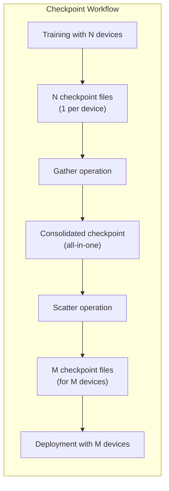
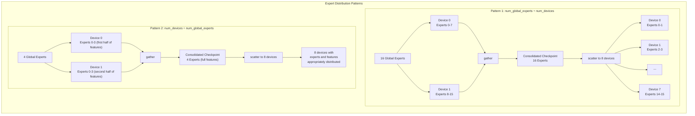
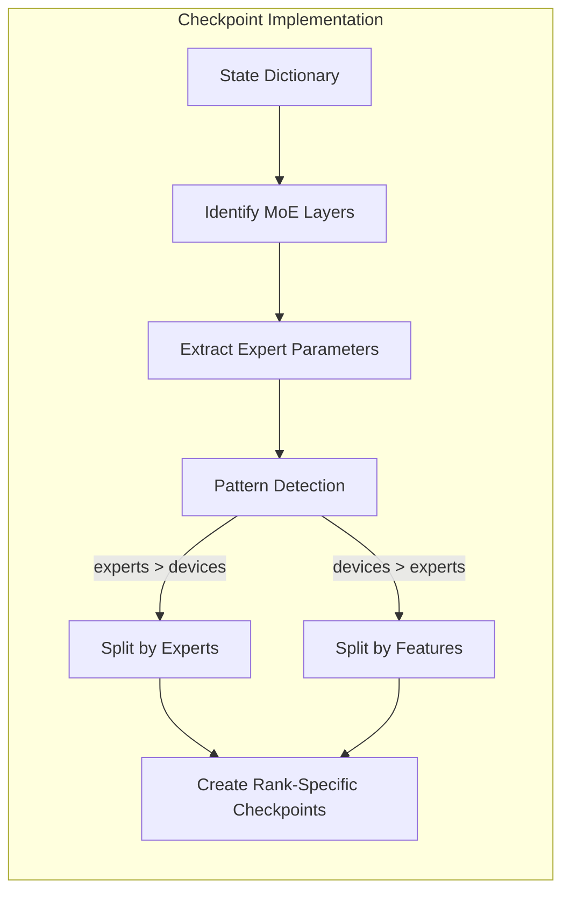

<!-- source: DeepWiki mcp.deepwiki.com · repo microsoft/Tutel · page 6.1 Checkpointing · fetched 2026-10-26 -->

# Checkpointing

<details>
<summary>Relevant source files</summary>

The following files were used as context for generating this wiki page:

- [doc/CHECKPOINT.md](doc/CHECKPOINT.md)
- [tutel/checkpoint/__init__.py](tutel/checkpoint/__init__.py)
- [tutel/checkpoint/gather.py](tutel/checkpoint/gather.py)
- [tutel/checkpoint/scatter.py](tutel/checkpoint/scatter.py)
- [tutel/examples/bandwidth_test.py](tutel/examples/bandwidth_test.py)

</details>


Tutel provides a robust checkpointing system for Mixture of Experts (MoE) models, allowing users to save and load model parameters across different distributed configurations. This page documents the checkpoint management functionality in Tutel, which is critical for training large-scale MoE models and redeploying them with different parallelism strategies.

For information about model parallelism in general, see [Model Parallelism](#6.3).

## Overview

Checkpointing in MoE models presents unique challenges due to the distributed nature of experts. When training with distributed computing, experts are typically distributed across different devices. The Tutel checkpointing system addresses these challenges by providing tools to:

1. **Gather** multiple distributed checkpoint files into a single consolidated checkpoint
2. **Scatter** a consolidated checkpoint into multiple files for distributed deployment

These tools are particularly valuable when you need to:
- Change the number of devices for training or inference
- Convert from multi-device to single-device execution (or vice versa)
- Deploy models trained on one hardware configuration to a different configuration



Sources: [doc/CHECKPOINT.md:4-25](), [tutel/checkpoint/gather.py](), [tutel/checkpoint/scatter.py]()

## Checkpoint Management Tools

Tutel provides two primary tools for checkpoint management:

### Gather Tool (`tutel.checkpoint.gather`)

The gather tool combines multiple checkpoint files (typically one from each device used in distributed training) into a single consolidated checkpoint file containing all model parameters.

Key features:
- Reconstructs expert parameters from distributed parts
- Handles different expert parallelism configurations
- Supports namespace specification for nested state dictionaries
- Can automatically detect expert configuration or use provided defaults

### Scatter Tool (`tutel.checkpoint.scatter`)

The scatter tool divides a consolidated checkpoint file into multiple files, each containing the parameters needed for a specific device in a distributed setup.

Key features:
- Distributes expert parameters across devices
- Handles different expert parallelism configurations
- Supports namespace specification for nested state dictionaries
- Creates output files with device-specific parameters

```mermaid
classDiagram
    class "GatherTool" {
        +inputs: str
        +input_size: int
        +output: str
        +namespace: str
        +default_num_global_experts: int
        +process_checkpoints()
    }
    
    class "ScatterTool" {
        +input: str
        +output_size: int
        +outputs: str
        +namespace: str
        +process_checkpoint()
    }
    
    class "CheckpointManager" {
        +convert_between_configurations()
    }
    
    CheckpointManager --> GatherTool: uses
    CheckpointManager --> ScatterTool: uses
```

Sources: [tutel/checkpoint/gather.py:11-81](), [tutel/checkpoint/scatter.py:11-75]()

## Expert Distribution in Checkpoints

One of the key challenges in MoE checkpointing is handling the distribution of experts. Tutel provides flexibility for different distribution patterns:

### Case 1: num_global_experts ÷ num_devices

When the number of global experts is divisible by the number of devices, each device gets an equal number of experts. During gathering, expert parameters from all devices are concatenated along the expert dimension.

### Case 2: num_devices ÷ num_global_experts

When the number of devices is divisible by the number of global experts, experts are replicated across devices with their parameters sharded along feature dimensions. During gathering, expert parameters are reconstructed by concatenating shards.



Sources: [tutel/checkpoint/gather.py:62-70](), [tutel/checkpoint/scatter.py:40-50]()

## Gathering Checkpoints

The checkpoint gathering process combines distributed checkpoint files into a single file, particularly focusing on reconstructing the expert parameters.

### How Gathering Works

1. Load the first checkpoint to determine the model structure
2. Identify MoE layers by looking for `._num_global_experts` parameters
3. For each rank's checkpoint, extract the expert parameters
4. Reconstruct the full expert parameters by combining parts from all ranks
5. Create a consolidated checkpoint with all parameters

### Command-line Interface

```
python -m tutel.checkpoint.gather \
    --inputs=./checkpoint_path/{rank}-of-{size}.ckpt \
    --input_size=<number_of_input_files> \
    --output=<output_file_path> \
    [--namespace=<nested_dict_path>] \
    [--default_num_global_experts=<expert_count>]
```

Key parameters:
- `--inputs`: Pattern for input checkpoint files with {rank} and {size} placeholders
- `--input_size`: Number of input checkpoint files (typically the number of devices used)
- `--output`: Path for the consolidated output checkpoint
- `--namespace`: Optional path to nested dictionary in the checkpoint (e.g., "model")
- `--default_num_global_experts`: Used when expert count cannot be automatically detected

Sources: [tutel/checkpoint/gather.py:12-34](), [doc/CHECKPOINT.md:8-9]()

## Scattering Checkpoints

The checkpoint scattering process divides a consolidated checkpoint into multiple files for distributed deployment.

### How Scattering Works

1. Load the consolidated checkpoint
2. Identify MoE layers by looking for `._num_global_experts` parameters
3. For each expert parameter, divide it according to the desired distribution pattern
4. Create separate checkpoint files for each rank, containing only the necessary parameters

### Command-line Interface

```
python -m tutel.checkpoint.scatter \
    --input=<input_file_path> \
    --output_size=<number_of_output_files> \
    --outputs=<output_pattern> \
    [--namespace=<nested_dict_path>]
```

Key parameters:
- `--input`: Path to the consolidated input checkpoint
- `--output_size`: Number of output checkpoint files to create (typically the number of target devices)
- `--outputs`: Pattern for output checkpoint files with {rank} and {size} placeholders
- `--namespace`: Optional path to nested dictionary in the checkpoint (e.g., "model")

Sources: [tutel/checkpoint/scatter.py:12-17](), [doc/CHECKPOINT.md:14-15]()

## Usage Examples

### Basic Workflow Example

The following example demonstrates a typical workflow:

1. Train with 2 GPUs (8 experts per GPU, 16 total experts)
2. Gather checkpoints into a single file
3. Scatter to a new configuration with 8 GPUs (2 experts per GPU, 16 total experts)

```
# Train with 2 GPUs and save checkpoints
python -m torch.distributed.run --nproc_per_node=2 \
    -m tutel.examples.helloworld \
    --num_local_experts=8 \
    --checkpoint=./states/{rank}-of-{size}.ckpt \
    --device=cuda

# Gather checkpoints into a single file
python -m tutel.checkpoint.gather \
    --inputs=./states/{rank}-of-{size}.ckpt \
    --input_size=2 \
    --output ./model-all-in-one.ckpt

# Scatter to 8 GPUs
python -m tutel.checkpoint.scatter \
    --input=./model-all-in-one.ckpt \
    --output_size=8 \
    --outputs=./adapted-for-8-gpus/{rank}-of-{size}.ckpt

# Train/evaluate with 8 GPUs
python -m torch.distributed.run --nproc_per_node=8 \
    -m tutel.examples.helloworld \
    --num_local_experts=2 \
    --checkpoint=./adapted-for-8-gpus/{rank}-of-{size}.ckpt \
    --device=cuda
```

### Special Case: More Devices Than Experts

When the number of devices exceeds the number of global experts, use negative values for `num_local_experts` to indicate expert replication:

```
# Scatter to 32 GPUs (with 16 global experts)
python -m tutel.checkpoint.scatter \
    --input=./model-all-in-one.ckpt \
    --output_size=32 \
    --outputs=./adapted-for-32-gpus/{rank}-of-{size}.ckpt

# Use negative num_local_experts to indicate expert replication
# This creates a 4-node, 8-GPUs-per-node setup (32 GPUs total)
# Each expert spans 2 GPUs (32 GPUs ÷ 16 experts = 2 GPUs per expert)
python -m torch.distributed.run \
    --nproc_per_node=8 \
    --nnodes=4 \
    --node_rank=<node_rank> \
    --master_addr=<master_node_ip> \
    -m tutel.examples.helloworld \
    --num_local_experts=-2 \
    --checkpoint=./adapted-for-32-gpus/{rank}-of-{size}.ckpt \
    --device=cuda
```

### Model-Specific Checkpointing: SWIN-Transformer

Tutel provides special support for SWIN-Transformer checkpoints, which use a different format:

```
# Gather SWIN-Transformer checkpoint from 32 GPUs
python -m tutel.checkpoint.gather \
    --namespace model \
    --default_num_global_experts=32 \
    --inputs=./swin_checkpoint/swin_moe.pth.rank{rank} \
    --input_size=32 \
    --output ./swin-moe-all-in-one.ckpt

# Scatter to 2 GPUs
python -m tutel.checkpoint.scatter \
    --namespace model \
    --input=./swin-moe-all-in-one.ckpt \
    --output_size=2 \
    --outputs=./swin_for_2_gpus/swin_moe.pth.rank{rank}
```

Sources: [doc/CHECKPOINT.md:4-45]()

## Implementation Details

The checkpoint handling implementation includes several critical components:

### Expert Parameter Detection

Tutel identifies MoE layers by looking for parameters ending with `._num_global_experts`. The corresponding expert parameters are found under paths starting with the base path followed by `.experts.`.

### Parameter Transformation

Depending on the distribution pattern, expert parameters are either:
- Split along the expert dimension (when experts > devices)
- Split along feature dimensions (when devices > experts)



Sources: [tutel/checkpoint/gather.py:36-70](), [tutel/checkpoint/scatter.py:29-51]()

## Limitations and Considerations

When using the checkpoint conversion tools, keep the following in mind:

1. **Expert Distribution Requirements**: Either the number of global experts must be divisible by the number of devices, or the number of devices must be divisible by the number of global experts.

2. **Nested State Dictionaries**: For checkpoints with nested structure, use the `--namespace` parameter to specify the path to the model state dictionary.

3. **Automatic Detection**: Tutel attempts to automatically detect MoE layers by looking for `._num_global_experts` parameters. For legacy checkpoints without this field, you must provide the `--default_num_global_experts` parameter.

4. **Framework Compatibility**: While the checkpointing system is designed for PyTorch, it can be adapted for other frameworks by ensuring the checkpoint structure follows the expected format.

Sources: [tutel/checkpoint/gather.py:36-38](), [tutel/checkpoint/scatter.py:32-33]()

---

