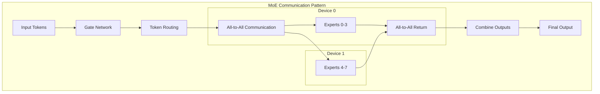
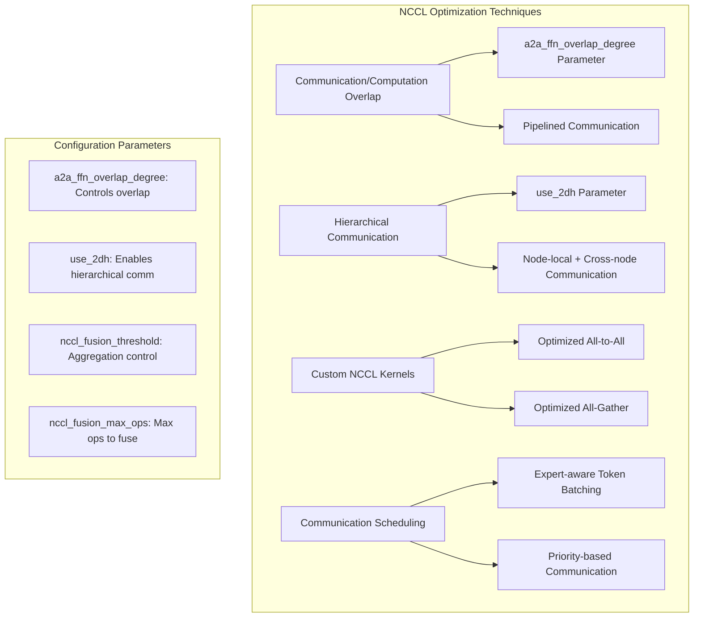
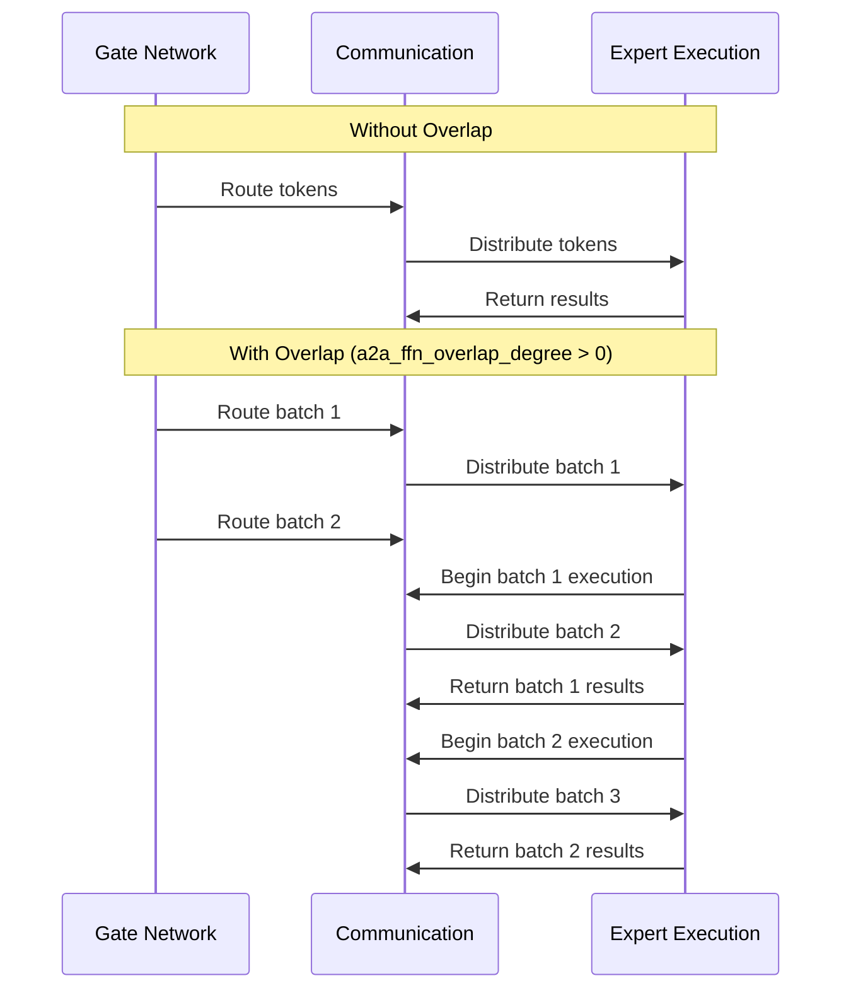
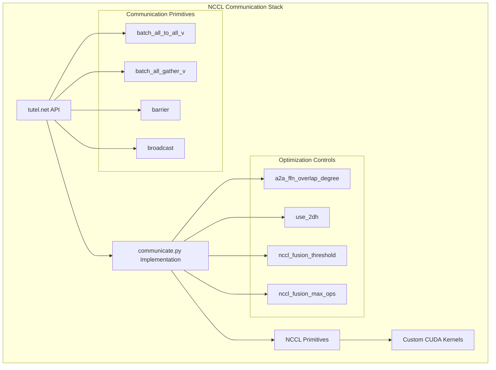
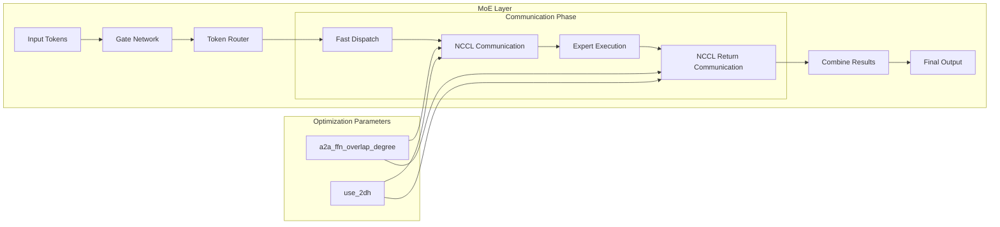

<!-- source: DeepWiki mcp.deepwiki.com · repo microsoft/Tutel · page 6.2 NCCL Communication Optimization · fetched 2026-10-26 -->

# NCCL Communication Optimization

<details>
<summary>Relevant source files</summary>

The following files were used as context for generating this wiki page:

- [tutel/examples/nccl_all_gather_v.py](tutel/examples/nccl_all_gather_v.py)
- [tutel/examples/nccl_all_to_all_v.py](tutel/examples/nccl_all_to_all_v.py)

</details>


## Purpose and Scope

This document describes the NCCL (NVIDIA Collective Communications Library) communication optimization techniques implemented in Tutel to accelerate distributed Mixture-of-Experts (MoE) model training and inference. It focuses on how Tutel optimizes the critical all-to-all communication pattern required for routing tokens to appropriate experts across devices. For general information about communication primitives, see [Communication Primitives](#3.3).

## Communication Challenges in MoE

MoE models face unique communication challenges due to their token routing requirements between devices. These challenges are illustrated in the diagram below:



Sources: `tutel/examples/nccl_all_to_all_v.py`, `tutel/examples/nccl_all_gather_v.py`

### Key Communication Bottlenecks

1. **Token Distribution**: Each device must send tokens to devices hosting specific experts
2. **Result Collection**: Each device must receive processed tokens back from other devices
3. **Communication Overhead**: Network latency and bandwidth limitations can become bottlenecks
4. **Load Imbalance**: Uneven token distribution can lead to synchronization delays

## NCCL Optimization Techniques

Tutel implements several optimization techniques to address these challenges:



Sources: `tutel/examples/nccl_all_to_all_v.py`, `tutel/examples/nccl_all_gather_v.py`

### Communication-Computation Overlap

One of the most significant optimizations in Tutel is overlapping communication with computation to hide latency. The `a2a_ffn_overlap_degree` parameter controls how this overlap is managed:



Sources: `tutel/examples/nccl_all_to_all_v.py`

### Hierarchical 2D Communication

The `use_2dh` parameter enables a hierarchical communication pattern that optimizes for multi-node deployments by:

1. First performing intra-node communication using fast NVLink or other local interconnects
2. Then performing inter-node communication using network interfaces

This reduces the amount of data sent across slower network links and takes advantage of the high-bandwidth connections within nodes.

### Example Usage

Tutel provides optimized implementations of key collective operations. Below are examples of how to use these primitives:

#### All-to-All Vector Example

```
# Initialize communication environment
parallel_env = system.init_data_model_parallel(backend='nccl', group_count=1)
local_device = parallel_env.local_device

# Prepare data and counts for all-to-all-v
input = torch.tensor([...], device=local_device)
send_counts = torch.tensor([...], dtype=torch.int64, device=local_device)

# Perform optimized all-to-all-v operation
result = net.batch_all_to_all_v([input,], send_counts)[0]
```

Sources: `tutel/examples/nccl_all_to_all_v.py`

#### All-Gather Vector Example

```
# Initialize communication environment
parallel_env = system.init_data_model_parallel(backend='nccl', group_count=1)
local_device = parallel_env.local_device

# Prepare data for all-gather-v
input = torch.tensor([...], device=local_device)

# Perform optimized all-gather-v operation
result = net.batch_all_gather_v([input,])[0]
```

Sources: `tutel/examples/nccl_all_gather_v.py`

## Implementation Architecture

The NCCL optimization techniques are implemented in Tutel's communication infrastructure as shown below:



Sources: `tutel/examples/nccl_all_to_all_v.py`, `tutel/examples/nccl_all_gather_v.py`

## Performance Considerations

When using NCCL communication in Tutel MoE, consider the following performance factors:

| Factor | Description | Recommendation |
|--------|-------------|----------------|
| Overlap Degree | Controls communication-computation overlap | Higher values increase parallelism but consume more memory |
| 2D Hierarchical | Enables intra-node + inter-node optimization | Enable for multi-node deployments |
| Fusion Threshold | Controls when to fuse communication ops | Tune based on message size and hardware |
| Expert Distribution | How experts are distributed across devices | Even distribution usually performs best |
| Batch Size | Number of tokens processed together | Larger batches amortize communication overhead |
| Hardware | GPU interconnect and network capabilities | NVLink/NVSwitch provides best performance |

## Integration with MoE Layer

The NCCL communication optimizations are tightly integrated with the MoE layer implementation:



Sources: `tutel/examples/nccl_all_to_all_v.py`

## Conclusion

Tutel's NCCL communication optimizations significantly improve the performance of distributed MoE models by reducing communication overhead through techniques like computation-communication overlap and hierarchical communication patterns. The system provides configurable parameters to adapt these optimizations to different hardware configurations and model sizes.

---

