<!-- source: DeepWiki mcp.deepwiki.com · repo microsoft/Tutel · page 6.3 Model Parallelism · fetched 2026-10-26 -->

# Model Parallelism

<details>
<summary>Relevant source files</summary>

The following files were used as context for generating this wiki page:

- [tutel/parted/backend/torch/config.py](tutel/parted/backend/torch/config.py)
- [tutel/parted/backend/torch/executor.py](tutel/parted/backend/torch/executor.py)
- [tutel/parted/solver.py](tutel/parted/solver.py)
- [tutel/parted/spmdx.py](tutel/parted/spmdx.py)

</details>


This document describes Tutel's Single Program Multiple Data (SPMD) model parallelism implementation. Model parallelism enables training and inference on large models by distributing the model parameters across multiple devices, allowing models that don't fit on a single device to execute efficiently.

For information about data parallelism and distributed training, see [Distributed Training](#5.3). For optimizing communication in distributed systems, see [NCCL Communication Optimization](#6.2).

## Overview of Model Parallelism in Tutel

Tutel implements model parallelism through a system in `tutel.parted` that provides automatic partitioning of computational graphs across multiple devices. Unlike data parallelism (which runs the same model on different data partitions), model parallelism divides the model itself across devices, allowing each device to handle a portion of the model's parameters and computation.

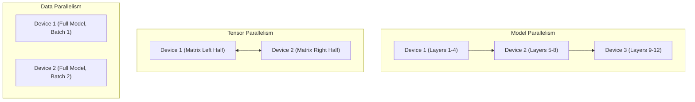

Sources: [tutel/parted/spmdx.py:17-21](), [tutel/parted/backend/torch/executor.py:41-45]()

## Architecture

Tutel's model parallelism system consists of several interconnected components:

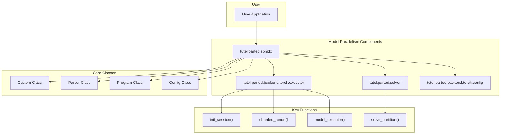

Sources: [tutel/parted/spmdx.py:10-37](), [tutel/parted/solver.py:1-17]()

### Data Flow

When using Tutel's model parallelism system, data flows through several stages:

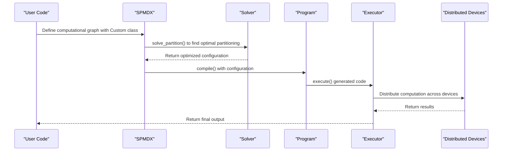

Sources: [tutel/parted/spmdx.py:419-516](), [tutel/parted/solver.py:19-27]()

## Core Components

### Parallel Session

Tutel's model parallelism begins with initializing a parallel session that defines how computation will be distributed:

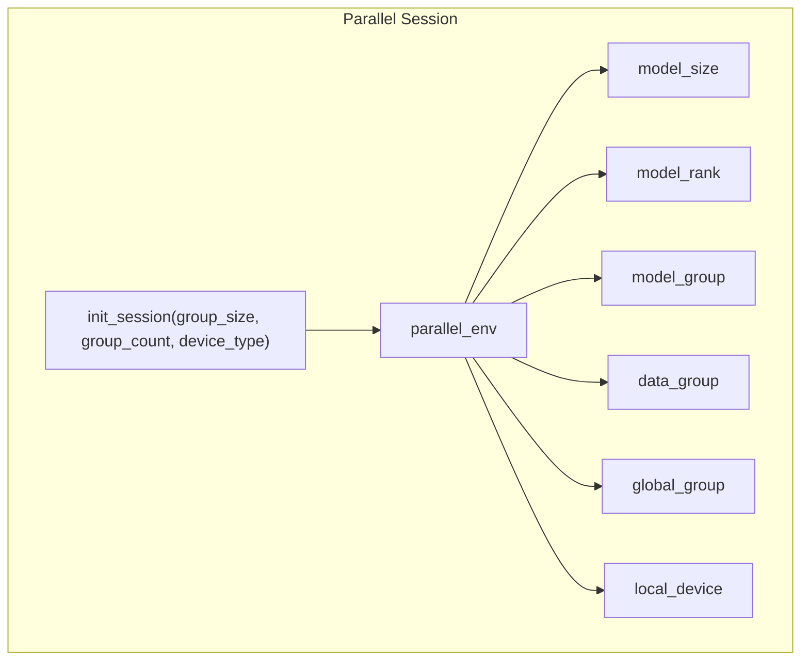

The session establishes:
- `model_size`: Number of devices for model parallelism
- `model_rank`: Current device's position in the model group
- `model_group`: Process group for model parallel communication
- `data_group`: Process group for data parallel communication
- `global_group`: Process group for global communication

Sources: [tutel/parted/backend/torch/executor.py:41-45]()

### Sharded Tensor Operations

Tutel provides specialized operations for creating and manipulating tensors in a distributed setting:

#### sharded_randn

The `sharded_randn` function creates tensors that are automatically sharded across devices according to the parallel configuration:

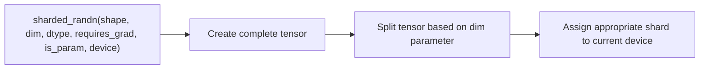

This function supports different sharding strategies:
- `dim >= 0`: Sharding along a specific dimension
- `dim == -2`: Zero-based sharding (param sharding)
- `dim == -1`: Full replication (no sharding)

Sources: [tutel/parted/backend/torch/executor.py:19-39]()

### Computational Graph Construction

Tutel uses the `Custom` class to represent nodes in a computational graph:

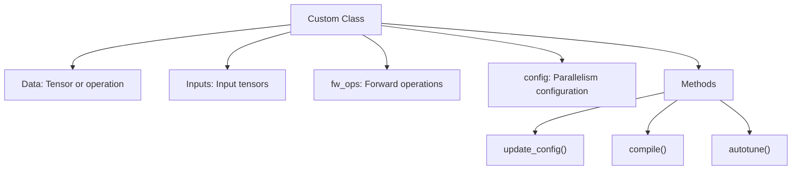

The `Custom` class is used to:
1. Define tensor values with `Tensor()`
2. Define computational operations with mathematical expressions
3. Track dependencies between operations
4. Apply parallelism configurations

Sources: [tutel/parted/spmdx.py:178-302]()

### Program Generation and Execution

The `Program` class handles code generation and execution:

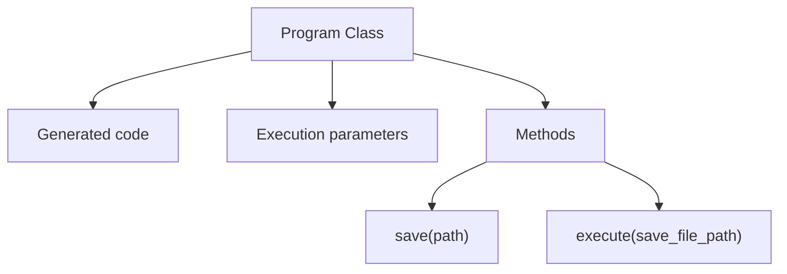

The program execution process:
1. Generates optimized Python code for the distributed model
2. Saves the code to a temporary file
3. Executes the code using the appropriate distributed launcher
4. Collects and returns execution results

Sources: [tutel/parted/spmdx.py:122-176]()

## Parallelism Strategies

### Pattern Registration

Tutel defines parallel patterns through a registration system:

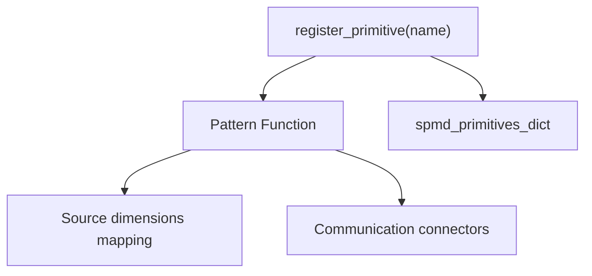

Parallel patterns define how to:
- Split input tensors across devices
- Perform distributed computation
- Aggregate results through communication operations

Sources: [tutel/parted/solver.py:9-17]()

### Partition Solving

The `solve_partition` function finds the optimal partitioning strategy:

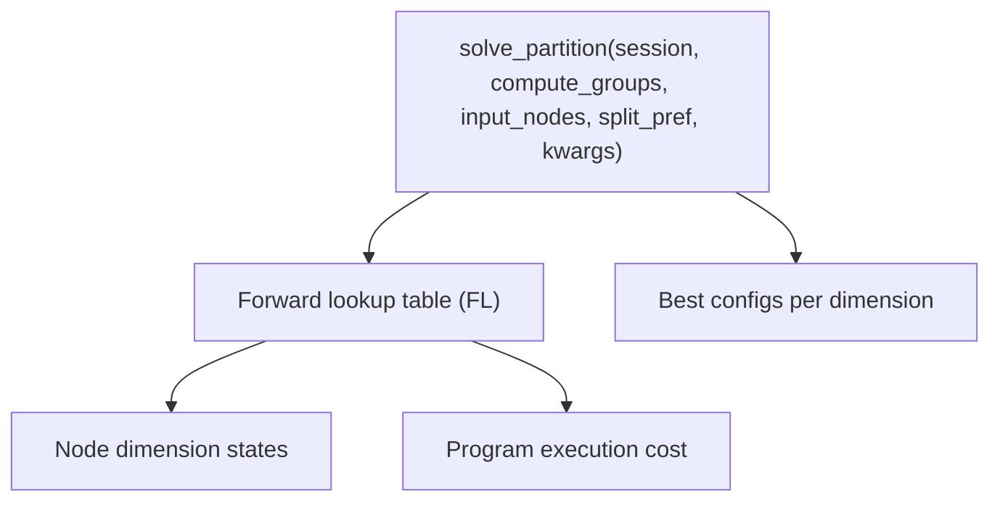

The partition solver:
1. Analyzes the computational graph structure
2. Identifies articulation points for partitioning
3. Evaluates different partitioning strategies
4. Selects the most efficient configuration based on execution time

Sources: [tutel/parted/solver.py:19-144]()

## Configuration Management

The `Config` class handles creation, storage, and loading of model parallel configurations:

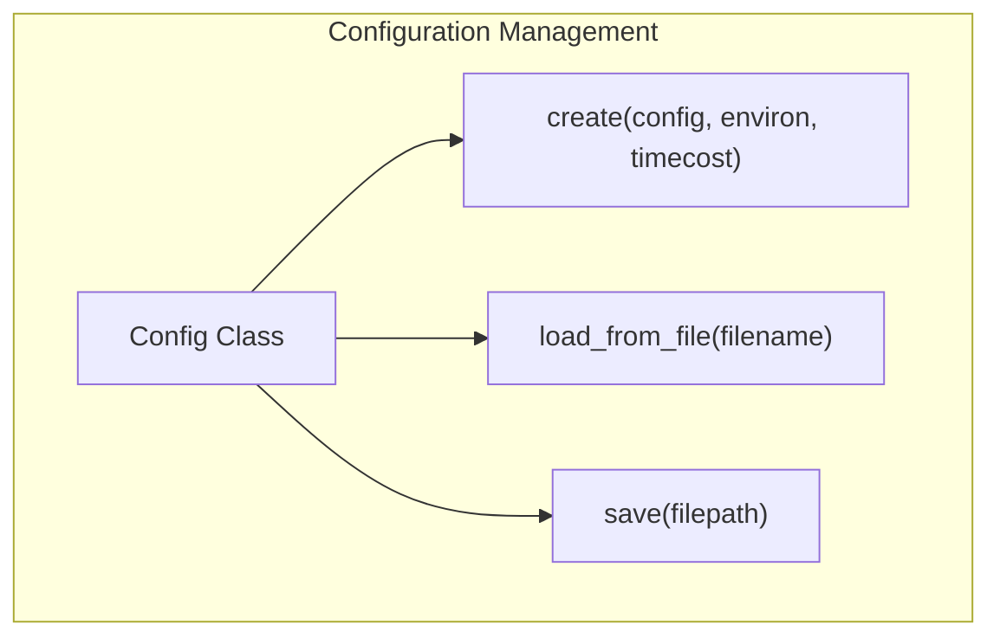

Configuration objects store:
- Version information
- Device configuration
- Node-specific partitioning strategies
- Execution parameters

Sources: [tutel/parted/spmdx.py:545-578]()

## Usage Example

A typical workflow for using Tutel's model parallelism:

1. Define tensors with the `Tensor` function:
   ```python
   weight = Tensor(shape=[1024, 1024], dtype="float32", is_param=True)
   input_tensor = Tensor(shape=[32, 1024], dtype="float32")
   ```

2. Define computation with `Custom` operators:
   ```python
   output = Custom("abc = ab,bc", inputs=[input_tensor, weight])
   ```

3. Auto-tune or specify configuration:
   ```python
   config = output.autotune(total_nodes=8, spmd_nodes=4)
   ```

4. Compile and execute:
   ```python
   program = output.compile(config)
   result = program.execute()
   ```

Sources: [tutel/parted/spmdx.py:580-597]()

## Performance Considerations

When using model parallelism, consider these factors:

| Factor | Consideration |
|--------|---------------|
| Communication Overhead | Balance computation and communication costs |
| Memory Efficiency | Choose partitioning strategies that minimize memory usage |
| Load Balancing | Ensure work is evenly distributed across devices |
| Model Architecture | Some layers benefit more from specific parallelism strategies |
| Hardware Topology | Account for network topology when partitioning |

## Integration with Tutel MoE

Tutel's model parallelism system can be used together with the MoE (Mixture of Experts) implementation to enable even larger models:

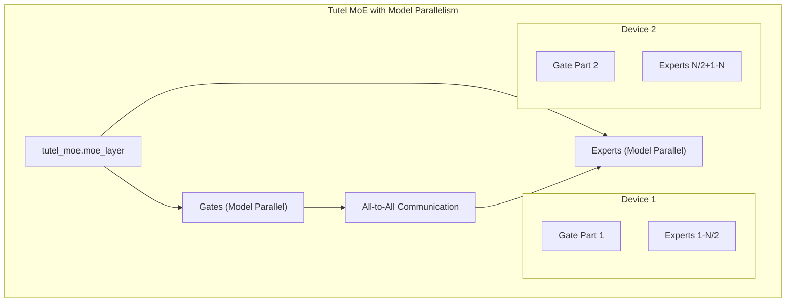

This combined approach allows:
- Sharding the gate network across devices
- Distributing experts across model-parallel groups
- Scaling to even larger model sizes
- Efficient handling of both dense and sparse components

## Conclusion

Tutel's model parallelism provides a powerful framework for distributing large neural networks across multiple devices. By automatically partitioning computational graphs and optimizing communication patterns, it enables efficient training and inference on models that would otherwise be too large for a single device.

For information about NCCL communication optimization, see [NCCL Communication Optimization](#6.2).

---

