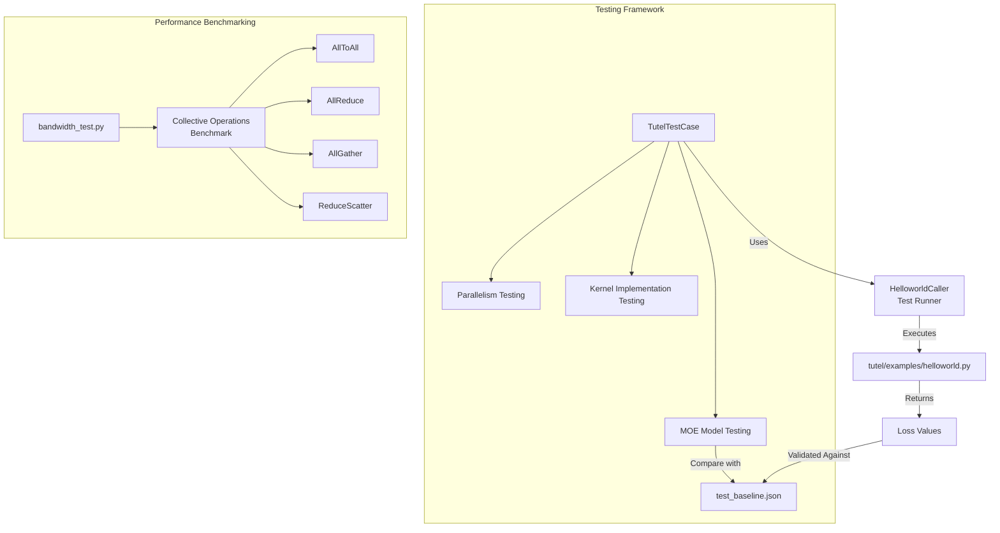
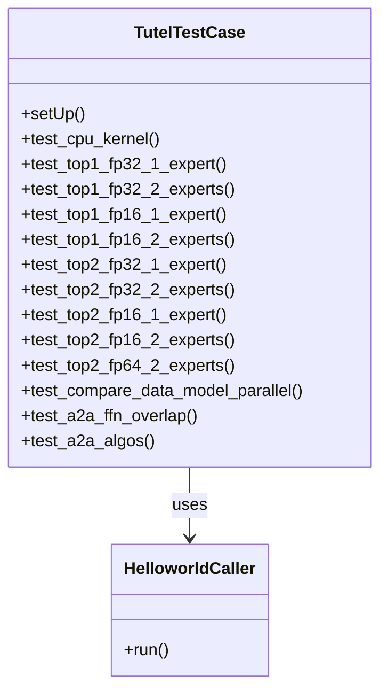
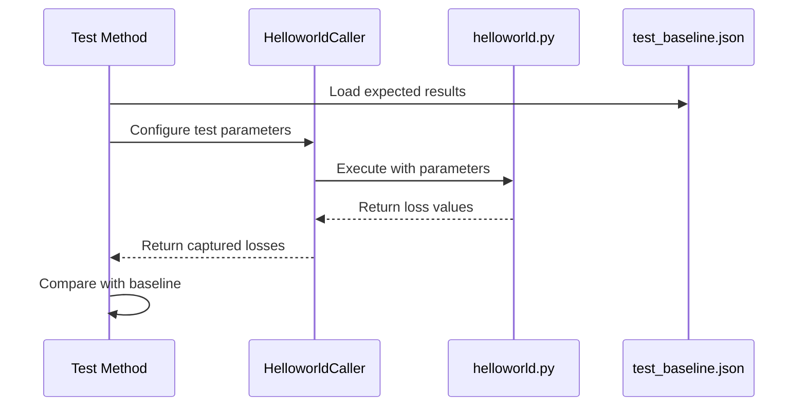
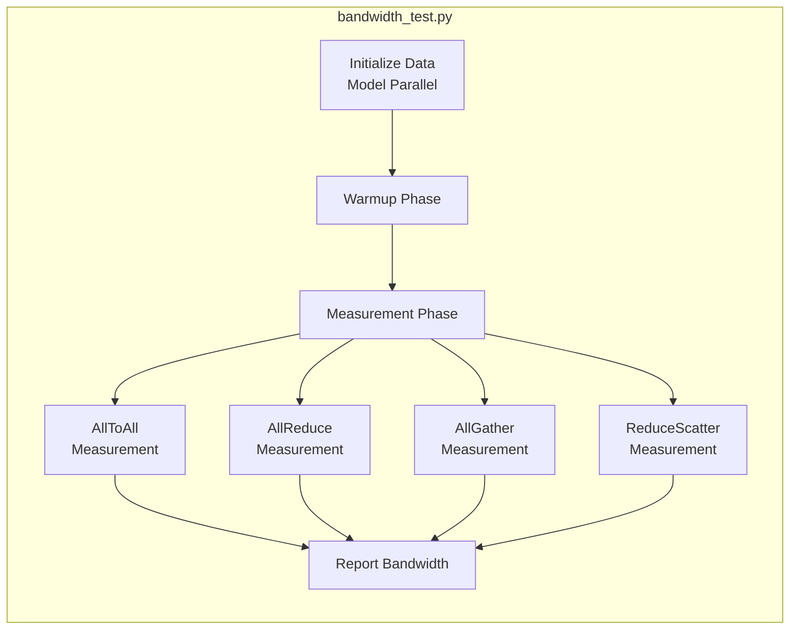
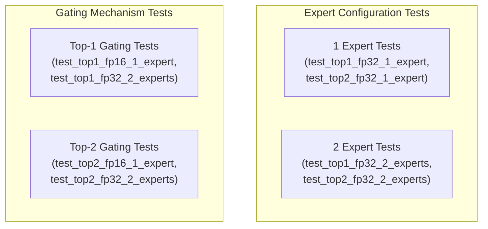
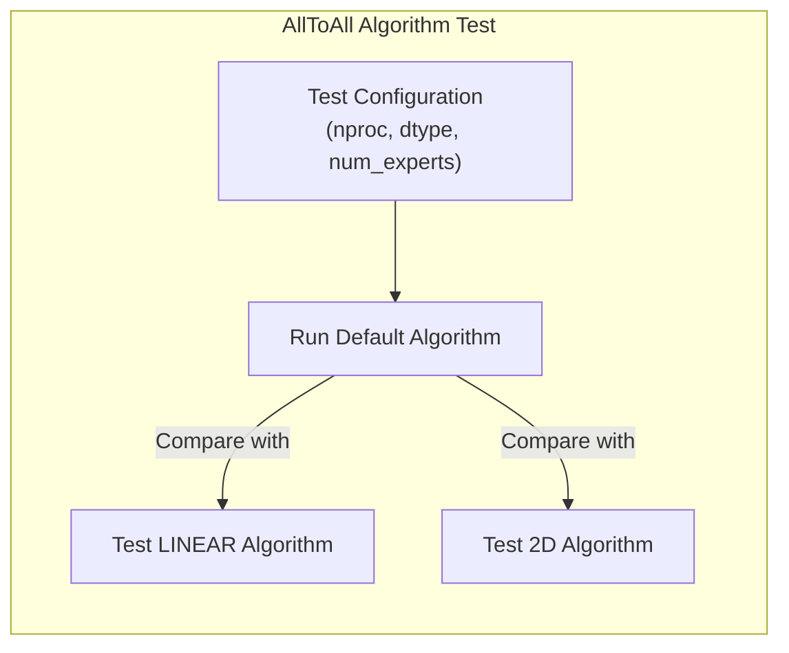
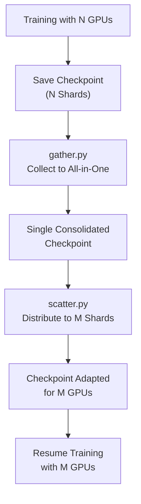

<!-- source: DeepWiki mcp.deepwiki.com · repo microsoft/Tutel · page 7 Testing and Performance · fetched 2026-10-26 -->

# Testing and Performance

<details>
<summary>Relevant source files</summary>

The following files were used as context for generating this wiki page:

- [doc/CHECKPOINT.md](doc/CHECKPOINT.md)
- [tests/test_baseline.json](tests/test_baseline.json)
- [tests/test_tutel.py](tests/test_tutel.py)
- [tutel/checkpoint/__init__.py](tutel/checkpoint/__init__.py)
- [tutel/checkpoint/gather.py](tutel/checkpoint/gather.py)
- [tutel/checkpoint/scatter.py](tutel/checkpoint/scatter.py)
- [tutel/examples/bandwidth_test.py](tutel/examples/bandwidth_test.py)

</details>


This page documents the testing infrastructure and performance benchmarking capabilities in Tutel. It covers the testing framework, performance evaluation methodologies, and provides guidance on how to measure and interpret Tutel's performance characteristics across different hardware configurations and model parameters.

## Overview

Tutel includes comprehensive testing and benchmarking tools to ensure correctness of the Mixture-of-Experts implementation and to measure performance across various configurations. The testing framework validates Tutel's behavior across different data types, expert configurations, gating mechanisms, and hardware platforms.



Sources: [tests/test_tutel.py:70-176](). [tutel/examples/bandwidth_test.py:1-84]()

## Testing Framework

The Tutel testing framework is built around the Python `unittest` module and includes specialized test cases for validating the correctness and performance of the MoE implementation.

### Test Suite Structure

The main test suite is implemented in the `TutelTestCase` class, which provides tests for a wide range of configurations:



Sources: [tests/test_tutel.py:70-83](), [tests/test_tutel.py:20-68]()

### Test Execution Flow

The tests in Tutel follow a consistent pattern that allows for comparing results across different configurations:

1. Test setup loads baseline results from `test_baseline.json`
2. The `HelloworldCaller` utility executes the `helloworld.py` example with specific parameters
3. Loss values and step times are captured and compared against expected results
4. Tests pass when the actual loss values match the expected values within specified tolerances



Sources: [tests/test_tutel.py:70-95](), [tests/test_tutel.py:20-68]()

### Test Coverage

The testing framework covers a comprehensive set of configurations:

| Test Category | Variations Tested |
|---------------|------------------|
| Gating Mechanism | Top-1, Top-2 |
| Data Type | float16, float32, float64 |
| Expert Configuration | 1 expert, 2 experts |
| Hardware | CPU, CUDA |
| Parallelism | Data parallel, Model parallel |
| Communication | AllToAll-FFN overlap, AllToAll algorithms |

Sources: [tests/test_tutel.py:94-209]()

## Performance Benchmarking

Tutel provides dedicated tools for performance benchmarking, enabling users to evaluate the efficiency of communication primitives and overall system performance.

### Bandwidth Testing

The bandwidth testing tool (`bandwidth_test.py`) measures the performance of key collective operations used in distributed MoE training:



Sources: [tutel/examples/bandwidth_test.py:1-84]()

### Running Bandwidth Tests

To measure the communication performance across nodes, run:

```bash
python -m torch.distributed.run --nproc_per_node=N tutel/examples/bandwidth_test.py --size_mb=256 --loop=50
```

This will output the average bandwidth for each collective operation across the specified number of nodes.

### Step Time Measurement

The testing framework also captures and compares step time across different hardware platforms. The expected step times for various GPU types are stored in the baseline file:

```json
{
  "GPU": "V100",
  "value": "0.06863923072814941"
}
```

When tests run, they validate that step times remain consistent with expectations for the given hardware platform.

Sources: [tests/test_baseline.json:6-15](), [tests/test_tutel.py:97-106]()

## Testing Across Configurations

Tutel's testing framework validates performance and correctness across a wide range of configurations.

### Data Type Testing

Tests verify that Tutel produces correct results with different numerical precision:

1. **float16 (FP16)**: Tests validate training stability with half-precision 
2. **float32 (FP32)**: Tests confirm baseline performance with single-precision
3. **float64 (FP64)**: Tests ensure maximum precision calculations work correctly

For each data type, the expected loss progression is stored in the baseline file and compared against actual results.

Sources: [tests/test_tutel.py:108-152](), [tests/test_baseline.json:4-117]()

### Expert Configuration Testing

Tests validate Tutel's behavior with different expert configurations:

1. **Single Expert Tests**: Verify basic MoE functionality with one expert per device
2. **Multiple Expert Tests**: Validate load balancing and routing with multiple experts per device
3. **Expert Scaling Tests**: Ensure consistent behavior when scaling the number of experts



Sources: [tests/test_tutel.py:94-150]()

### Parallelism Strategy Testing

Tests ensure that both data parallelism and model parallelism strategies produce identical results:

```python
def test_compare_data_model_parallel(self):
    """Test helloworld data parallel and helloworld model parallel which should have same result"""
    self.assertEqual(
        self.tutelCaller.run(use_model_parallel=False),
        self.tutelCaller.run(use_model_parallel=True)
    )
```

This test validates that users can switch between parallelism strategies without affecting model correctness.

Sources: [tests/test_tutel.py:154-159]()

### Communication Optimization Testing

Tests verify that communication optimizations like AllToAll-FFN overlapping work correctly:

```python
def test_a2a_ffn_overlap(self):
    """Test whether AllToAll-FFN overlapping works properly."""
    self.assertEqual(
        self.tutelCaller.run(a2a_ffn_overlap_degree=1),
        self.tutelCaller.run(a2a_ffn_overlap_degree=2)
    )
```

This ensures that performance optimizations don't compromise model accuracy.

Sources: [tests/test_tutel.py:161-176]()

## Advanced Performance Testing

Beyond basic correctness testing, Tutel includes advanced tools for evaluating performance across different algorithms and hardware configurations.

### AllToAll Algorithm Testing

The `test_a2a_algos` method tests different AllToAll communication algorithms to ensure they produce consistent results:



The test validates that both loss values and step times remain consistent across different algorithms.

Sources: [tests/test_tutel.py:178-209]()

### Hardware Performance Comparison

The testing framework includes expected performance metrics for different GPU types:

| GPU Model | Test Case | Expected Step Time (ms) |
|-----------|-----------|-------------------------|
| V100      | top1_fp32_1_expert | 68.6 |
| RTX 2080 Ti| top1_fp32_1_expert | 59.5 |
| V100      | top2_fp32_2_experts | 136.3 |
| RTX 2080 Ti| top2_fp32_2_experts | 140.0 |

This allows for tracking performance across different hardware platforms and detecting potential regressions.

Sources: [tests/test_baseline.json:240-249](), [tests/test_baseline.json:825-834]()

## Running Tests

### Basic Test Execution

To run the complete test suite:

```bash
python -m unittest tests/test_tutel.py
```

Individual tests can be executed with:

```bash
python -m unittest tests.test_tutel.TutelTestCase.test_top2_fp32_2_experts
```

### Custom Test Configurations

The `HelloworldCaller` class can be used to run custom test configurations:

```python
caller = HelloworldCaller()
results = caller.run(
    nproc_per_node=4,           # Number of processes
    top=2,                      # Top-k experts to route to
    dtype='float16',            # Data type
    num_local_experts=4,        # Experts per device
    device='cuda',              # Device type
    batch_size=16,              # Batch size
    num_steps=100,              # Number of steps
    a2a_ffn_overlap_degree=2    # Overlap degree
)
```

This allows for custom performance testing beyond the standard test cases.

Sources: [tests/test_tutel.py:20-68]()

## Checkpoint-Related Performance

While not directly related to performance testing, Tutel's checkpoint management tools can affect performance in distributed settings. The `scatter.py` and `gather.py` utilities allow for efficient conversion of model checkpoints between different distributed configurations.



This capability is especially useful for testing model performance across different hardware configurations without retraining.

Sources: [tutel/checkpoint/gather.py:1-82](), [tutel/checkpoint/scatter.py:1-77](), [doc/CHECKPOINT.md:1-47]()

## Summary

Tutel provides a comprehensive testing and performance evaluation infrastructure that:

1. Validates correctness across different configurations
2. Benchmarks communication performance
3. Compares step times across hardware platforms
4. Ensures optimizations don't compromise model quality
5. Facilitates scaling models across different distributed configurations

This testing framework helps ensure that Tutel's MoE implementation remains correct, efficient, and scalable across a wide range of deployment scenarios and hardware platforms.

---

